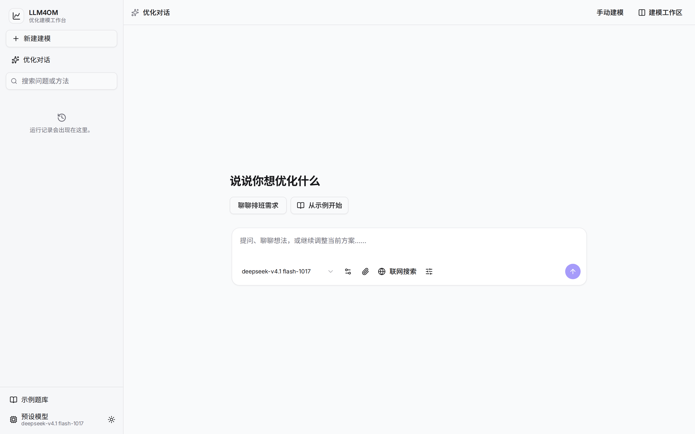
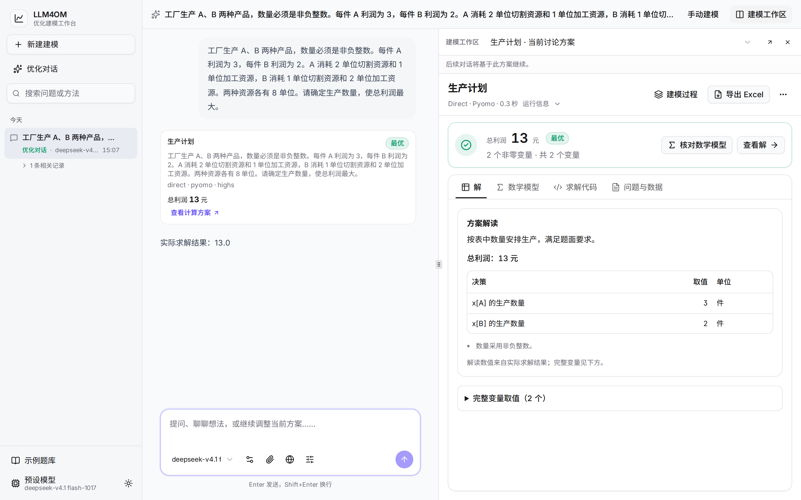
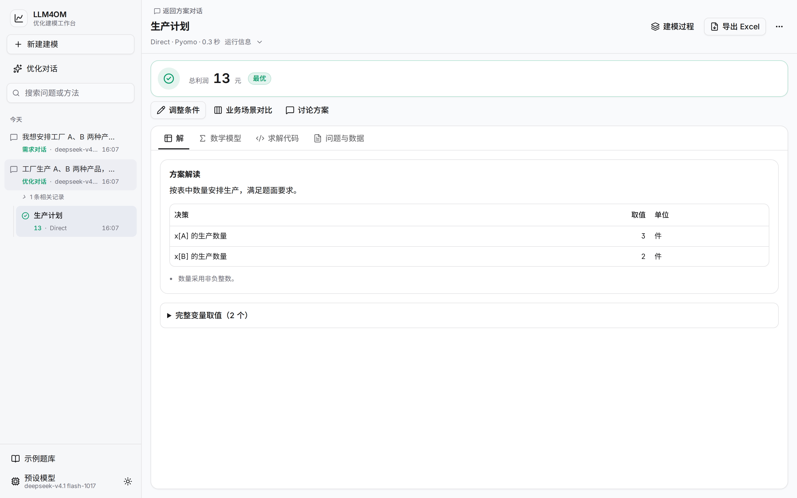
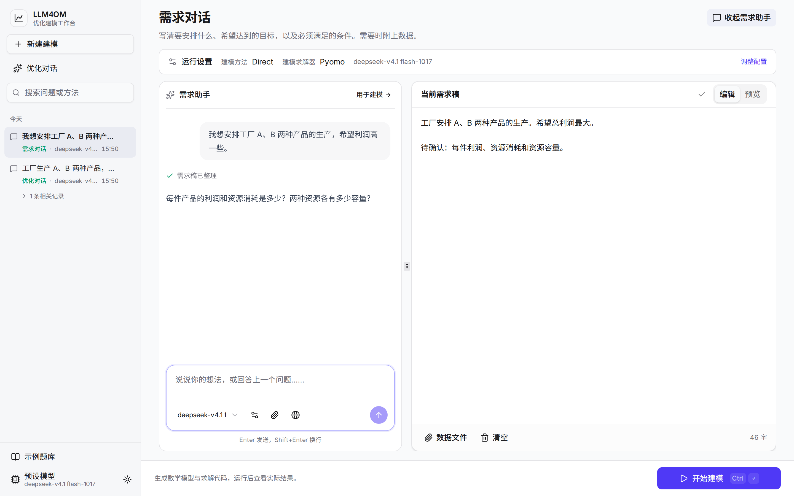
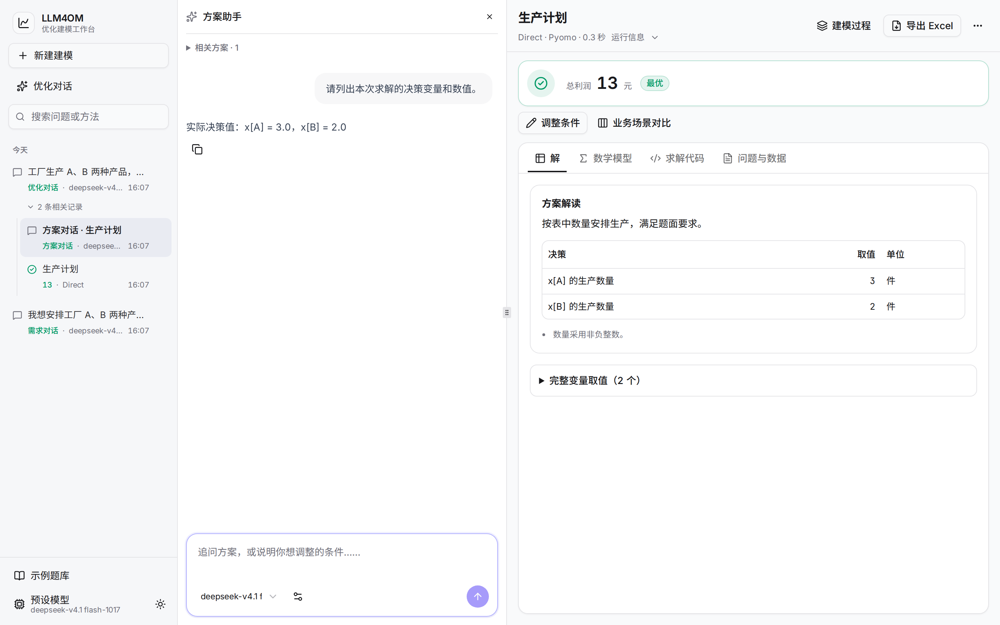
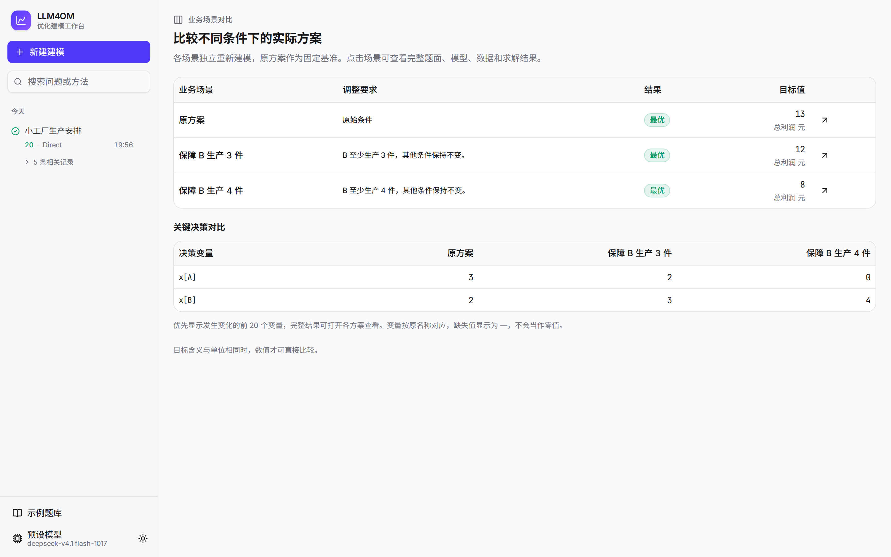
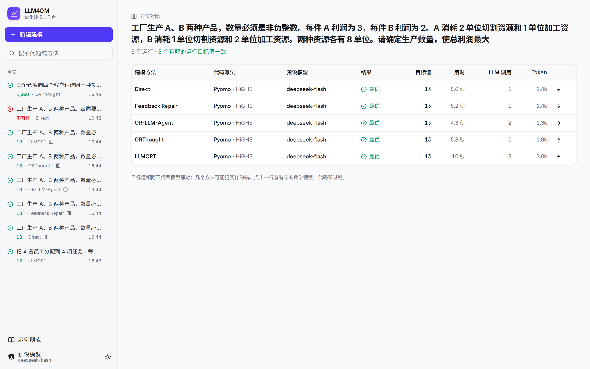
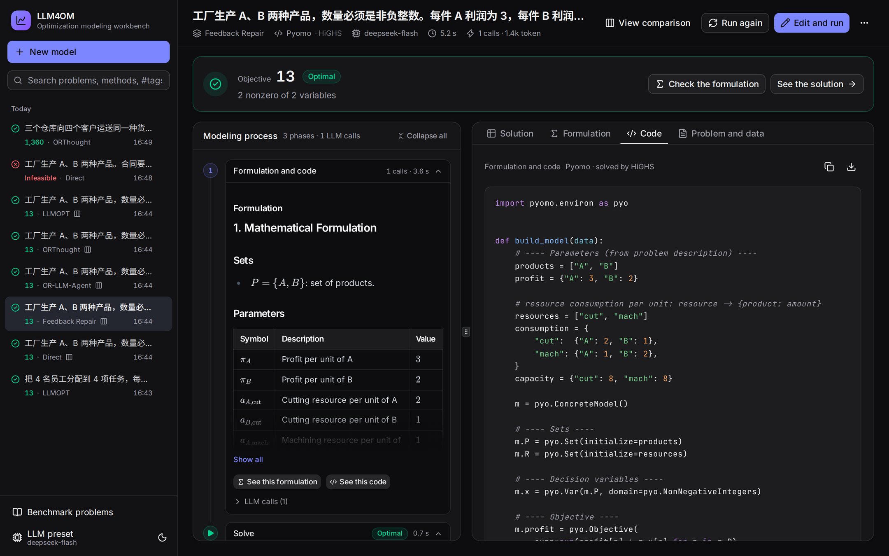
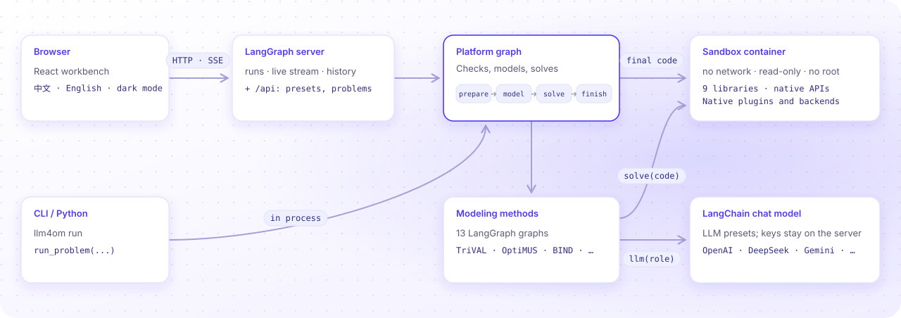

<p align="center">
  <picture>
    <source media="(prefers-color-scheme: dark)" srcset="docs/assets/banner-dark.svg">
    
  </picture>
</p>

<p align="center">
  
  
  
  
  <a href="LICENSE"></a>
</p>

<p align="center">
  <a href="README.md">中文</a> · <b>English</b>
  <br>
  <a href="https://fangziyang0910.github.io/LLM4OM/docs/en/introduction/">Docs</a> ·
  <a href="#quick-start">Quick start</a> ·
  <a href="#modeling-methods">Methods</a> ·
  <a href="docs/user-guide.md">User guide</a> ·
  <a href="docs/deployment.md">Deployment</a> ·
  <a href="CONTRIBUTING.md">Development</a> ·
  <a href="CHANGELOG.md">Changelog</a>
</p>

---

**General Intelligent Optimization Solver** (**通用智能优化求解器**) is a general solver for complex optimization problems across scheduling, supply chains, vehicle routing, resource allocation, network flows and nonlinear programming. Configure runs directly in the workbench, or chat with the optimization assistant and attach business data. The agent invokes a complete modeling workflow to formulate the mathematical model, write solver code and compute optimal solutions inside an isolated container. Inspect actual steps, formulations, code and results in the workspace alongside chat, and continue the conversation to revise constraints.

The platform integrates **9 modeling strategies**: 8 exact-modeling workflows and the AutoCO metaheuristic engine, alongside **5 modeling libraries**. Enter an optimization problem, run modeling and solving, and inspect models and computed solutions without writing solver code yourself.

<p align="center">
  
  <br><sub>A real run recorded before the interface update: move from ordinary chat and arithmetic to production modeling with DeepSeek · Direct · Pyomo, revise conditions, then return to the original plan.</sub>
</p>

## Highlights

| Feature | What you get |
|---|---|
| 💬 **Model through conversation** | Discuss an idea, calculate a first plan, inspect results and revise conditions in one agent. Specify methods and libraries in chat, or use the retained manual workbench |
| 🧠 **9 modeling strategies** | Direct, OR-LLM-Agent, LLMOPT, TriVAL, BIND, AutoCO, OptiTree, Chain-of-Experts and OptiMUS 0.3; each has its own LangGraph |
| 🧩 **5 modeling libraries** | Pyomo, OR-Tools, CVXPY, PySCIPOpt and CasADi, with backend discovery through each library’s own plugin registry |
| 📝 **Requirements chat** | Capture the decision, objectives and conditions in an editable draft. Open questions appear only while there is something to resolve |
| 🔍 **Every step visible** | Live LLM calls, saved partial work after cancellation, paged history and a fixed configuration record for every run |
| ⚖️ **Compare methods** | Run up to 12 methods or models on one problem and compare objective, time and tokens |
| 💬 **Explain and revise plans** | Get a direct answer with actual choices, locations, quantities and cost or profit, followed by decision details; change conditions and compare the new plan with the saved original |
| 🔄 **Plan chat and business scenarios** | Ask about actual results; condition changes show real modeling progress and result cards, with a fixed baseline for several alternatives |
| 📊 **Review data before modeling** | Edit CSV, TSV, JSON and text attachments, including converted Excel sheets; clarify column names and units before saving |
| 🧯 **Explain infeasibility** | Read business explanations grounded in actual conflicting constraints; select and edit a candidate change, then solve a new model to verify it (Gurobi IIS) |
| 🔒 **Isolated sandbox** | Generated code runs in a container with no network, a read-only file system and no root, removed after use |
| 👥 **Team deployment** | One `docker compose up`; preset keys never leave the server; optional HTTPS and usage limits |
| 🌗 **A workbench people like** | Export Excel plans with business labels, units and all actual values; notes and tags, Markdown reports, Excel import, 2,033 public problems, Chinese and English, dark mode |

Optimization chat is the default workbench at `/`; manual modeling and method comparisons are available at `/model`. Describe a problem or attach data; the assistant asks focused questions when needed and calls a complete modeling workflow. Specify a method or library in chat. Exact modeling and AutoCO use their respective solving paths, with actual settings retained in the run. Actual steps stream to a task card; the modeling workspace shows the mathematical model, code and results. Each plan is saved independently. Plan views, links, exports and revisions from a conversation use its saved checkpoint, so later thread updates do not replace an earlier plan. Both interfaces remain available and share the same modeling methods and independently saved runs.

The agent also handles ordinary questions, writing, code explanations, supplied material and arithmetic without starting a modeling run. For plan discussions, a calculator reads all saved decision values to check costs, remaining capacity and ratios. Say “use the second plan” or “return to the original” to change the baseline for later discussion without solving again. Browsing a historical plan still only changes the view.

## Screenshots

Optimization, requirements and plan conversations use the same layout: chat on the left, the draft or plan on the right. Drag the divider to resize the panels; widths survive reload. On phones, switch between **Model and results** and **Solving Steps**. **Ask Follow-up** opens the conversation, and **Open Original Plan** returns to its saved result. Requirements chat offers Review requirements draft before modeling. Browsing history keeps the calculation baseline, and opening an original plan preserves its frozen version. Run settings show methods, modeling libraries and models side by side.

The conversation screenshots use scripted examples and locally solved results.

<table>
  <tr>
    <td width="50%"><p align="center"><sub>A separate agent entry, starting from a problem</sub></p></td>
    <td width="50%"><p align="center"><sub>Calculate through chat; inspect actual models and results alongside</sub></p></td>
  </tr>
  <tr>
    <td width="50%"><p align="center"><sub>Write the problem; choose method, language and model</sub></p></td>
    <td width="50%"><p align="center"><sub>The verdict first: objective, modeling process, solution matrix</sub></p></td>
  </tr>
  <tr>
    <td colspan="2"><p align="center"><sub>Methods, modeling libraries and models visible together</sub></p></td>
  </tr>
  <tr>
    <td colspan="2"><p align="center"><sub>Discuss business requirements, then review the draft before modeling</sub></p></td>
  </tr>
  <tr>
    <td><p align="center"><sub>Review cells, column names and units before modeling</sub></p></td>
    <td><p align="center"><sub>Discuss actual results; calculate a new plan after changing conditions</sub></p></td>
  </tr>
  <tr>
    <td colspan="2"><p align="center"><sub>Compare actual results under different conditions against one saved baseline</sub></p></td>
  </tr>
  <tr>
    <td><p align="center"><sub>Formulations render as LaTeX; each version can be diffed</sub></p></td>
    <td><p align="center"><sub>Five methods on one problem</sub></p></td>
  </tr>
  <tr>
    <td><p align="center"><sub>Infeasible model: Gurobi IIS finds 3 conflicting constraints</sub></p></td>
    <td><p align="center"><sub>Dark mode and the English interface</sub></p></td>
  </tr>
</table>

## Quick start

### Use the current model in Codex / Claude Code

Install with Node.js 22.20+ and Git. Select your agent when prompted. To run the skill, the agent needs shell and workspace access, [uv](https://docs.astral.sh/uv/getting-started/installation/), and a running Docker engine.

```bash
npx skills add Fangziyang0910/LLM4OM --skill llm4om -g
```

Open a new session, invoke `$llm4om` in Codex or `/llm4om` in Claude Code, then describe your problem and attach your data. Your current model formulates the problem and explains the solution. The skill downloads its pinned runtime on first use and builds and reuses the Docker solver image on demand. No separate LLM4OM CLI, model API key, or Web service is required.

For a worked example, session recovery, and upgrades, see the [host modeling guide](docs/host-modeling.md).

### Option 1: Docker (recommended)

You need Docker with Compose v2.24 or later:

```bash
git clone https://github.com/Fangziyang0910/LLM4OM.git && cd LLM4OM
cp .env.example .env && chmod 600 .env    # fill in the LLM provider, base URL, model and key
docker compose up -d --build
```

Open <http://localhost:8767>. Others on the network use `http://<this machine's IP>:8767`. For HTTPS, backups, usage limits and Gurobi licenses, see the [deployment guide](docs/deployment.md).

### Option 2: run locally

You need Python 3.11–3.13, [uv](https://docs.astral.sh/uv/) and Docker:

```bash
uv sync --extra web
uv run llm4om build-worker      # build the solver sandbox image llm4om-worker:19
uv run llm4om serve --workspace runs/web --port 8767
```

The repository includes the built frontend, so Node.js is not needed. Solver dependencies run inside the Docker Worker; the host only needs the Web dependencies, without installing every commercial or platform-specific solver locally.

### Try a problem

Send a problem to the modeling assistant on the home page (`/`), or open **Multi-plan comparison** in the sidebar (`/model`) to follow this example.

1. If `.env` sets no model, click **AI model** at the bottom left and add a provider, key and model ID.
2. Click the **Production planning** example, or enter:

   > A factory makes products A and B in non-negative integer quantities. Each A earns 3 and each B earns 2. A uses 2 units of cutting and 1 unit of machining; B uses 1 unit of cutting and 2 units of machining. Each resource has 8 units. Choose the quantities that maximize total profit.

3. Click **Solve Now**. The optimal plan for this example makes 3 units of A and 2 of B, for a total profit of 13.
4. Click **Ask Follow-up** and ask “How much of the profit comes from each product?” At the saved quantities, A contributes 9 and B contributes 4. To try different resource limits, open **Compare Scenarios** and enter each limit. Each scenario runs from the same original plan.

Click an uploaded file name to inspect or edit the data before solving. You can export a feasible solution to Excel. For an infeasible model or a failed run, use the result page to ask about conflicting requirements or the cause of the failure.

To prepare a separate requirements draft, open **Multi-plan comparison** in the sidebar and click **Discuss your requirements**. The assistant updates an editable draft as you talk. Add data and review the text, then click **Apply to Quick Solve** to return to the editor. Click **Solve Now** to start modeling. Saved conversations can be continued from history. Press Enter to send, or Shift+Enter for a new line. Enable **Web search** to find public references and inspect their sources. DeepSeek presets use their own search endpoint; other models can use a separate server-side search key (see `.env.example`).

You can also run from the command line or Python:

```bash
uv run llm4om run --problem "..." --method or_llm_agent --language pyomo --time-limit 30
```

```python
from llm4om import run_problem

state = run_problem("...", method="optimus", language="pyomo")
print(state["failure"] or state["solve"]["objective"])
```

## Modeling methods

| Method | Flow | Source |
|---|---|---|
| Direct | One call writes the formulation and the code | Baseline |
| OR-LLM-Agent | Formulates, writes code, debugs from execution errors, then checks infeasibility | [arXiv](https://arxiv.org/abs/2503.10009) · [Code](https://github.com/bwz96sco/or_llm_agent/tree/5dccdaab89ab91c3cb28066fe849423dc124d287) |
| LLMOPT | Writes a five-element model, then code; the LLM judges both and rewrites the wrong step | [ICLR 2025](https://arxiv.org/abs/2410.13213) · [Code](https://github.com/antgroup/LLMOPT/tree/1492dd33e39ea13f1afe32a0adc13d4217334195) |
| TriVAL | Validates semantics, formulation and code in three stages; each stage builds, validates and revises | [Code](https://github.com/SCUT-EIPI/TriVAL/tree/380a529) |
| BIND | Prompt with schemas; read full attachments in code; repair execution failures | [Paper](https://arxiv.org/abs/2605.21751) · [Adaptation](src/llm4om/methods/bind/README.md) |
| AutoCO | Runs heuristic and evolutionary search in an isolated sandbox, including multi-objective Pareto candidates | [Implementation and algorithm pool](src/llm4om/methods/autoco/graph.py) |
| OptiTree | Matches the problem to modeling thoughts in a problem-type tree, then writes the model and code | [NeurIPS 2025](https://arxiv.org/abs/2510.22192) · [Code](https://github.com/MIRALab-USTC/OptiTree/tree/2e70ecfd0a3c8e9c0c16d36d7d498a7344cfdec9) |
| Chain-of-Experts | A conductor picks experts one by one; a reducer writes the code; optional backward reflection | [ICLR 2024](https://openreview.net/forum?id=HobyL1B9CZ) · [Code](https://github.com/xzymustbexzy/Chain-of-Experts/tree/afb89bf602690ea621f13a23c42722f20f653a43) |
| OptiMUS 0.3 | Extracts parameters, objective and constraints; models and codes each one; assembles and debugs | [v0.3 paper](https://arxiv.org/abs/2407.19633) · [Code](https://github.com/teshnizi/OptiMUS/tree/e182e9ef5841605c2a7e87467021fd83522b6484) |

Each method records its reference commit and adaptations. BIND uses no benchmark reference answers. All 8 exact-modeling workflows accept the five modeling libraries. Some retain an LP/MILP scope; the library and backend must support the problem. AutoCO uses its built-in algorithm pool; heuristic results do not guarantee global optimality. See [methods](docs/methods.md).

## Modeling libraries and backends

Each library counts once. Choose one of these five libraries; the backend is automatic unless specified. Native API choice stays in the code, and the worker recognizes the returned model. The backend list comes from native registries in the actual sandbox and includes installation status.

| Modeling library | Native APIs | Backend integration |
|---|---|---|
| Pyomo | Algebraic (ConcreteModel/AbstractModel), Kernel | Native SolverFactory adapters |
| OR-Tools | MPSolver, MathOpt, CP-SAT, ModelBuilder, Routing, Constraint Solver, max flow, min-cost flow, assignment, knapsack | Each interface’s native engines and algorithms |
| CVXPY | DCP, DGP, DQCP | Native registry; AUTO uses solver_path and records the actual engine |
| PySCIPOpt | Scalar/expression, matrix | Native SCIP engine |
| CasADi | Opti NLP, Opti Conic, nlpsol, qpsol, conic | Native Nlpsol/Conic plugins |

Generated code defines `build_model(data)`. Ordinary interfaces return native models. Interfaces that need endpoints, bounds or structured problem inputs return the documented dictionaries. The worker uses the selected native API. An explicit unavailable backend fails instead of changing engines or relaxing integer domains.

See [interface contracts and validation](docs/references/modeling-libraries.md). Commercial engines require a suitable license or compliance with their limited mode. Loading an adapter does not validate its license. Local NLP solutions and heuristic routing results retain their actual status.

## Architecture

<picture>
  <source media="(prefers-color-scheme: dark)" srcset="docs/assets/architecture-en-dark.svg">
  
</picture>

The platform is thin. LangChain makes the LLM calls. The LangGraph server (in-memory runtime, no license needed) runs, streams and stores the runs. The platform adds only the code contract, the solver sandbox, step records and the workbench. See [architecture](docs/architecture.md) (in Chinese).

## Documentation

The detailed documents are in Chinese.

| Document | Contents |
|---|---|
| [User guide](docs/user-guide.md) | Workbench, comparison, diagnosis, LLM presets, problem library, CLI, Python API, FAQ |
| [Deployment](docs/deployment.md) | Docker Compose, HTTPS, team use, usage limits, Gurobi, backups, troubleshooting |
| [Development](CONTRIBUTING.md) | Setup, layout, tests, adding a method or a code language, releases |
| [Architecture](docs/architecture.md) | Modules, platform graph, method interface, sandbox, run records |
| [Methods](docs/methods.md) | Flow, pinned source, adaptations and real-run validation of each method |

## Contributing

Issues and pull requests are welcome. Please read the [development guide](CONTRIBUTING.md) first. Report security issues privately as described in [SECURITY](SECURITY.md).

## Citation

If you use General Intelligent Optimization Solver in research, please cite this repository (see [CITATION.cff](CITATION.cff)) and the papers of the methods you use.

```bibtex
@software{llm4om,
  author  = {Fang, Ziyang},
  title   = {General Intelligent Optimization Solver: A General Solver for Complex Optimization Problems},
  year    = {2026},
  version = {0.43.0},
  url     = {https://github.com/Fangziyang0910/LLM4OM}
}
```

## License

The code is licensed under [Apache-2.0](LICENSE). Bundled third-party prompts, code and data keep their original licenses; see [NOTICE](NOTICE). The LLMOPT repository states no license at the pinned commit; its prompts are included for research reproduction only.
