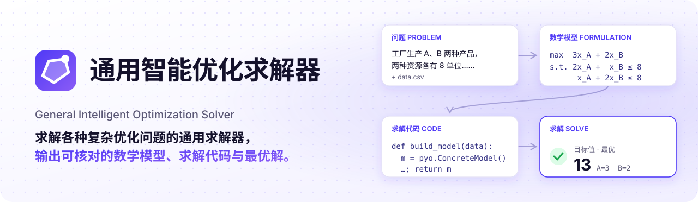
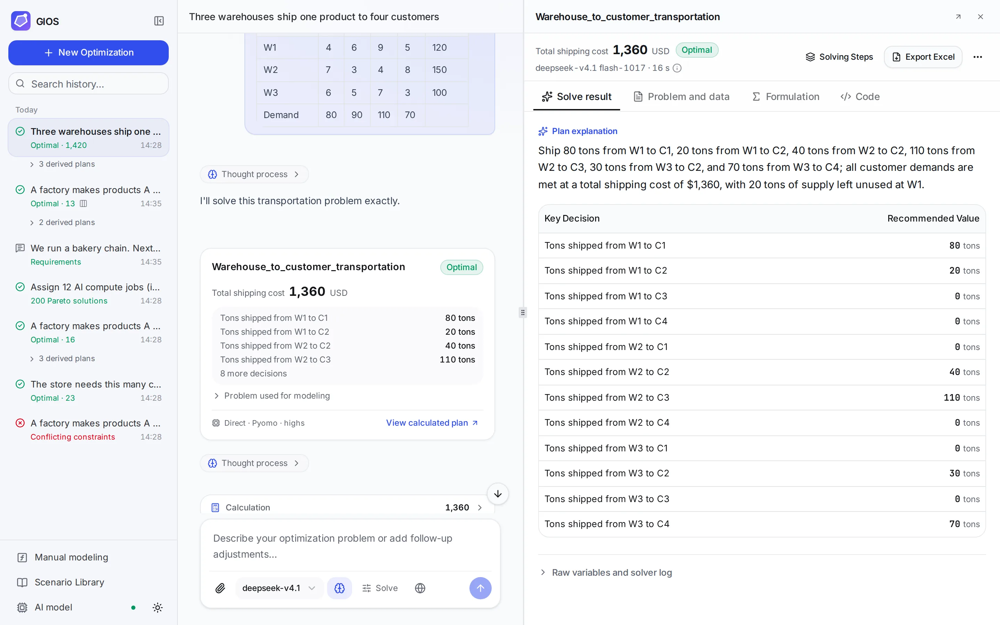
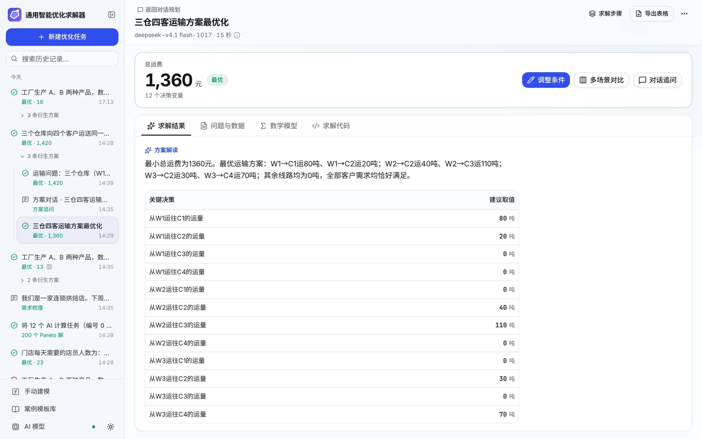
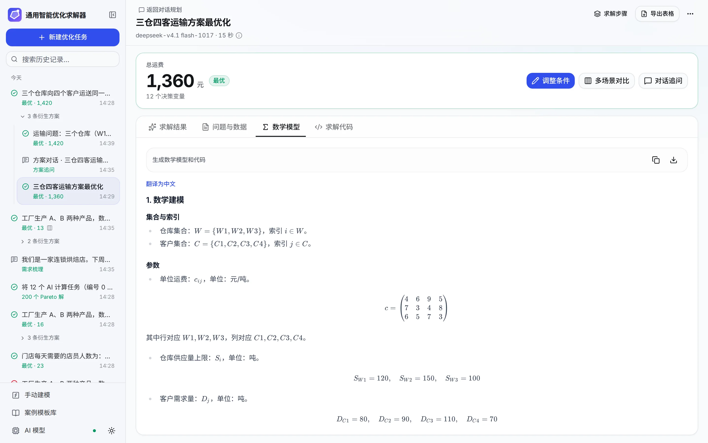
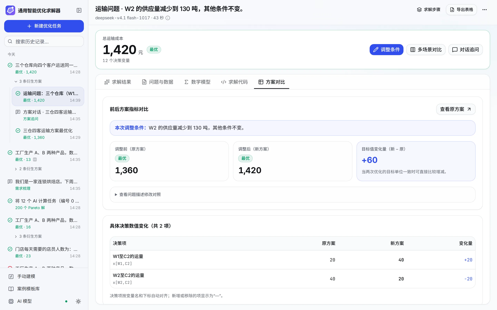
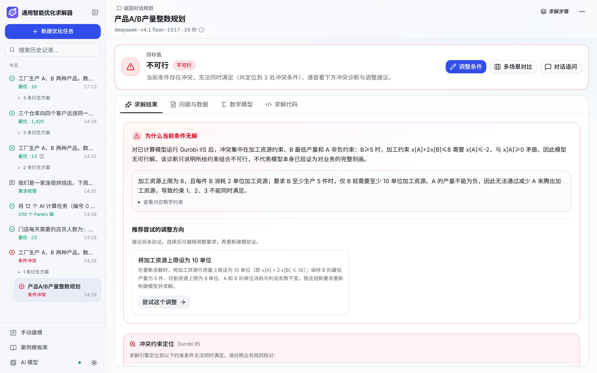
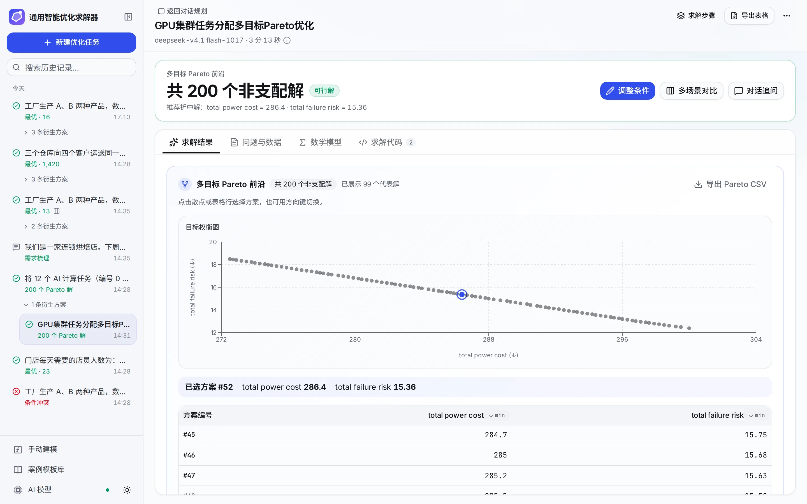
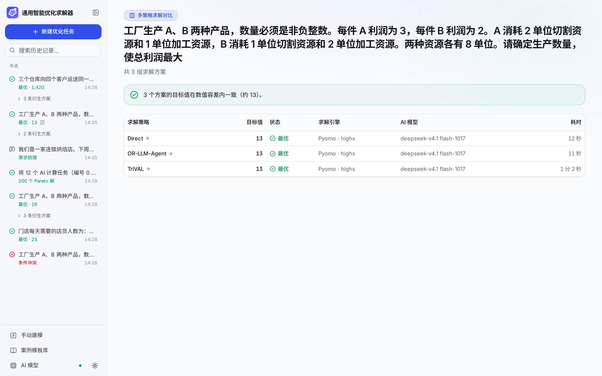
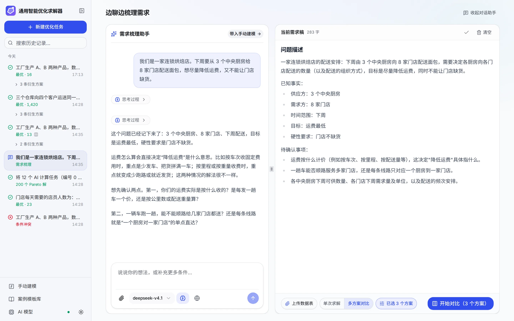
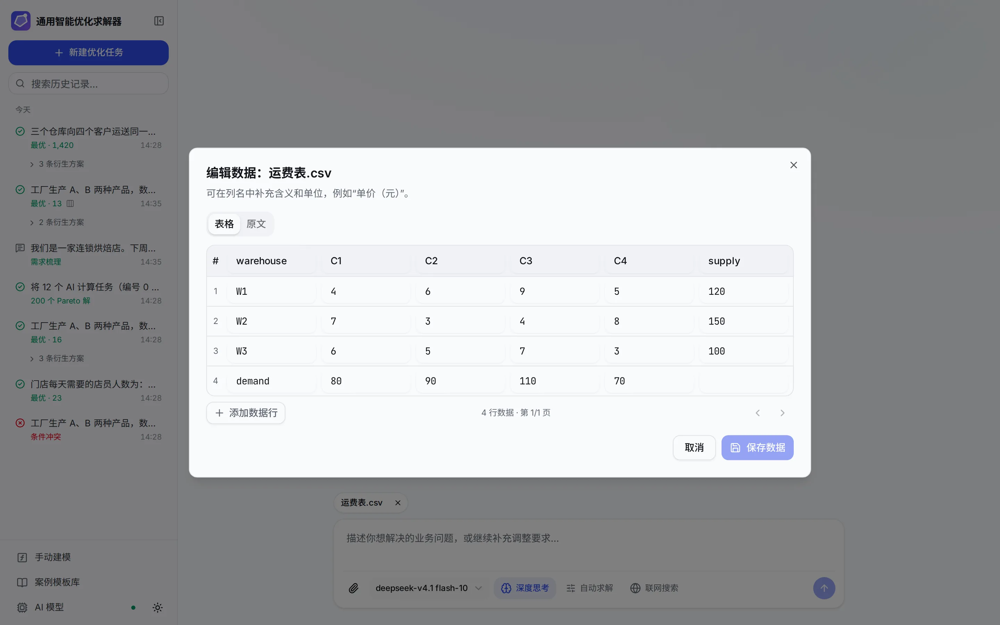

<p align="center">
  <picture>
    <source media="(prefers-color-scheme: dark)" srcset="docs/assets/banner-dark.svg">
    
  </picture>
</p>

<p align="center">
  
  
  
  
  <a href="LICENSE"></a>
</p>

<p align="center">
  <a href="README.md">中文</a> · <b>English</b>
  <br>
  <a href="https://fangziyang0910.github.io/LLM4OM/?lang=en">Website</a> ·
  <a href="https://fangziyang0910.github.io/LLM4OM/docs/en/introduction/">Docs</a> ·
  <a href="#quick-start">Quick start</a> ·
  <a href="#modeling-methods">Methods</a> ·
  <a href="docs/user-guide.md">User guide</a> ·
  <a href="docs/deployment.md">Deployment</a> ·
  <a href="CONTRIBUTING.md">Development</a> ·
  <a href="CHANGELOG.md">Changelog</a>
</p>

---

**General Intelligent Optimization Solver** (**通用智能优化求解器**) turns a business problem into an optimization plan you can check. Describe a production, staffing, shipping or siting problem in plain language and attach your spreadsheets. The platform writes a mathematical model and solver code, runs a real solver in an isolated Docker container, and explains the result in business terms. The model, code, solver log and every variable stay in the run record.

<p align="center">
  <picture>
    <source media="(prefers-color-scheme: dark)" srcset="docs/assets/dark-en.webp">
    
  </picture>
  <br><sub>Optimization chat: describe a shipping problem, the assistant models it and solves it with HiGHS, and the full plan appears on the right. Captured from a real run (DeepSeek · Direct · Pyomo).</sub>
</p>

## Features

- **Solve through chat**: describe the problem or drop in a spreadsheet. The assistant asks for missing conditions when needed, then models, solves and explains. The result card lists the objective, the key decisions and the method, library and solver actually used.
- **Results you can check**: generated code runs in a container with no network, a read-only file system and no root, removed after use. Formulations, solver code, solver logs and all variables are kept for every version; export an Excel plan with business labels and units, or a Markdown report.
- **Change and compare**: change one condition in a sentence to get a new plan while the original stays; compute several what-ifs from the same baseline and compare them side by side. When a model is infeasible, the explanation is based on the conflicting constraints reported by the solver (Gurobi IIS), with suggested changes to verify.
- **Two solving paths**: linear, integer, convex and constraint programs go through Pyomo, OR-Tools, CVXPY, PySCIPOpt or CasADi to backends such as HiGHS, SCIP, CP-SAT and Ipopt. Large combinatorial, black-box and multi-objective problems can use AutoCO, which selects and configures one of 12 heuristic algorithm families. Heuristic results are not guaranteed to be globally optimal.
- **Manual modeling and method comparison**: choose from 9 modeling methods, 5 modeling libraries and your model presets; run up to 12 setups on one problem and compare objective, time and tokens.
- **Data and requirements**: review and edit CSV, TSV, JSON, text and Excel before modeling; when the problem is still vague, the requirements assistant turns the conversation into an editable draft.
- **Deploy and integrate**: start with one Docker Compose command; model keys stay on the server. The same workflow runs from the command line, Python, or as a skill in Codex and Claude Code.
- **Templates and benchmarks**: 8 industry templates ready to solve and 2,033 public benchmark problems in 9 collections. Chinese and English interfaces, light and dark modes.

## Screenshots

Captured from real runs: DeepSeek model, local Docker solving. The Chinese interface is shown below; the English interface is above.

<table>
  <tr>
    <td width="50%"><p align="center"><sub>Result page: objective, plan explanation and key decisions</sub></p></td>
    <td width="50%"><p align="center"><sub>Formulation and solver code kept for every version</sub></p></td>
  </tr>
  <tr>
    <td><p align="center"><sub>Change one condition and compare with the original</sub></p></td>
    <td><p align="center"><sub>Infeasible model: the conflict explained, with changes to try</sub></p></td>
  </tr>
  <tr>
    <td><p align="center"><sub>Multi-objective problem: a Pareto front from AutoCO</sub></p></td>
    <td><p align="center"><sub>Several methods on one problem, side by side</sub></p></td>
  </tr>
  <tr>
    <td><p align="center"><sub>The requirements assistant drafts as you talk</sub></p></td>
    <td><p align="center"><sub>Review and edit data before modeling</sub></p></td>
  </tr>
</table>

See the [user guide](docs/user-guide.md) and the [online docs](https://fangziyang0910.github.io/LLM4OM/docs/en/introduction/) for more.

## Quick start

### Option 1: Docker (recommended)

You need Docker with Compose v2.24 or later:

```bash
git clone https://github.com/Fangziyang0910/LLM4OM.git && cd LLM4OM
cp .env.example .env && chmod 600 .env    # fill in the LLM provider, base URL, model and key
docker compose up -d --build
```

Open <http://localhost:8767>. Others on the network use `http://<this machine's IP>:8767`. For HTTPS, backups, usage limits and Gurobi licenses, see the [deployment guide](docs/deployment.md).

### Option 2: run locally

You need Python 3.11–3.13, [uv](https://docs.astral.sh/uv/) and Docker:

```bash
uv sync --extra web
uv run llm4om build-worker      # build the solver sandbox image llm4om-worker:19
uv run llm4om serve --workspace runs/web --port 8767
```

The repository includes the built frontend, so Node.js is not needed. Solver dependencies run inside the Docker Worker; the host only needs the Web dependencies, without installing every commercial or platform-specific solver locally.

### Option 3: use it in Codex / Claude Code

Install with Node.js 22.20+ and Git. Select your agent when prompted. To run the skill, the agent needs shell and workspace access, [uv](https://docs.astral.sh/uv/getting-started/installation/), and a running Docker engine.

```bash
npx skills add Fangziyang0910/LLM4OM --skill llm4om -g
```

Open a new session, invoke `$llm4om` in Codex or `/llm4om` in Claude Code, then describe your problem and attach your data. Your current model formulates the problem and explains the solution. The skill downloads its pinned runtime on first use and builds and reuses the Docker solver image on demand. No separate LLM4OM CLI, model API key, or Web service is required.

For a worked example, session recovery, and upgrades, see the [host modeling guide](docs/host-modeling.md).

### Try a problem

Send a problem to the modeling assistant on the home page (`/`), or open **Manual modeling** in the sidebar (`/model`) to follow this example.

1. If `.env` sets no model, click **AI model** at the bottom left and add a provider, key and model ID.
2. Click the **Production planning** example, or enter:

   > A factory makes products A and B in non-negative integer quantities. Each A earns 3 and each B earns 2. A uses 2 units of cutting and 1 unit of machining; B uses 1 unit of cutting and 2 units of machining. Each resource has 8 units. Choose the quantities that maximize total profit.

3. Choose **Single run** under **Run mode**, then click **Solve Now**. The optimal plan for this example makes 3 units of A and 2 of B, for a total profit of 13.
4. Click **Ask Follow-up** and ask “How much of the profit comes from each product?” At the saved quantities, A contributes 9 and B contributes 4. To try different resource limits, open **Compare Scenarios** and enter each limit. Each scenario runs from the same original plan.

Click an uploaded file name to inspect or edit the data before solving. You can export a feasible solution to Excel. For an infeasible model or a failed run, use the result page to ask about conflicting requirements or the cause of the failure.

To prepare a separate requirements draft, open **Manual modeling** in the sidebar and click **Discuss your requirements**. The assistant updates an editable draft as you talk. Add data and review the text, then click **Apply to Manual modeling** to return to the editor. Choose **Single run** and click **Solve Now** to start modeling. Saved conversations can be continued from history. Press Enter to send, or Shift+Enter for a new line. Enable **Web search** to find public references and inspect their sources. DeepSeek presets use their own search endpoint; other models can use a separate server-side search key (see `.env.example`).

You can also run from the command line or Python:

```bash
uv run llm4om run --problem "..." --method or_llm_agent --language pyomo --time-limit 30
```

```python
from llm4om import run_problem

state = run_problem("...", method="optimus", language="pyomo")
print(state["failure"] or state["solve"]["objective"])
```

## Modeling methods

| Method | Flow | Source |
|---|---|---|
| Direct | One call writes the formulation and the code | Baseline |
| OR-LLM-Agent | Formulates, writes code, debugs from execution errors, then checks infeasibility | [arXiv](https://arxiv.org/abs/2503.10009) · [Code](https://github.com/bwz96sco/or_llm_agent/tree/5dccdaab89ab91c3cb28066fe849423dc124d287) |
| LLMOPT | Writes a five-element model, then code; the LLM judges both and rewrites the wrong step | [ICLR 2025](https://arxiv.org/abs/2410.13213) · [Code](https://github.com/antgroup/LLMOPT/tree/1492dd33e39ea13f1afe32a0adc13d4217334195) |
| TriVAL | Validates semantics, formulation and code in three stages; each stage builds, validates and revises | [Code](https://github.com/SCUT-EIPI/TriVAL/tree/380a529) |
| BIND | Prompt with schemas; read full attachments in code; repair execution failures | [Paper](https://arxiv.org/abs/2605.21751) · [Adaptation](src/llm4om/methods/bind/README.md) |
| AutoCO | Problem modeling produces a candidate evaluator. Model features guide algorithm selection and configuration for sandboxed search over feasible solutions or multi-objective trade-offs | [Implementation and algorithm pool](src/llm4om/methods/autoco/graph.py) |
| OptiTree | Matches the problem to modeling thoughts in a problem-type tree, then writes the model and code | [NeurIPS 2025](https://arxiv.org/abs/2510.22192) · [Code](https://github.com/MIRALab-USTC/OptiTree/tree/2e70ecfd0a3c8e9c0c16d36d7d498a7344cfdec9) |
| Chain-of-Experts | A conductor picks experts one by one; a reducer writes the code; optional backward reflection | [ICLR 2024](https://openreview.net/forum?id=HobyL1B9CZ) · [Code](https://github.com/xzymustbexzy/Chain-of-Experts/tree/afb89bf602690ea621f13a23c42722f20f653a43) |
| OptiMUS 0.3 | Extracts parameters, objective and constraints; models and codes each one; assembles and debugs | [v0.3 paper](https://arxiv.org/abs/2407.19633) · [Code](https://github.com/teshnizi/OptiMUS/tree/e182e9ef5841605c2a7e87467021fd83522b6484) |

Each method records its reference commit and adaptations. BIND uses no benchmark reference answers. All 8 exact-modeling workflows accept the five modeling libraries. Some retain an LP/MILP scope; the library and backend must support the problem. AutoCO uses its built-in algorithm pool; heuristic results do not guarantee global optimality. See [methods](docs/methods.md).

## Modeling libraries and backends

Each library counts once. Choose one of these five libraries; the backend is automatic unless specified. Native API choice stays in the code, and the worker recognizes the returned model. The backend list comes from native registries in the actual sandbox and includes installation status.

| Modeling library | Native APIs | Backend integration |
|---|---|---|
| Pyomo | Algebraic (ConcreteModel/AbstractModel), Kernel | Native SolverFactory adapters |
| OR-Tools | MPSolver, MathOpt, CP-SAT, ModelBuilder, Routing, Constraint Solver, max flow, min-cost flow, assignment, knapsack | Each interface’s native engines and algorithms |
| CVXPY | DCP, DGP, DQCP | Native registry; AUTO uses solver_path and records the actual engine |
| PySCIPOpt | Scalar/expression, matrix | Native SCIP engine |
| CasADi | Opti NLP, Opti Conic, nlpsol, qpsol, conic | Native Nlpsol/Conic plugins |

Generated code defines `build_model(data)`. Ordinary interfaces return native models. Interfaces that need endpoints, bounds or structured problem inputs return the documented dictionaries. The worker uses the selected native API. An explicit unavailable backend fails instead of changing engines or relaxing integer domains.

See [interface contracts and validation](docs/references/modeling-libraries.md). Commercial engines require a suitable license or compliance with their limited mode. Loading an adapter does not validate its license. Local NLP solutions and heuristic routing results retain their actual status.

## Architecture

<picture>
  <source media="(prefers-color-scheme: dark)" srcset="docs/assets/architecture-en-dark.svg">
  
</picture>

The platform is thin. LangChain makes the LLM calls. The LangGraph server (in-memory runtime, no license needed) runs, streams and stores the runs. The platform adds only the code contract, the solver sandbox, step records and the workbench. See [architecture](docs/architecture.md) (in Chinese).

## Documentation

The detailed documents are in Chinese.

| Document | Contents |
|---|---|
| [User guide](docs/user-guide.md) | Workbench, comparison, diagnosis, LLM presets, problem library, CLI, Python API, FAQ |
| [Deployment](docs/deployment.md) | Docker Compose, HTTPS, team use, usage limits, Gurobi, backups, troubleshooting |
| [Development](CONTRIBUTING.md) | Setup, layout, tests, adding a method or a code language, releases |
| [Architecture](docs/architecture.md) | Modules, platform graph, method interface, sandbox, run records |
| [Methods](docs/methods.md) | Flow, pinned source, adaptations and real-run validation of each method |

## Contributing

Issues and pull requests are welcome. Please read the [development guide](CONTRIBUTING.md) first. Report security issues privately as described in [SECURITY](SECURITY.md).

## Citation

If you use General Intelligent Optimization Solver in research, please cite this repository (see [CITATION.cff](CITATION.cff)) and the papers of the methods you use.

```bibtex
@software{llm4om,
  author  = {Fang, Ziyang},
  title   = {General Intelligent Optimization Solver: A General Solver for Complex Optimization Problems},
  year    = {2026},
  version = {0.43.0},
  url     = {https://github.com/Fangziyang0910/LLM4OM}
}
```

## License

The code is licensed under [Apache-2.0](LICENSE). Bundled third-party prompts, code and data keep their original licenses; see [NOTICE](NOTICE). The LLMOPT repository states no license at the pinned commit; its prompts are included for research reproduction only.
