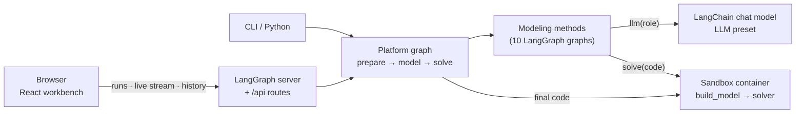

<p align="center">
  <picture>
    <source media="(prefers-color-scheme: dark)" srcset="docs/assets/banner-dark.svg">
    
  </picture>
</p>

<p align="center">
  <a href="https://github.com/Fangziyang0910/LLM4OM/actions/workflows/checks.yml"></a>
  
  
  
  
  <a href="LICENSE"></a>
</p>

<p align="center">
  <a href="README.md">中文</a> · <b>English</b>
  <br>
  <a href="#quick-start">Quick start</a> ·
  <a href="#modeling-methods">Methods</a> ·
  <a href="docs/user-guide.md">User guide</a> ·
  <a href="docs/deployment.md">Deployment</a> ·
  <a href="CONTRIBUTING.md">Development</a> ·
  <a href="CHANGELOG.md">Changelog</a>
</p>

---

**LLM4OM** (Large Language Models for Optimization Modeling) is a platform for automated optimization modeling. You describe a problem in plain language and choose a modeling method and a code language. An LLM writes the mathematical formulation and the solver code. The platform solves the code in an isolated container and shows every intermediate step.

It puts **10 published LLM modeling methods** on one platform, with one set of LLM presets, one code contract and one solver sandbox. Researchers can compare them side by side on the same problem, or plug in their own method.

<p align="center">
  
  <br><sub>A real run: transport problem · ORThought · Pyomo/HiGHS · DeepSeek. The modeling phase plays at 2× speed.</sub>
</p>

## Highlights

| Feature | What you get |
|---|---|
| 🧠 **10 modeling methods** | Direct, TriVAL, OptiMUS, Chain-of-Experts, OptiTree, OR-LLM-Agent, ORThought, LLMOPT, AutoFormulation and more, each with its original prompts and flow |
| 🧩 **6 languages × 6 solvers** | Pyomo/HiGHS, gurobipy/Gurobi, OR-Tools/SCIP, PuLP/CBC, CPMpy/CP-SAT, CVXPY/Clarabel: LP, MILP, constraint programming and convex optimization |
| 🔍 **Every step visible** | LLM calls stream live; every version of the formulation and the code can be viewed and diffed |
| ⚖️ **Compare methods** | Run up to 12 methods or models on one problem and compare objective, time and tokens |
| 🧯 **Infeasibility diagnosis** | For an infeasible model, see a set of constraints that cannot hold together (Gurobi IIS / CPMpy MUS) |
| 🔒 **Isolated sandbox** | Generated code runs in a container with no network, a read-only file system and no root, removed after use |
| 👥 **Team deployment** | One `docker compose up`; preset keys never leave the server; optional HTTPS and usage limits |
| 🌗 **A workbench people like** | Notes and tags, Markdown reports, Excel import, 2,033 public problems, Chinese and English, dark mode |

## Screenshots

<table>
  <tr>
    <td width="50%"><p align="center"><sub>Write the problem; choose method, language and model</sub></p></td>
    <td width="50%"><p align="center"><sub>The verdict first: objective, modeling process, solution matrix</sub></p></td>
  </tr>
  <tr>
    <td><p align="center"><sub>Formulations render as LaTeX; each version can be diffed</sub></p></td>
    <td><p align="center"><sub>Five methods on one problem</sub></p></td>
  </tr>
  <tr>
    <td><p align="center"><sub>Infeasible model: Gurobi IIS finds 3 conflicting constraints</sub></p></td>
    <td><p align="center"><sub>Dark mode and the English interface</sub></p></td>
  </tr>
</table>

## Quick start

### Option 1: Docker (recommended)

You need Docker with Compose v2.24 or later:

```bash
git clone https://github.com/Fangziyang0910/LLM4OM.git && cd LLM4OM
cp .env.example .env && chmod 600 .env    # fill in the LLM provider, base URL, model and key
docker compose up -d --build
```

Open <http://localhost:8767>. Others on the network use `http://<this machine's IP>:8767`. For HTTPS, backups, usage limits and Gurobi licenses, see the [deployment guide](docs/deployment.md).

### Option 2: run locally

You need Python 3.11–3.13, [uv](https://docs.astral.sh/uv/) and Docker:

```bash
uv sync --all-extras
uv run llm4om build-worker      # build the solver sandbox image llm4om-worker:7
uv run llm4om serve --workspace runs/web --port 8767
```

The repository includes the built frontend, so Node.js is not needed.

### Try a problem

1. If `.env` sets no model, click **LLM preset** at the bottom left and add a provider, key and model ID.
2. Click the **Production planning** example, or enter:

   > A factory makes products A and B in non-negative integer quantities. Each A earns 3 and each B earns 2. A uses 2 units of cutting and 1 unit of machining; B uses 1 unit of cutting and 2 units of machining. Each resource has 8 units. Choose the quantities that maximize total profit.

3. Click **Start modeling**. In a few seconds the page shows the optimum A=3, B=2 with profit 13.

You can also run from the command line or Python:

```bash
uv run llm4om run --problem "..." --method orthought --language pyomo
```

```python
from llm4om import run_problem

state = run_problem("...", method="optimus", language="gurobipy")
print(state["failure"] or state["solve"]["objective"])
```

## Modeling methods

| Method | Flow | Source |
|---|---|---|
| Direct | One call writes the formulation and the code | Baseline |
| Feedback Repair | Direct, then repairs from solver feedback | Baseline |
| TriVAL | Validates semantics, formulation and code in three stages; each stage builds, validates and revises | [Code](https://github.com/SCUT-EIPI/TriVAL/tree/380a529) |
| OptiMUS | Extracts parameters, objective and constraints; models and codes each one; assembles and debugs | [ICML 2024](https://arxiv.org/abs/2402.10172) · [Code](https://github.com/teshnizi/OptiMUS/tree/e182e9ef5841605c2a7e87467021fd83522b6484) |
| Chain-of-Experts | A conductor picks experts one by one; a reducer writes the code; optional backward reflection | [ICLR 2024](https://openreview.net/forum?id=HobyL1B9CZ) · [Code](https://github.com/xzymustbexzy/Chain-of-Experts/tree/afb89bf602690ea621f13a23c42722f20f653a43) |
| OptiTree | Matches the problem to modeling thoughts in a problem-type tree, then writes the model and code | [NeurIPS 2025](https://arxiv.org/abs/2510.22192) · [Code](https://github.com/MIRALab-USTC/OptiTree/tree/2e70ecfd0a3c8e9c0c16d36d7d498a7344cfdec9) |
| OR-LLM-Agent | Formulates, writes code, debugs from execution errors, then checks infeasibility | [arXiv](https://arxiv.org/abs/2503.10009) · [Code](https://github.com/bwz96sco/or_llm_agent/tree/5dccdaab89ab91c3cb28066fe849423dc124d287) |
| ORThought | Writes a solution path, formulation and code with expert modeling thoughts; debugs with the model and the error | [arXiv](https://arxiv.org/abs/2508.14410) · [Code](https://github.com/BeinuoYang/ORThought/tree/5293e24861a65d1e4a2f61f4fad0a81de901ee38) |
| LLMOPT | Writes a five-element model, then code; the LLM judges both and rewrites the wrong step | [ICLR 2025](https://arxiv.org/abs/2410.13213) · [Code](https://github.com/antgroup/LLMOPT/tree/1492dd33e39ea13f1afe32a0adc13d4217334195) |
| AutoFormulation | Builds a tree by sampling and pruning layer by layer, then ranks with MCTS and pairwise comparison (many calls) | [ICML 2025](https://arxiv.org/abs/2411.01679) · [Code](https://github.com/jumpynitro/AutoFormulator/tree/52148018d04de23dc2d36d4281eb6244c2a42ffc) |

Each research method is pinned to an upstream commit and keeps its original prompts, orchestration and stopping rules. The platform only makes the adaptations needed to plug it in, and records each one. Methods whose original prompts ask for LP/MILP offer only the four MILP languages. See [methods](docs/methods.md) (in Chinese).

## Code languages and solvers

You choose the code language; the language decides the solver. Generated code defines `build_model(data)` and returns the model; the sandbox solves it through the language's own API.

| Language | Solver | Problems |
|---|---|---|
| Pyomo | HiGHS | LP, MILP |
| gurobipy | Gurobi | LP, MILP (small models only without a full license) |
| OR-Tools `pywraplp` | SCIP | LP, MILP |
| PuLP | CBC | LP, MILP |
| CPMpy | OR-Tools CP-SAT | Constraint programming: integer and Boolean variables, global constraints, satisfaction |
| CVXPY | Clarabel | Continuous convex optimization: LP, convex QP, SOCP and more |

## Architecture



The platform is thin. LangChain makes the LLM calls. The LangGraph server (in-memory runtime, no license needed) runs, streams and stores the runs. The platform adds only the code contract, the solver sandbox, step records and the workbench. See [architecture](docs/architecture.md) (in Chinese).

## Documentation

The detailed documents are in Chinese.

| Document | Contents |
|---|---|
| [User guide](docs/user-guide.md) | Workbench, comparison, diagnosis, LLM presets, problem library, CLI, Python API, FAQ |
| [Deployment](docs/deployment.md) | Docker Compose, HTTPS, team use, usage limits, Gurobi, backups, troubleshooting |
| [Development](CONTRIBUTING.md) | Setup, layout, tests, adding a method or a code language, releases |
| [Architecture](docs/architecture.md) | Modules, platform graph, method interface, sandbox, run records |
| [Methods](docs/methods.md) | Flow, pinned source, adaptations and real-run validation of each method |

## Contributing

Issues and pull requests are welcome. Please read the [development guide](CONTRIBUTING.md) first. Report security issues privately as described in [SECURITY](SECURITY.md).

## Citation

If you use LLM4OM in research, please cite this repository (see [CITATION.cff](CITATION.cff)) and the papers of the methods you use.

```bibtex
@software{llm4om,
  author  = {Fang, Ziyang},
  title   = {{LLM4OM}: A Platform for Automated Optimization Modeling with Large Language Models},
  year    = {2026},
  version = {0.41.0},
  url     = {https://github.com/Fangziyang0910/LLM4OM}
}
```

## License

The code is licensed under [Apache-2.0](LICENSE). Bundled third-party prompts, code and data keep their original licenses; see [NOTICE](NOTICE). The LLMOPT and ORThought repositories state no license at the pinned commits; their prompts are included for research reproduction only.
