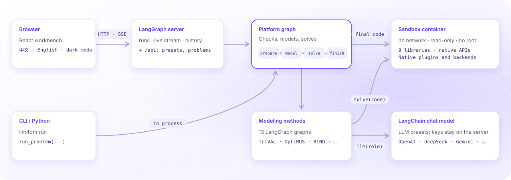

<p align="center">
  <picture>
    <source media="(prefers-color-scheme: dark)" srcset="docs/assets/banner-dark.svg">
    
  </picture>
</p>

<p align="center">
  <a href="https://github.com/Fangziyang0910/LLM4OM/actions/workflows/checks.yml"></a>
  
  
  
  
  <a href="LICENSE"></a>
</p>

<p align="center">
  <a href="README.md">中文</a> · <b>English</b>
  <br>
  <a href="https://fangziyang0910.github.io/LLM4OM/docs/en/introduction/">Docs</a> ·
  <a href="#quick-start">Quick start</a> ·
  <a href="#modeling-methods">Methods</a> ·
  <a href="docs/user-guide.md">User guide</a> ·
  <a href="docs/deployment.md">Deployment</a> ·
  <a href="CONTRIBUTING.md">Development</a> ·
  <a href="CHANGELOG.md">Changelog</a>
</p>

---

**LLM4OM** (Large Language Models for Optimization Modeling) is a platform for automated optimization modeling. Use the original configuration workbench, or chat with the optimization assistant and attach data. The agent calls a complete modeling method to write the mathematical model and solver code, then solve in an isolated container. Inspect actual steps and results in the modeling workspace, and continue the conversation to change conditions.

The platform includes **13 LLM modeling methods**: its own Direct and Feedback Repair methods, plus eleven methods from public research. Enter a problem, run the modeling process and inspect the model and result without writing solver code yourself.

<p align="center">
  
  <br><sub>A real run: move from ordinary chat and arithmetic to production modeling with DeepSeek · Direct · Pyomo, revise conditions, then return to the original plan.</sub>
</p>

## Highlights

| Feature | What you get |
|---|---|
| 💬 **Model through conversation** | Discuss an idea, calculate a first plan, inspect results and revise conditions in one agent. Specify methods and libraries in chat, or use the retained manual workbench |
| 🧠 **13 modeling methods** | Direct, Feedback Repair, TriVAL, SAC-Opt, BIND, OptiMind and more; each has its own LangGraph |
| 🧩 **9 modeling libraries** | Native modeling APIs, with backend discovery through each library’s own plugin registry |
| 📝 **Requirements chat** | Multi-turn streaming chat with expandable search sources and retry after stopping or failure; review the editable draft, then hand it to any modeling method |
| 🔍 **Every step visible** | Live LLM calls, saved partial work after cancellation, paged history and a fixed configuration record for every run |
| ⚖️ **Compare methods** | Run up to 12 methods or models on one problem and compare objective, time and tokens |
| 💬 **Explain and revise plans** | Read decisions in business terms, change conditions in plain language, and compare the new plan with the saved original |
| 🔄 **Plan chat and business scenarios** | Ask about actual results; condition changes show real modeling progress and result cards, with a fixed baseline for several alternatives |
| 📊 **Review data before modeling** | Edit CSV, TSV, JSON and text attachments, including converted Excel sheets; clarify column names and units before saving |
| 🧯 **Explain infeasibility** | Read business explanations grounded in actual conflicting constraints; select and edit a candidate change, then solve a new model to verify it (Gurobi IIS / CPMpy MUS) |
| 🔒 **Isolated sandbox** | Generated code runs in a container with no network, a read-only file system and no root, removed after use |
| 👥 **Team deployment** | One `docker compose up`; preset keys never leave the server; optional HTTPS and usage limits |
| 🌗 **A workbench people like** | Export Excel plans with business labels, units and all actual values; notes and tags, Markdown reports, Excel import, 2,033 public problems, Chinese and English, dark mode |

The original workbench remains the desktop home page. A separate “Optimization chat” entry opens `/agent`. Describe a problem or attach data; the assistant asks focused questions when needed and calls a complete modeling workflow. Defaults are Direct, Pyomo and automatic backend selection. Specify alternatives in chat or pin them under modeling preferences. Actual steps stream to a task card; the modeling workspace shows the mathematical model, code and results. Each plan is saved independently. Both interfaces remain available and share the same modeling methods and independently saved runs.

The agent also handles ordinary questions, writing, code explanations, supplied material and arithmetic without starting a modeling run. For plan discussions, a calculator reads all saved decision values to check costs, remaining capacity and ratios. Say “use the second plan” or “return to the original” to change the baseline for later discussion without solving again. Browsing a historical plan still only changes the view.

## Screenshots

On desktop, drag the divider beside the Agent or plan assistant to resize the conversation and modeling panels. Layouts survive reload. Historical plans are marked, with a shortcut back to the plan being discussed; browsing does not change the calculation baseline. Run settings show methods, modeling libraries and models side by side.

<table>
  <tr>
    <td width="50%"><p align="center"><sub>A separate agent entry, starting from a problem</sub></p></td>
    <td width="50%"><p align="center"><sub>Calculate through chat; inspect actual models and results alongside</sub></p></td>
  </tr>
  <tr>
    <td width="50%"><p align="center"><sub>Write the problem; choose method, language and model</sub></p></td>
    <td width="50%"><p align="center"><sub>The verdict first: objective, modeling process, solution matrix</sub></p></td>
  </tr>
  <tr>
    <td colspan="2"><p align="center"><sub>Methods, modeling libraries and models visible together</sub></p></td>
  </tr>
  <tr>
    <td colspan="2"><p align="center"><sub>Discuss business requirements, then review the draft before modeling</sub></p></td>
  </tr>
  <tr>
    <td><p align="center"><sub>Review cells, column names and units before modeling</sub></p></td>
    <td><p align="center"><sub>Discuss actual results; calculate a new plan after changing conditions</sub></p></td>
  </tr>
  <tr>
    <td colspan="2"><p align="center"><sub>Compare actual results under different conditions against one saved baseline</sub></p></td>
  </tr>
  <tr>
    <td><p align="center"><sub>Formulations render as LaTeX; each version can be diffed</sub></p></td>
    <td><p align="center"><sub>Five methods on one problem</sub></p></td>
  </tr>
  <tr>
    <td><p align="center"><sub>Infeasible model: Gurobi IIS finds 3 conflicting constraints</sub></p></td>
    <td><p align="center"><sub>Dark mode and the English interface</sub></p></td>
  </tr>
</table>

## Quick start

### Option 1: Docker (recommended)

You need Docker with Compose v2.24 or later:

```bash
git clone https://github.com/Fangziyang0910/LLM4OM.git && cd LLM4OM
cp .env.example .env && chmod 600 .env    # fill in the LLM provider, base URL, model and key
docker compose up -d --build
```

Open <http://localhost:8767>. Others on the network use `http://<this machine's IP>:8767`. For HTTPS, backups, usage limits and Gurobi licenses, see the [deployment guide](docs/deployment.md).

### Option 2: run locally

You need Python 3.11–3.13, [uv](https://docs.astral.sh/uv/) and Docker:

```bash
uv sync --all-extras
uv run llm4om build-worker      # build the solver sandbox image llm4om-worker:12
uv run llm4om serve --workspace runs/web --port 8767
```

The repository includes the built frontend, so Node.js is not needed.

### Try a problem

1. If `.env` sets no model, click **LLM preset** at the bottom left and add a provider, key and model ID.
2. Click the **Production planning** example, or enter:

   > A factory makes products A and B in non-negative integer quantities. Each A earns 3 and each B earns 2. A uses 2 units of cutting and 1 unit of machining; B uses 1 unit of cutting and 2 units of machining. Each resource has 8 units. Choose the quantities that maximize total profit.

3. Click **Start modeling**. In a few seconds the page shows the optimum A=3, B=2 with profit 13.

Click an uploaded file name to review and edit its data. After solving, use **Discuss the plan** to ask questions or request explicit changes, or **Business scenario comparison** below the results to calculate several alternatives from one baseline. Each new outcome comes from real modeling and solving; original records remain intact.

If you have only an idea, click **Discuss your requirements**. The assistant updates an editable draft as you talk. Add data and review the text, then click **Use for modeling** to return to the existing settings. You choose when to click **Start modeling**. Saved conversations can be continued from history. Press Enter to send, or Shift+Enter for a new line. Enable **Web search** to find public references and inspect their sources. DeepSeek presets use their own search endpoint; other models can use a separate server-side search key (see `.env.example`).

You can also run from the command line or Python:

```bash
uv run llm4om run --problem "..." --method orthought --language pyomo
```

```python
from llm4om import run_problem

state = run_problem("...", method="optimus", language="gurobipy")
print(state["failure"] or state["solve"]["objective"])
```

## Modeling methods

| Method | Flow | Source |
|---|---|---|
| Direct | One call writes the formulation and the code | Baseline |
| Feedback Repair | Generates, solves and checks against the problem; repairs format, execution or modeling errors | In-house method |
| TriVAL | Validates semantics, formulation and code in three stages; each stage builds, validates and revises | [Code](https://github.com/SCUT-EIPI/TriVAL/tree/380a529) |
| OptiMUS 0.3 | Extracts parameters, objective and constraints; models and codes each one; assembles and debugs | [v0.3 paper](https://arxiv.org/abs/2407.19633) · [Code](https://github.com/teshnizi/OptiMUS/tree/e182e9ef5841605c2a7e87467021fd83522b6484) |
| Chain-of-Experts | A conductor picks experts one by one; a reducer writes the code; optional backward reflection | [ICLR 2024](https://openreview.net/forum?id=HobyL1B9CZ) · [Code](https://github.com/xzymustbexzy/Chain-of-Experts/tree/afb89bf602690ea621f13a23c42722f20f653a43) |
| OptiTree | Matches the problem to modeling thoughts in a problem-type tree, then writes the model and code | [NeurIPS 2025](https://arxiv.org/abs/2510.22192) · [Code](https://github.com/MIRALab-USTC/OptiTree/tree/2e70ecfd0a3c8e9c0c16d36d7d498a7344cfdec9) |
| OR-LLM-Agent | Formulates, writes code, debugs from execution errors, then checks infeasibility | [arXiv](https://arxiv.org/abs/2503.10009) · [Code](https://github.com/bwz96sco/or_llm_agent/tree/5dccdaab89ab91c3cb28066fe849423dc124d287) |
| ORThought | Writes a solution path, formulation and code with expert modeling thoughts; debugs with the model and the error | [arXiv](https://arxiv.org/abs/2508.14410) · [Code](https://github.com/BeinuoYang/ORThought/tree/5293e24861a65d1e4a2f61f4fad0a81de901ee38) |
| LLMOPT | Writes a five-element model, then code; the LLM judges both and rewrites the wrong step | [ICLR 2025](https://arxiv.org/abs/2410.13213) · [Code](https://github.com/antgroup/LLMOPT/tree/1492dd33e39ea13f1afe32a0adc13d4217334195) |
| AutoFormulation | Builds a tree by sampling and pruning layer by layer, then ranks with MCTS and pairwise comparison (many calls) | [ICML 2025](https://arxiv.org/abs/2411.01679) · [Code](https://github.com/jumpynitro/AutoFormulator/tree/52148018d04de23dc2d36d4281eb6244c2a42ffc) |
| SAC-Opt | Semantic anchors, constraint backtranslation and selective repair (independent implementation) | [Paper](https://proceedings.mlr.press/v306/zhang26cb.html) · [Adaptation](src/llm4om/methods/sac_opt/README.md) |
| BIND | Prompt with schemas; read full attachments in code; repair execution failures | [Paper](https://arxiv.org/abs/2605.21751) · [Adaptation](src/llm4om/methods/bind/README.md) |
| OptiMind | Public class hints, modeling, execution feedback and iterative review | [Paper](https://arxiv.org/abs/2509.22979) · [Public scope](src/llm4om/methods/optimind/README.md) |

Each method records its reference commit and adaptations. SAC-Opt is independently implemented; BIND uses no benchmark reference answers; OptiMind integrates the public inference workflow and the published TSP hint subset, not trained weights. All 13 methods accept the nine modeling libraries. Some methods retain an LP/MILP scope; the library and backend must support the problem. See [methods](docs/methods.md).

## Modeling libraries and backends

Each library counts once. Choose one of these nine libraries; the backend is automatic unless specified. Native API choice stays in the code, and the worker recognizes the returned model. The backend list comes from native registries in the actual sandbox and includes installation status.

| Modeling library | Native APIs | Backend integration |
|---|---|---|
| Pyomo | Algebraic (ConcreteModel/AbstractModel), Kernel | Native SolverFactory adapters |
| gurobipy | Scalar/expression, matrix | Native Gurobi engine |
| OR-Tools | MPSolver, MathOpt, CP-SAT, ModelBuilder, Routing, Constraint Solver, max flow, min-cost flow, assignment, knapsack | Each interface’s native engines and algorithms |
| CPMpy | Model, SolverInterface | SolverLookup, including native subsolvers |
| PuLP | Row-oriented, column-oriented | Native getSolver registry |
| CVXPY | DCP, DGP, DQCP | Native registry; AUTO uses solver_path and records the actual engine |
| PySCIPOpt | Scalar/expression, matrix | Native SCIP engine |
| CasADi | Opti NLP, Opti Conic, nlpsol, qpsol, conic | Native Nlpsol/Conic plugins |
| coptpy | Scalar/expression, matrix | Native COPT engine |

Generated code defines `build_model(data)`. Ordinary interfaces return native models. Interfaces that need endpoints, bounds or structured problem inputs return the documented dictionaries. The worker uses the selected native API. An explicit unavailable backend fails instead of changing engines or relaxing integer domains.

See [interface contracts and validation](docs/references/modeling-libraries.md). Commercial engines require a suitable license or compliance with their limited mode. Loading an adapter does not validate its license. Local NLP solutions and heuristic routing results retain their actual status.

## Architecture

<picture>
  <source media="(prefers-color-scheme: dark)" srcset="docs/assets/architecture-en-dark.svg">
  
</picture>

The platform is thin. LangChain makes the LLM calls. The LangGraph server (in-memory runtime, no license needed) runs, streams and stores the runs. The platform adds only the code contract, the solver sandbox, step records and the workbench. See [architecture](docs/architecture.md) (in Chinese).

## Documentation

The detailed documents are in Chinese.

| Document | Contents |
|---|---|
| [User guide](docs/user-guide.md) | Workbench, comparison, diagnosis, LLM presets, problem library, CLI, Python API, FAQ |
| [Deployment](docs/deployment.md) | Docker Compose, HTTPS, team use, usage limits, Gurobi, backups, troubleshooting |
| [Development](CONTRIBUTING.md) | Setup, layout, tests, adding a method or a code language, releases |
| [Architecture](docs/architecture.md) | Modules, platform graph, method interface, sandbox, run records |
| [Methods](docs/methods.md) | Flow, pinned source, adaptations and real-run validation of each method |

## Contributing

Issues and pull requests are welcome. Please read the [development guide](CONTRIBUTING.md) first. Report security issues privately as described in [SECURITY](SECURITY.md).

## Citation

If you use LLM4OM in research, please cite this repository (see [CITATION.cff](CITATION.cff)) and the papers of the methods you use.

```bibtex
@software{llm4om,
  author  = {Fang, Ziyang},
  title   = {{LLM4OM}: A Platform for Automated Optimization Modeling with Large Language Models},
  year    = {2026},
  version = {0.42.0},
  url     = {https://github.com/Fangziyang0910/LLM4OM}
}
```

## License

The code is licensed under [Apache-2.0](LICENSE). Bundled third-party prompts, code and data keep their original licenses; see [NOTICE](NOTICE). The LLMOPT and ORThought repositories state no license at the pinned commits; their prompts are included for research reproduction only.
