<p align="center">
  <picture>
    <source media="(prefers-color-scheme: dark)" srcset="docs/assets/banner-dark.svg">
    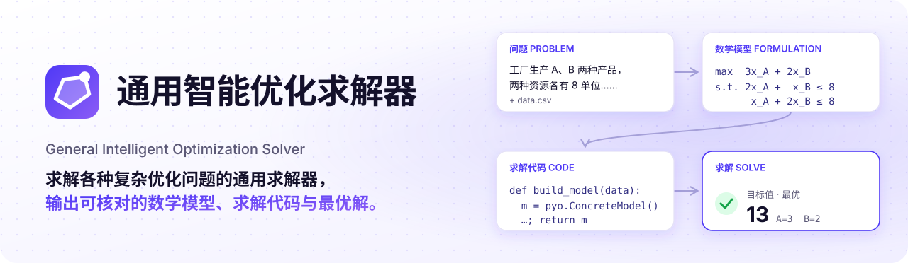
  </picture>
</p>

<p align="center">
  
  
  
  
  <a href="LICENSE"></a>
</p>

<p align="center">
  <b>中文</b> · <a href="README.en.md">English</a>
  <br>
  <a href="https://fangziyang0910.github.io/LLM4OM/?lang=zh">官网</a> ·
  <a href="https://fangziyang0910.github.io/LLM4OM/docs/zh/introduction/">在线文档</a> ·
  <a href="#快速开始">快速开始</a> ·
  <a href="#建模方法">建模方法</a> ·
  <a href="docs/user-guide.md">使用指南</a> ·
  <a href="docs/deployment.md">部署指南</a> ·
  <a href="CONTRIBUTING.md">开发指南</a> ·
  <a href="CHANGELOG.md">更新日志</a>
</p>

---

**通用智能优化求解器**（General Intelligent Optimization Solver）把业务问题变成可以核对的优化方案。用日常语言描述生产、排班、运输、选址等问题并附上数据表格，平台生成数学模型和求解代码，在隔离的 Docker 容器中调用真实求解器计算，再用业务语言解释结果。模型、代码、求解日志和完整变量都保存在运行记录里。

<p align="center">
  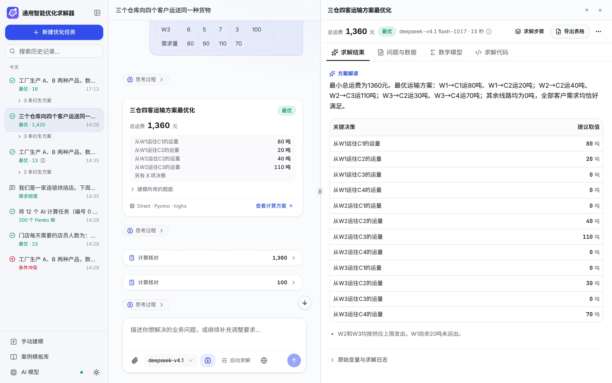
  <br><sub>优化对话：描述一个运输问题，助手建模并调用 HiGHS 求解，右侧显示完整方案。截图来自真实运行（DeepSeek · Direct · Pyomo）。</sub>
</p>

## 主要功能

- **对话求解**：描述问题或拖入表格，助手按需追问缺少的条件，然后建模、求解并解释结果。结果卡片列出目标值、关键决策，以及实际使用的方法、建模库和求解器。
- **结果可以核对**：生成的代码在无网络、只读、非 root 的容器中运行，用完即删。数学模型、求解代码、求解日志和完整变量逐版本保留，可导出带业务名称和单位的 Excel 或 Markdown 报告。
- **调整与比较**：一句话修改条件得到新方案，原方案保留；多个假设从同一基准分别计算并排比较。无解时根据求解器给出的冲突约束（Gurobi IIS）解释原因，并给出待验证的调整建议。
- **两类求解路径**：线性、整数、凸优化和约束规划问题由 Pyomo、OR-Tools、CVXPY、PySCIPOpt、CasADi 交给 HiGHS、SCIP、CP-SAT、Ipopt 等后端求解；大规模组合、黑盒和多目标问题可交给 AutoCO，从 12 类启发式算法中选择并配置。启发式结果不保证全局最优。
- **手动建模与方法对比**：在 9 种建模方法、5 个建模库和多个模型预设中自行选择；同一问题一次并排运行最多 12 组，比较目标值、用时和 Token。
- **数据与需求整理**：建模前检查和编辑 CSV、TSV、JSON、文本和 Excel；需求还不清楚时，先由需求助手整理成可编辑的需求稿。
- **部署与集成**：Docker Compose 一条命令启动，模型密钥只保存在服务器；同一套流程也可以在命令行、Python 或 Codex / Claude Code 的 Skill 中运行。
- **场景模板与题库**：8 个可直接求解的行业场景模板，以及 9 组、2033 道公开评测题。界面支持中英文、浅色和深色模式。

## 截图

截图来自真实运行：DeepSeek 模型，本地 Docker 求解。

<table>
  <tr>
    <td width="50%">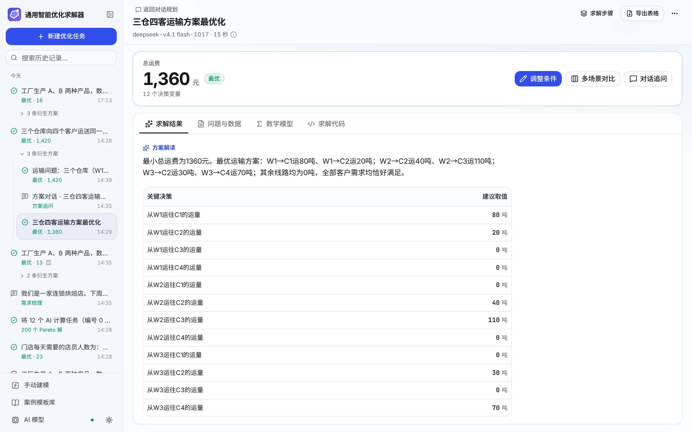<p align="center"><sub>结果页：目标值、方案解读和关键决策</sub></p></td>
    <td width="50%">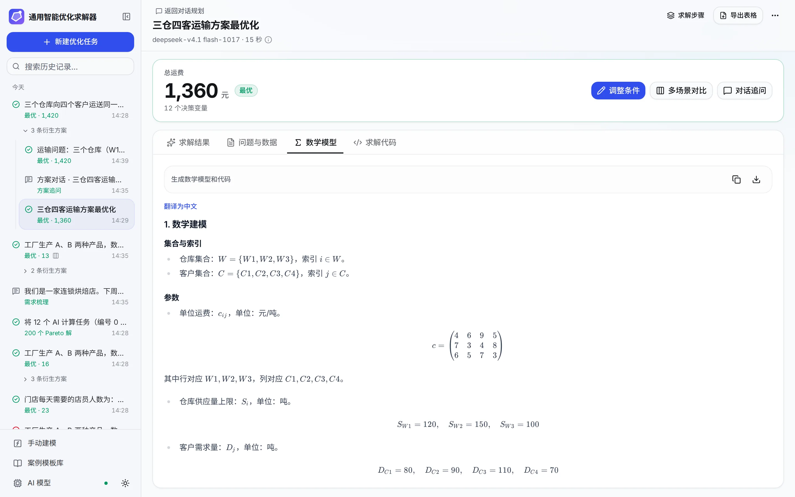<p align="center"><sub>数学模型与求解代码逐版本保留</sub></p></td>
  </tr>
  <tr>
    <td>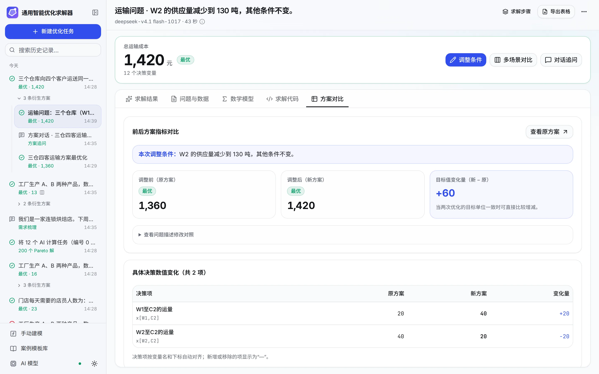<p align="center"><sub>改一个条件，与原方案逐项对比</sub></p></td>
    <td>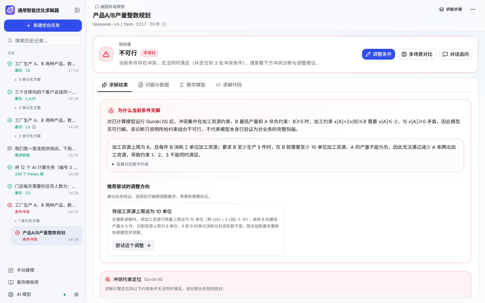<p align="center"><sub>无解时说明冲突，并给出调整建议</sub></p></td>
  </tr>
  <tr>
    <td>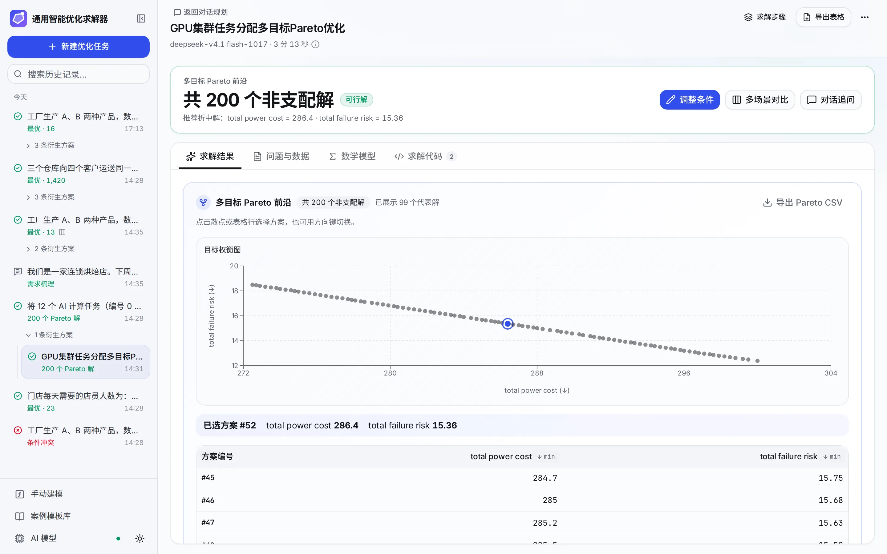<p align="center"><sub>多目标问题：AutoCO 给出 Pareto 前沿</sub></p></td>
    <td>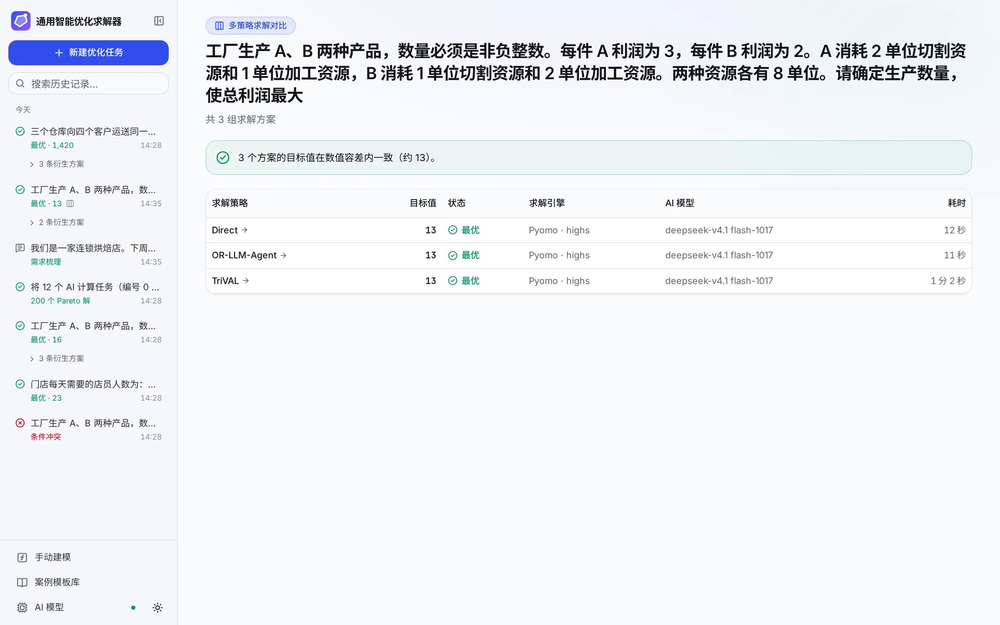<p align="center"><sub>同一问题，多种方法并排对比</sub></p></td>
  </tr>
  <tr>
    <td>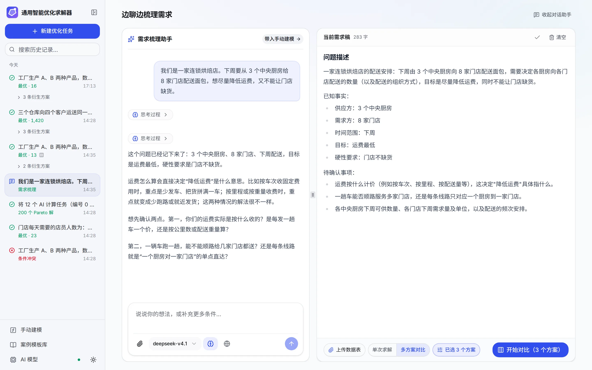<p align="center"><sub>需求助手边聊边整理需求稿</sub></p></td>
    <td>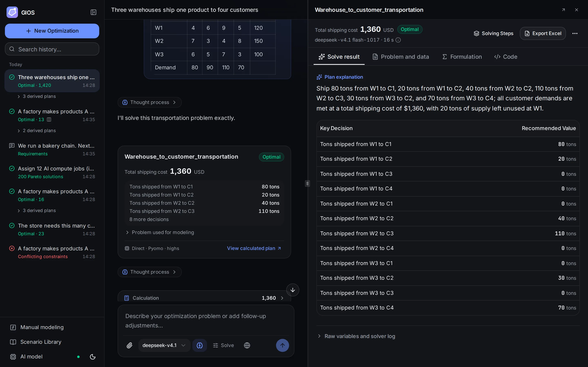<p align="center"><sub>英文界面与深色模式</sub></p></td>
  </tr>
</table>

更多界面见[使用指南](docs/user-guide.md)和[在线文档](https://fangziyang0910.github.io/LLM4OM/docs/zh/introduction/)。

## 快速开始

### 方式一：Docker（推荐）

只需要 Docker（含 Compose v2.24 或更新版本）：

```bash
git clone https://github.com/Fangziyang0910/LLM4OM.git && cd LLM4OM
cp .env.example .env && chmod 600 .env    # 填写 LLM 服务商、地址、模型和密钥
docker compose up -d --build
```

打开 <http://localhost:8767>。同一网络中的其他人用 `http://<本机 IP>:8767` 访问。HTTPS、备份、用量上限和 Gurobi 许可证见[部署指南](docs/deployment.md)。

### 方式二：本地运行

需要 Python 3.11–3.13、[uv](https://docs.astral.sh/uv/) 和 Docker：

```bash
uv sync --extra web
uv run llm4om build-worker      # 构建求解沙箱镜像 llm4om-worker:19
uv run llm4om serve --workspace runs/web --port 8767
```

仓库已包含前端构建文件，不需要 Node.js。求解依赖安装在 Docker Worker 中，宿主机只需安装 Web 依赖；不必在本机安装全部商业或平台限定的求解器。

### 方式三：在 Codex / Claude Code 中使用

安装时需要 Node.js 22.20+ 和 Git。在安装器中选择你的 Agent。运行 Skill 时，Agent 需要能执行命令、访问工作区，并能使用 [uv](https://docs.astral.sh/uv/getting-started/installation/) 和已启动的 Docker。

```bash
npx skills add Fangziyang0910/LLM4OM --skill llm4om -g
```

新开会话，在 Codex 输入 `$llm4om`，或在 Claude Code 输入 `/llm4om`，然后描述问题、附上数据。当前模型负责建模和解读，Skill 首次运行时自动下载固定版本的运行库，求解时按需构建并复用 Docker 镜像。无需单独安装 LLM4OM CLI、配置模型 API Key 或启动 Web 服务。

完整求解示例、会话恢复与升级见[宿主建模指南](docs/host-modeling.md)。

### 试一个问题

在首页 `/` 可以直接把问题发给建模助手。要跟着下面的例子操作，请打开侧栏的“手动建模”（`/model`）。

1. 没有在 `.env` 中设置模型时，点击左下角“AI 模型”，添加服务商、密钥和模型 ID。
2. 点击“生产计划”例子，或输入：

   > 工厂生产 A、B 两种产品，数量必须是非负整数。每件 A 利润为 3，每件 B 利润为 2。A 消耗 2 单位切割资源和 1 单位加工资源，B 消耗 1 单位切割资源和 2 单位加工资源。两种资源各有 8 单位。请确定生产数量，使总利润最大。

3. 在“运行模式”选择“单次求解”，再点击“立即求解”。这个例子的最优产量是 A 3 件、B 2 件，总利润为 13。
4. 点击“对话追问”，问“这 13 单位利润分别来自哪种产品？”按实际产量，A 贡献 9，B 贡献 4。若需比较不同资源额度，点击“多场景对比”，填写每个场景的额度，从同一原方案分别重算。

有附件时，可点击文件名检查或编辑数据，再提交求解。已有可行解可导出 Excel；遇到无解或运行失败，可在结果页追问冲突条件或失败原因。

需要单独整理需求稿时，从侧栏打开“手动建模”，点击“通过对话整理需求”。助手会边聊边整理需求稿；你可以修改文本、附上数据，再点击“带入手动建模”回到编辑页。选择“单次求解”，点击“立即求解”启动建模。对话可从历史记录继续。Enter 发送，Shift+Enter 换行；可打开“联网搜索”查阅公开资料并核对来源。DeepSeek 预设直接使用自身搜索接口，其他模型可配合服务端独立搜索密钥（见 `.env.example`）。

也可以在命令行或 Python 中运行：

```bash
uv run llm4om run --problem "……" --method or_llm_agent --language pyomo --time-limit 30
```

```python
from llm4om import run_problem

state = run_problem("……", method="optimus", language="pyomo")
print(state["failure"] or state["solve"]["objective"])
```

完整用法见[使用指南](docs/user-guide.md)。

## 建模方法

| 方法 | 流程 | 来源 |
|---|---|---|
| Direct | 一次调用，同时给出数学模型和代码 | 基线 |
| OR-LLM-Agent | 先数学建模，再生成代码，按执行错误调试，最后检查不可行 | [arXiv](https://arxiv.org/abs/2503.10009) · [代码](https://github.com/bwz96sco/or_llm_agent/tree/5dccdaab89ab91c3cb28066fe849423dc124d287) |
| LLMOPT | 先写五要素模型，再写代码；LLM 判断对错，回到错的一步重写 | [ICLR 2025](https://arxiv.org/abs/2410.13213) · [代码](https://github.com/antgroup/LLMOPT/tree/1492dd33e39ea13f1afe32a0adc13d4217334195) |
| TriVAL | 语义、数学模型、代码三阶段验证；每阶段构建、验证、修订 | [代码](https://github.com/SCUT-EIPI/TriVAL/tree/380a529) |
| BIND | 提示只读附件结构，代码读取完整数据，执行失败时修正 | [论文](https://arxiv.org/abs/2605.21751) · [适配说明](src/llm4om/methods/bind/README.md) |
| AutoCO | 问题建模生成候选解评估器，再根据模型特征完成算法选择与配置，在隔离沙箱中搜索可行解或多目标权衡方案 | [实现与算法池](src/llm4om/methods/autoco/graph.py) |
| OptiTree | 在问题类型树中匹配建模思路，再生成模型和代码 | [NeurIPS 2025](https://arxiv.org/abs/2510.22192) · [代码](https://github.com/MIRALab-USTC/OptiTree/tree/2e70ecfd0a3c8e9c0c16d36d7d498a7344cfdec9) |
| Chain-of-Experts | 协调者逐个选择专家，汇总器写代码；可选反向反思 | [ICLR 2024](https://openreview.net/forum?id=HobyL1B9CZ) · [代码](https://github.com/xzymustbexzy/Chain-of-Experts/tree/afb89bf602690ea621f13a23c42722f20f653a43) |
| OptiMUS 0.3 | 提取参数、目标和约束，逐条建模和写代码，组装后调试 | [v0.3 论文](https://arxiv.org/abs/2407.19633) · [代码](https://github.com/teshnizi/OptiMUS/tree/e182e9ef5841605c2a7e87467021fd83522b6484) |

各方法固定参考提交并记录差异；BIND 不使用基准参考答案。8 种精确建模流程均可选择五个建模库；部分方法保留 LP/MILP 问题范围，库与后端须支持该数学问题。AutoCO 使用内置算法池，启发式结果不保证全局最优。详见[建模方法](docs/methods.md)。

## 建模求解器与后端

一个建模库只算一种建模求解器。只需选择这五个库之一，后端默认自动选择，也可指定。库内 API 由代码表达，平台自动识别原生模型，不需要再选建模接口。后端列表从实际沙箱的原生插件注册表读取，并显示安装状态；增加后端不会增加一级分类。

| 建模求解器 | 原生 API | 后端接入方式 |
|---|---|---|
| Pyomo | Algebraic（ConcreteModel、AbstractModel）、Kernel | 原生 SolverFactory 适配器，包括 HiGHS、CBC、GLPK、Gurobi、SCIP、CPLEX 等 |
| OR-Tools | MPSolver、MathOpt、CP-SAT、ModelBuilder、Routing、Constraint Solver、最大流、最小费用流、指派、背包 | 各接口原生支持的引擎和算法 |
| CVXPY | DCP、DGP、DQCP | 原生求解器注册表；AUTO 使用 solver_path 选择可执行后端，记录实际引擎 |
| PySCIPOpt | 标量/表达式、矩阵 | SCIP 原生引擎 |
| CasADi | Opti NLP、Opti Conic、nlpsol、qpsol、conic | Nlpsol/Conic 原生插件，包括 Ipopt、SQP、QP 和其他可加载插件 |

生成代码定义 `build_model(data)`。常规接口返回原生模型；Routing、网络流端点、Knapsack 和 CasADi 底层接口按约定返回模型或问题参数字典。Worker 调用对应库的原生求解接口，统一读取结果。明确选择的后端不可用时会报错，不会换引擎或放松变量域。

各接口的返回类型、后端探测、部署依赖与验证记录见[建模库与官方接口](docs/references/modeling-libraries.md)。商业后端需要相应许可证或遵守其有限规模模式；可加载不等于许可已验证。非凸 NLP 的局部解、Routing 的启发式解按实际状态展示。

## 架构

<picture>
  <source media="(prefers-color-scheme: dark)" srcset="docs/assets/architecture-zh-dark.svg">
  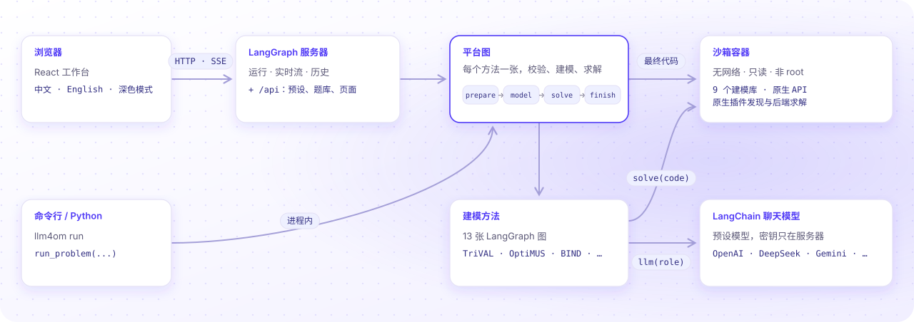
</picture>

平台本身很薄。LLM 调用交给 LangChain，图编排、运行、流式推送和历史交给 LangGraph 服务器（内存运行时，无需许可证）。平台只提供代码契约、求解沙箱、步骤记录和工作台。详见[架构](docs/architecture.md)。

## 文档

| 文档 | 内容 |
|---|---|
| [使用指南](docs/user-guide.md) | 工作台、对比、诊断、预设模型、题库、命令行、Python 接口、常见问题 |
| [部署指南](docs/deployment.md) | Docker Compose、HTTPS、多人使用、用量上限、Gurobi、备份、故障排查 |
| [开发指南](CONTRIBUTING.md) | 环境、项目结构、测试、接入新方法、增加代码写法、发布 |
| [架构](docs/architecture.md) | 模块、平台图、方法接口、沙箱和运行记录 |
| [建模方法](docs/methods.md) | 各方法的流程、固定来源、适配差异和真实运行验证 |
| [架构决策](docs/adr/README.md) · [术语](GLOSSARY.md) | 重要取舍和领域术语 |
| [参考资料](docs/references/README.md) | 相关论文、代码和 Benchmark |

## 参与贡献

欢迎提交 Issue 和 Pull Request。开始前请读[开发指南](CONTRIBUTING.md)和[开发规范](CODING_STANDARDS.md)。安全问题请按 [SECURITY](SECURITY.md) 私下报告。

## 引用

在研究中使用通用智能优化求解器时，可以引用本仓库（见 [CITATION.cff](CITATION.cff)）：

```bibtex
@software{llm4om,
  author  = {Fang, Ziyang},
  title   = {General Intelligent Optimization Solver: A General Solver for Complex Optimization Problems},
  year    = {2026},
  version = {0.43.0},
  url     = {https://github.com/Fangziyang0910/LLM4OM}
}
```

使用其中的某个研究方法时，也请引用原论文。

## 许可

代码采用 [Apache-2.0](LICENSE)。随包分发的第三方提示、代码和数据保留原许可，见 [NOTICE](NOTICE)。LLMOPT 的上游仓库在固定提交上没有声明许可证，其提示收录在本仓库中仅用于研究。

## 致谢

感谢各研究方法的作者公开代码和提示，感谢 [LangChain](https://github.com/langchain-ai/langchain)、[LangGraph](https://github.com/langchain-ai/langgraph)、[Pyomo](https://www.pyomo.org)、[HiGHS](https://highs.dev)、[OR-Tools](https://developers.google.com/optimization)、[CVXPY](https://www.cvxpy.org)、[PySCIPOpt](https://github.com/scipopt/PySCIPOpt)、[CasADi](https://web.casadi.org) 等开源项目。
