<p align="center">
  <picture>
    <source media="(prefers-color-scheme: dark)" srcset="docs/assets/banner-dark.svg">
    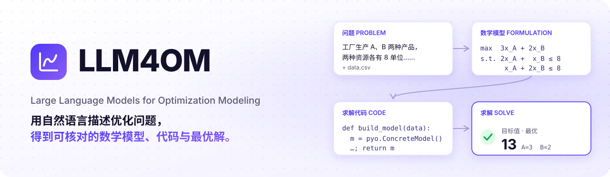
  </picture>
</p>

<p align="center">
  <a href="https://github.com/Fangziyang0910/LLM4OM/actions/workflows/checks.yml"></a>
  
  
  
  
  <a href="LICENSE"></a>
</p>

<p align="center">
  <b>中文</b> · <a href="README.en.md">English</a>
  <br>
  <a href="#快速开始">快速开始</a> ·
  <a href="#建模方法">建模方法</a> ·
  <a href="docs/user-guide.md">使用指南</a> ·
  <a href="docs/deployment.md">部署指南</a> ·
  <a href="CONTRIBUTING.md">开发指南</a> ·
  <a href="CHANGELOG.md">更新日志</a>
</p>

---

**LLM4OM**（Large Language Models for Optimization Modeling）是一个自动优化建模平台。你可以在原工作台配置运行，也可以与优化助手对话、上传数据，由 Agent 调用建模方法，写出数学模型和求解代码，在隔离容器中求解。实际步骤、模型、代码和结果可在旁边的建模工作区查看，也可以继续对话调整条件。

平台内置 **13 种 LLM 建模方法**，包括 Direct、Feedback Repair 两种自有方法，以及 11 种来自公开研究的方法。你不需要手写求解代码，可以直接输入问题、运行建模，再查看模型和结果。

<p align="center">
  
  <br><sub>真实运行：保留原工作台草稿，从独立优化 Agent 使用 DeepSeek · Direct · Pyomo 求解，再通过对话调整条件。</sub>
</p>

## 亮点

| 能力 | 说明 |
|---|---|
| 💬 **对话完成建模** | 从想法沟通到首次求解、结果讨论和条件调整，在同一个 Agent 中完成；可直接指定方法和建模库，手动配置入口仍保留 |
| 🧠 **13 种建模方法** | Direct、Feedback Repair、TriVAL、SAC-Opt、BIND、OptiMind 等；每种方法都有独立 LangGraph 图 |
| 🧩 **9 种建模求解器** | 支持各库原生 API 与多种求解后端，覆盖数学规划、约束规划、路径、网络流和非线性优化 |
| 📝 **需求对话** | 多轮流式聊天，搜索来源按需展开，停止或失败后可重试原问题；确认可编辑需求稿后，交给任意建模方法 |
| 🔍 **全过程可见** | 每次 LLM 调用实时显示；保留中断前已完成的步骤和产物；历史可分页，运行配置固定记录 |
| ⚖️ **多方法对比** | 同一问题一次运行最多 12 个方法或模型，并排比较目标值、用时和 token |
| 💬 **方案解读与条件调整** | 用业务名称展示实际决策数值；一句话修改条件，重新建模并与原方案对比，保留原运行 |
| 🔄 **方案对话与业务场景** | 围绕实际结果多轮追问；改条件时显示实际建模进度和结果卡片，多个场景共用固定基准并排比较 |
| 📊 **建模前检查数据** | 直接编辑 CSV、TSV、JSON 和文本；Excel 转换后可检查表格、补充列名及单位，保存后再建模 |
| 🧯 **无解原因与调整** | 根据实际冲突约束解释业务矛盾；选择并编辑候选调整，再重新建模验证（Gurobi IIS / CPMpy MUS） |
| 🔒 **隔离沙箱** | 生成代码在无网络、只读、非 root 的容器中运行，用完即删 |
| 👥 **团队部署** | 一条 `docker compose up` 启动；预设模型的密钥不出服务器；可选 HTTPS 和用量上限 |
| 🌗 **好用的工作台** | 导出含业务名称、单位和完整数值的 Excel 方案；备注与标签、Markdown 报告、Excel 导入、2033 道公开题、中英文界面、深色模式 |

原工作台继续作为首页，保留问题编辑、配置、运行和检查结果的使用方式。侧栏新增“优化对话”入口（`/agent`）：描述问题或附上数据，助手按需追问，并调用完整建模流程。默认使用 Direct、Pyomo 和自动求解后端，可通过对话指定其他方法或建模库，也可在“建模偏好”中固定选择。计算时展示实际步骤；建模工作区查看数学模型、代码和结果。每个方案独立保存，后续修改保留原方案。两套交互并列提供，共用建模方法与独立运行记录。

## 截图

电脑端可拖动 Agent 和方案助手旁的分隔线，调整对话与建模内容的宽度，刷新后保留布局。查看历史方案时会明确提示，可一键返回当前讨论方案；浏览历史不改变后续计算的基准。运行设置并列展示方法、建模库和模型。

<table>
  <tr>
    <td width="50%">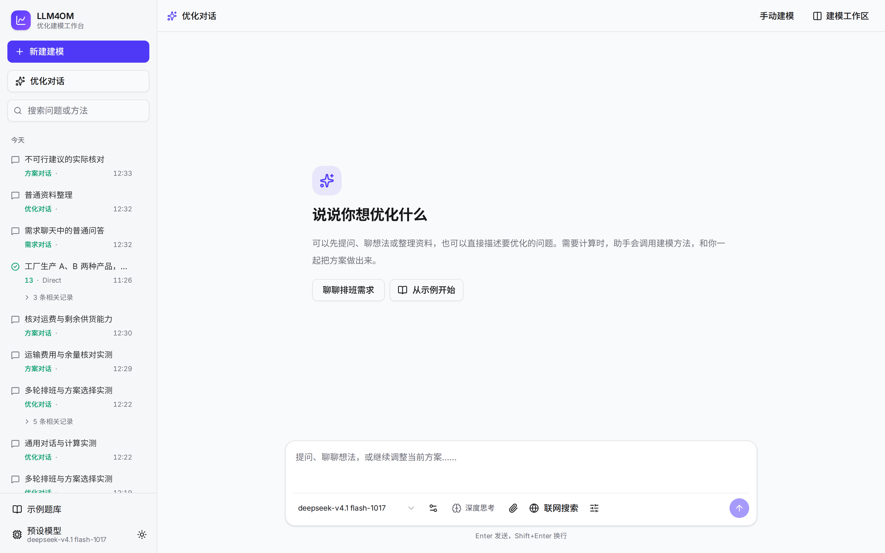<p align="center"><sub>独立 Agent 入口，从一个问题开始</sub></p></td>
    <td width="50%">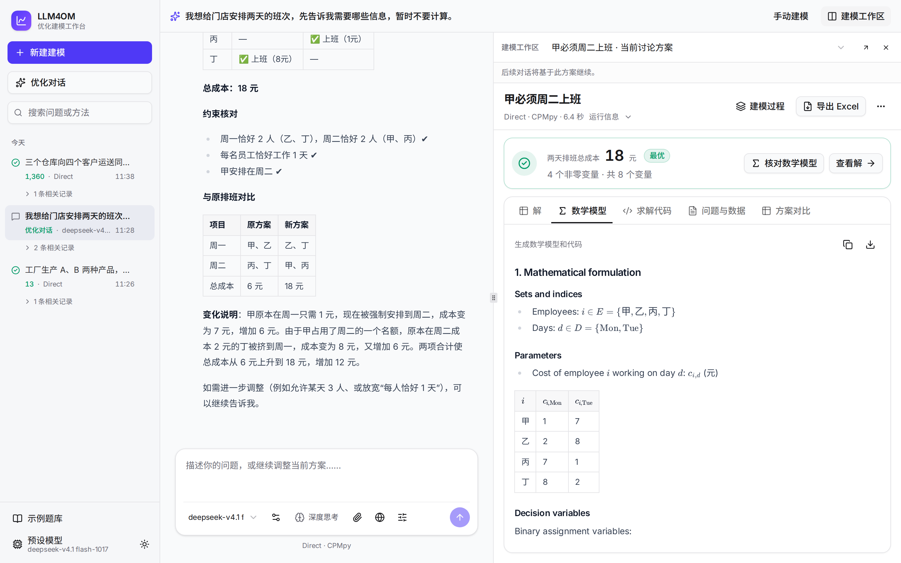<p align="center"><sub>对话完成求解，旁边查看实际模型与结果</sub></p></td>
  </tr>
  <tr>
    <td width="50%">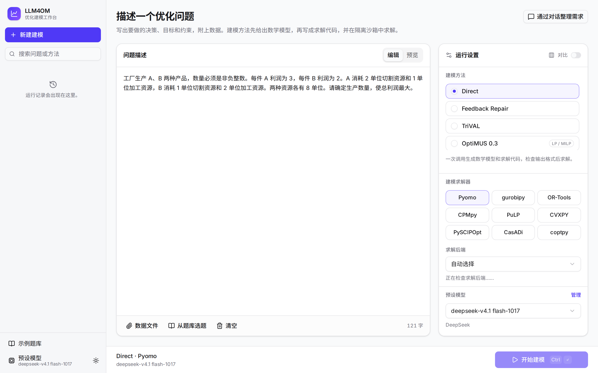<p align="center"><sub>写问题，选择方法、写法和模型</sub></p></td>
    <td width="50%">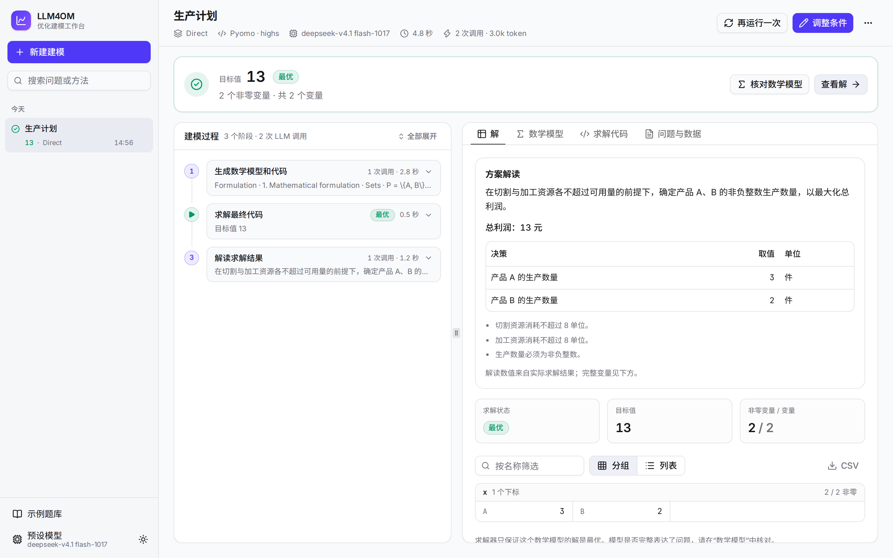<p align="center"><sub>结论先行：目标值、建模过程和解的矩阵</sub></p></td>
  </tr>
  <tr>
    <td colspan="2">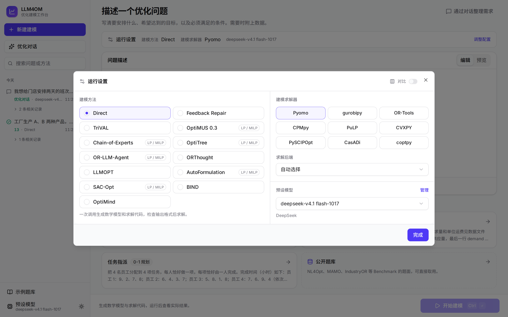<p align="center"><sub>方法、建模库与模型同时可见</sub></p></td>
  </tr>
  <tr>
    <td colspan="2">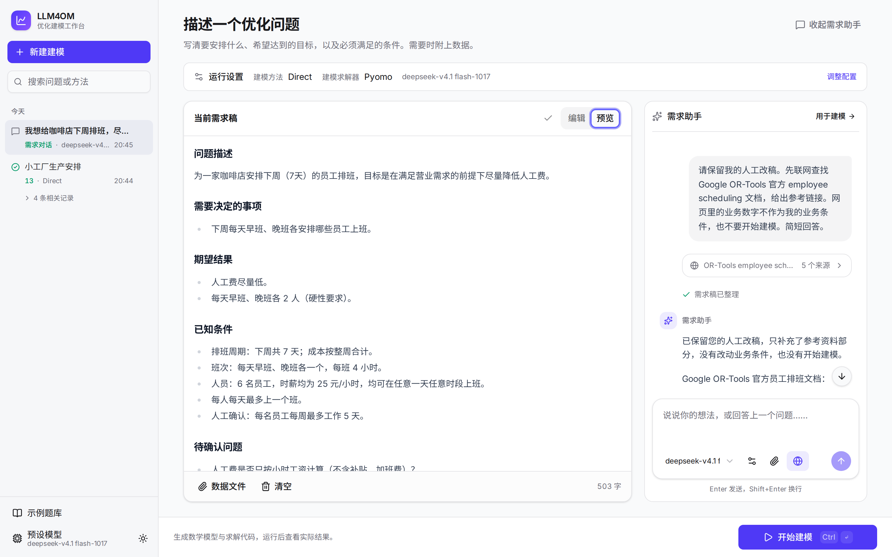<p align="center"><sub>聊天整理业务要求，确认需求稿后再建模</sub></p></td>
  </tr>
  <tr>
    <td>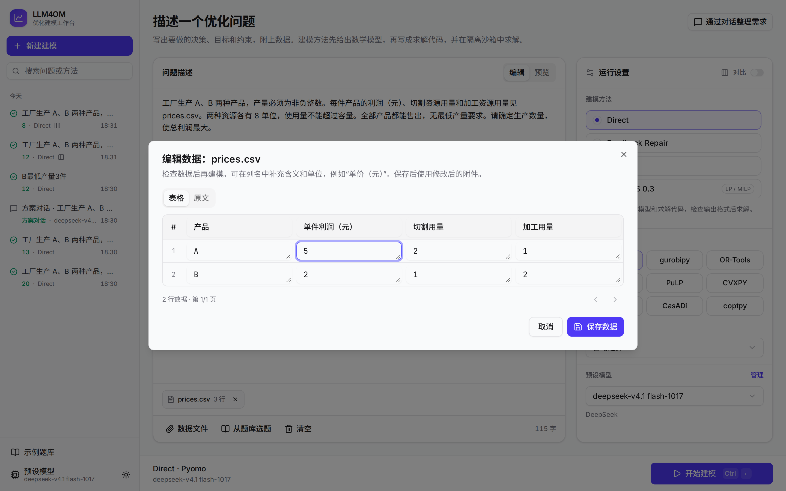<p align="center"><sub>检查表格、补充列名与单位，再建模</sub></p></td>
    <td>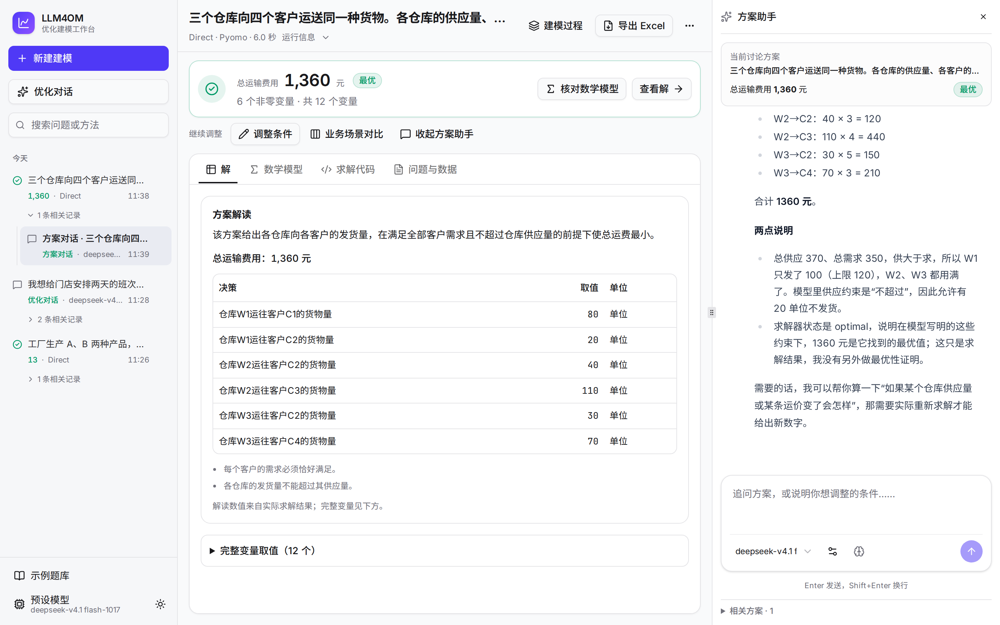<p align="center"><sub>解释实际结果，改变条件后实际计算新方案</sub></p></td>
  </tr>
  <tr>
    <td colspan="2">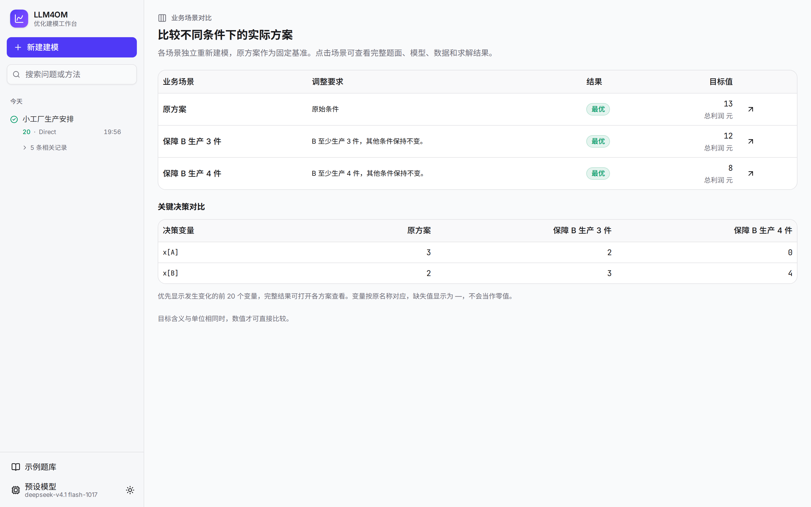<p align="center"><sub>同一份原方案，比较不同业务条件下的实际结果</sub></p></td>
  </tr>
  <tr>
    <td>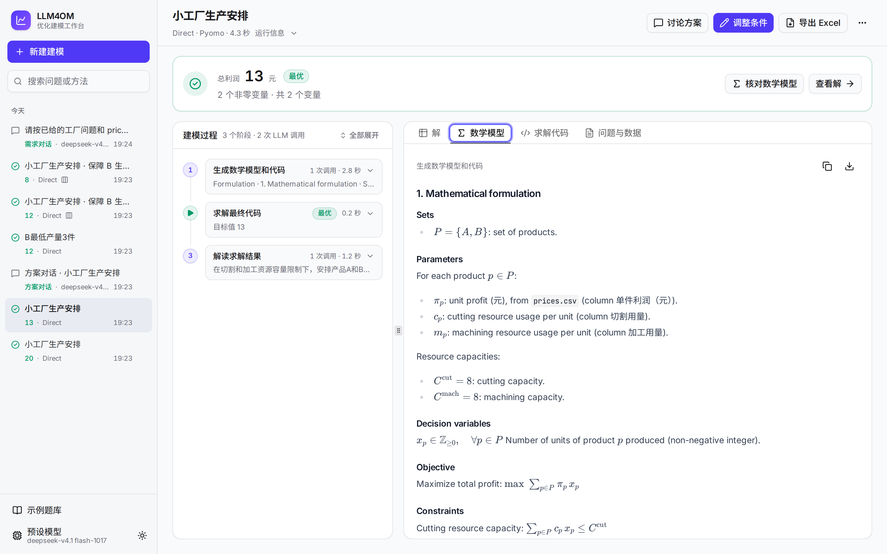<p align="center"><sub>数学模型用 LaTeX 渲染，每一版都能对比</sub></p></td>
    <td>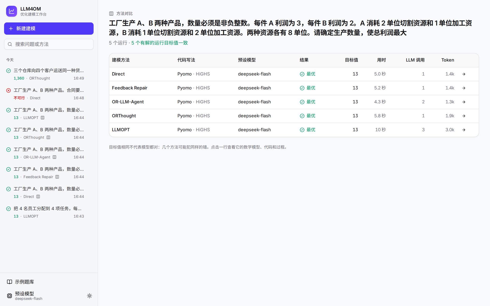<p align="center"><sub>5 种方法同题对比</sub></p></td>
  </tr>
  <tr>
    <td>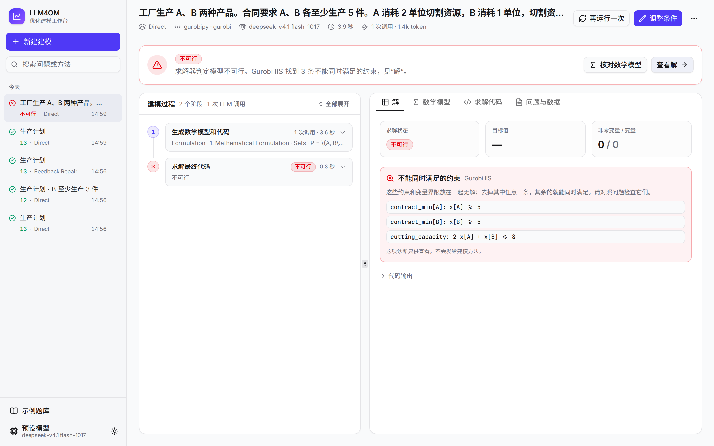<p align="center"><sub>把实际冲突解释成业务要求，选择调整后重新求解</sub></p></td>
    <td>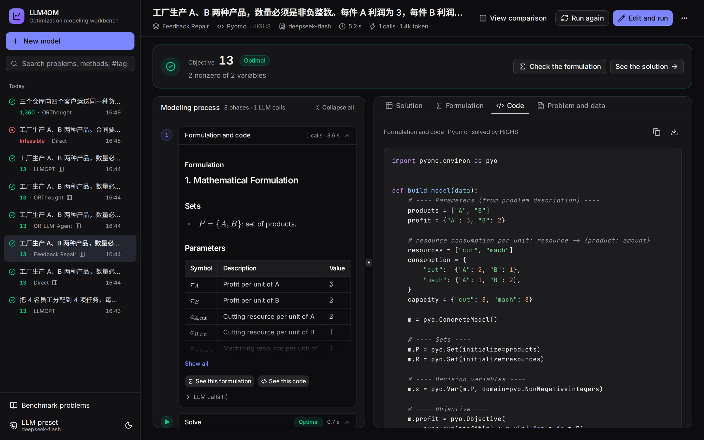<p align="center"><sub>深色模式和英文界面</sub></p></td>
  </tr>
</table>

## 快速开始

### 方式一：Docker（推荐）

只需要 Docker（含 Compose v2.24 或更新版本）：

```bash
git clone https://github.com/Fangziyang0910/LLM4OM.git && cd LLM4OM
cp .env.example .env && chmod 600 .env    # 填写 LLM 服务商、地址、模型和密钥
docker compose up -d --build
```

打开 <http://localhost:8767>。同一网络中的其他人用 `http://<本机 IP>:8767` 访问。HTTPS、备份、用量上限和 Gurobi 许可证见[部署指南](docs/deployment.md)。

### 方式二：本地运行

需要 Python 3.11–3.13、[uv](https://docs.astral.sh/uv/) 和 Docker：

```bash
uv sync --all-extras
uv run llm4om build-worker      # 构建求解沙箱镜像 llm4om-worker:12
uv run llm4om serve --workspace runs/web --port 8767
```

仓库已包含前端构建文件，不需要 Node.js。

### 试一个问题

按下面的步骤使用原有工作台。也可以点击侧栏“优化对话”，直接发送完整问题开始建模。

1. 没有在 `.env` 中设置模型时，点击左下角“预设模型”，添加服务商、密钥和模型 ID。
2. 点击首页的“生产计划”例子，或输入：

   > 工厂生产 A、B 两种产品，数量必须是非负整数。每件 A 利润为 3，每件 B 利润为 2。A 消耗 2 单位切割资源和 1 单位加工资源，B 消耗 1 单位切割资源和 2 单位加工资源。两种资源各有 8 单位。请确定生产数量，使总利润最大。

3. 点击“开始建模”。几秒后，页面给出最优解 A=3、B=2，总利润 13。

附件上传后可点击文件名检查和编辑。求解结束后，点击“讨论方案”继续提问或明确改变条件；通过结果下方的“业务场景对比”可从同一原方案计算多个场景。所有新结果都经过实际建模求解，原记录保留。

如果还只有一个想法，点击“通过对话整理需求”。助手会边聊边整理需求稿；你可以修改文本、附上数据，再点击“用于建模”回到运行设置。建模仍由你点击“开始建模”启动。对话可从历史记录继续。Enter 发送，Shift+Enter 换行；可打开“联网搜索”查阅公开资料并核对来源。DeepSeek 预设直接使用自身搜索接口，其他模型可配合服务端独立搜索密钥（见 `.env.example`）。

也可以在命令行或 Python 中运行：

```bash
uv run llm4om run --problem "……" --method orthought --language pyomo
```

```python
from llm4om import run_problem

state = run_problem("……", method="optimus", language="gurobipy")
print(state["failure"] or state["solve"]["objective"])
```

完整用法见[使用指南](docs/user-guide.md)。

## 建模方法

| 方法 | 流程 | 来源 |
|---|---|---|
| Direct | 一次调用，同时给出数学模型和代码 | 基线 |
| Feedback Repair | 生成、求解、复核题意一致性，按格式、执行或建模问题修正 | 自有方法 |
| TriVAL | 语义、数学模型、代码三阶段验证；每阶段构建、验证、修订 | [代码](https://github.com/SCUT-EIPI/TriVAL/tree/380a529) |
| OptiMUS 0.3 | 提取参数、目标和约束，逐条建模和写代码，组装后调试 | [v0.3 论文](https://arxiv.org/abs/2407.19633) · [代码](https://github.com/teshnizi/OptiMUS/tree/e182e9ef5841605c2a7e87467021fd83522b6484) |
| Chain-of-Experts | 协调者逐个选择专家，汇总器写代码；可选反向反思 | [ICLR 2024](https://openreview.net/forum?id=HobyL1B9CZ) · [代码](https://github.com/xzymustbexzy/Chain-of-Experts/tree/afb89bf602690ea621f13a23c42722f20f653a43) |
| OptiTree | 在问题类型树中匹配建模思路，再生成模型和代码 | [NeurIPS 2025](https://arxiv.org/abs/2510.22192) · [代码](https://github.com/MIRALab-USTC/OptiTree/tree/2e70ecfd0a3c8e9c0c16d36d7d498a7344cfdec9) |
| OR-LLM-Agent | 先数学建模，再生成代码，按执行错误调试，最后检查不可行 | [arXiv](https://arxiv.org/abs/2503.10009) · [代码](https://github.com/bwz96sco/or_llm_agent/tree/5dccdaab89ab91c3cb28066fe849423dc124d287) |
| ORThought | 按专家建模思路写出求解思路、数学模型和代码；出错时带上模型和错误调试 | [arXiv](https://arxiv.org/abs/2508.14410) · [代码](https://github.com/BeinuoYang/ORThought/tree/5293e24861a65d1e4a2f61f4fad0a81de901ee38) |
| LLMOPT | 先写五要素模型，再写代码；LLM 判断对错，回到错的一步重写 | [ICLR 2025](https://arxiv.org/abs/2410.13213) · [代码](https://github.com/antgroup/LLMOPT/tree/1492dd33e39ea13f1afe32a0adc13d4217334195) |
| AutoFormulation | 逐层采样并剪枝建树，再用 MCTS 和两两比较排名（调用量很大） | [ICML 2025](https://arxiv.org/abs/2411.01679) · [代码](https://github.com/jumpynitro/AutoFormulator/tree/52148018d04de23dc2d36d4281eb6244c2a42ffc) |
| SAC-Opt | 语义锚点提取、约束代码回译、比较与选择性修正（独立实现） | [论文](https://proceedings.mlr.press/v306/zhang26cb.html) · [适配说明](src/llm4om/methods/sac_opt/README.md) |
| BIND | 提示只读附件结构，代码读取完整数据，执行失败时修正 | [论文](https://arxiv.org/abs/2605.21751) · [适配说明](src/llm4om/methods/bind/README.md) |
| OptiMind | 公开类型提示、建模、求解反馈与多轮检查 | [论文](https://arxiv.org/abs/2509.22979) · [公开范围](src/llm4om/methods/optimind/README.md) |

各方法固定参考提交并记录差异。SAC-Opt 根据公开算法独立实现；BIND 不使用基准参考答案；OptiMind 接入公开推理流程，提示库目前只有旅行商问题。13 种方法均可选择九个建模库；部分方法保留 LP/MILP 问题范围，库与后端须支持该数学问题。详见[建模方法](docs/methods.md)。

## 建模求解器与后端

一个建模库只算一种建模求解器。只需选择这九个库之一，后端默认自动选择，也可指定。库内 API 由代码表达，平台自动识别原生模型，不需要再选建模接口。后端列表从实际沙箱的原生插件注册表读取，并显示安装状态；增加后端不会增加一级分类。

| 建模求解器 | 原生 API | 后端接入方式 |
|---|---|---|
| Pyomo | Algebraic（ConcreteModel、AbstractModel）、Kernel | 原生 SolverFactory 适配器，包括 HiGHS、CBC、GLPK、Gurobi、SCIP、CPLEX 等 |
| gurobipy | 标量/表达式、矩阵 | Gurobi 原生引擎 |
| OR-Tools | MPSolver、MathOpt、CP-SAT、ModelBuilder、Routing、Constraint Solver、最大流、最小费用流、指派、背包 | 各接口原生支持的引擎和算法 |
| CPMpy | Model、SolverInterface | SolverLookup 注册的 CP、SAT、SMT、MIP、MaxSAT、知识编译等后端及子求解器 |
| PuLP | 行式、列式建模 | 原生 getSolver 注册的 Python、命令行及动态库适配器 |
| CVXPY | DCP、DGP、DQCP | 原生求解器注册表；AUTO 使用 solver_path 选择可执行后端，记录实际引擎 |
| PySCIPOpt | 标量/表达式、矩阵 | SCIP 原生引擎 |
| CasADi | Opti NLP、Opti Conic、nlpsol、qpsol、conic | Nlpsol/Conic 原生插件，包括 Ipopt、SQP、QP 和其他可加载插件 |
| coptpy | 标量/表达式、矩阵 | COPT 原生引擎 |

生成代码定义 `build_model(data)`。常规接口返回原生模型；Routing、网络流端点、Knapsack 和 CasADi 底层接口按约定返回模型或问题参数字典。Worker 调用对应库的原生求解接口，统一读取结果。明确选择的后端不可用时会报错，不会换引擎或放松变量域。

各接口的返回类型、后端探测、部署依赖与验证记录见[建模库与官方接口](docs/references/modeling-libraries.md)。商业后端需要相应许可证或遵守其有限规模模式；可加载不等于许可已验证。非凸 NLP 的局部解、Routing 的启发式解按实际状态展示。

## 架构

<picture>
  <source media="(prefers-color-scheme: dark)" srcset="docs/assets/architecture-zh-dark.svg">
  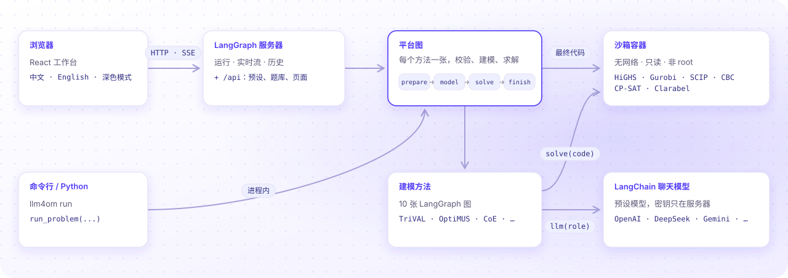
</picture>

平台本身很薄。LLM 调用交给 LangChain，图编排、运行、流式推送和历史交给 LangGraph 服务器（内存运行时，无需许可证）。平台只提供代码契约、求解沙箱、步骤记录和工作台。详见[架构](docs/architecture.md)。

## 文档

| 文档 | 内容 |
|---|---|
| [使用指南](docs/user-guide.md) | 工作台、对比、诊断、预设模型、题库、命令行、Python 接口、常见问题 |
| [部署指南](docs/deployment.md) | Docker Compose、HTTPS、多人使用、用量上限、Gurobi、备份、故障排查 |
| [开发指南](CONTRIBUTING.md) | 环境、项目结构、测试、接入新方法、增加代码写法、发布 |
| [架构](docs/architecture.md) | 模块、平台图、方法接口、沙箱和运行记录 |
| [建模方法](docs/methods.md) | 各方法的流程、固定来源、适配差异和真实运行验证 |
| [架构决策](docs/adr/README.md) · [术语](GLOSSARY.md) | 重要取舍和领域术语 |
| [参考资料](docs/references/README.md) | 相关论文、代码和 Benchmark |

## 参与贡献

欢迎提交 Issue 和 Pull Request。开始前请读[开发指南](CONTRIBUTING.md)和[开发规范](CODING_STANDARDS.md)。安全问题请按 [SECURITY](SECURITY.md) 私下报告。

## 引用

在研究中使用 LLM4OM 时，可以引用本仓库（见 [CITATION.cff](CITATION.cff)）：

```bibtex
@software{llm4om,
  author  = {Fang, Ziyang},
  title   = {{LLM4OM}: A Platform for Automated Optimization Modeling with Large Language Models},
  year    = {2026},
  version = {0.41.1},
  url     = {https://github.com/Fangziyang0910/LLM4OM}
}
```

使用其中的某个研究方法时，也请引用原论文。

## 许可

代码采用 [Apache-2.0](LICENSE)。随包分发的第三方提示、代码和数据保留原许可，见 [NOTICE](NOTICE)。LLMOPT 和 ORThought 的上游仓库在固定提交上没有声明许可证，其提示收录在本仓库中仅用于研究。

## 致谢

感谢各研究方法的作者公开代码和提示，感谢 [LangChain](https://github.com/langchain-ai/langchain)、[LangGraph](https://github.com/langchain-ai/langgraph)、[HiGHS](https://highs.dev)、[OR-Tools](https://developers.google.com/optimization)、[CPMpy](https://github.com/CPMpy/cpmpy)、[CVXPY](https://www.cvxpy.org) 等开源项目。
