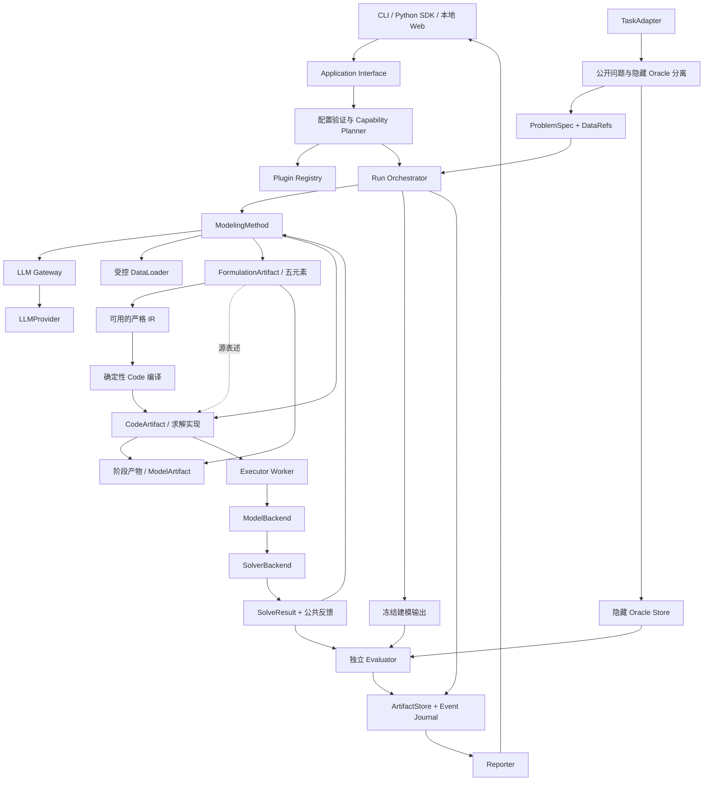
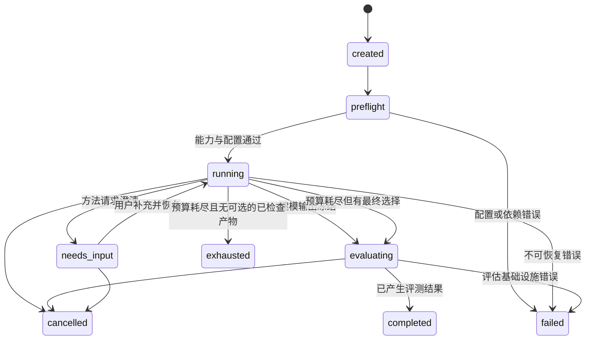

# LLM4OM 架构设计

文档修订：0.4.0。本文为实现目标，接口规范见 [插件契约](plugin-contracts.md)，执行细节见 [详细设计](detailed-design.md)，范围以 [需求规格](requirements/v1.0.md) 为准。

## 0. 领域主流程与架构目标

系统围绕自然语言问题的建模与求解组织：公开问题与数据 → 指定方法的 Formulation → Code → 模型构建与求解 → 决策结果和可检查记录。Benchmark 是这条流程的批量实验用法，CLI 与 Web 是同一流程的两种入口。

从研究角度，方法、LLM、模型表示、数据绑定、数值求解和评测是独立变化的因素。从开发角度，它们分别映射为小接口与适配器。算法搜索、多 Agent 角色和自评机制封装在方法内，不进入调度内核。

| 架构层 | 领域含义 | 主要接口／对象 |
|---|---|---|
| 用户入口 | 建模使用、模型检查与实验比较 | CLI、Web、Python SDK |
| 应用流程 | 单问题运行与批量实验 | run_problem、run_experiment、RunBundle |
| 自动建模 | Formulation／Code 的生成、修正与选择 | ModelingMethod、LLMProvider、建模步骤 |
| 模型与数据 | 五元素数学表述、求解实现与数据绑定 | ProblemSpec、ModelArtifact、FormulationArtifact、CodeArtifact、DataRef |
| 优化执行 | 模型构建、数值求解与公开反馈 | Compiler、ModelBackend、SolverBackend、Executor |
| 科研评测 | 参考比较、独立检查与统计 | TaskAdapter、Evaluator、EvaluationResult |

每层的具体流程与不变量见 DD-01～DD-08。采用这些接口的依据见 [研究综述](research-landscape.md)，而非假定领域中的每个方法天然满足当前契约。

这些是需要用不同实现验证的目标接口。开发先实现一条完整路径，再以第二种方法、Provider 或 Solver 检验 Seam；不因本图存在一个模块就预先建立空包。代码设计准则由 [开发规范](../CODING_STANDARDS.md)维护，关键取舍由 [ADR](decisions-and-open-questions.md#3-已记录的关键架构取舍)维护。

## 1. 架构原则

1. **核心只编排契约**：不根据 `if method == optimus` 等分支写厂商或论文逻辑。
2. **方法与资源独立**：方法决定生成、修正与选择策略；Provider、Executor、Solver 等提供受预算控制的能力。
3. **两条产物路径**：结构化 IR 与原生代码共存，能力不同需要公开声明。
4. **反馈与评分分离**：方法能读取公开执行反馈，隐藏参考材料只供独立评估。
5. **证据比成功标记重要**：运行完成、模型最优、参考匹配与语义正确分别表达。
6. **阶段可观察，策略封装在方法内**：Formulation／Code 有独立输入输出与资源关联，方法可联合生成或往返修正；不新增两个固定 Agent 或强制两次调用。
7. **保持小接口与深模块**：插件内部可以包含多 Agent、搜索树或多个提示；核心不用理解其内部实现。

## 2. 模块与可替换位置（Seam）

Formulation 与 Code 的阶段含义统一，实际步骤由方法决定。五元素文本由方法转换为实现；严格 IR 走确定性编译。旧方法只提供代码时仍可接入，数学表述标为不可用或来源明确的派生视图。图中反馈回路是否发生、发生几次由方法决定。CLI／Web 的批量入口不能重新实现另一套方法或评分流程。

建模输出已有与当前配置一致的执行记录时直接复用；否则由同一 Execution Gateway 补齐构建与求解。建模输出在隐藏评分前冻结。用户问题没有 oracle 时仍可完成建模与求解，独立证据为不可用。

| 模块 | 持有的职责 | 不持有的职责 |
|---|---|---|
| Application | SDK 用例、CLI／Web 输入转换、呈现产物 | 方法内部提示、求解算法、私有评分 |
| Registry | 发现插件、版本与 ID 冲突、配置结构与能力描述 | 默认替换不兼容插件 |
| Capability Planner | 运行前建立表示→编译→建模→求解→评测路径 | 用 LLM 猜测接口可用性 |
| Orchestrator | 状态机、预算、检查点、建模输出冻结、调用评估 | Agent 角色、MCTS 节点选择等方法实现 |
| Method Adapter | Formulation／Code 生成、阶段修正、最终选择与原方法状态 | 访问 oracle、在核心包注册特殊分支 |
| LLM Gateway | 提供方接口、受控重试、用量、日志脱敏 | 未声明的模型路由或隐式改变提示 |
| Data Gateway | 数据权限、有限视图、类型／哈希校验 | 将参考答案提供给方法 |
| Execution Gateway | 建立执行请求、资源限制、收集反馈 | 依赖不可信 stdout 直接认定正确 |
| Compiler／ModelBackend／Solver | 各自表示转换、模型构建、数值求解 | 自行修正业务含义 |
| Evaluator | 按版本化协议评分、给出证据与不可用原因 | 反馈参考目标以帮助方法做最终选择 |
| ArtifactStore／Reporter | 产物寻址、事件持久化、汇总导出 | 将无证据字段填写为通过或零成本 |

## 3. 当前源码职责

当前采用单个Python包和本机Web工作台。按实际职责集中实现，不按每一种插件预先建立目录。

| 位置 | 职责 | 主要调用方向 |
|---|---|---|
| `application.py` | 单问题运行、报告、恢复与派生运行 | 调用公开检查流水线、方法资源、admission与存储 |
| `checks.py` | 阶段产物保存、编译、执行及中断阶段核对 | 使用Compiler、Executor、脚本执行和公共记录 |
| `method_resources.py` | 方法的预算、公开检查、最终选择与公开记录 | 调用公开检查流水线，不反向调用application |
| `script_execution.py` | 原生脚本执行、独立收集及已有结果复用 | 使用admission资源与公共记录 |
| `providers.py` | 凭据加载、Provider适配及HTTP通信 | 保留提供方接口；运行Gateway在独立模块 |
| `gateway.py` | LLM调用预算、私有资源日志、恢复与检查点回调 | 通过Provider调用；不持有方法策略 |
| `run_records.py` | 公共运行引用的namespace、hash、大小及引用图校验 | 应用、公开检查、脚本和Web共用；私有评测引用仍由Evaluator读取 |
| `runtime_identity.py` | SDK源码身份 | 运行、任务与批量实验共用 |
| `workbench.py` | 内置方法的工作台默认配置与说明 | Web bootstrap提供模板；兼容性由Manifest和Planner验证 |
| `benchmarks.py` | 平台内置公开题面目录、分页与单问题输入 | 随包题面直接复用 OPT-Agent 管理器输出；不读取工作区导入或私有参考 |
| `frontend/src/App.tsx` | 启动配置、导航与页面组合 | 组合问题编辑、运行查看与数据集浏览 |
| `frontend/src/useRunSnapshot.ts` | 任务及版本选择、顺序轮询、过期响应过滤 | 通过已有HTTP接口读取运行 |
| `frontend/src/components/ProblemEditor.tsx` | 问题、上传、有效配置与检查 | 表单只维护一份有效配置；JSON草稿显式应用 |
| `frontend/src/components/RunView.tsx` | 运行结果、版本与产物展示 | 复用已有展示组件与修订编辑 |
| `frontend/src/components/RevisionEditor.tsx` | 修订模板、编辑文档和派生提交 | 旧模板响应失效；运行版本变化后重新载入 |

Formulation／Code与方法、Provider、Backend、Solver的公共契约保持不变。阶段产物的不同执行路径共用产物与结果校验；脚本仍执行独立可信收集。历史运行可以继续浏览，严格恢复仍核对保存的源码、配置与资源身份，源码变化不会隐式重放旧请求。

## 4. Formulation 与 Code 的实现路径

### 4.1 默认五元素与结构化 Code 路径

`ProblemSpec → FormulationArtifact（五元素＋可用 GroundedLPIR）→ Compiler → CodeArtifact（Pyomo 工厂）→ ModelBackend → Solver`。

五元素记录集合、参数、变量、目标和约束，作为默认可读数学表述。文本公式本身不进入确定性编译器；代码阶段由方法生成后端实现，或使用明确提供的严格 IR。阶段字段由契约维护，选择依据见 [ADR-0004](adr/0004-formulation-and-code.md)。

LPIR 0.1 表达具体实例的已展开线性模型。它的常数与系数已绑定到某份数据哈希；同一 IR 不能在换数据后默认为同一模型。重新绑定需要产生新 revision 并重新验证。1.0 不设计任意表达式求值器或 Python `eval`。

编译结果包含变量／约束 ID 到生成代码、后端模型名称的映射；求解解向量必须能够映射回 IR。编译器正确性采用手算 fixture、变量域／常数项／目标方向检查及跨后端对比验收。

独立Compiler的选择与宿主／Worker身份校验已进入SDK0.20.0，实际profile及本机证据见 [S03-C3a](development/s03-compiler-registry.md)。Backend／Solver的独立注册仍按完整计划推进。

### 4.2 工厂与原生代码路径

方法的 Code 步骤可以直接生成 Python 工厂 `build_model(data)` 返回声明后端的模型对象，平台在隔离 Worker 内掌握求解调用与结果收集。模型对象只在 Worker 内存在，不作为跨进程传输契约。

历史方法可能生成含求解调用的完整脚本。Legacy Adapter 负责运行、记录原始日志、抽取模型／解／solver 状态，明确结果可信来源；若不能得到独立检查所需解向量，评测只能提供有限证据。不能将原生代码二次 LLM 转换后仍命名为原论文方法。

领域 DSL 可以作为 Formulation 的扩展表示，其模板、约束特征与求解适配范围单独声明；首批不承诺 DSL 路径。代码转 IR 是单独的可选 Adapter，失败不阻止代码运行，也不得把推断出的 IR 当成经验证的原始模型。切换求解器只在 Planner 找到受支持路径时成立。

## 5. 公开与私有数据平面

TaskAdapter 在导入端输出 EvaluationCase；Orchestrator 创建 MethodContext 时只投影出 PublicProblem。oracle 存于独立 namespace，Method、LLM 调用环境和执行容器均不能读取。

ArtifactStore 的公开读取接口不能仅靠用户提供路径控制；运行层分配只读公开引用集合，拒绝跨 namespace 引用。隐藏 oracle 不写进公开检查点、LLM trace 或可下载 RunBundle。Evaluator 读取隐藏材料后，公开的是允许的评分证据与摘要，不自动导出受限参考模型。

**一段 Python 插件代码不能靠 Protocol 获得可信隔离。** 自己安装的方法插件视为受信任平台代码；生成的代码始终视为不受信任。对第三方恶意方法的强隔离、供应链攻击及多租户权限不是 1.0 的完整保证。对公平评测仍必须做到 Context 无 oracle、工作目录无 oracle、私有文件不进入容器或提供方调用。

方法可得到语法错误、缺失数据、模型 infeasible 等公开反馈。隐藏 objective match、独立 oracle 的约束或 ground truth 不作为默认修正反馈。允许公开验证器的实验必须单独标记协议与提供的信息。

## 6. 执行模型

LLM 调用在宿主受控 Gateway 完成，密钥不进入生成代码 Worker。容器仅挂载公开数据为只读、当前检查工作目录为可写，禁用网络、限制 CPU／内存／wall time／输出字节，不挂载宿主 Docker socket。

`trusted_local` 模式只供已知 fixture 或用户明确选择的可信脚本；所有报告注明模式。容器未准备好时默认拒绝生成代码执行，不自动降级。合法 Gurobi 许可证由受控执行环境配置；会暴露给生成代码的环境内容必须最小化，许可证配置方案由后端实现说明。

运行调度与执行 Worker 分离；Worker OOM、timeout、异常或退出后调度器记录结果，继续其他任务。取消停止新任务与新调用，向正在执行的工具发送取消信号，再强制清理 Worker；供应方无法取消的请求记录晚到响应及消耗，不能复活已取消 run。

## 7. 运行状态与公开检查状态

`completed` 不等于正确。问题无解、目标不匹配或语义未知都可以是 completed 的评测结果。公开检查合法性、执行阶段与 solve_status 属于公开检查结果，不复用 run_status。批量无交互下的 needs_input 归一化为终态 `unresolved`。

## 8. 事件、检查点与恢复

方法阶段事件另有 stage、输入／输出引用和 call_ids；联合调用共享 call_id，真实 attempts 不重复入账。每个事件有 schema_version、run_id、event_id、递增序号、UTC 时间、check_id、类型与脱敏载荷。JST 只用于人类报告呈现；序号决定顺序，不能靠墙钟排序避免时钟漂移。

发送外部调用前记录 call_id 与预算预留；取得响应后先保存响应，再记录完成事件。恢复优先复用已保存响应。崩溃发生在供应方处理后、响应持久化前时，无法保证 exactly-once：标记 `outcome_unknown`，保守计费／预算，按显式恢复策略决定是否再次调用。界面与报告应呈现此不确定性。

恢复需要 Method 声明 checkpoint 能力，校验插件版本和问题哈希；不支持恢复的方法只能创建派生 run 重新运行，不能叫“继续原状态”。变更模型、提示、数据、方法参数或后端创建新的 run fingerprint。

澄清中确认已有声明可以追加公开回答记录并恢复；新增或改变业务规则时建立新的问题 revision 和派生 run，保持原实验输入不可变。无交互 benchmark 不使用隐藏材料代替回答。

## 9. 复现层次与缓存

- **产物回放**：重读保存记录，报告标记 `replay`，不计入新实验样本。
- **确定性阶段复现**：相同 IR／编译配置／依赖与数据，重编译与重求解，并在容差内检查结果。
- **完整方法重跑**：重新调用真实模型；固定 seed 不保证远程模型输出一致，保存不可控模型别名变化与温度配置。

缓存键至少包含问题／数据哈希、方法与插件版本、模型标识、调用配置、提示／工具定义、编译／求解设置、协议版本和执行模式。费用未知、响应来源或模型别名未知时要记录不确定性；错误缓存不跨 run 隐式复用。报告同时给出调用实际发生与缓存命中的资源。

## 10. 后续扩展的接入点

后续算法选择／算法设计消费 ModelArtifact 与模型特征，不直接绑到当前聊天 UI。新的问题类型采用新 IR schema 或代码产物及能力声明；新的 SolverBackend 消费声明兼容的 Code／ModelHandle，不改变公开问题语义；新的评估器消费已有证据并声明新增 oracle 要求。数据合成与训练是独立模块，不能混进测试 split 的建模工作流。

## 11. CLI/Web 与本地部署

本地进程持有应用接口、运行调度、可信方法插件和模型调用凭据；生成代码在隔离 Worker 运行。私有评测材料由评估模块受控读取，不进入方法 Context 或 Worker 挂载。单机部署不需要消息队列或独立微服务。

Web 只管理问题输入、配置选择与结果呈现。其后台任务调用同一应用接口，状态来自运行事件和存储；CLI 离开前台或 Web 页面刷新不会改变方法策略。1.0 可以轮询进度，传输技术不成为领域契约。

Web 的主要可视化对象是问题、数学表述／代码阶段产物、数据绑定、决策解、求解状态和平台内置样例。样例可以逐条浏览、复制或带入单问题输入；批量实验通过 CLI 完成。数学视图不可提取时明确显示未提供；不会以一段聊天回复代替结构化产物。完整页面与用例映射见 DD-08。

## 12. 方法路线与外部模型

科研方法可按基于提示、基于训练及混合路线描述，分类作为来源信息，不成为核心插件种类。OptiMUS／CoE 的角色和反馈组织留在方法内，外部 LLM 经共同 Gateway 调用。当前不集成任务专用训练权重；复用训练类工作的提示或流程时记录独立变体与原模型差异，未来微调模型仍使用同一 LLM 接口。
