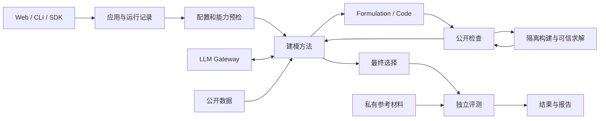

# 系统架构

LLM4OM 用共同应用流程连接问题、方法、LLM、建模产物和求解器。接口字段见[契约](plugin-contracts.md)，调用时序见[详细设计](detailed-design.md)。

## 职责与数据流

方法内部管理专家路由、搜索和修正。核心管理预算、状态、检查、最终输出和持久化。原生代码与严格 IR 共用阶段记录，分别走其声明的执行路径。

| 模块 | 主要职责 |
|---|---|
| Application | SDK 用例、输入转换、流程衔接和结果 |
| Registry / Planner | 发现插件，校验配置、能力、依赖与执行路径 |
| ModelingMethod | 组织提示、角色、生成、修正和选择 |
| LLM Gateway | 凭据隔离、调用、预算、重试、用量与恢复 |
| DataLoader | 原数据校验、有限视图和数据来源 |
| 公开检查资源 | 保存阶段产物，编译、执行、求解及返回诊断 |
| Compiler / ModelBackend / Solver | 确定性转换、模型构建和数值优化 |
| Evaluator | 最终选择后按独立协议评测 |
| ArtifactStore / Reporter | 持久化、引用、事件和公开报告 |

## 独立配置

方法、LLM、建模后端和求解器分别配置。方法接收已预检的代码目标，组合阶段提示与后端要求。生成模型工厂后，由平台调用所选求解器。

Pyomo 工厂可连接 HiGHS、Gurobi 和 OR-Tools/SCIP。gurobipy 工厂使用 Gurobi。能力规划拒绝不兼容组合，不通过改写代码或替换方法掩盖失败。取舍见 [ADR-0003](adr/0003-independent-plugin-axes.md)。

## 数学表述与求解实现

Formulation 表达问题的数学含义，Code 保存计算实现。默认数学表述使用五元素；方法也可以保留声明的原生表述。缺少阶段时明确标为不可用。

严格 LPIR 可确定性编译为 Pyomo 工厂。自由文本公式由方法生成代码，不作为任意表达式执行。参数化工厂从公开数据字节构建实例；换数据要形成新的绑定和修订。

工厂导出视图及 MPS 保留提取来源。它们用于校验和可信求解，不证明源代码与原问题等价。取舍见 [ADR-0001](adr/0001-dual-artifact-paths.md)和 [ADR-0004](adr/0004-formulation-and-code.md)。

## 信任边界

TaskAdapter 在导入端分开公开问题和私有参考材料。方法、LLM 提示及 Worker 仅获得公开投影。隐藏材料只由评估端读取，最终选择不能依赖隐藏答案。

已安装 Python 插件属于可信平台代码。生成代码始终视为不可信，在无网络、只读和受限资源的容器子进程中运行。可信父进程验证模型并独立调用求解器。密钥不进入 Worker。

容器不可用时拒绝生成代码执行，不自动降级。显式 `trusted_local` 只处理平台的受信任严格 IR 路径。边界见 [ADR-0002](adr/0002-oracle-isolation.md)和 [ADR-0005](adr/0005-factory-collector-isolation.md)。

## 状态与恢复

运行、阶段和求解状态分别记录。`completed` 表示流程完成，不等于业务模型正确。等待输入、预算耗尽、取消、执行失败和评测错误有不同结果。

事件按递增序号排序，时间戳保存 UTC。事件顺序不依赖显示时区。

外部调用先保存尝试和预算预留，再发送请求。响应和结果持久化后，恢复复用相同身份的记录。未知外部结果保留预留，不自动重发。严格恢复核对 SDK、插件、数据、配置和 Worker 身份。

阶段产物和公开检查分别保存。只改代码时复用原数学表述；最终选择指向真实已检查组合。同一运行内的修正不计为 Pass@k 样本。取舍见 [ADR-0006](adr/0006-modeling-process-replaces-candidate.md)。

## 源码导航

| 位置 | 责任 |
|---|---|
| `application.py` | 单问题、恢复和派生用例 |
| `checks.py / method_resources.py` | 产物保存、公开检查、选择和预算 |
| `script_execution.py` | 原生脚本与独立收集 |
| `providers.py / gateway.py` | 文本协议、凭据、调用资源和日志 |
| `plugins.py / preflight.py` | 注册与运行前校验 |
| `run_records.py / runtime_identity.py` | 公开引用验证与源码身份 |
| `benchmarks.py` | 随包题库和公开问题输入 |
| `web.py / workbench.py` | HTTP 工作区与页面预设 |
| `frontend/src/` | 问题输入、运行与阶段产物展示 |

当前采用单 Python 包、本地文件存储和一个 Web 前端。单机使用无需独立队列或微服务。开发入口见 [CONTRIBUTING](../CONTRIBUTING.md)。
