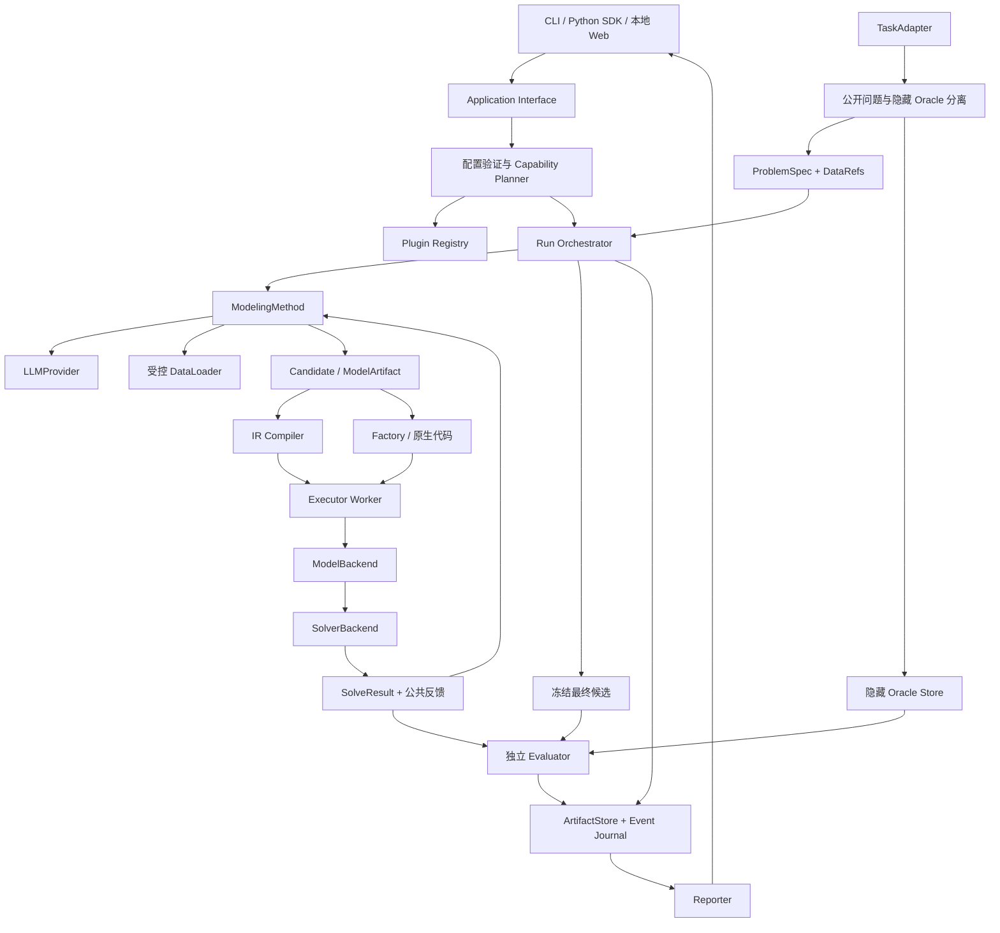
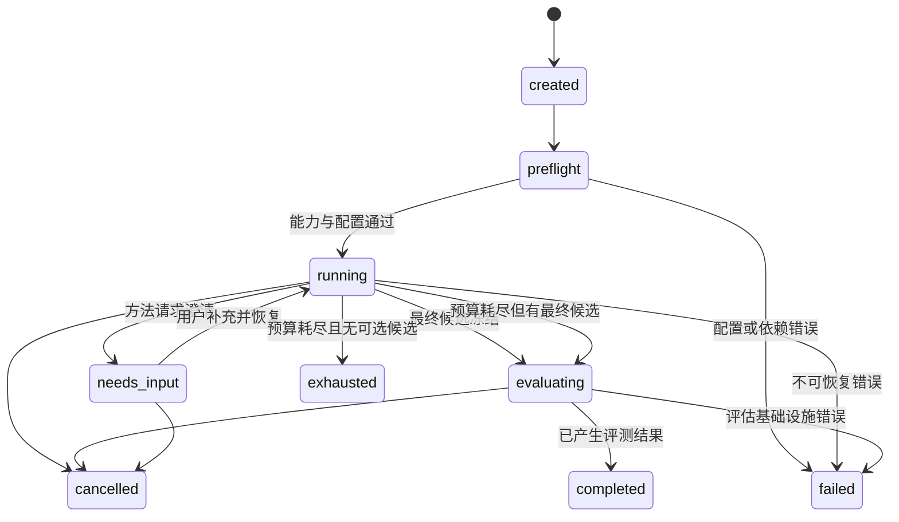

# FormuMesh 架构设计

设计版本：0.1.0。本文为实现目标，接口规范见 [插件契约](plugin-contracts.md)，范围以 [需求规格](requirements/v1.0.md) 为准。

## 1. 架构原则

1. **核心只编排契约**：不根据 `if method == optimus` 等分支写厂商或论文逻辑。
2. **方法与资源独立**：方法决定生成、修正与选择策略；Provider、Executor、Solver 等提供受预算控制的能力。
3. **两条产物路径**：结构化 IR 与原生代码共存，能力不同需要公开声明。
4. **反馈与评分分离**：方法能读取公开执行反馈，隐藏参考材料只供独立评估。
5. **证据比成功标记重要**：运行完成、候选最优、参考匹配与语义正确分别表达。
6. **保持小接口与深模块**：插件内部可以包含多 Agent、搜索树或多个提示；核心不用理解其内部实现。

## 2. 模块与可替换位置（Seam）



图中反馈回路是否发生、发生几次由方法决定。CLI／Web 的批量入口不能重新实现另一套方法或评分流程。

| 模块 | 持有的职责 | 不持有的职责 |
|---|---|---|
| Application | SDK 用例、CLI／Web 输入转换、呈现产物 | 方法内部提示、求解算法、私有评分 |
| Registry | 发现插件、版本与 ID 冲突、配置结构与能力描述 | 默认替换不兼容插件 |
| Capability Planner | 运行前建立表示→编译→建模→求解→评测路径 | 用 LLM 猜测接口可用性 |
| Orchestrator | 状态机、预算、检查点、最终候选冻结、调用评估 | Agent 角色、MCTS 节点选择等方法实现 |
| Method Adapter | 候选生成／修正／选择、原方法特有状态 | 访问 oracle、在核心包注册特殊分支 |
| LLM Gateway | 提供方接口、受控重试、用量、日志脱敏 | 未声明的模型路由或隐式改变提示 |
| Data Gateway | 数据权限、有限视图、类型／哈希校验 | 将参考答案提供给方法 |
| Execution Gateway | 建立执行请求、资源限制、收集反馈 | 依赖不可信 stdout 直接认定正确 |
| Compiler／ModelBackend／Solver | 各自表示转换、模型构建、数值求解 | 自行修正业务含义 |
| Evaluator | 按版本化协议评分、给出证据与不可用原因 | 反馈参考目标以帮助方法选候选 |
| ArtifactStore／Reporter | 产物寻址、事件持久化、汇总导出 | 将无证据字段填写为通过或零成本 |

## 3. 模块包结构建议

这是未来结构，不是当前已实现目录：

```text
src/formumesh/
  contracts/        # immutable data objects / errors / protocol versions
  application/      # SDK use cases, run/experiment/report
  core/             # registry, planning, orchestration, budgets, events
  plugins/
    methods/        # direct, feedback_repair, optimus
    providers/      # openai_compatible, anthropic, mock
    tasks/          # user_problem, nl4opt, industryor
    data/           # csv, json
    compilers/      # lp_ir_to_pyomo
    model_backends/ # pyomo_factory, native_gurobipy
    solvers/        # highs, gurobi
    evaluators/     # structural, objective_match, independent_checker
    executors/      # container, trusted_local
    stores/         # filesystem
    reporters/     # jsonl, csv, markdown, html
  cli/
  web/
tests/
  contracts/
  fixtures/
  integration/
  external/
```

Core 依赖 contracts，不依赖具体 Provider／Solver SDK。插件依赖 contracts 与窄的资源 Context；入口依赖 application。插件之间需要协作时经声明接口，不直接导入另一插件的内部类。外部插件通过 entry points 安装，避免强制修改 `plugins/`。

## 4. 两条建模产物路径

### 4.1 结构化路径

`ProblemSpec → Method → GroundedLPIR → Compiler → Pyomo Factory → ModelBackend → Solver`。

LPIR 0.1 表达具体实例的已展开线性模型。它的常数与系数已绑定到某份数据哈希；同一 IR 不能在换数据后默认为同一模型。重新绑定需要产生新 revision 并重新验证。1.0 不设计任意表达式求值器或 Python `eval`。

编译结果包含变量／约束 ID 到生成代码、后端模型名称的映射；求解解向量必须能够映射回 IR。编译器正确性采用手算 fixture、变量域／常数项／目标方向检查及跨后端对比验收。

### 4.2 工厂与原生代码路径

首选 Python 工厂 `build_model(data)` 返回声明后端的模型对象，平台在隔离 Worker 内掌握求解调用与结果收集。模型对象只在 Worker 内存在，不作为跨进程传输契约。

历史方法可能生成含求解调用的完整脚本。Legacy Adapter 负责运行、记录原始日志、抽取模型／解／solver 状态，明确结果可信来源；若不能得到独立检查所需解向量，评测只能提供有限证据。不能将原生代码二次 LLM 转换后仍命名为原论文方法。

代码转 IR 是单独的可选 Adapter，失败不阻止代码运行，也不得把推断出的 IR 当成经验证的原始模型。切换求解器只在 Planner 找到受支持路径时成立。

## 5. 公开与私有数据平面

TaskAdapter 在导入端输出 EvaluationCase；Orchestrator 创建 MethodContext 时只投影出 PublicProblem。oracle 存于独立 namespace，Method、LLM 调用环境和执行容器均不能读取。

ArtifactStore 的公开读取接口不能仅靠用户提供路径控制；运行层分配只读公开引用集合，拒绝跨 namespace 引用。隐藏 oracle 不写进公开检查点、LLM trace 或可下载 RunBundle。Evaluator 读取隐藏材料后，公开的是允许的评分证据与摘要，不自动导出受限参考模型。

**一段 Python 插件代码不能靠 Protocol 获得可信隔离。** 自己安装的方法插件视为受信任平台代码；生成的代码始终视为不受信任。对第三方恶意方法的强隔离、供应链攻击及多租户权限不是 1.0 的完整保证。对公平评测仍必须做到 Context 无 oracle、工作目录无 oracle、私有文件不进入容器或提供方调用。

方法可得到语法错误、缺失数据、候选模型 infeasible 等公开反馈。隐藏 objective match、独立 oracle 的约束或 ground truth 不作为默认修正反馈。允许公开验证器的实验必须单独标记协议与提供的信息。

## 6. 执行模型

LLM 调用在宿主受控 Gateway 完成，密钥不进入生成代码 Worker。容器仅挂载公开数据为只读、当前候选工作目录为可写，禁用网络、限制 CPU／内存／wall time／输出字节，不挂载宿主 Docker socket。

`trusted_local` 模式只供已知 fixture 或用户明确选择的可信脚本；所有报告注明模式。容器未准备好时默认拒绝生成代码执行，不自动降级。合法 Gurobi 许可证由受控执行环境配置；会暴露给生成代码的环境内容必须最小化，许可证配置方案由后端实现说明。

运行调度与执行 Worker 分离；Worker OOM、timeout、异常或退出后调度器记录结果，继续其他任务。取消停止新任务与新调用，向正在执行的工具发送取消信号，再强制清理 Worker；供应方无法取消的请求记录晚到响应及消耗，不能复活已取消 run。

## 7. 运行状态与候选状态



`completed` 不等于正确。问题无解、目标不匹配或语义未知都可以是 completed 的评测结果。候选合法性、执行阶段与 solve_status 属于候选结果，不复用 run_status。批量无交互下的 needs_input 归一化为终态 `unresolved`。

## 8. 事件、检查点与恢复

每个事件有 schema_version、run_id、event_id、递增序号、UTC 时间、candidate_id、类型与脱敏载荷。JST 只用于人类报告呈现；序号决定顺序，不能靠墙钟排序避免时钟漂移。

发送外部调用前记录 call_id 与预算预留；取得响应后先保存响应，再记录完成事件。恢复优先复用已保存响应。崩溃发生在供应方处理后、响应持久化前时，无法保证 exactly-once：标记 `outcome_unknown`，保守计费／预算，按显式恢复策略决定是否再次调用。界面与报告应呈现此不确定性。

恢复需要 Method 声明 checkpoint 能力，校验插件版本和问题哈希；不支持恢复的方法只能创建派生 run 重新运行，不能叫“继续原状态”。变更模型、提示、数据、方法参数或后端创建新的 run fingerprint。

## 9. 复现层次与缓存

- **产物回放**：重读保存记录，报告标记 `replay`，不计入新实验样本。
- **确定性阶段复现**：相同 IR／编译配置／依赖与数据，重编译与重求解，并在容差内检查结果。
- **完整方法重跑**：重新调用真实模型；固定 seed 不保证远程模型输出一致，保存不可控模型别名变化与温度配置。

缓存键至少包含问题／数据哈希、方法与插件版本、模型标识、调用配置、提示／工具定义、编译／求解设置、协议版本和执行模式。费用未知、响应来源或模型别名未知时要记录不确定性；错误缓存不跨 run 隐式复用。报告同时给出调用实际发生与缓存命中的资源。

## 10. 后续扩展的接入点

后续算法选择／算法设计消费 ModelArtifact 与模型特征，不直接绑到当前聊天 UI。新的问题类型采用新 IR schema 或代码产物及能力声明；新的 SolverBackend 不改变 ProblemSpec；新的评估器消费已有证据并声明新增 oracle 要求。数据合成与训练是独立模块，不能混进测试 split 的建模工作流。
