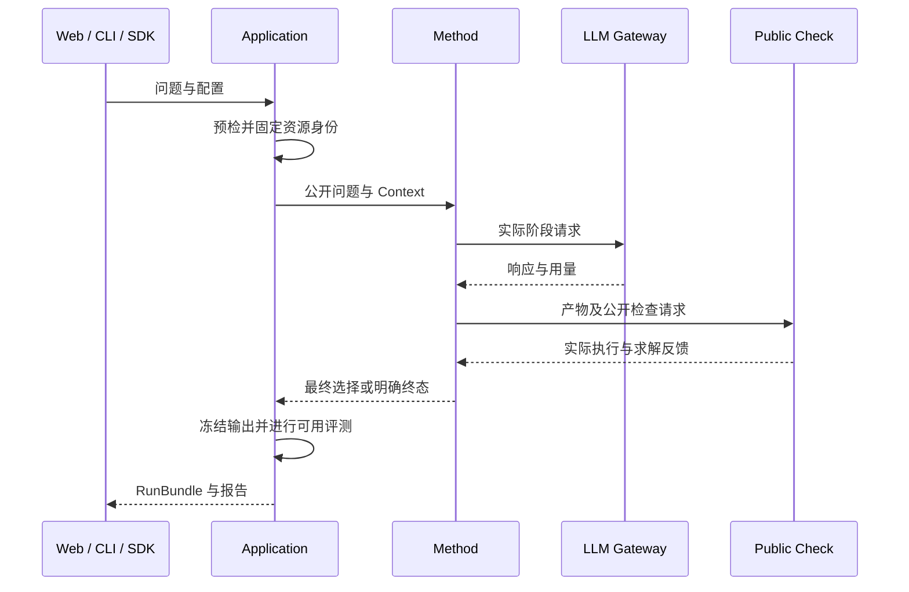

# 单问题与建模方法

字段见[方法契约](../contracts/methods.md)。方法来源和提示编排见[方法说明](../development/methods.md)。

## DD-01 单问题建模与求解

输入是公开问题、可选 CSV/JSON 和一个 RunConfig。用户无需提供参考答案、需求列表或问题类型。方法在声明的 LP/MILP 范围内形成输出，平台核对实际类型。



数据加载保留原字节和哈希，再形成允许范围内的视图。LLM 使用声明视图；工厂在 Worker 内读取绑定的原始数据。需要完整数据的方法在视图不完整时拒绝生成。

最终阶段复用已匹配的执行记录。匹配包含产物、数据、编译、后端、选项和执行身份；未匹配时才补齐执行并计入预算。

输出为 RunBundle，包含阶段产物、建模步骤、最终选择、求解状态、可用决策和证据。失败保留已有产物。无参考材料使用公开评测协议，独立检查标为不可用。

一个运行固定一个公开输入快照及方法配置。最终检查属于该运行。求解成功只说明当前模型的结果。对应 FR-07/13/20/24/26/29/35/36，AC-03/20/23。

## DD-02 方法内部生成修正与选择

方法决定内部步骤。Direct 联合生成两阶段输入，调用只计一次；研究流程自行组织专家、检索或搜索。核心不控制内部节点选择，也不访问隐藏评分来选择输出。

```text
生成阶段产物 → 公开检查 → 读取公开诊断
                       ↓
          预算允许时修正，再次检查
                       ↓
                 保存最终选择
```

代码修正保留源 Formulation，数学变化生成新表述。检查和修正分别计数。合法不可行/无界可以是最终结果，不能为获得可行解删除业务需求。

不同模型的自报目标不直接比较。方法按声明的公开规则选择；规则和理由写入记录。Feedback Repair 使用合法性、可信 primal、阶段完整性和顺序。

角色模型共享运行预算。公开评议角色与独立评估器权限分开。搜索节点可以是不完整表述，进入公开检查的模型需要符合执行契约。

澄清确认原声明时可在同一运行继续。新事实创建问题修订和派生运行；非交互批次保留 unresolved。内部续跑需要已声明检查点，完整阶段恢复由核心处理。

对应 FR-13–19/28/32/33，AC-06/08/09/12。
