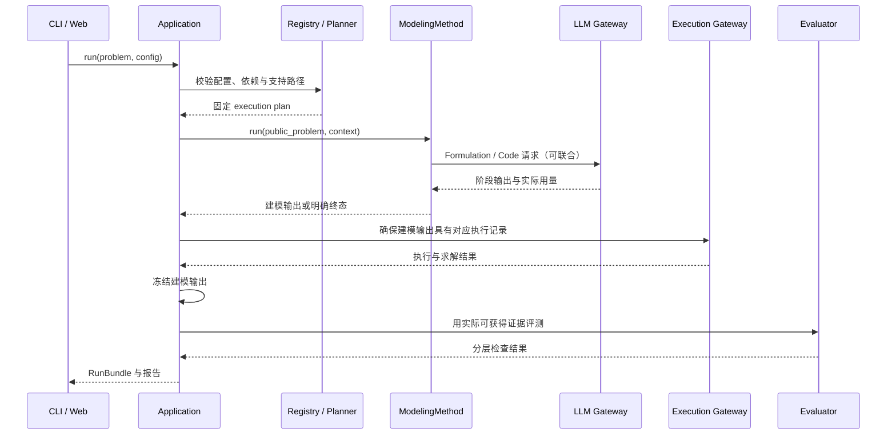

# 单问题与建模方法详细设计

文档修订：0.4.0。开发设计，S01 离线流程已实现；返回 [详细设计索引](../detailed-design.md)。字段与错误语义由 [接口契约](../plugin-contracts.md)维护，指标由 [评测协议](../evaluation.md)维护。

## DD-01 单问题建模与求解

### 输入与输出

输入为自然语言描述、可选 CSV/JSON 数据，以及固定一个方法的 RunConfig。用户无需提供参考答案、需求条目列表或问题类型；未知类型在本次允许的 LP/MILP 范围内由方法探索，再校验实际产物。

输出为 RunBundle，包含公开问题、所用配置、Formulation／Code 阶段产物与建模步骤记录、最终选择、决策解与目标、求解状态、可用验证证据和运行记录。执行失败也输出已有记录。无 oracle 的用户问题使用公开结构／执行检查，独立检查标为 `not_available`。

默认检查协议为 `llm4om.eval.public-v0.1`，因此无隐藏评分的单问题也有明确的 EvaluationResult 协议标识；不产生 benchmark 正确率。

公开数据加载先保存原始bytes与hash，再形成声明范围内的数据视图。Direct／feedback_repair向LLM发送实际视图；参数化工厂在隔离Worker中读取原始绑定数据。需要完整数据的方法在视图不完整时拒绝生成。SDK0.22.0的实际范围见 [DataLoader记录](../development/s03-data-loader.md)，字段与限制由 [插件契约](../plugin-contracts.md#27-s03-c4-public-dataloader-and-dataview-sdk-0220)维护。

### 运行时序



建模的 Formulation 阶段产生数学表述，Code 阶段实现表述，Solve 随后发生。方法可以在两个建模阶段之间往返，阶段产物的父产物、改动理由与来源按契约保存。严格 IR 的 Code 编译可由 Execution Gateway 完成；自由文本到代码的推理属于方法。方法内部可以已经请求公开检查。最终阶段只有在产物、数据、编译配置、后端、求解参数及执行模式均一致时复用其记录；否则重新执行并计入预算。不能为每次已执行的公开检查无条件再求解一次。

### 必须保持的不变量

- 一个 run 固定一个公开问题快照、方法变体和资源配置。
- 最终 check_id 必须属于本 run 的公开检查记录，或有明确的派生来源。
- 求解配置由运行计划锁定，方法不得静默切换后端或许可证路径。
- `completed` 表示流程产生了结果；建模正确性由独立检查状态表达。
- 无参考答案不阻止单问题建模与求解；没有实际执行不能输出伪造的 SolveResult。

对应 FR-07/13/20/24/26/29/35/36；AC-03/20/23。
## DD-02 方法内部生成、修正与选择

方法是组织 Formulation、Code、公开反馈与最终选择的推理策略。平台向它提供 LLM、公开数据、执行、产物、预算和取消资源，不规定其内部步骤数。

### direct

工程对照默认一次语义生成，联合产出五元素与可编译 IR 或工厂代码 → 分别解析阶段输出 → 保存 ModelArtifact → 返回建模输出。联合生成仍保留两阶段含义，实际调用只计一次。解析失败保存原始响应与诊断。Provider 的基础设施重试不算第二次语义生成，实际 attempts 仍全部入账。

### optimus 与 coe

首批经典方法分别锁定上游版本。OptiMUS 的模块化问题状态、代码生成和调试留在方法内；CoE 的专家路由、协作与反思留在方法内。适配器把实际可观察的数学表述与代码映射为阶段输出，不为凑齐五元素添加额外 LLM 推断。

原模型与本次通用外部 LLM、提示、预算及执行差异进入 fidelity report。CoE 的 code_example 必须按数据来源判断：允许的公开示例可保留，参考答案进入私有 oracle；改变原输入条件时使用变体 ID。来源与考察范围见 [固定提交记录](../references/source-inspection.md)。

### feedback_repair（可选对照）

0.16.0 的项目自编实现与实际支持见 [S05-C2](../development/s05-feedback-repair.md)。下列策略通过共用公开检查资源执行；数学声明比较与原问题独立验证分别记录。

```text
生成表述与代码阶段产物
请求公开检查，读取公开 parse/compile/execution/solver 反馈
若需要修正且预算允许：生成修正后的阶段产物，保存父产物与改动理由，再请求公开检查
依据预声明的公开规则做最终选择
返回最终选择及 checkpoint（若实现支持）
```

`max_repairs=0` 合法。每次修正产生新的阶段产物与公开检查，parent_ids 指向被修正的检查。Code 修复关联原 Formulation；数学含义变化产生新 Formulation 引用，并重新生成或编译 Code。模型 infeasible 可以触发调查；原问题本来 infeasible 也可能是合理结果，不能仅为了可行而删除需求。

不同模型的自报目标不可直接比较选优。默认选择规则：优先合法且有模型内可行解的检查，再按公开诊断完整性与最近修正顺序选择。规则版本与实际选择理由写入运行记录。不得读取 reference objective。

### 多 Agent 与搜索方法

研究路线元数据区分基于提示、基于训练与混合方法；模型训练权重和推理流程分别接入。首批不加载专用训练模型，复用其流程／提示时保存变体来源。角色调用共用 run 预算。搜索节点可以产生部分表述，但进入公开检查的阶段产物必须完整可执行。节点价值估计、Agent 路由、反思与剪枝属于方法实现；它们不是核心插件种类。

方法内部的 critic/evaluator 是公开推理角色。平台独立 Evaluator 是 benchmark 评分模块。二者名字相近但权限和结论不同。

### 澄清与恢复

0.17.0的CLI／SDK实现与真实证据见 [S05-D2](../development/s05-clarification.md)。确认仅接受原问题声明的true回答；新信息需要用户提供新revision，不由模型偷偷改写。

交互模式保存 ClarificationRequest 后暂停。确认已有声明可写入澄清记录并按方法支持恢复；新增或改写业务规则、数据、模型配置时创建新 ProblemSpec revision 和派生 run。原 run 的输入、阶段产物和评分不改写。批量模式不从参考答案补齐，终态为 `unresolved`。

对应 FR-13～19/28/32/33；AC-06/08/09/12。
