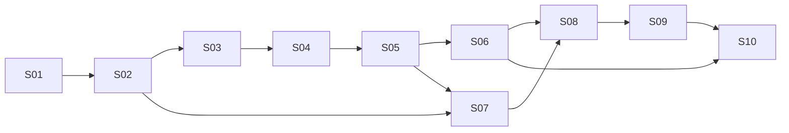

# 1.0 开发计划与接入顺序

计划是开发切片，不是已创建的 GitHub Issues；本次任务只提交需求文档。未给出人员和可用时间，因此不承诺日历工期。

## 1. 首批能力矩阵

| 模块 | 1.0 MUST | 接入方式 | 主要验收 |
|---|---|---|---|
| 方法 | direct | 平台 baseline | 统一输入→IR／工厂→结果 |
| 方法 | feedback_repair | 平台 baseline，与 direct 明确不同策略 | 公共执行反馈修正、有界循环与最终选择 |
| 方法 | optimus | 固定上游版本的忠实 Adapter | 来源锁、适配差异、真实求解与公共评测 |
| LLM | openai_compatible | 通用端点＋模型配置 | 成功、超时、usage 未知、工具能力不支持 |
| LLM | anthropic | 独立协议 Adapter | 消息／usage／错误映射真实验收 |
| LLM | mock | 离线工程 fixture | 确定性流程、明确 mock 标识 |
| 任务 | user_problem | 文本＋CSV／JSON | 描述与表格独立、路径与类型校验 |
| 任务 | nl4opt、industryor | 版本锁定的本地／fetch Adapter | 来源、清洗、public／oracle 隔离 |
| 编译 | lp_ir_to_pyomo | 确定性编译 | 变量域、目标常数、约束与 symbol map |
| 建模后端 | pyomo_factory、native_gurobipy | 工厂／Legacy 两条路径 | 同进程模型 Handle 与结果抽取 |
| 求解器 | highs、gurobi | 可选依赖、独立 capability | 微型 LP／MILP 与不同终止状态 |
| 评估 | structural、objective_match、independent_checker | 相同 EvaluationResult | 漏约束反例与证据 not_available |
| 执行／存储／报告 | container／trusted_local、filesystem、JSONL／CSV／Markdown／HTML | 共同资源接口 | 权限、哈希、失败产物、报告可重建 |

必需支持的组合：direct／feedback_repair → LPIR 或 Pyomo 工厂 → HiGHS；相同受支持表示 → Gurobi；OptiMUS → 上游原生代码 → 对应 Gurobi 路径。不得要求 OptiMUS 任意转换到 HiGHS 后仍视为原方法。

## 2. 方法集成的行为规范

### direct

固定提示／工具定义，一次语义生成，解析候选并运行；基础设施 retry 与语义 repair 分开计数。输出失败时不自动切换另一提示策略；variant 记录输出模式。

### feedback_repair

从 direct 生成开始，将公开 parse／compile／execution／solver 反馈提供给修正步骤；最多 max_repairs 次，每次产生新 Candidate。不得读取 reference objective。默认选择规则：优先合法且有候选内可行解的候选，再按公开诊断完整性与最近修正顺序选择；不以候选自报更大／更小目标跨不同模型比较选优。规则版本写入 config。

候选模型 infeasible 可以触发调查，但修正不得无说明删除业务约束以求 feasible；每次约束变化保存需求映射和变更说明。判断不出业务意图时产生 needs_input／unresolved。

### optimus

在 S06 开始时选择并记录 `teshnizi/OptiMUS` 对应版本／提交；不同分支接口可能不同，不凭本文假设源码一致。保留上游生成和修正策略，将模型调用、执行、结果和日志适配到平台契约。任何提示、Agent 角色或预算变化列入 fidelity report。无法不改算法接入时，使用明确 variant ID 并与 reference run 对比。

上游实验依赖商业求解器时按原生路径运行，不为制造通用性而强制转 IR。上游未提供完整模型／解提取时如实降低证据级别，并把缺口纳入接入工作。

## 3. 可独立验收的开发切片

### S01 统一问题契约与离线纵向流程

依赖：无。实现 contracts、ProblemSpec／ArtifactRef、用户任务、Mock Provider、最小 direct、filesystem 与事件、一个固定工厂 fixture；贯通单问题→产物→模拟结果→JSON 报告。此切片结果必须标 mock，不声称真实求解。

验收：示例 MILP 的输入、数据、产物和错误样本可校验；oracle 不出现在 MethodContext；所有失败也有 RunBundle。覆盖 FR-07／08／13／20／32／36。

### S02 真实 IR 编译与 HiGHS 求解

依赖：S01。实现 GroundedLPIR、lp_ir_to_pyomo、pyomo_factory、highs、标准状态映射与独立示例检查器。把 S01 的模拟 solve 替换为真实 solve，保持同一个 application 用例。

验收：示例 MILP 最优值 13、决策 A=3/B=2；LP 松弛值 40/3；目标常数／无解／无界／多解／整数域 fixture 正确；重新编译相同 IR 结构一致。覆盖 FR-21～25／29。

### S03 插件发现、配置与预检

依赖：S01／S02。实现 Manifest、entry points、版本／依赖校验、Planner、CLI plugins／doctor、预算 admission。交付一个独立安装的第三方方法示例包。

验收：不改核心新增方法；ID 冲突、类型不匹配和依赖缺失在付费调用前定位；插件能力矩阵可显示。覆盖 FR-01～06／17、NFR-01／08／10。

### S04 隔离执行与恢复

依赖：S02／S03。实现容器 Executor、资源限制、无网络／无密钥／无 oracle 挂载、取消／检查点、未知外部调用结果的恢复策略。

验收：网络／越界／OOM／timeout fixture；批量单任务失败不影响其他任务；已保存响应不重复调用；不支持 checkpoint 的方法产生明确派生重跑。覆盖 FR-27／33、NFR-04／06。

### S05 真实 LLM 与反馈修正

依赖：S03／S04。实现 openai_compatible、anthropic、脱敏 trace、usage、有限 retry、feedback_repair、澄清请求和角色模型配置。

验收：真实提供方分别成功运行；错误／用量不可用／超时均保留证据；修正循环按预算停止，hidden oracle 未进入提示；基于公开反馈选择最终候选。覆盖 FR-14～19。

### S06 原生代码与 OptiMUS 适配

依赖：S04／S05。实现 Gurobi SolverBackend、native_gurobipy、OptiMUS Adapter、上游提交锁与 fidelity report。原生脚本不能抽取某证据时标记缺失，不造数据。

验收：有许可证环境真实微型任务；上游 reference 与平台 Adapter 在预定任务上结果／流程可对照；不支持 HiGHS 的组合预检明确失败。覆盖 FR-14／22～26、NFR-12。

### S07 基准导入与独立评测

依赖：S02／S05，OptiMUS 比较依赖 S06。实现 NL4Opt／IndustryOR Adapter、Manifest、objective／checker 协议、清洗与 oracle 访问隔离。

验收：固定版本导入；样本数可由 manifest 重建；未知／异常不被静默剔除；漏约束及目标偶合反例不会显示 semantic_verified。覆盖 FR-08～12／28～30。

### S08 批量实验与比较报告

依赖：S07，完整三方法依赖 S06。实现实验矩阵、并发与共享预算、逐样本明细、缓存来源、JSONL／CSV／Markdown／HTML 报告及 resource 统计。

验收：三方法公共样本比较；复算分母与 numerator 一致；限制预算、未知成本、数据版本差异呈现；1,000 个短任务与故障恢复测试。覆盖 FR-18／30～34、NFR-03／05。

### S09 本地 Web 工作台

依赖：S08。实现插件／环境、单问题运行、候选与模型检查、实验进度与逐样本对比、取消与恢复、公开 RunBundle 导出。

验收：同配置 Web／CLI 经相同 SDK 生成一致 run fingerprint；UI 不泄漏 oracle；不支持组合显示原因；用户编辑形成派生 run。覆盖 FR-26／35。

### S10 发布验收与开源准备

依赖：S01～S09。完成文档、插件接入示例、依赖／来源清单、最小真实实验与故障／性能报告；补齐所有真实 Provider／Solver／方法验收证据。

验收：逐项完成 [验收清单](acceptance.md)；当前仓库私有状态不会因“开源准备”自动改变；1.0 标签与公开发布须在实际实现完成后单独决定。

## 4. 依赖图

每个切片都有用户可观察纵向流程，避免先为所有未来类型建立空抽象。必须先用真实可变实现验证接口，再增加更多适配器。

## 5. 推荐工程选择

Python 3.11／3.12、Pydantic v2 数据契约、Pyomo、HiGHS、pytest、标准 JSON/YAML 配置；CLI 可选 Typer，本地 Web 可选 Streamlit。这些具体库版本在 S01 选定并锁定，当前文档不伪造已验证兼容矩阵。

文件存储＋事件日志优先，实验索引可用 SQLite；SDK 对存储只使用接口。是否引入 LangGraph 等由方法插件自己决定，不能让全部插件强制依赖单一 Agent 框架。

## 6. 主要风险与对应切片

| 风险 | 可执行处理 |
|---|---|
| 强制统一 IR 改变论文方法 | S06 原生路径与 fidelity report；变体单独命名 |
| 隐藏答案泄漏到修正 | S01 投影、S04 文件隔离、S07 transcript 扫描与访问拒绝 fixture |
| 数据集版本／清洗差异 | S07 Manifest 与 source ID／hash；S08 分组比较 |
| 最优目标匹配被误称语义正确 | S02 独立反例、S07 分层证据、S09 UI 标签 |
| 云调用费用／响应不可知 | S05 原子预留、未知使用量、S04 outcome_unknown 恢复 |
| 新插件需要核心分支 | S03 第三方独立包验收及接口回顾 |
| 可选求解器无许可证 | S06 显式缺失并保留 HiGHS 路径，发布声明以真实证据为准 |

MCTS autoformulation、ORPilot、更多基准及 NLP／CP 不属于 S10 前必须完成的项目。它们应在内核与首批契约验证后作为新增插件切片开发。
