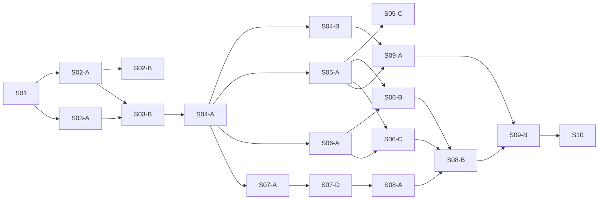

# 1.0 开发计划与接入顺序

文档修订：0.4.0。以下是开发计划；S01／S02-A／S02-B／S03／S04-A／S04-B／S05-A／S07-A／S06-A 已实现当前范围，S03 使用 [Issue #3](https://github.com/Fangziyang0910/LLM4OM/issues/3)／[#4](https://github.com/Fangziyang0910/LLM4OM/issues/4)，S02-A 使用 [Issue #1](https://github.com/Fangziyang0910/LLM4OM/issues/1) 跟踪，未标记为已完成的切片继续按依赖开发。阶段 S01–S10 保持原编号；较大阶段拆成可独立演示的纵向切片。工期在人员和资源明确后估算。

## 1. 首批能力矩阵

| 模块 | 1.0 MUST | 接入方式 | 主要验收 |
|---|---|---|---|
| 方法 | optimus、coe、optitree、or_llm_agent、autoformulation；direct／feedback_repair 为项目基线 | 自然语言输入、固定来源的流程适配；搜索保留在方法内 | 两阶段记录、通用外部LLM、来源与差异；见[扩展记录](development/s06-method-expansion.md) |
| LLM | openai_compatible、anthropic、mock | 独立协议 Adapter、确定性 fixture | 真实成功、超时、未知 usage、能力匹配 |
| 任务 | user_problem、nl4opt、nlp4lp、mamo | 公开输入／私有参考投影、版本锁 | 数据绑定、来源、样本与 oracle 隔离 |
| 编译 | lp_ir_to_pyomo | 确定性编译 | 域、目标常数、约束与 symbol map |
| 建模后端 | pyomo_factory、native_gurobipy | 工厂／原生两条路径 | Worker 内构建与可靠结果抽取 |
| 求解器 | highs、gurobi、ortools | 可选依赖与独立 capability；OR-Tools使用SCIP求解LP/MILP | 真实LP/MILP、终止状态、常数项与可信结果 |
| 评估 | structural、objective_match、independent_checker | 共同 EvaluationResult | 正确性层次、漏约束反例、not_available |
| 执行／存储／报告 | container／trusted_local、filesystem、JSONL／CSV／Markdown／HTML | 共同资源接口 | 权限、失败记录、恢复、可复算报告 |

当前七个自动方法均通过Pyomo LP/MILP通道选择HiGHS、Gurobi或OR-Tools。OptiMUS／CoE／OptiTree／OR-LLM-Agent保留核心编排和提示思路，生成所选后端的模型工厂；可选gurobipy通道使用Gurobi。数学表述保留方法实际输出，不强制转换为统一IR。论文作为策略来源，完整论文复现不属于当前交付要求。具体支持与验收见[扩展记录](development/s06-method-expansion.md)。

## 2. 工作项的粒度

一个切片贯通一个用户可观察结果，带输入、行为、输出和公共测试入口。先用最窄路径验证接口，再接入第二种真实实现；只为已发生的变化增加 Seam。平台方法行为见 [DD-02](detailed-design.md#dd-02-方法内部生成修正与选择)，字段与能力由 [契约](plugin-contracts.md)维护。

表内 Blocked by 是直接阻塞项，阶段汇总不是领取单位。父规格使用 [issue 模板](../.github/ISSUE_TEMPLATE/feature-spec.md)，切片使用 [纵向任务模板](../.github/ISSUE_TEMPLATE/vertical-slice.md)；正式创建前按技能展示划分并使用当时授权。每张票据引用对应 FR/AC，用领域行为描述验收。

## 3. 可独立验收的开发切片

### S01 统一问题契约与离线纵向流程

| 切片 | What to build／可演示结果 | Blocked by | 公共测试入口与验收 |
|---|---|---|---|
| S01 | 最小 CLI run 读取自然语言与 CSV，经 Mock direct 保存五元素、阶段可用性和标为 mock 的运行记录 | 无 | CLI：无 oracle 单问题；成功和失败都保存 RunBundle；数据 hash 可核验。AC-03/08/19/23 |

只实现这条路径需要的契约与存储。不建立全套空插件、完整实验矩阵或伪造的真实 SolveResult。覆盖 FR-07/13/20/32/36；DD-01/04/07。

状态：已实现；[运行、实际支持范围与交付证据](development/s01-offline-run.md)。仅完成上述 FR/AC 的离线工程部分，完整发布项保持待验收。

### S02 真实 IR 编译与 HiGHS 求解

| 切片 | What to build／可演示结果 | Blocked by | 公共测试入口与验收 |
|---|---|---|---|
| S02-A | 同一个 CLI run 将 Formulation 中显式提供的 grounded LPIR 编译为 CodeArtifact，并用 HiGHS 真实求解 | S01 | CLI＋编译／Solver 公共契约：MILP=13，LP=40/3；常数、域、无解、无界与状态。AC-10/11/13；隔离归 AC-14/S04 |
| S02-B | 同一个 CLI run 接受参数化 Pyomo 工厂，关联源 Formulation，换数据后形成新绑定 | S02-A | CLI：数据 revision、模型 Handle、决策映射和工厂异常。AC-03/10/13/24 |

以 CSV 为独立依据核验决策；交换利润的候选按原目标应为 12。覆盖 FR-21～25/29；DD-04/05。独立检查器是后续验收要求，不声称一般语义等价。

状态：S02-A 已实现，见 [支持范围与真实证据](development/s02-highs.md)；S02-B 当前参数化工厂／HiGHS 路径已完成真实外部模型、重绑定与独立审阅后修复验收，见 [实现记录](development/s02b-factory.md)。HiGHS 与 S04-A 容器路径已验证；S06-A 当前 Gurobi 微型路径与实际终止状态见 [实现记录](development/s06-gurobi.md)。

### S03 插件发现、配置与预检

| 切片 | What to build／可演示结果 | Blocked by | 公共测试入口与验收 |
|---|---|---|---|
| S03-A | 单独安装第三方方法，通过 plugins list 和 run 使用 | S01 | CLI：不改内核、ID 冲突、版本与配置错误。AC-01/02/21 |
| S03-B | doctor 给出实际兼容路径、环境缺失与预算 admission 结果 | S03-A、S02-A | CLI：不兼容组合在付费调用前拒绝，未知能力不当作支持。AC-02/07/12 |

状态：独立方法与多种资源插件已经接入，doctor与run共用预检；当前[可安装Executor](development/s03-executor-registry.md)、[显式连通性检查](development/s03-connectivity.md)与[可安装ArtifactStore](development/s03-store-registry.md)已实现，各插件种类均有共同注册入口。实际支持以各切片证据为准。覆盖 FR-01～06/17、NFR-01/08/10 的当前部分；DD-03。

### S04 隔离执行与恢复

| 切片 | What to build／可演示结果 | Blocked by | 公共测试入口与验收 |
|---|---|---|---|
| S04-A | CLI 在容器内执行候选，只挂载公开数据，限制网络与资源 | S02-A、S03-B | CLI＋Executor：网络、越界、OOM、timeout；不挂载密钥或 oracle。AC-09/14 |
| S04-B | 用户取消／resume 已保存运行，复用完成记录并处理未知外部结果 | S04-A | 应用入口：已保存响应不重调；checkpoint 不兼容拒绝；不支持内部状态时默认拒绝、显式派生重跑；保留父历史与累计资源，不静默重跑。当前实现见 [S04-B](development/s04-resume.md)。AC-08/18 |

外部调用的未知状态先用确定性资源 fixture 验证，再在 S05 接入真实调用。覆盖 FR-27/33、NFR-04/06；DD-05/07。

### S05 真实 LLM 与反馈修正

| 切片 | What to build／可演示结果 | Blocked by | 公共测试入口与验收 |
|---|---|---|---|
| S05-A | direct 经 openai_compatible 真实生成并求解，记录 retry、usage、预算与脱敏 trace | S03-B、S04-A | CLI＋Provider：成功、超时、未知 usage、恢复结算、隐藏材料未入提示。AC-06/07/08/09 |
| S05-B | 独立 Messages Adapter，经相同 CLI/SDK 与 Gateway 生成并求解，保留协议、usage 与恢复证据 | S05-A、S04-B | CLI/SDK＋HTTP/OS：真实成功、能力拒绝、usage、错误、取消与 journal 恢复。AC-07/08/12 |
| S05-C | 公共阶段反馈支持 Formulation／Code 定位、有界修正和选择；feedback_repair 可选对照 | S05-A、S04-B | 应用入口：max_repairs=0、预算停止、约束变化记录、选择理由。AC-06/07/09/12 |
| S05-D | 交互运行提出澄清、恢复或形成派生 run，并支持角色模型配置 | S05-C | 应用入口：批量 unresolved；新业务规则不改写原输入。AC-06/08/23 |

状态：S05-A 当前文本范围已实现，见 [实际支持与真实证据](development/s05-provider.md)和 [Issue #8](https://github.com/Fangziyang0910/LLM4OM/issues/8)；S05-B 实现与验收见 [Messages](development/s05b-messages.md)。[S05-C1候选资源](development/s05-public-candidates.md)、[S05-C2修正方法](development/s05-feedback-repair.md)及 [S05-D2澄清](development/s05-clarification.md)已有真实行为；2026-10-11五组独立Standards／Spec审阅全部完成（唯一P1/P2已当场修复）。

覆盖 FR-14～19；DD-02/07。S05-B 使用 S05-A 已验证的共享 Gateway；这不是模型质量的依赖。

### S06 原生代码与经典方法适配

| 切片 | What to build／可演示结果 | Blocked by | 公共测试入口与验收 |
|---|---|---|---|
| S06-A | 固定微型工厂／原生 gurobipy 候选经 Gurobi 求解并抽取结果 | S03-B、S04-A、S02-B | CLI＋Solver：真实许可证环境、状态与解向量；native→HiGHS 拒绝。AC-11/12/13 |
| S06-B | 指定 optimus 经通用外部 LLM 跑同一单问题流程，保存阶段记录、上游锁与 fidelity report | S06-A、S05-A | CLI：与固定上游 reference run 对照，缺失证据如实标记。AC-12/13/25 |
| S06-C | 指定 coe，保留专家路由与协作，经同一外部 LLM Gateway 输出阶段记录与原生实现 | S06-A、S05-A | CLI：固定上游流程对照；code_example 权限与原模型差异可查。AC-05/06/12/25 |

S06-A 已实现当前微型 LPIR／Pyomo／native gurobipy 的真实 Gurobi 路径，限实际 size-limited 环境；验收与剩余范围见 [S06-A](development/s06-gurobi.md)。

OptiMUS 与 CoE 的工作项互不阻塞；共享原生执行和外部 LLM 入口。优先复核 [optimus-v0.3 源码考察](references/source-inspection.md)，正式接入另锁实际版本。保留上游策略，改变行为使用 variant。覆盖 FR-14/22～26、NFR-12；DD-03/05。

### S07 基准导入与独立评测

| 切片 | What to build／可演示结果 | Blocked by | 公共测试入口与验收 |
|---|---|---|---|
| S07-A | 导入锁版本 NL4Opt，冻结样本 manifest，用现有单问题流程评测一个样本 | S02-A、S03-B、S04-A | Task／Evaluation 公共契约＋应用入口：来源、公开投影、私有参考、异常保留。AC-04/05/15/16/25 |
| S07-B | 增加 NLP4LP，公开描述／参数与私有参考代码／解分离，锁 release | S07-A | 同一入口：ID/hash、过滤原因、参考可用性；不跨版本混比较。AC-04/05/25 |
| S07-C | 增加 MAMO EasyLP／ComplexLP 的 LP/MILP 实例，保存原子集与派生数据来源 | S07-A | 同一入口：ODE／不支持类型预先分类，样本与参考来源可重建。AC-04/05/15/25 |
| S07-D | 独立检查器给出可行性／原目标质量，区分目标匹配与语义证据 | S07-A | Evaluation 公共契约：漏约束、目标偶合、检查器异常、无证据。AC-15/16/24 |

不依赖真实 LLM 才能检验数据隔离与协议。三方法正式比较在 S08-B 完成。覆盖 FR-08～12/28～30；DD-06。

### S08 批量实验与比较报告

| 切片 | What to build／可演示结果 | Blocked by | 公共测试入口与验收 |
|---|---|---|---|
| S08-A | benchmark 展开样本与配置，复用 run，生成逐样本 JSONL／CSV | S07-A、S07-D | CLI：失败分母、并发共享预算、空 eligible 集合和缓存来源。AC-07/17/18/22 |
| S08-B | direct／OptiMUS／CoE 在同一通用外部 LLM 与三个基准各自共同兼容的样本上比较，生成可复算 Markdown／HTML 报告 | S08-A、S06-B、S06-C、S07-B、S07-C | report：numerator／denominator、未知成本、配置与数据版本分组。AC-15/16/17/22/25 |
| S08-C | 1,000 个短任务的资源与故障恢复报告 | S08-A、S04-B | 同一批量入口：单样本故障不阻断他样本，恢复无静默丢失。AC-18/22，NFR-03/05 |

覆盖 FR-18/30～34；DD-06/07。Mock 负载验证调度；方法准确率来自另行冻结的真实实验。

### S09 本地 Web 工作台

| 切片 | What to build／可演示结果 | Blocked by | 公共测试入口与验收 |
|---|---|---|---|
| S09-A | 用户在本地页面输入问题、选方法与求解配置，查看输出、决策、诊断和取消／恢复 | S02-B、S03-B、S04-B、S05-A | Web＋应用入口：与 CLI 同配置 fingerprint，run_id 独立；公开导出无 oracle。AC-19/20/23/24 |
| S09-B | 同一工作台展示实验进度、逐样本比较与派生编辑 | S09-A、S08-B | Web：逐样本证据、兼容原因、编辑后新 revision／run。AC-17/19/20/22 |

单问题 Web 不被完整 benchmark 比较阻塞。覆盖 FR-26/35；DD-08。部署范围为本地单用户。

### S10 发布验收与开源准备

依赖：S01、所有 S02–S09 子切片。完成 [AC-01～AC-25](acceptance.md)、接入示例、来源清单、真实 Provider／Solver／三方法证据与故障／性能报告。检查全部 MUST，不用一个成功示例替代完整验收。

2026-10-11发布验收审计完成：S01～S09全部切片具备实现、本机验收、独立Standards／Spec审阅与真实证据（官方API端到端、九格4/4数值匹配、99格真实批量取消恢复）；[验收清单](acceptance.md)的编译fixture与发布证据清单已按当前证据勾选。保持未验证并明确声明的边界：macOS／Windows平台隔离（Linux为唯一完整验证环境）；版本标签、发行包与可见性变更仍由实际发布任务与用户授权决定。当前保持 private。

版本标签、发行包和可见性变更由实际实现后的发布任务决定。当前保持 private。

## 4. 阻塞关系与可执行前沿

表格维护完整 blocking edges；下图只展示主路径，避免维护第二份详细依赖表。

当前SDK／Worker为0.37.0开发版本。单问题CLI／SDK／Web、外部Provider、HiGHS／微型Gurobi、Direct／反馈修正／固定OptiMUS／CoE、三个首批任务来源、批量调度与报告已有实现。各版本的支持组合与验收证据保留在对应切片记录；[用户界面](development/s09-user-experience.md)包含当前输入、真实步骤、数据、模型、决策与派生编辑。

2026-10-14当前交付范围按用户指令收窄为本机后端与Web能启动、展示并继续开发。复用已有接口，聚焦验证受影响路径；公网多人部署、多平台适配和正式发布动作不作为本轮收尾条件。前端旧规格中的原始JSON与批量页面入口已由后续需求替换，当前界面和验收流程见 [S09-D](development/s09-frontend-redesign.md)。

2026-10-11 S08-B官方API全九格重跑完成：9/9真实接入、连接失败清零、4/4数值参考匹配，3格方法性失败（CoE collector×2、Direct单次输出×1）如实记录；五组切片独立Standards／Spec审阅全部完成（唯一P1/P2已当场修复）。S08-C真实批量调度故障恢复已通过（99格真实Provider、SIGINT取消＋resume零丢失，见[S08-C](development/s08-load-acceptance.md)）；全部插件种类已具备共同注册入口。发行标签与公开发布动作留待实际发布任务安排。当前优先推进核心流程和Web，批量评测与底层扩展按实际需求安排。外部接口可达性以实际请求记录为依据，不由历史成功或Mock推定。2026-10-11起真实核心流程已切换到DeepSeek官方API并完成端到端恢复（一次真实LLM调用、容器HiGHS目标13），此前中转链路的连接失败不再影响新运行。

2026-10-10按用户要求暂停开发，将现有代码与文档统一到main，并关闭当前全部PR和Issue。关闭工作项是本次仓库整理，不代表未完成能力已实现或完整1.0验收通过。后续工作以本计划与[验收清单](acceptance.md)为依据。暂停前两次最新真实LLM请求在连接阶段失败；2026-10-11恢复开发时已改用官方API完成真实端到端验证，该前提解除。

## 5. 工程默认值与完成边界

S01 采用 Python 3.11／3.12、标准库 argparse／dataclass／unittest，以及已有 PyYAML／jsonschema；依赖由 pyproject.toml 与 uv.lock 管理。维护工具复用这些依赖，类型检查使用开发依赖 mypy。Pyomo 6.10.1／highspy 1.15.1 已通过可选 solve extra 接入 S02-A，Web使用已有标准库HTTP入口和HTML／CSS／JavaScript。文件和事件优先，确有查询需要时再引入 SQLite。方法可自行依赖 Agent 框架，核心不强制依赖它。

LLMOPT 等训练类工作的流程／提示变体、MCTS autoformulation、ORPilot、IndustryOR／OptMATH 及 NLP／CP 留待首批契约被真实验证后扩展。每个新增方法、Solver 或 benchmark 都需要声明实际支持组合与来源。

S07-C 当前已贯通固定 MAMO 导入、公开资格冻结与单样本数值比较；已完成规范来源的真实 HiGHS 微型验收，包／Worker／干净 wheel 安装及268项本机完整回归已通过；2026-10-11五组独立Standards／Spec审阅全部完成（唯一P1/P2已当场修复）。见 [实现记录](development/s07-mamo.md)。

S07-B 当前已贯通 NLP4LP 固定发布导入、公开 JSON 参数／私有参考隔离与资格冻结；361个原始问题完整导入，322／37／2参考可用性分别记录。真实指定模型／容器 HiGHS 已验收（两次试运行含一次连接失败），273项完整本机回归已通过；2026-10-11五组独立Standards／Spec审阅全部完成（唯一P1/P2已当场修复）。见 [实现记录](development/s07-nlp4lp.md)。

[S05-D1角色模型配置](development/s05-role-models.md)已通过实际指定模型／Messages角色覆盖、HiGHS和314项本机回归；2026-10-11五组独立Standards／Spec审阅全部完成（唯一P1/P2已当场修复）。该组件不替代S05-D澄清；公共反馈与修正的实现由S05-C1/C2记录。

S05-C1候选资源见 [记录](development/s05-public-candidates.md)；S05-C2有界修正、解析失败入账、声明变化与Code-only来源复用见 [记录](development/s05-feedback-repair.md)；S05-D2原声明确认、新修订与派生运行见 [记录](development/s05-clarification.md)。2026-10-11五组独立Standards／Spec审阅全部完成（唯一P1/P2已当场修复）。完整注册、批量／报告、Web及发布验收已按各自切片记录完成。

S03-C1独立文本Provider接入与身份校验见 [记录](development/s03-provider-registry.md)。全部插件种类的共同注册已完成，当前支持以各切片记录为准。

S03-C2独立Task／Evaluator接入与冻结身份见 [记录](development/s03-task-registry.md)；独立审阅已完成。

S03-C3a独立grounded LPIR→Pyomo Compiler与Worker身份见 [记录](development/s03-compiler-registry.md)；Backend／Solver及其余插件种类已有本机验收和独立审阅。

S03-C3b由 [#43](https://github.com/Fangziyang0910/LLM4OM/issues/43)跟踪，Backend／Solver共同接口与实际Worker路径已完成本机验收，见 [开发状态](development/s03-solver-registry.md)。

S03-C4由 [#45](https://github.com/Fangziyang0910/LLM4OM/issues/45)跟踪。DataLoader通过共同Registry接入；原始数据、有限视图与模型绑定分别保留，见 [开发状态](development/s03-data-loader.md)。Executor／ArtifactStore／Reporter的共同注册也已完成。

按2026-10-10用户对推进节奏的反馈，当前优先交付S09-A本地单问题工作台，再推进S08批量实验与报告。S09-A所需现有单问题、预检、隔离、取消／恢复已具备；其开发不依赖其余注册接口完成。完整插件注册与S09-B／S10仍在范围内，按实际使用路径补齐。开发采用聚焦测试与实际功能演示，完整回归集中到较大的交付节点。

S09-A [#49](https://github.com/Fangziyang0910/LLM4OM/issues/49)已编写本地页面与运行接口，并完成真实网页HTTP→DeepSeek→容器HiGHS13。当前优先推进功能，之后集中完善细节与测试。浏览器视觉与完整交互已按 [S09用户体验](development/s09-user-experience.md)记录验收；S08批量／报告、S09-B、其余接口和S10见对应切片记录。

S03 Reporter注册／单问题与实验呈现见[记录](development/s03-reporters.md)；ArtifactStore注册与run_store/0.1.0打开契约见[记录](development/s03-store-registry.md)。批量故障恢复已有实际验收，发布动作不阻塞当前本机Web开发。

2026-10-10 用户进一步明确优先级：先做好面向用户的单问题 Web 使用界面和真实核心流程，展示方法内部步骤、数学模型、求解实现与决策结果。批量 benchmark、其余边缘适配与大规模回归暂缓；完整1.0范围保持，但不以这些任务阻塞页面交付。当前实现见 [S09 用户体验](development/s09-user-experience.md)和 [#64](https://github.com/Fangziyang0910/LLM4OM/issues/64)。

2026-10-13 S09-D 前端重构完成：workbench 前端迁移到 `frontend/`（React + Vite + TypeScript，固定文件名产出到 `web_assets/`，路由表与 CSP 不变），以垂直故事流、五元素结果区、起点页引导、人话失败诊断与统一设计令牌重做用户界面；键盘可达性纳入浏览器验收。等价性以旧/新实现同一测试电池对照证明，后端契约零改动。问卷归档于 [design](design/frontend-redesign-questionnaire.md)，实现记录见 [S09-D](development/s09-frontend-redesign.md)，spec 与工单证据见 [#86](https://github.com/Fangziyang0910/LLM4OM/issues/86)–[#93](https://github.com/Fangziyang0910/LLM4OM/issues/93)。
