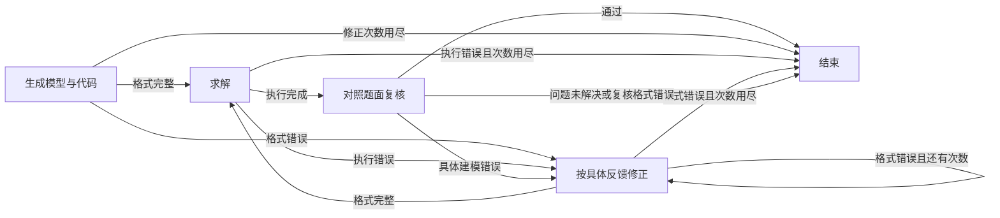

# 建模方法

方法负责建模流程：调用 LLM、输出中间产物、请求求解、根据反馈修正。平台提供 LLM、代码契约和求解沙箱。接口见[架构](architecture.md#方法接口)。

每个方法都是一张 LangGraph 图，即使只有一个节点。代码提示按建模库与可选后端组装；库内 API 由代码表达，平台自动识别原生模型。OptiMUS、CoE、OptiTree、OR-LLM-Agent、AutoFormulation 保留四种 MILP 方言。SAC-Opt 只支持 gurobipy；OptiMind 另支持 PySCIPOpt、coptpy、CVXPY。其他方法使用平台统一代码契约。后端须支持模型的变量类型、约束和目标。

## 方法一览

| id | 名称 | 图 | 预设参数 |
|---|---|---|---|
| `direct` | Direct | `generate`；校验数学模型与代码均存在，平台求解最终代码 | — |
| `feedback_repair` | Feedback Repair | `generate → solve → review → finish`；格式错误、执行错误或具体建模问题进入 `repair` 后重新求解与复核 | `max_repairs`=3 |
| `trival` | TriVAL | 语义验证 → 数学模型验证 → 代码验证；每阶段构建、验证、修订；代码缺陷可回溯到数学模型 | 每阶段最多验证 5 轮（`max_validations`），代码最多执行 20 次（`max_code_executions`） |
| `optimus` | OptiMUS 0.3 | `parameters → objective → constraints → check_constraints → formulate_constraints → formulate_objective → write_code → assemble → execute →（debug → use_fix → execute）*`，最多 3 次执行 | `temperature`=1.0、`max_debug_tries`=3 |
| `coe` | Chain-of-Experts | `start_trial → conductor ⇄ expert → reducer →（evaluate → backward）→ finish`；协调者逐个选专家，专家依次评论，汇总器写代码；开启反思时，代码出错则从最后一位专家向前询问责任 | `temperature`=0、`max_collaborate_nums`=3、`enable_reflection`=false、`max_trials`=3 |
| `optitree` | OptiTree | `classify*（逐层匹配问题类型）→ retrieve → reason → execute →（inspect → execute）*`，最多检查 4 次 | `temperature`=0、`max_inspections`=4 |
| `or_llm_agent` | OR-LLM-Agent | `math_model → write_code → execute →（fix → execute）* → end_round`，再按结果做一轮不可行检查或模型复查 | `temperature`=0.2；主轮 3 次、不可行检查 1 次、复查 2 次（`attempts`） |
| `orthought` | ORThought | `model → execute →（debug → execute）*`；一次写出求解思路、数学模型和代码，代码无法运行时带上模型和错误调试 | `temperature`=0、`debug_max_try`=3 |
| `llmopt` | LLMOPT | `define → write_code → execute →（self_correct →（define 或 write_code）→ execute）*`；五要素模型 → 代码 → 执行，LLM 分别判断模型和代码对错，回到错的一步重写 | `max_resolves`=12 |
| `autoformulation` | AutoFormulation | `start → expand*（深度优先建树）→ rollout*（MCTS）→ select` | `n_used_gpt`=8、`n_top`=3、`n_reward`=5、`total_rollouts`=16；其余搜索常数和运行上限见预设文件 |
| `sac_opt` | SAC-Opt | 锚点 → 分项生成 → 约束回译/比较/选择性修正 → 组装 → 求解/调试 | `temperature`=0，解析 5 次、语义 5 轮、执行 3 次 |
| `bind` | BIND | schema → 生成 → 求解 → 错误反馈修正 | `temperature`=0、`top_p`=1、`max_rounds`=3 |
| `optimind` | OptiMind | 分类 → 提示 → 生成 → 求解反馈 → 反思 | `temperature`=0.6、`top_p`=0.95、`max_turns`=5 |

参数全部集中在 [`src/llm4om/methods/presets.py`](../src/llm4om/methods/presets.py)，每个方法一个不可变的 dataclass。移植方法的取值依据上游固定提交，部署适配差异另行说明。运行时不能改参数：命令行、Python 接口和页面都不接受方法参数；要换参数，改这个文件。

各方法通过 `Method.parameters()` 声明运行记录中的参数快照。复杂方法的图在 `graph.py`，提示、解析和搜索按职责分开；包入口只导出方法对象与图工厂。CoE 的提示和解析分别位于 `coe/prompts.py` 与 `coe/parsing.py`，移动保留原文和逻辑。

## Direct 与 Feedback Repair

这两种方法由本项目维护，共用 `methods/direct/prompts.py` 中的生成提示和 `graph.py` 中的生成节点。Direct 保留一次 LLM 调用：明确变量域、目标方向、单位、索引、数据来源和每条约束，输出数学模型和完整代码。格式不完整时报告失败，不把空代码交给求解器。附件预览可能截断，代码通过 `build_model(data)` 读取完整数据。

Feedback Repair 在此基础上使用以下 LangGraph 图：



复核读取原题、数学模型、代码、求解反馈和可用的冲突诊断，返回 `accept` 或 `repair` 及原因。求得最优仍需复核目标系数、变量域、约束和数据绑定。真实不可行或无界可以正常结束；超时、仅有可行解、可满足性问题没有目标值，都不能单独成为改模型的理由。

最多修正三次，格式、执行和建模修正共享这个上限。复核仍发现问题时，保留产物并记录失败。若后续生成格式不完整，保留最后一次已求解的数学模型、代码和结果；不按目标值或求解状态把不同模型排成“最好的一次”。复核响应无法解析或调用失败时，同样保留已完成结果并报告失败。

无修正时，Feedback Repair 使用两次 LLM 调用和一次求解。复核是额外检查，不是正确性证明。它没有移植 SAC-Opt 的语义锚点或 OptiMind 的专家提示库。新增方法的实际接入范围见本文末节，来源调查见[接入调查](references/methods-solvers.md)。

## 固定来源与实现方式

原有八种研究方法的核心建模逻辑忠实移植：编排、提示、解析和停止条件来自上游。新增 SAC-Opt、BIND、OptiMind 的独立实现或部署适配另见文末，不将它们一概描述为逐字移植。目标不是逐行复刻上游的工程代码（文件输出、日志、命令行），而是让建模过程与上游一致。改动只有三类：

- **适配**：接入平台所必需，例如由平台提供 LLM、在沙箱中执行、按代码写法替换库名。
- **避错**：避免明显的运行失败，不改变机制。
- **修正**：上游代码与自身逻辑明显矛盾时才做，并单独列出。

论文与代码冲突时，以代码为准。每条改动在下文和源码中（`llm4om:` 注释）记录。

| 方法 | 固定来源 | 实现方式 |
|---|---|---|
| TriVAL | [SCUT-EIPI/TriVAL@380a529](https://github.com/SCUT-EIPI/TriVAL/tree/380a529) | 移植原 LangGraph 图、节点、提示和循环上限 |
| OptiMUS 0.3 | [teshnizi/OptiMUS@e182e9e](https://github.com/teshnizi/OptiMUS/tree/e182e9ef5841605c2a7e87467021fd83522b6484) | 上游 README 标注为 v0.3；`main.py` 流程改写为图；提示逐字提取（`optimus/prompts.py`，MIT）；保留上游输出格式并修正解析；代码提示按写法方言组装（`optimus/dialects.py`） |
| CoE | [xzymustbexzy/Chain-of-Experts@afb89bf](https://github.com/xzymustbexzy/Chain-of-Experts/tree/afb89bf602690ea621f13a23c42722f20f653a43) | `main.py` 的 `chain_of_experts` 改写为图；七位专家、协调者和汇总器的提示逐字保留 |
| OptiTree | [MIRALab-USTC/OptiTree@2e70ecf](https://github.com/MIRALab-USTC/OptiTree/tree/2e70ecfd0a3c8e9c0c16d36d7d498a7344cfdec9) | `Reasoner.reason_run` 改写为图；分类、推理、检查三组提示逐字提取（`optitree/prompts.py`）；随包分发原问题类型树和思路模板（`optitree/source/`，MIT） |
| OR-LLM-Agent | [bwz96sco/or_llm_agent@5dccdaa](https://github.com/bwz96sco/or_llm_agent/tree/5dccdaab89ab91c3cb28066fe849423dc124d287) | `or_llm_eval.py` 的 `or_llm_agent` 改写为图；提示逐字保留，代码请求改为平台契约 |
| ORThought | [BeinuoYang/ORThought@5293e24](https://github.com/BeinuoYang/ORThought/tree/5293e24861a65d1e4a2f61f4fad0a81de901ee38) | `workflow.py` 的 `ORThoughtModelAgent`（`formalized` 模式）与 `ORThoughtSolveAgent` 改写为图；`prompt.py` 逐字收录（`orthought/prompts.py`）。论文见 [arXiv 2508.14410](https://arxiv.org/abs/2508.14410) |
| LLMOPT | [antgroup/LLMOPT@1492dd3](https://github.com/antgroup/LLMOPT/tree/1492dd33e39ea13f1afe32a0adc13d4217334195) | `inference/inference_q2f2c.py` 的 Q2F → F2C → 执行改写为图，加上论文的自我校正循环；`prompts/generate_prompt.py` 与 `prompts/self_correction_prompt.py` 逐字收录（`llmopt/prompts.py`）。论文见 [ICLR 2025](https://arxiv.org/abs/2410.13213) |
| AutoFormulation | [jumpynitro/AutoFormulator@5214801](https://github.com/jumpynitro/AutoFormulator/tree/52148018d04de23dc2d36d4281eb6244c2a42ffc) | `MCTS_used.py` 的建树与 `many_rollouts` 改写为图；`prompts.py` 和 `utils_*` 的解析与等价判断放在 `autoformulation/upstream/`；代码生成按写法组装（`autoformulation/codegen.py`）。论文见 [ICML 2025](https://proceedings.mlr.press/v267/astorga25a.html) |

这些实现使用你配置的通用 LLM，没有复现论文的模型、数据或运行条件。采样温度沿用上游：OR-LLM-Agent 0.2；ORThought 0；CoE 0（协调者 `max_tokens=10`）；OptiTree 0；OptiMUS 和 AutoFormulation 上游不设温度，这里用 OpenAI 默认值 1.0。

### TriVAL

详细说明见 [`methods/trival/README.md`](../src/llm4om/methods/trival/README.md)。

| 改动 | 类型 | 原因 |
|---|---|---|
| 各节点通过 `context.llm("trival.<节点>")` 取得模型 | 适配 | LLM 由平台配置 |
| `code_executor` 改为调用 `context.solve()` | 适配 | 代码在平台沙箱中构建和求解 |
| 代码智能体提示中的求解器选择和 OR-Tools/CP-SAT/CVXPY 语法段落，替换为平台代码契约（包括 CPMpy 写法） | 适配 | 代码写法由用户选择 |
| 代码验证提示删去“代码是否打印可解释的求解结果”一条 | 适配 | 平台契约要求代码只构建模型，结果由 Worker 输出 |
| `messages[-1].content` 改为 `.text` | 避错 | Anthropic 等模型返回分块内容 |
| agent 节点和多工具编辑中间件使用异步调用；工具声明 `ToolRuntime[ContextSchema]` | 避错 | 取消可沿调用链传播；工具上下文按实际类型序列化，无需全局屏蔽警告 |
| `code_agent` 生成代码后清除入口预设的“未生成代码”失败标记 | 避错 | 平台保留方法的显式失败，成功路径不能携带过期失败标记；不改变验证和路由 |

DeepSeek 的思考模式不支持强制 `tool_choice`，而 TriVAL 的结构化输出需要它。使用 DeepSeek 时，在额外请求参数中设置 `{"thinking": {"type": "disabled"}}`。

### OptiMUS 0.3

当前固定提交已采用 [OptiMUS v0.3](https://arxiv.org/abs/2407.19633)，不是待新增方法。界面显示版本，方法 id 仍为 `optimus`。

上游 `main.py` 的流程（`ERROR_CORRECTION=True`，不启用 RAG）：目标 → 约束（冗余检查 k=5、每条约束置信度检查 k=5）→ 约束公式 → 目标公式 → 逐条代码 → 确定性组装 → 执行与调试（最多 3 次）。

| 改动 | 类型 | 原因 |
|---|---|---|
| 上游从 `params.json` 读取参数和取值。附带同格式 `params.json` 时照此使用；否则运行上游的参数提取提示，并在输出格式中加一个 `value` 字段 | 适配 | 平台输入是自然语言，参数取值必须来自题面 |
| 代码提示、组装和变量代码取所选写法的方言。gurobipy 方言是上游原文；Pyomo 和 `pywraplp` 方言只替换 `{solver}`、编码指引中的导入和 `addConstr`、两个代码示例、“不支持 a <= x <= b”一句，以及变量声明 | 适配 | 代码写法由用户选择 |
| 组装结果包装为 `build_model(files)`，参数取值写入代码；删去 `model.optimize()` 和结果打印 | 适配 | 平台契约只构建模型 |
| 约束检查走上游的 `ask_LLM` 分支；参数的人工确认（`input()`）不执行 | 适配 | 平台运行没有人工交互；上游 `main.py` 本身也不运行参数提取 |
| 解析时把五个以上连续的 `=` 视为一个 `=====` 分隔符 | 避错 | 上游在 `=======` 内部找到“闭合”分隔符，取出空代码。DeepSeek 实测这样写，目标函数代码因此丢失，模型以目标值 0 “最优”结束 |
| 读取分隔符内的全文，不额外跳过首字符；只删除代码块开头的语言标签 | 避错 | 分隔符后没有换行时首字符丢失；全局删除 `python` 会破坏变量名和字符串 |
| 缺少完整分隔符或 Python 代码块时报解析错误 | 避错 | 不再用负索引截取无效代码 |
| 回复没有 `=====` 分隔符时，取最后一个 ```` ```python ```` 代码块（上游取第一个） | 避错 | 模型用 Markdown 作答时常先写表达式片段，最后才写完整语句。实测 gurobipy 下第一个块是裸的 `quicksum(...)`，目标未设置，模型以目标值 0 “最优”结束 |
| JSON 对象和数组由同一个解析器读取，保留转义和嵌套结构，只清理字符串外的行注释 | 避错 | 原解析器会破坏转义，并在含 URL 且没有后续换行时无限循环；删除备用解析器 |

调试以“求解状态为最优”为成功条件，与上游一致。因此不可行或无界的模型也会进入调试。

### Chain-of-Experts

| 改动 | 类型 | 原因 |
|---|---|---|
| 专家提示中的 `code_example` 改为平台的空 `build_model` 模板（`CodeTarget.starter`），替代数据集的 `prob_*` 函数 | 适配 | 平台契约 |
| 程序员角色中的 “Gurobi” 换成所选写法的库名 | 适配 | 代码写法由用户选择 |
| 反思时在沙箱中构建并求解代码；不再让 LLM 生成测试输入 | 适配 | 平台直接执行模型 |

每轮试验开始时清空评论池，与上游一致：每轮试验是一次独立运行。反思只在代码执行失败时触发，`enable_reflection` 默认关闭，与上游命令行一致。

### OptiTree

上游 `Reasoner.reason_run`：解释器从根类型“Mixed Integer Programming”开始，在当前节点的子类型中逐层匹配（`TemplateMatcher.final_template`）；最深匹配节点的整条树条目（去掉 `id`）作为思路模板交给推理器写代码；代码运行失败时由检查员修改，最多 4 次。题面前加上 `test.py` 的 MILP 前缀。

| 改动 | 类型 | 原因 |
|---|---|---|
| 推理提示中的 “gurobi code” 换成所选写法的库名；推理和检查提示末尾拼接平台代码契约，替代模板中的求解与打印代码 | 适配 | 代码写法由用户选择 |
| 代码在沙箱中执行。上游在输出为错误、空或 “None” 时检查；这里在代码无法运行时检查，检查员读取沙箱反馈 | 适配 | 平台契约只构建模型，没有打印输出 |
| 上游 `Agent` 把自己的回复以 `system` 角色存入对话；这里改为 assistant 消息 | 适配 | 多家供应商拒绝首条之后的 system 消息 |
| 匹配到的类型不在树中、回复缺少判断字段，或匹配会回到路径上已有的节点时，停在当前节点 | 避错 | 上游在这些情况下抛出异常或循环 |

### OR-LLM-Agent

| 改动 | 类型 | 原因 |
|---|---|---|
| 代码请求中的“使用 Gurobi……以及求解和结果输出”改为平台代码契约 | 适配 | 代码写法由用户选择 |
| 两条恢复提示中的“Gurobi Python code”改为“Python code”；建模提示中的 “Gurobi” 换成所选写法的库名 | 适配 | 同上 |
| 代码在平台沙箱中执行 | 适配 | — |

修复对话只保留在副本中，只有最后一次代码进入主对话，与上游 `generate_or_code_solver` 一致。上游在最后一次修复后不再执行；平台把这段未执行代码作为中间产物输出，最终结果取最后一次实际执行的代码。

### ORThought

上游流程：`formalized_solution_path_prompt` 让 LLM 按专家建模的顺序写出求解思路（理解问题：目标、决策变量、约束；再逐步建立变量、目标和约束），然后汇总数学模型并写出代码，三部分分别放在 `<solution_path>`、```` ```model ```` 和 ```` ```python ```` 中。代码执行出错时，`debug_prompt` 读问题、数学模型、代码和错误信息，返回改正的代码，最多 `debug_max_try` 次（上游 `main.sh` 为 3）。代码能运行但无可行解时不调试。论文报告的多智能体对照和 LogiOR 数据集不在平台中。

| 改动 | 类型 | 原因 |
|---|---|---|
| 两条代码要求（“带默认参数的可调用函数，返回最优目标值或 `None`”）改为平台代码契约；“Gurobipy”换成所选写法的库名 | 适配 | 代码写法由用户选择；平台读取模型而不是函数返回值 |
| “执行出错”定义为沙箱没有得到求解状态；错误信息是沙箱反馈。上游判断返回值是否为含 “Error” 的字符串 | 适配 | 代码在平台沙箱中执行 |
| 代码块取最长的 ```` ```python ```` 块，不再要求超过 400 个字符 | 避错 | 上游的长度门槛针对带默认参数和数据的函数；`build_model(data)` 常常更短，按原门槛会被当成“没有代码” |

求解思路作为 `solution_path` 产物显示在过程中。仓库没有声明许可证，提示仅用于研究复现（见 NOTICE）。

### LLMOPT

上游流程：`Q2F` 让 LLM 按模板写出五要素模型（Sets、Parameters、Variables、Objective、Constraints），`F2C` 只根据五要素模型写代码，然后执行。论文第 3.4 节在测试时加入自我校正：`self_correction` 提示把问题、五要素模型、代码和运行信息交给 LLM，分别判断五要素模型和代码是否正确；第 4.1 节规定最多重解 12 次。

LLMOPT 的主要贡献是微调模型（多指令 SFT 加 KTO 对齐），发布为 [LLMOPT-Qwen2.5-14B](https://huggingface.co/ant-opt/LLMOPT-Qwen2.5-14B)。平台只复现测试时流程，使用所选预设。要复现论文条件，用 vLLM 等服务以 OpenAI 兼容接口部署该模型，并添加一个 `openai_compatible` 预设。

| 改动 | 类型 | 原因 |
|---|---|---|
| 代码请求的结尾（“写 Pyomo 代码，以 `from pyomo.environ import *` 开头，打印最优解，写成类并加 main 函数”）改为平台代码契约；其余提示中的 “Pyomo”/“pyomo” 换成所选写法的库名 | 适配 | 代码写法由用户选择；平台读取模型而不是打印输出 |
| 自我校正提示的运行信息是沙箱反馈（状态、错误、目标值和非零变量），不是代码的打印输出 | 适配 | 生成代码不再打印结果 |
| 自我校正提示中“生成并执行 pyomo 代码”一句改为说明平台契约：代码定义 `build_model(data)` 并返回模型，由平台求解 | 适配 | 不说明时，判断者把“代码没有调用求解、没有打印”判为错误，每轮都要求重写正确的代码（DeepSeek 实测） |
| 五要素取第一个代码块；该块不含全部五个小节（Sets、Parameters、Variables、Objective、Constraints）时，改用整段回答去掉代码块标记的文本 | 避错 | 上游假设回答只有一个代码块。通用 LLM 常把每个小节分别放进代码块，或不用代码块，按原规则只取到 Sets，代码因缺少参数而建错；不用代码块时上游直接中断 |
| 上游没有发布循环代码。五要素判为错时回到 `define`（随后重写代码），否则代码判为错时回到 `write_code`，两者都对时结束；回答中缺少某个判断时按“正确”处理 | 适配 | 按论文的文字描述实现；论文未说明两个判断如何对应到返回哪一步 |
| 结果取最后一次执行 | 适配 | 论文未说明；与“判对即停”一致 |

提示与 `inference_q2f2c.py` 一致，作为单条用户消息发送，不加系统消息，不设温度。代码回答中没有 ```` ```python ```` 块时，上游因 `IndexError` 中断；这里同样让运行失败，并给出原因。仓库没有声明许可证，提示仅用于研究复现（见 NOTICE）。

### AutoFormulation

上游流程：`MCTS.dfs_from_scratch` 深度优先建树。每个节点为下一个组件（参数、决策变量、目标、等式约束、不等式约束）采样 `n_used_gpt` 个回答；去掉空回答；对可执行的组件运行检查脚本；去除等价候选（参数取众数，决策变量由 LLM 分组 8 次取多数，其余用 SymPy/Z3 脚本判断）；LLM 排名打分，保留前 `n_top` 个。然后 `MCTS.many_rollouts(global_scoring="ranking")`：UCT（`w_exp=1`、`λ=0.5`）选出完整模型；前 3 个有解的完整模型作为基线（奖励 0.5）；之后的完整模型与每个基线双向比较（每次 5 个判断），胜率作为奖励回传；Bradley-Terry 给出全局排名。

图中 `expand` 每步展开一个节点，`rollout` 每步完成一次有效 rollout（到达未评估过的完整模型），`select` 取排名最高的有解模型。`upstream/` 中保留 `prompts.py`、`utils_prompt.py`、`utils_general.py` 和 `utils_diff.py`（改动处标注 `# llm4om:`）；`search.py` 逐行移植 `MCTS_used.py` 与 `utils_metrics.py` 中不依赖文件的函数。

上游辅助函数只保留当前流程使用的部分；纳入 Ruff 检查，清理导入和裸 except。删除未调用函数、被后续定义覆盖的重复函数，以及失败后原样重复调用同一函数的兜底。

| 改动 | 类型 | 原因 |
|---|---|---|
| 检查脚本与完整模型的代码按写法生成（`codegen.py`）。gurobipy 输出是上游 `create_code_str` 的文本；Pyomo 输出用稀疏 `Var(pyo.Any, dense=False)` 和字典表达同一结构；`pywraplp` 输出逐个创建变量，结构与 gurobipy 相同 | 适配 | 代码写法由用户选择 |
| 决策变量提示中“用 Gurobi 变量类型（如 `GRB.INTEGER`）”一句，以及完整模型比较提示中的 “Gurobipy”，按写法替换 | 适配 | 同上 |
| 检查脚本和等价判断脚本通过 `context.run_script` 在沙箱中运行，按上游 `check_script_output` 的关键词判断；完整模型由平台求解 | 适配 | 生成代码不在主机执行 |
| “有解”定义为求解器返回目标值。上游从 Gurobi 日志解析 “Best objective” | 适配 | 求解器由写法决定 |
| 入口：建树之后直接运行 `many_rollouts` 并取排名第一的有解模型 | 适配 | 上游发布的入口 `run_NL4OPT.py` 只建树；排名选择在 `many_rollouts` 中 |
| 等式约束的边界变量：上游在主机进程中 `exec` LLM 生成的参数代码来判断索引是否越界；这里生成带成员检查的代码，在沙箱中运行时判断 | 避错 | 不在主机执行生成代码，判断结果相同 |
| 变量的 `iteration_space` 除 `[i for i in I]` 外，也接受 `i for i in I`、`for i in I`、生成器表达式和索引集本身 | 避错 | 上游只解析列表推导式，其他写法会让索引变量被建成标量，整个分支被剪掉。DeepSeek 实测会写成 `products` 或 `for p in products` |
| SMT 等价脚本中 `Reals(...)` 的取值与括号 | 避错 | 上游生成的脚本在单变量时语法错误 |
| 两两比较的解析失败时最多重试 5 次（上游无限重试）；决策变量分组全部无法解析时保留全部候选（上游抛出异常） | 避错 | 防止运行卡死或中断 |
| 只有两个有解模型时，上游把被判更差的一个排在前面，与其 Bradley-Terry 分支相反；这里把被判更好的排在前面 | 修正 | `pairwise[1][0]` 是模型 1 的胜率，上游写反了比较方向 |
| 字典抽取使用 Python tokenizer 跳过字符串内的花括号 | 避错 | 参数文本中的花括号不再截断字典 |
| 参数代码和表达式字典用 `repr()` 转义字符串 | 避错 | 引号、换行和反斜杠不再生成无效 Python；不改变参数取值或候选选择 |
| 并发采样和沙箱检查在出错或取消时，取消并等待同批其他任务；成功结果保持输入顺序 | 避错 | 运行返回后不再启动或遗留同批任务，计数不会在写回后继续变化 |

注意事项：

- **成本**：这里的“调用”指单个回答（补全）。上游一次请求用 `n` 取多个回答；这里每个回答单独请求，回答数与上游相同，请求数更多。默认参数下，建树最多约 540 个回答（上游约 80 次请求）；前 3 次 rollout 只作基线，之后每次最多 30 个回答。候选等价时会被剪掉，简单问题实际少得多。要试用，可在 `presets.py` 中临时减小这些值，例如 `n_used_gpt=8 n_top=2 n_reward=2 total_rollouts=2`（约 50 次调用）。`n_used_gpt` 太小时，候选可能全部因代码错误被剪掉。
- **简单问题**：候选全部等价时树只有一个完整模型，rollout 阶段没有比较；`many_rollouts` 在 1000 次无效 rollout 后停止，这一步不调用 LLM。

## 验证

### SAC-Opt、BIND、OptiMind 与新增求解路径（2026-10-22）

确定性检查：Python 166 项通过（含本机 Gurobi）；默认跳过的 14 项 Docker 测试另行执行后全部通过，另 1 项持证 MOSEK 成功测试因无许可证跳过。前端 37 项 Vitest、8 项 Playwright 通过。新增浏览器用例检查 SAC-Opt/OptiMind/BIND 的求解器可选范围，并完成 BIND 建模。Ruff、ESLint、类型检查、前端构建与 wheel 构建通过；wheel 与当前源码/数据/前端产物一致，无旧构建缓存残留。Worker 10 与当前 `worker.py` 字节一致。

新回归覆盖：SAC-Opt 冻结已通过约束、仅修复失败组件、分项数量和格式重试、代码围栏解析、执行调试及未解决语义失败；BIND 超长完整数据绑定、JSON 非矩形结构、CSV 边界、修复历史和真实不可行；OptiMind 有/无专项提示、成功后的反思以及无代码/执行失败时的退出条件。求解器覆盖 SCIP 非线性约束、Ipopt 局部结果与超时、COPT 整数规划、OSQP 二次规划、SCS 半正定约束及许可证隔离。

真实 LLM 使用环境预设 `deepseek-flash`。下表使用 Docker Worker 10；最终 SAC-Opt 运行在提示区分固定参数/决策变量、补全附件契约并处理分项代码围栏后完成：

| 方法 | 代码写法 | 问题与结果 | LLM 调用 / 求解 |
|---|---|---|---|
| SAC-Opt | gurobipy | 生产计划，最优值 13；约束语义检查通过 | 21 / 1 |
| BIND | PySCIPOpt | 生产计划，JSON 只向 LLM 提供结构，完整数据在代码中读取，最优值 13 | 1 / 1 |
| OptiMind | Pyomo | 生产计划，通用提示，最优值 13，代码外最终答复结束反思 | 3 / 1 |

另一次 OptiMind 真实运行使用本地 PySCIPOpt，四城市有向旅行商矩阵为 `[[0,2,9,10],[1,0,6,4],[15,7,0,8],[6,3,12,0]]`。分类匹配 `TravelingSalesman` 并使用原提示，求得最优值 21，3 次 LLM 调用、1 次求解。

同一模型的 Direct 方法还在 Docker Worker 10 中验证了新增代码接口；每次均为 1 次真实 LLM 调用、1 次求解：COPT 整数生产计划为 13；OSQP 求解带线性约束的凸二次问题为 0.5；CasADi/Ipopt 求解有界 Rosenbrock 问题为 `locally_optimal`，目标约 `6.4e-18`；SCS 求解 `min trace(X), X-I ⪰ 0` 的 2×2 半正定问题为 `2.000011`（理论最优值 2）。

MOSEK 已验证缺失许可证时的明确失败，没有用其他求解器伪装成功。COPT 使用内置小规模非商业模式验证。这些验证说明接入流程和所列问题可以运行，没有测量大规模表现或整体建模准确率。

### Direct 与 Feedback Repair 更新（2026-10-22）

确定性检查：Python 138 项测试通过，默认跳过的 8 项 Docker 测试另行执行后全部通过；前端 36 项 Vitest、7 项 Playwright 浏览器测试通过。Ruff、ESLint、TypeScript 类型检查、前端构建和 Python wheel 构建通过；wheel 包含新的 `direct/` 包，不含旧 `direct.py`，页面引用的构建产物齐全。

新增回归覆盖：生成格式不完整及修正上限；代码求得最优但目标系数错误；真实不可行、无界、求解限时和无目标可满足性结果；复核响应无法解析；修正后仍有建模问题；后续生成或复核调用失败时保留已完成模型、代码和求解结果。TriVAL 成功路径不再携带过期失败标记。

真实运行使用环境预设 `deepseek-flash`，Docker 镜像 `llm4om-worker:9`，Pyomo/HiGHS：

| 输入与方式 | 方法 | 结果 |
|---|---|---|
| README 的生产计划，完整真实运行 | Direct | 最优值 13；1 次 LLM 调用、1 次求解 |
| 同上，完整真实运行 | Feedback Repair | 复核通过，最优值 13；2 次 LLM 调用、1 次求解 |
| 同一题增加 A 至少生产 5 件，完整真实运行 | Feedback Repair | `infeasible`；复核确认 A 的下限与切割容量冲突，未放宽约束；2 次 LLM 调用、1 次求解 |
| 首次生成注入错误：数学模型和代码都把 A 的利润系数从 3 改为 6；后续复核与修正使用真实 LLM | Feedback Repair | 第一次虽为 `optimal`、目标值 24，仍识别出系数错误；修正后最优值 13；1 次注入生成、3 次真实 LLM 调用、2 次求解 |

这些运行验证了流程与特定错误的恢复，没有测量整体建模准确率。

### 先前维护检查

本轮维护检查：Python 3.12 的 71 项测试通过（含本机 Gurobi）。前端 10 项 Vitest 测试、lint、类型检查和构建通过。依赖审计（前端 `npm audit`；Python 锁定依赖与 Worker 镜像内的包用 `pip-audit`）无已知漏洞。四种语言在 Docker 中求得生产计划预期最优值，另验证了容器取消。LangGraph Server 的后台运行、流重放、历史读取和 TriVAL 取消使用假 HTTP 模型及真实本机求解验证，取消后没有继续发起模型请求。

异常路径回归分布在对应模块的测试中（`tests/test_graph.py`、`test_llm.py`、`test_cli.py`、`test_methods.py`，前端 `src/features/runs/useRun.test.ts`）：JSON 中的 URL、转义和嵌套结构；TriVAL 超时与多工具顺序编辑；AutoFormulation 并发取消；建模与最终求解共享截止时间；求解超限记录；Anthropic 额外参数；OpenRouter 流式工具对话保留推理字段；断线后重新读取运行状态；节点产物步骤先于下一节点的调用记录。沙箱测试另检查环境变量隔离和取消后的子进程回收。这些测试使用脚本模型或本地假 HTTP 响应。

确定性测试（`tests/test_methods.py`、`tests/test_sandbox.py`、`tests/test_server.py`）用脚本化的聊天模型跑通全部 10 张图，覆盖：Pyomo、gurobipy、`pywraplp`、PuLP 和 CPMpy 各自由对应求解器求到最优，CVXPY 由 Clarabel 求解凸二次规划；不可行模型的冲突约束（Gurobi IIS、CPMpy MUS）；CPMpy 可满足性问题；代码与写法不符时的报错；MILP 方法拒绝 CPMpy；Direct 生成 CPMpy 代码；OR-LLM-Agent 的修复与不可行复查；OptiMUS 在四种写法方言下的组装、调试、长分隔符与多代码块解析；CoE 的反向反思；OptiTree 沿类型树匹配并检查失败代码；AutoFormulation 的参数众数、变量分组、SymPy 等价剪枝、排名、双向比较和两模型排名；TriVAL 回溯到数学模型的路径；ORThought 的错误调试；LLMOPT 按自我校正结果回到五要素或代码步骤，以及 12 次重解上限；LLM 调用上限。

2026-10-21 用 DeepSeek（关闭思考模式）在 Docker 沙箱中做了真实运行：

| 问题 | 方法 | 代码写法（求解器） | 结果 |
|---|---|---|---|
| README 中的生产计划示例 | Direct、TriVAL、OptiMUS、CoE、OptiTree、OR-LLM-Agent、AutoFormulation（`n_used_gpt=3 n_top=2 n_reward=2 total_rollouts=4`） | Pyomo（HiGHS）、gurobipy（Gurobi）、`pywraplp`（SCIP） | 21 次运行全部最优，目标值 13 |
| 同上 | Feedback Repair | Pyomo（HiGHS） | 最优，目标值 13 |
| 同上 | Direct、TriVAL | CPMpy（CP-SAT） | 最优，目标值 13 |
| 单机 4 作业排程，最小化总拖期（参考最优值 0） | Direct | Pyomo（HiGHS） | 最优，目标值 0 |
| 同上 | Feedback Repair、TriVAL | CPMpy（CP-SAT） | 最优，目标值 0 |
| 8 皇后，第一行皇后在第 1 列（可满足性问题） | Direct | CPMpy（CP-SAT） | 找到解（`feasible`，无目标值），经检查合法；代码使用 `AllDifferent` |
| README 中的生产计划示例 | OptiMUS | gurobipy（Gurobi） | 首次组装的代码有语法错误，调试一轮后最优，目标值 13 |
| 3×4 带固定费用的运输问题 | AutoFormulation（`n_used_gpt=4 n_top=2 n_reward=2 total_rollouts=4`） | Pyomo（HiGHS） | 最优，目标值 1860；40 次 LLM 调用。两个完整模型进入 rollout，排名与两两比较都实际运行 |

平台改为 LangGraph 服务器后（[ADR 0009](adr/0009-langgraph-server.md)），同日经 `llm4om serve` 的线程、后台运行和可重放流再次真实运行，模型开启流式输出：

| 方法 | 代码写法 | 结果 |
|---|---|---|
| Direct | Pyomo、CPMpy | 最优，目标值 13 |
| Feedback Repair | gurobipy、CPMpy | 最优，目标值 13 |
| TriVAL | Pyomo、CPMpy | 最优，目标值 13 |
| OptiMUS | `pywraplp` | 最优，目标值 13 |
| Chain-of-Experts、OptiTree | Pyomo | 最优，目标值 13 |
| OR-LLM-Agent | gurobipy | 最优，目标值 13 |
| AutoFormulation（`n_used_gpt=2 n_top=2 n_reward=1 total_rollouts=2`） | Pyomo | 最优，目标值 13 |

8 个运行同时进行，全部成功；流式输出下 token 统计仍然完整。页面上的运行、停止和重新打开也做了浏览器检查。

生产计划示例上，OptiMUS 曾因长分隔符丢失目标函数代码，以目标值 0“最优”结束；修正解析后重跑为 13。这些运行只证明流程能端到端工作，不代表方法在 Benchmark 上的准确率。

### v0.41

确定性检查：Python 86 项测试、前端 16 项 Vitest 测试和 5 项 Playwright 浏览器测试通过，Ruff、ESLint、类型检查和构建通过。新增测试覆盖 PuLP 与 CVXPY 的求解、CVXPY 拒绝整数变量、各写法不可行模型的冲突约束（且不进入 `feedback()`）、OptiMUS 与 AutoFormulation 的 PuLP 方言、ORThought 的错误调试、LLMOPT 的回退路径与 12 次重解上限、每日 token 预算和运行频率上限。浏览器测试发现并修复了两个只在构建后的页面出现的错误：手动拆分的 SDK 代码块让发起运行报错 `r is not a function`；历史查询把 TanStack Query 的上下文当成元数据过滤条件，运行记录为空。

2026-10-22 用 DeepSeek（关闭思考模式）在 Docker 沙箱中真实运行。问题：README 中的生产计划（13）、3×4 运输问题（独立求得 1360）、凸二次规划 $\min (x-1)^2+(y-2)^2,\ x+y\le 2,\ x,y\ge 0$（0.5，解 $(0.5,1.5)$），以及合同下限与切割产能矛盾的生产问题（不可行）。

| 方法 | 代码写法（求解器） | 问题 | 结果 |
|---|---|---|---|
| Direct、OR-LLM-Agent | PuLP（CBC） | 生产计划 | 最优，13 |
| OptiMUS | PuLP（CBC） | 运输问题 | 最优，1360；19 次 LLM 调用 |
| Direct、Feedback Repair | CVXPY（Clarabel） | 凸二次规划 | 最优，0.5，解 (0.5, 1.5) |
| Direct | Pyomo、PuLP、CPMpy | 不可行生产问题 | `infeasible`；Pyomo 与 PuLP 由 Gurobi IIS 给出 3 条冲突约束，CPMpy 由 MUS 给出 2 条（$A\ge 5$ 与 $2A+B\le 8$） |
| ORThought | Pyomo、gurobipy、PuLP、CVXPY、CPMpy | 生产计划、运输问题、凸二次规划 | 5 次运行全部最优，目标值分别为 13、1360、1360、0.5、13；每次 1 次 LLM 调用 |
| LLMOPT | Pyomo、gurobipy、PuLP、CVXPY、CPMpy | 同上 | 5 次运行全部最优，目标值同上；每次 3 次 LLM 调用（五要素、代码、自我校正判对） |

LLMOPT 第一次真实运行暴露了两个适配问题（见上文 LLMOPT 改动表）：DeepSeek 把每个小节分别放进代码块，按上游规则只取到 Sets，运输问题得到目标值 0 和 4 的错误模型，并用满 12 次重解；判断者不知道平台契约，把“代码没有调用求解”判为错误。修正后 5 次运行都在第一轮判对。

同日在 Docker 部署上检查：经 Caddy 的 HTTPS 访问和流式输出正常；设置预算后，用完预算的预设在第一次 LLM 调用前停止；同一地址第 3 次发起运行得到 429；正常重启后运行记录数量不变（61 条）；`docker compose cp` 备份得到完整的 `.langgraph_api/` 与 `.private/`。恢复命令与迁移命令相同，本次没有在生产数据上执行。LangSmith 追踪没有实际接入验证。


## SAC-Opt、BIND 与 OptiMind

三种方法均注册为独立 LangGraph 图，参数来自 `methods/presets.py`，在页面、CLI、Python 与 LangGraph 服务中可用。

| 方法 | 固定参考提交 | 图与公开范围 |
|---|---|---|
| SAC-Opt | [`ec0ddb5`](https://github.com/Forrest-Stone/SAC-Opt/tree/ec0ddb544ae6b70714181740ebbba16027df50e4) | 四类锚点 → 分项代码 → 约束回译 → 语义比较 → 仅修正未通过约束 → 组装 → 求解/调试。独立实现与自写提示，当前仅 gurobipy |
| BIND | [`1dac06b`](https://github.com/SprocketLab/Text2Opt-Bench/tree/1dac06be656c41d827ef20987cf8af0b48d382a2) | 数据结构 → 生成 → 求解 → 错误反馈 → 重新生成；最多 3 次，JSON/CSV 内容留在求解环境 |
| OptiMind | [`419cf7b`](https://github.com/microsoft/OptiGuide/tree/419cf7b9eee20b6af036abf15152fa775b20c951/optimind) | 类型分类 → 公开提示 → 生成 → 求解 → 反思；最多 5 次生成，一条轨迹，专项提示仅有 TravelingSalesman |

SAC-Opt 的核心是按约束进行选择性修正；已通过约束不会再次改写。默认温度 0、解析 5 次、语义比较 5 轮、执行 3 次。它检查约束代码的回译一致性，不额外宣称独立验证了目标。批量组件处理、附件绑定、结束时保留未解决失败等差异见 [SAC-Opt 说明](../src/llm4om/methods/sac_opt/README.md)。上游未声明许可证，因此本实现不复制其提示和代码。

BIND 默认温度 0、top_p 1。平台没有参考最优值或参考模型，删除了上游基准评分作为修复条件的依赖，只以真实执行状态决定是否调试。不可行是有效求解状态，不会据此改松约束。题面应说明数据字段语义；只有完整附件在代码执行时解析。细节见 [BIND 说明](../src/llm4om/methods/bind/README.md)。

OptiMind 默认温度 0.6、top_p 0.95，成功求解后仍给出反馈。LLM 可以提供修正版，或用不含代码的最终回答结束。分类节点只匹配公开库中的类别，没有匹配则使用通用提示。没有下载训练模型、引入多数投票或补造未公开提示。细节与原文件哈希见 [OptiMind 说明](../src/llm4om/methods/optimind/README.md)。

这些实现改变了执行环境和部分输出契约，不能直接宣称复现论文成绩。求解器能力和方法的建模范围分别限制支持的组合；旧方法不会因为增加求解器而自动获得新的方言。
