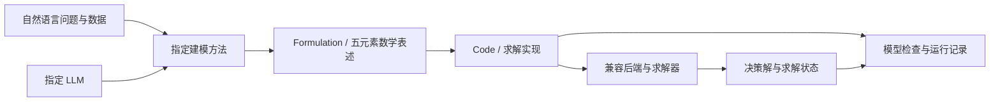

# LLM4OM 需求分析

文档修订：0.4.0；日期：2026-10-08。本文解释需求形成的依据。可测试要求见 [需求规格](v1.0.md)，文献依据见 [研究综述](../research-landscape.md)。

## 1. 已确认的产品目标

LLM4OM 的 Web 面向普通使用者。用户输入自然语言问题及可选业务数据，选择建模方法和求解器，获得建模输出、求解结果和运行记录。Benchmark 由平台内部集成和维护，用户可以浏览每条题面、复制或带入建模，无需上传数据集或配置实验。CLI／SDK 为开发和评测入口，与 Web 共用 Python 应用接口。

平台支持持续接入不同 benchmark、建模方法、建模表示和求解器。统一抽象按职责分别定义：同类实现共享接口，跨类模块通过产物和配置协作。平台形式借鉴 LLM4AD 的多方法、多任务与模型接入方式，处理对象是优化模型与建模过程。[LLM4AD 论文](https://arxiv.org/abs/2412.17287)

### 1.1 业务主线

反馈修正、搜索或多 Agent 协作由方法内部决定。平台提供统一的模型调用、数据访问和候选执行能力，保存全过程。

### 1.2 科研主线

Benchmark 将多个问题实例按冻结的样本、配置、预算和评测协议组织成实验。实验中的每个样本都使用单问题应用流程；报告从逐样本结果汇总。这样，日常调试与正式实验共享相同的方法行为和结果语义。

## 2. 领域任务与系统责任

一个公开问题记为 \(p=(d,D,a)\)：\(d\) 是原始描述，\(D\) 是数据，\(a\) 是已声明假设。建模方法 \(m\) 在 LLM \(\ell\) 与预算 \(b\) 下产生候选建模输出 \(A\)，并依据公开信息选择最终候选。建模输出在概念上分为数学表述 F 与求解实现 C；这是输入输出责任的区分，不要求方法实现为两个固定函数。Formulation 表达问题的数学含义，Code 将其实现为目标后端的可执行模型；平台通过受支持路径构建候选优化模型 \(M\)，求解得到 \((x,z,t)\)：决策解、目标值与终止状态。

数学表述一般由集合、参数、决策变量、目标和约束组成。领域文献使用这些对象组织建模过程；本项目采纳这五元素作为默认 Formulation 规范。它定义信息组织，不要求自由文本直接可执行；Code 可由 LLM 生成或从严格 IR 编译。[LLMOPT 方法与模板](https://arxiv.org/html/2410.13213v2)

| 问题 | 责任主体 | 平台提供的支持 |
|---|---|---|
| 如何理解描述并形成候选表述？ | 建模方法与 LLM | 公开问题、数据视图、调用与候选记录 |
| 如何探索、修正和选择候选？ | 建模方法 | 公开执行反馈、共享预算、父子关系 |
| 如何保持表示转换的数学含义？ | 编译器与建模后端 | 版本化 IR、变量映射、确定性编译 |
| 如何求解当前候选模型？ | 求解器适配器 | 资源限制、状态归一化、解与界提取 |
| 如何评价是否符合原问题？ | 独立评估器与可用参考材料 | 分层检查、证据记录、明确不可用状态 |
| 如何接入和比较多个实现？ | 平台内核与应用接口 | 接口、能力匹配、实验配置和共同报告 |

平台提高接入、执行和观察过程的一致性。建模准确率由方法、模型、任务与预算共同决定，需要实测。

## 3. 用户需求与优先级

| 用户 | 当前最重要的需求 | 必需输出 | 对应 FR |
|---|---|---|---|
| 单问题使用者 | 指定方法完成建模与求解 | 模型／代码、决策解、目标、状态、诊断 | 07、13、20、24、26 |
| 方法开发者 | 保留自身策略并接入平台 | Manifest、方法入口、受控 Context | 01～04、13～19 |
| 自动建模研究者 | 固定条件比较方法并解释失败 | 逐样本结果、候选轨迹、成本与证据 | 18、28～34 |
| Benchmark 维护者 | 保留任务含义、版本与参考材料 | 来源、公开输入、私有参考、划分记录 | 08～12、29、30 |
| 求解后端开发者 | 接入受支持表示并归一化求解结果 | 兼容矩阵、原始状态、映射与真实记录 | 04、21～25 |

P0 是普通使用者的单问题闭环及内置样例试用；P1 是第三方方法与后端接入；P2 是在同一闭环上批量评测与比较。Web 聚焦单问题使用；开发与批量评测通过 CLI／SDK 完成。

## 4. 核心需求为何形成

### 4.1 方法与模型分别配置

训练得到的优化建模 LLM、调用该 LLM 的推理流程，以及模型生成的数据集是不同对象。ORLM 同时提供训练方案、模型和 IndustryOR；接入时分别落到模型配置、方法变体与数据适配器。[ORLM](https://arxiv.org/abs/2405.17743)

当前将方法研究路线分为基于提示、基于训练及混合类型。首批优先 OptiMUS／CoE 的推理流程，主要使用通用外部 LLM；暂不集成专用训练权重。训练类工作的流程或提示可另作变体，不能将模型替换后的结果归为原专用模型复现。

因此，方法接口只规定公开输入、可使用的资源与输出，不规定内部必须有多少 Agent、提示步骤或搜索节点。

### 4.2 建模输出采用共同封装与不同表示

自动建模有 Formulation 与 Code 两个主要阶段，数值 Solve 随后发生。同一方法可以分步、联合或往返修正；共同封装分别保存表述和实现，允许历史方法明确缺少某阶段。共同封装应保存问题 revision、数据绑定、假设、来源和可用视图；执行路径由实际表示决定。强制重写历史方法的表示会改变其行为，接入后必须区分忠实适配与新变体。

五元素以集合、参数、变量、目标和约束组织表述；可选领域 DSL 保留其问题族语义，不作为全局唯一表示。1.0 的 GroundedLPIR 表达绑定到当前数据的有限 LP/MILP 实例。参数化模型可由 Python 工厂表达，其实例化结果进入真实求解。通用的符号索引 IR 不在本阶段增加。

### 4.3 建模结构与数据绑定分别观察

结构正确仍可能出现错列、错索引或错系数。外部表格访问、派生参数计算与具体数值绑定需要单独记录。Text2Opt-Bench/BIND 对这一失败维度进行了专门研究；本项目据此增加诊断区分，不假定它是所有任务的主要瓶颈。[Text2Opt-Bench/BIND](https://arxiv.org/abs/2605.21751)

### 4.4 求解反馈与建模正确性证据分别处理

编译错误和 solver 反馈可支持修正；遗漏业务约束的模型仍可能求出最优解。平台须保留独立检查器接口。无隐藏参考材料的用户问题仍能建模和求解，评测只呈现可获得的证据。

候选选择使用公开信息。隐藏 benchmark 参考目标与参考代码不参与方法输入或选择。若研究专门开放验证反馈，使用单独实验协议。

### 4.5 Benchmark 作为任务、数据和协议的组合

原始版、清洗版、修正版可能有不同题目与参考答案；模型—数据分离的任务还需要参数文件。首批导入 NL4Opt、NLP4LP、MAMO EasyLP／ComplexLP 的 LP/MILP 实例。NLP4LP 的参数与参考代码须分别投影；MAMO ODE 任务不进入本版范围。平台不能仅按数据集名称汇总，也不能照抄论文中的样本数。任务适配器需保持原始 ID、文件哈希、过滤规则和协议覆盖范围。

## 5. 需求到设计的追踪

| 分析结论 | 需求组 | 架构位置 | 详细设计 | 验收 |
|---|---|---|---|---|
| 单问题是共同流程 | FR-07/13/20/24/35/36 | Application、Method、Execution | DD-01/02/08 | AC-03/20/23 |
| 同类实现可替换 | FR-01～06 | Registry、Planner | DD-03 | AC-01/02/21 |
| 表示不同但产物可检查 | FR-20～26 | Artifact、Compiler、Backend | DD-04/05 | AC-10～13 |
| 数据含义与来源可追溯 | FR-07～12/20/26 | Task、Data、Artifact | DD-04/06 | AC-03/04/24 |
| 公共修正与私有评分分开 | FR-08/13/19/27～30 | Method、Executor、Evaluator | DD-02/06/07 | AC-05/09/15/16 |
| 实验可重建 | FR-17/18/30～34 | Experiment、Journal、Reporter | DD-06/07 | AC-08/17/18/22 |

DD 编号在 [详细设计](../detailed-design.md) 中定义，AC 编号在 [验收清单](../acceptance.md) 中定义。

## 6. 当前范围与实现时需要回答的问题

1.0 以 LP/MILP 验证共同流程；保留三种首批方法、两类真实 Provider、两种求解器路径和三个首批 benchmark 的发布要求。后续方法与数据集的参考资料不构成接入承诺。

实现应优先检验三个问题：OptiMUS 与 CoE 的不同推理策略能否共享同一接口；结构化与原生代码产物能否保留各自信息并进入求解；同一单问题流程能否直接用于批量实验。每次发现需要核心插件特例时，先查共同契约缺少什么。

当前工程默认值与用户已确认目标分别列于 [决策记录](../decisions-and-open-questions.md)。研究文献中的效果属于其具体实验，本项目尚无方法效果或性能结果。
