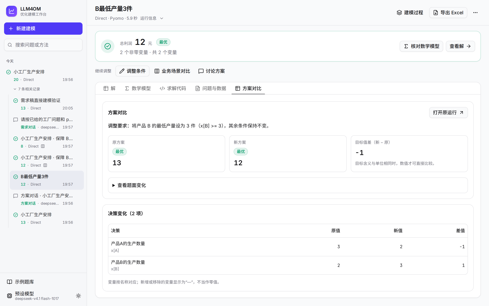

# 使用指南

本文说明怎样用工作台、命令行和 Python 接口求解优化问题。安装和启动见 [README](../README.md#快速开始)，部署给多人使用见[部署指南](deployment.md)。

## 一次运行的流程

```text
问题描述 + 可选数据文件
   → 建模方法调用 LLM，写出数学模型和求解代码
   → 沙箱执行代码，用所选写法的求解器求解
   → 结果：目标值、变量取值、数学模型、代码和全部过程
```

运行在服务器上进行。关闭页面不会中断运行。重新打开时，页面从第一步重放到当前进度。

## 工作台

### 优化对话：新增独立入口

原工作台继续作为首页。点击侧栏“优化对话”进入 `/agent`，可以直接发送问题或上传数据，无需先填写建模配置。信息不足时，助手简短追问；问题已经明确时，调用完整建模方法并实际求解。支持多轮流式回复、Enter 发送、Shift+Enter 换行、停止及失败重试。默认使用 Direct、Pyomo 和自动求解后端；可在对话里指定其他方法、建模库和后端，也可通过输入框旁的“建模偏好”固定方法与建模库。

选择 DeepSeek 预设时，三类对话的输入区都显示“深度思考”开关。初始状态继承预设，发送后保存在当前对话，刷新仍保留。开关通过 [DeepSeek 原生参数](https://api-docs.deepseek.com/guides/thinking_mode/) 控制本轮对话回复，不修改共享预设；工具调用的建模流程继续使用运行预设。模型返回的思考过程单独折叠，可点击展开。其他服务商仍使用各自预设参数。

工具调用期间，对话显示实际步骤和产物入口。电脑端的建模工作区在旁边展示数学模型、代码及结果，可切换查看本次对话已生成的方案，也可打开完整运行页进行导出等操作。普通解释不重新计算；明确修改业务条件时调用原建模流程。单个新方案成为当前方案，多个业务场景从共同基准计算。每次计算独立保存，删除对话不会删除已保存方案。

拖动对话和建模工作区之间的分隔线可调整宽度；也可用 Tab 聚焦分隔线，再按左右方向键。布局在刷新后保留。方案选择列表标出“当前讨论方案”；查看其他方案时显示“正在查看历史方案”，点击“查看讨论中的方案”返回。浏览历史不会切换后续对话的计算基准。

附件可点击文件名检查、编辑和移除。附件修改只影响后续新建模型，已保存方案的题面、配置和附件保持固定。改变附件后，请明确要求按新数据重新建模。联网搜索按需开启，搜索来源可展开核对；公开资料中的业务建议需要用户确认后再用于计算。

刷新正在执行的对话会重新连接服务器上的活动运行。最终文字回复失败时，已计算的方案仍可查看，重试使用已保存结果。中止尚未完成的计算后，可重试原消息；未完成的计算不会冒充已完成方案。每轮调用一个计算工具，可以通过“业务场景”批量比较多个明确条件。

点击“新建建模”或顶部“手动建模”可返回首页，使用下面的原有工作台。两套交互独立提供；切换入口会保留原工作台草稿。已有需求对话、方案对话、运行与对比链接继续有效。


### 1. 添加预设模型

点击左下角“预设模型”，选择服务商，填写密钥和模型 ID，再保存。可填写预设名称用于显示；实际请求仍使用模型 ID。DeepSeek 服务商使用原生 `langchain-deepseek` 客户端，接口地址可填写兼容该协议的自定义地址。服务器设置了 `LLM4OM_LLM_*` 环境变量时，已经有一个默认预设，可以跳过这一步。

添加表单可按 Enter 提交。读取模型或保存时会显示进度，失败后保留已填写内容。预设加载失败时直接点击页面提示中的“重试”，不需要重新填写配置。

预设固定服务商、接口地址、密钥、模型 ID 和请求参数：

- 预设只能添加和删除，不能修改。要换参数，就删掉后重新添加。重新添加会获得新 ID；旧运行再次执行时需重新选择预设。
- 密钥只保存在服务器上（`<workspace>/.private/llm-presets.json`，权限 `600`）。所有接口和运行记录都不返回密钥，也不显示掩码。密钥只发给与它一起保存的接口地址。
- 服务器 `.env` 中的 `LLM4OM_LLM_*` 变量给出 id 为 `env` 的预设。它排在第一位，是默认预设。页面上不能删除它，只能在服务器上修改。

支持的服务商：OpenAI、Google Gemini、Kimi、GLM、OpenRouter、阿里云百炼、DeepSeek 和 Anthropic。其他服务选“OpenAI 兼容”，再填写接口地址。

### 2. 写问题

写清决策、目标和约束。需要数据时，拖入或添加 CSV、JSON 文件，每个文件最大 2 MB。Excel 工作簿（`.xlsx`）的每个工作表会转换为一个 CSV 文件。

普通附件可使用中文、空格、括号等常见文件名字符，名称保持原样。

点击附件名称可先检查和编辑数据。CSV、TSV 以表格显示，可修改单元格和列名，例如将“价格”补充为“单价（元）”。数值保留原始文本，编号 `001` 不会变成 `1`。每页显示 50 行；翻页和保存保留全部数据。超过 50 列时用“原文”编辑，JSON 和文本也用原文编辑。CSV 引号不完整或 JSON 无效时，修正后才能保存。

点击“保存数据”才应用修改，取消保留原附件。需求对话中的附件同样可编辑，并保存到当前需求稿。已经运行的方案保留当时的数据；修改新草稿不会改变历史方案。

建模修正后若尚未执行新版代码就超限或失败，页面保留新版产物和失败原因，不把上一版的解当作新版结果。此前已执行的目标值和反馈仍可在“建模过程”中查看。

TriVAL 达到验证次数上限仍未通过时，会明确显示未通过的阶段和反馈，并保留实际求解结果。求解器报告“最优”只对应当前模型，不代表该模型已通过方法的全部验证。

读取附件时可以继续写问题，读取完成后才能开始建模。清空问题后可点击提示中的“撤销”恢复原文和附件。题库翻页按钮固定在窗口底部，无需滚完当前页。


输入区可在“编辑”和“预览”之间切换。预览支持 Markdown 标题、列表、表格和代码块；提交、复制和再次编辑仍使用原文。运行页的“问题与数据”也按相同格式显示。

电脑端打开编辑页后可直接输入。切换预览后保留编辑区的光标、选区和滚动位置。Ctrl+Enter 或 Cmd+Enter 开始建模；中文输入法组合输入时不会误启动。

题面中的单个 `$` 保留为普通文本，例如 `$4` 不会被误当成公式。公式请使用 `\(...\)`、`\[...\]` 或 `$$...$$`；生成的数学模型仍支持 `$...$`。

聊天消息支持 `$...$` 行内公式，并区分 `$4` 等价格；`\[...\]` 和 `$$...$$` 按行间公式排版。生成中的公式暂不完整时显示原文，补齐后再排版。长公式和代码在内容区内横向滚动。流式回复会跟随最新内容；向上翻阅后暂停跟随，点击“回到最新消息”恢复。滚动条随亮色、深色主题切换。

也可以从首页的三个例子开始，或在“示例题库”中选择公开题目。

### 可选：先通过对话整理需求

还没有完整题面时，点击首页“通过对话整理需求”。已有问题文本和附件会带入对话，也可以从空白开始。先说想安排什么、做什么决定或改善什么；助手根据你的回答整理业务目标、规则、数据及待确认事项，每轮只追问最影响问题的内容。

回复以自然语言流式显示，支持多轮对话。Enter 发送，Shift+Enter 换行；中文输入法选词时的回车不会误发送。回复期间可继续起草下一条消息，完成后发送，也可以停止回复。未发送文字按对话保存在当前浏览器标签页，切换页面或刷新后仍保留；发送成功后清除。

电脑端在问题编辑区旁展开需求助手，需求稿始终是主内容，运行设置和“开始建模”仍在当前工作区。需求稿可直接编辑，支持 Markdown 预览与原有文件导入。人工改稿离开编辑区时保存，也可以点击“保存需求稿”；发送下一条消息或交给建模前会先保存。附件读取后保存。回复期间暂停编辑，避免新回复覆盖正在输入的修改。窄窗口通过“问题与数据 / 需求助手”页签切换。

确认当前需求稿后，可直接配置方法、建模库及预设，点击“开始建模”。启动会先完成尚未保存的编辑。也可点击“用于建模”采用需求稿并收起助手。助手不自行启动求解，也不要求满足固定完整性清单；交接前请检查稿中的待确认事项。后续方法只收到文本和附件，对话本身保留在历史记录中，可以继续编辑或聊天。

每轮对话可选择支持工具调用的现有模型预设，用量计入相同的每日 token 预算。停止或失败后，点击“重试这一轮”重新回答原问题，不重复添加用户消息，也不清空输入框中尚未发送的下一条草稿。排队时立即停止，也会保留已提交的问题。技术错误可展开查看；主动停止单独显示。刷新正在回复的页面会重连原运行。删除需求对话会删除它的稿件和附件，已经创建的建模运行仍保留。

打开输入框下的“联网搜索”，助手可按需调用 [DeepSeek Search API](https://api-docs.deepseek.com/guides/search/) 查阅公开资料。执行时显示查询词，完成后来源默认折叠；展开可查看网页标题、域名、日期和摘要，刷新后仍可查看。网页建议需经你确认后才作为固定业务要求；搜索失败会显示原因，仍可继续整理需求。

DeepSeek 预设默认使用它自己的密钥和地址。使用其他模型时，在服务端配置 `LLM4OM_SEARCH_API_KEY`，可用 `LLM4OM_SEARCH_BASE_URL` 指定搜索地址（默认 `https://api.deepseek.com/v1`），重启服务即可。独立搜索密钥不会从模型预设借用，搜索密钥也不进入对话记录。


### 3. 选择方法、建模求解器和模型

问题上方展示当前运行配置摘要。点击“查看运行设置”或“调整配置”展开全部设置，选择后点击“完成”：

电脑端左侧选择建模方法，右侧选择建模库、后端和模型，常用配置同时可见。小窗口或预设较多时，设置主体可滚动，“完成”按钮始终保留。


| 设置 | 说明 |
|---|---|
| 建模方法 | 13 种方法，见 [README](../README.md#建模方法)和[建模方法](methods.md) |
| 建模求解器 | 九个建模库之一，每个库只出现一次 |
| 求解后端 | 所选库的原生后端，默认自动选择。列表显示当前沙箱的安装状态；商业许可在实际执行时校验 |
| 预设模型 | 本次运行使用的 LLM |

点击“开始建模”，或按 Ctrl+Enter。

Direct 用一次 LLM 调用生成模型和代码，适合快速运行。Feedback Repair 会在求解后对照原题复核，发现格式、执行或建模问题时最多修正三次。即使求解器返回最优，也会检查是否写错目标或漏掉约束。正确的不可行模型会保留为不可行，不会为了得到解而放宽要求。

### 4. 看结果


运行页顶部先给结论：目标值和求解状态，或失败原因。“核对数学模型”和“查看解”直接跳到对应页签。

顶部保留建模过程、Excel 导出和更多操作；结果下方集中提供“调整条件”“业务场景对比”和“讨论方案”。“再运行一次”“查看对比”等操作位于“更多操作”。展开“运行信息”查看预设模型、实际后端、用时和调用量。完整错误可展开读取，不只显示截断文字。

电脑端运行时并排展示建模过程与产物，完成后默认让数学模型、代码和求解结果使用完整主区域。点击顶部“建模过程”可再次展开或收起。展开后可拖动分隔线，也可聚焦分隔线后按左右方向键调整；宽度会在浏览器中记住。查看正在生成的内容时，向上滚动会暂停自动跟随，回到底部后恢复。方案解读下的“完整变量取值”可展开筛选、查看和下载原始变量；重复的结果统计不再占据阅读空间。

过程和产物分别在各自面板内滚动。产物页签只在宽度不足时横向滚动，改变窗口或分栏宽度后，当前页签仍保持可见。数据编辑与附件预览的表格共用一个横纵滚动区域，列头始终保留；运行设置中的方法列表随整个设置主体滚动，底部操作按钮保持可见。

- **建模过程**（左栏）：LLM 调用按它们产出的阶段分组。正在进行的调用实时显示文字。
- **解**：按变量分组或列表查看。二维变量显示为矩阵，可以导出 CSV。
- **数学模型**和**求解代码**：方法改写过的版本都可以查看，并和上一版对比。

  

- **问题与数据**：本次运行的问题描述和数据文件。

“最优”只说明求解器找到了当前模型的最优解。请对照问题检查数学模型是否完整。

### 方案解读

工作台在成功求解后自动生成“方案解读”，显示目标和决策变量的业务名称、单位及关键要求。表格中的数值直接读取实际求解结果，LLM 不填写数值。解读最多读取 100 个非零变量；全零解读取前 100 个变量。完整结果仍在下方查看和导出。

有实际解时，点击运行页顶部“导出 Excel”，下载两张工作表：“求解方案”包含业务名称、实际数值、单位和原变量名；“问题与条件”保留完整题面、调整要求、原问题、附件名称、运行设置和链接。Excel 导出包含零值及全部变量，不受页面分页或解读范围限制。没有业务标签的变量保留原名称，不补造单位；附件原始数据仍从“问题与数据”查看。

导出文件是本次求解结果的快照。修改 Excel 单元格不会重新求解；改变问题要求时使用“调整条件”。

最优、可行或局部最优结果可导出；达到时限但已有实际解的结果也可导出，并保留其原状态。不可行、无界和执行失败的结果不作为执行方案导出。

解读跟随开始运行时的界面语言，摘要保持简短，关键要求最多列三项。

解读使用本次运行的预设模型，额外调用一次 LLM，并计入步骤、token 和用量限制。解读失败或调用额度不足时，求解结果仍保留。已有历史不会自动补生成解读；重新运行后可生成。

### 用一句话调整条件

运行结束后点击“调整条件”，例如输入“B 至少生产 3 件，其他条件保持不变”。平台整理完整的新题面，再使用原运行的方法、预设模型、建模库、后端选择和附件重新建模、求解。原运行保持不变。完整题面编辑入口在“更多操作 → 修改后运行”。

新运行的“方案对比”显示原、新目标值和决策变化，并可展开查看题面差异。原方案取自开始调整时保存的检查点；以后再次执行原线程，也不会改变这次对比的基准。原运行删除后，基准检查点随之删除，新运行及其结果仍保留。

变量按名称对应。名称变化会分别列为新增或移除，不会当成数值零。目标含义或单位改变时，应按各自业务含义阅读结果。题面整理额外调用一次 LLM，后续仍执行所选方法的完整建模流程。



### 围绕方案继续对话

运行结束后点击“讨论方案”，在完整建模结果旁展开助手。可以询问实际决策值、目标含义或模型表达的条件。助手读取该次运行的固定结果；普通解释不会重新求解。支持多轮流式回复、Enter 发送、停止和失败重试，刷新后可以继续。

明确给出新条件，例如“B 至少生产 3 件，其他条件不变，请重新计算”，助手才会调用原方法，整理新题面、建模并实际求解。建模方法、模型预设、建模库、后端和附件继承基准方案；对话使用的模型预设可以单独选择。每个新方案单独保存，可查看完整步骤、模型、代码和结果，也可导出 Excel。

重新计算时，对话显示当前场景的实际题面整理、建模、求解和解读阶段。完成后显示实际状态和目标值卡片，点击“查看计算方案”在主区域核对模型与数值差异；批量场景可直接“对比本轮方案”。助手顶部明确标出“当前讨论方案”；展开“相关方案”可查看原运行或其他方案，浏览不会改变对话基准。收起助手即可恢复结果的完整宽度。

电脑端可拖动结果与助手之间的分隔线，或聚焦后按左右方向键调整宽度；刷新后保留。三类对话都会在底部跟随新输出，窗口或分栏变化后继续跟随。主动向上翻阅会暂停跟随，点击“回到最新消息”继续。

一个新方案成为后续对话的当前方案；继续调整默认基于它。明确说“从原方案出发”可以回到原基准。一次要求计算多个场景时，所有场景从同一基准出发，当前方案保持不变。原运行及其附件始终保留。回复失败后，已生成方案仍可打开；重试会读取已完成结果。批量计算部分保存失败时，重试仍使用原基准和原始场景，复用已保存结果并补完剩余场景。删除对话不会删除这些独立方案。


### 比较多个业务场景

在原运行的结果下方选择“业务场景对比”，填写 2 至 6 个场景名称和具体变化，例如“B 至少生产 3 件”和“B 至少生产 4 件”。点击“计算并对比”，各场景使用同一份原问题、附件和运行设置重新建模。也可以在方案对话中一次提出多个明确场景。

对比页显示固定原方案及各场景的实际状态、目标值、单位和关键决策。优先显示前 20 个发生变化的同名变量，完整结果可打开各方案查看。缺失变量显示为 `—`，不会当作零；不同含义或单位的目标值不直接排序。启动部分场景失败时，已经启动的运行仍保留，页面提示未全部启动。


### 不可行模型

模型不可行时，“解”页签列出一组不能同时满足的约束。线性模型用 Gurobi IIS 求出，CPMpy 模型用 MUS 求出。Feedback Repair 也读取这些信息，检查冲突是否来自建模错误；已移植的研究方法仍使用原有反馈。CVXPY 写法没有这项诊断。

运行结束后，如果求解器提供了具体冲突证据，平台显示“为什么无解”，把约束映射为业务要求，并提供至多一项有明确依据的候选调整，保留用户明确固定的要求。展开“查看对应约束”可核对每条说明的依据。诊断针对本次数学模型，也应核对模型是否准确表达了原问题。

候选调整尚未验证。点击“尝试这个调整”只会填入“调整条件”窗口；可编辑要求，再点击“生成新方案”重新建模求解。原问题和原结果保留，可查看新旧方案对比。业务解释和候选调整位于方法之外，不会自动放松原约束。

求解后端没有返回具体冲突、诊断失败，或只报告局部不可行时，平台不生成确定的冲突解释。业务解释调用仍计入本次用量、预算和时限；解释失败保留原状态与原始诊断。已有历史记录不会自动补算解释。


线性模型的诊断通过 Gurobi 完成。没有完整许可证时，Gurobi 只能处理小规模模型，大模型会提示诊断失败。

### 对比多个方法

打开“运行设置”中的“对比”开关，勾选多个方法或预设模型，一次最多发起 12 个运行。对比页并排列出每个运行的结果、目标值、用时、LLM 调用数和 token，并提示目标值是否一致。


目标值相同不代表模型都对。几个方法可能犯同样的错。点击一行，可以查看该运行的数学模型、代码和过程。

服务器设置了每小时运行上限时，对比可能只启动一部分运行。这时页面仍打开对比页，并提示有几个运行没有启动。

### 备注、标签和报告

- **备注与标签**：在运行页选择“更多操作 → 备注与标签”，记录结论。在左侧搜索框输入 `#标签`，可以筛选运行。能打开工作台的人都能看到和修改备注。
- **导出报告**：选择“更多操作 → 导出报告（Markdown）”，下载问题、设置、结果、数学模型、代码和备注。
- **再运行一次**：用同样的问题和设置重新运行。**修改后运行**：把问题和设置带回编辑页。
- **复制链接**：运行页和对比页都有固定地址，可以发给同事。

### 界面

左下角可以切换浅色、深色或跟随系统，也可以切换中文或英文。浏览器语言不是中文时，界面默认是英文。

电脑端以问题编辑和建模产物为主，完整运行设置按需展开；对话助手开启后在旁边显示。宽度不足 1024 像素时，使用页签切换主要内容与助手。宽度不足 1280 像素时，导航收进顶部菜单。输入和预览各自滚动，底部的开始按钮始终可见；短屏下可在设置窗口中继续向下滚动。

手机横屏或屏幕较矮时，运行页可以整体滚动，结果区保留阅读高度。属于对比组的运行会自动换行排列操作按钮。


## 服务商说明

**DeepSeek 与 TriVAL**：DeepSeek 的思考模式不支持强制 `tool_choice`，而 TriVAL 的结构化输出需要它。在“高级参数 → 额外请求参数”中填写 `{"thinking": {"type": "disabled"}}`，或在服务器上设置 `LLM4OM_LLM_EXTRA_BODY`。

**Anthropic**：额外参数支持 `thinking`。

额外请求参数用于服务商特有选项，不能重复指定模型、密钥、温度、token 上限等已有字段，也不能替换调用记录回调。

**OpenRouter**：平台使用专用集成，保留工具对话中的推理信息。推理强度可以设为 `{"reasoning": {"effort": "high"}}`。当前集成不支持的推理字段会报错。

## 内置题库

“示例题库”包含 9 组、2033 条公开题面。可以逐条阅读，再带入输入区。

| Benchmark | 题数 | Benchmark | 题数 |
|---|---:|---|---:|
| NL4Opt | 205 | IndustryOR | 99 |
| NL4LP | 178 | ComplexOR | 18 |
| MAMO Easy | 642 | OptiBench | 403 |
| MAMO Complex | 210 | OptMATH | 128 |
| NL4COP | 150 | | |

题面来自 [OPT-Agent](https://github.com/Fangziyang0910/OPT-Agent) 的整理版本，不含答案。部分题目超出 LP/MILP 范围。来源和许可见 [Benchmark 来源](references/benchmark-sources.md)。

## 命令行

```bash
uv run llm4om run --problem "……" --method trival --language pyomo
uv run llm4om run --file problem.txt --data demand.csv --method coe
```

命令在本进程中运行和服务器相同的图。它逐步打印过程，最后输出数学模型、代码和求解结果。

| 参数 | 说明 |
|---|---|
| `--problem` / `--file` | 问题描述文本，或 UTF-8 文本文件 |
| `--data` | 数据文件（CSV 或 JSON），可以重复 |
| `--method` | 方法 id，例如 `direct`、`orthought`、`llmopt` |
| `--language` | 九个库的 ID：`pyomo`、`gurobipy`、`ortools`、`cpmpy`、`pulp`、`cvxpy`、`pyscipopt`、`casadi`、`coptpy` |
| `--solver` | 原生后端 ID；省略时为 AUTO，由模型和库选择原生后端 |
| `--preset` | 预设模型 id；默认用第一个预设 |
| `--workspace` | 保存预设的工作区 |
| `--output` | 把最终状态（含全部步骤）写入 JSON 文件 |
| `--sandbox local` | 在本机子进程中执行生成代码，不隔离，只用于开发 |

## Python 接口

```python
from llm4om import run_problem

state = run_problem("……", method="optimus", language="gurobipy")
print(state["failure"] or state["solve"]["objective"])
```

用 `preset=` 选择预设，或用 `llm=LLMSettings(...)` 直接传入模型设置。`solver=` 可指定原生后端；省略时自动选择。库内 API 由生成代码表达，无需配置接口。

## 运行记录

每次运行是 LangGraph 服务器上的一个线程（thread）：

- **线程状态**保存问题、数据文件、数学模型、代码、求解结果、全部步骤和调用统计。
- **线程元数据**保存标题、方法、代码写法、模型名、备注和标签，不含密钥。

左侧按同一问题的已记录来源归并需求对话、运行、调整方案和对比，点击“相关记录”展开；搜索也能找到其中的记录。相同题名不代表同一个问题。旧记录没有来源信息时保持独立，删除任一记录也不连带删除其他记录。

服务器把它们保存在 `<workspace>/.langgraph_api/`，重启后仍在。使用同一个 `--workspace`，就能保留预设和历史。

## 常见问题

**页面一直显示“无法连接服务器”。** 检查 `llm4om serve` 或 `app` 容器是否在运行（`docker compose ps`），以及防火墙是否放行端口。

**运行失败，提示 Docker 或镜像不存在。** 先运行 `uv run llm4om build-worker` 构建沙箱镜像。Docker 部署会自动构建。

**gurobipy 提示许可证或规模限制。** 没有完整许可证时，Gurobi 只能求解小规模模型。换用 Pyomo、OR-Tools 或 PuLP 的开放后端，或按[部署指南](deployment.md#gurobi-许可证)挂载许可证。

**提示预设的每日 token 已用完。** 服务器设置了 `LLM4OM_DAILY_TOKENS`。换一个预设，或等到第二天。

## 运行记录与完整结果

历史列表每次读取 100 条，用“加载更早的运行”继续浏览；文字和标签筛选作用于已加载的记录，页面会显示这个范围。运行的“问题与数据”页可以展开“运行配置”，查看该次实际使用的方法参数、LLM 设置和求解环境；Markdown 报告也包含它，密钥不在记录中。

对比表的用时只计算实际执行，不含排队，也不受备注和标签修改影响。旧记录或中断记录没有完成计时数据时，对比表显示“—”。原预设已删除时，“再次运行”会提示重新选择预设。

停止运行后，已保存的步骤和中间产物仍可查看。重启服务后也能读取已落盘的进度；这不表示能够从中断点继续方法。变量较多时页面按需展示更多，但搜索、CSV 和 Excel 导出始终使用完整结果。Markdown 报告最多列出 500 个非零变量，并明确注明范围。

## 新增方法与求解路径

- SAC-Opt：适合逐项检查约束是否与题意一致。它会提取锚点，再把约束代码回译并比较；只修正不匹配的组件。支持九个建模库，保留 LP/MILP 问题范围。
- BIND：适合 JSON/CSV 数据较长的输入。题面需说明字段含义和单位；模型看到数据结构，生成的代码读取完整内容。Excel 继续通过页面转为 CSV。无附件时按题面直接建模。
- OptiMind：按问题类型添加公开提示并多轮检查求解结果。当前公开专项提示仅含旅行商问题，其他问题使用通用检查提示。

原生 SCIP（PySCIPOpt）可以表达非线性约束。CasADi/Ipopt 用于光滑连续非线性问题；“局部最优”不代表全局最优，“局部不可行”也不证明整个问题不可行。CasADi 只提供最小化：最大化问题写成最小化负目标时，报告的目标值也相应取负，数学模型中会注明。

CVXPY 的后端由原生注册表提供，不单独计成多个建模求解器。AUTO 使用原生候选路径选择可执行后端；显式选择的后端失败时不会替换。OSQP 限连续凸二次规划，MOSEK 需要许可证。COPT 可在无许可证的小规模非商业模式下运行，商业部署与大模型需相应许可。许可证配置见[部署指南](deployment.md#其他商业求解器许可证)。
