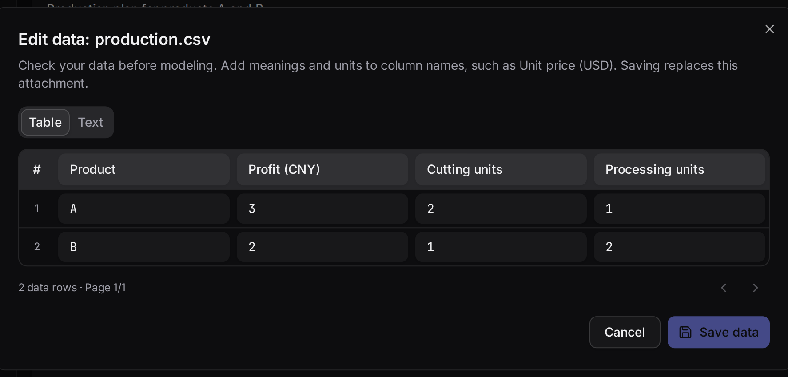

Attach CSV, JSON or Excel so generated code can use complete data. Click a file name to inspect fields, edit cells or raw text, and save the attachment to the current problem.

## Prepare files and descriptions

CSV and JSON files support up to 2 MB each. Every Excel worksheet becomes a CSV. Common file-name characters are preserved. Describe file names, fields, units and index mappings in the problem.

For `production.json`, explain that usage rows identify resources and columns identify products, measured in hours per unit, with nonnegative integer production quantities.

Download the ready-to-use [JSON example](../../../assets/examples/production.json) and [CSV example](../../../assets/examples/production.csv).

## What to inspect in the editor

| Data | Example action |
|---|---|
| Headers and units | Change “Price” to “Unit profit (CNY)” |
| Identifiers | Preserve store IDs such as 001 as text |
| Values | Edit costs, demands or available hours |
| Matrix orientation | Match rows to warehouses and columns to stores |
| Structure | Edit JSON as raw text; switch tables to raw view |

Tables display 50 rows per page while retaining the complete data. Use raw view above 50 columns. Saving validates CSV quoting and JSON syntax so errors can be corrected in the editor.

## Try saving and cancelling

Edit capacities below. “Save and calculate” creates a revised plan; “Cancel edits” restores saved values. The example retains its original snapshot.

```demo
data
```

In the workbench, “Save data” applies attachment edits. Modeling uses the current saved inputs; existing runs retain their original data for comparison.

## How data reaches the model


`data` maps file names to text, parsed during execution. For large structured attachments see [BIND](../bind/): generation receives structure and execution reads full values.

## Watch the actual workflow



The recording ends by opening an attachment, editing unit profit and saving it. Watch the continuous workflow in [quickstart](../quickstart/) too.

```video
workbench
```
