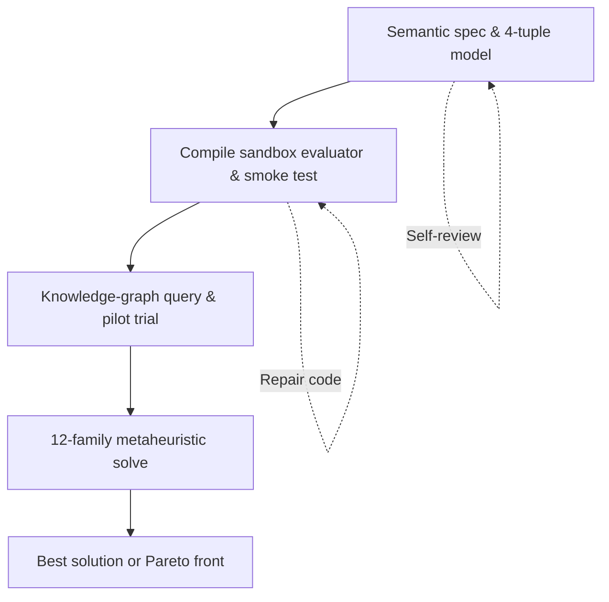

AutoCO (Automated Combinatorial Optimization) is the platform's metaheuristic optimization engine. For large-scale combinatorial scheduling, black-box nonlinear objectives, or multi-objective trade-offs, AutoCO compiles plain-language descriptions into fast sandboxed NumPy problem evaluators, then combines a feature knowledge graph with live pilot trials to select and run the best configuration from 12 metaheuristic families.

## When to choose AutoCO

| Problem characteristics | Recommended engine | Why |
|---|---|---|
| Multi-objective trade-offs (e.g., electricity cost vs. fault risk) | **AutoCO** (NSGA-II / MOEA/D / NSGA-III) | Produces a full non-dominated Pareto front and knee recommendation in one run without manual weights |
| Large quadratic assignment, routing, scheduling, or packing (e.g., QAP-30) | **AutoCO** (SA / TS / ILS / LNS) | Exact branch-and-bound frequently times out; high-throughput neighborhood search reaches near-optimal solutions in seconds |
| Black-box, piecewise, or nonconvex nonlinear objectives | **AutoCO** (CMA-ES / DE / PSO / GA) | Evaluates `evaluate(x)` directly without Big-M linearization or convexity assumptions |
| Small-to-medium LP, MILP, or standard convex models | **Exact Solvers** (Direct / TriVAL) | Reports feasibility, optimality and available conflict diagnostics |

In the default **Auto** mode inside [Chat Agent](../chat-agent/), the platform automatically routes multi-objective and metaheuristic requests to AutoCO while keeping exact models on exact solvers. You can also pin `AutoCO` explicitly in the composer or in [Configure a run](../run-settings/).

## Workflow and worked example



```walkthrough
[
  {"title":"Semantic & 4-tuple model","nodes":["Sem"],"body":"Parses objectives, decision variable semantics, and hard constraints into a typed 4-tuple M = (P, X, F, C), explicitly classifying variables as permutation, assignment, binary, integer, or continuous.","artifact":"Objectives: min total electricity cost f1(x), min total fault risk f2(x)\nDecision variable: assignment[0..11] in {0, 1, 2, 3} (4 heterogeneous GPU clusters)\nHard constraints: cluster capacities [80, 90, 75, 85]; conflict pairs (0,1), (3,6), (5,10) separated"},
  {"title":"Compile & smoke test","nodes":["Inst"],"body":"Generates build_model(data) -> Problem with a vectorized NumPy evaluate(x) -> (objectives, violation) function and optional decode(x), then runs a sandbox smoke check to verify shapes, violation semantics, and throughput.","artifact":"VarSpec(name='cluster', var_type='assignment', size=12, n_categories=4)\nSmoke check passed: senses=['min','min'], 0.04 ms/eval, violation >= 0 verified"},
  {"title":"KG selection & pilot trial","nodes":["KG"],"body":"The selection agent queries the Problem-Feature <-> Algorithm-Feature knowledge graph for bi-objective constrained assignment, inspects candidate operators, and benchmarks the top configurations in brief sandbox pilot trials.","artifact":"Features: bi_objective, assignment, capacity, conflict\nPilot comparison: NSGA-II (repair-aware mutation) vs. MOEA/D\nSelected: NSGA-II (100% feasible population, +4.8% hypervolume in pilot)"},
  {"title":"Sandbox solve & Pareto output","nodes":["Solve","Out"],"body":"Executes the full search budget inside the network-isolated sandbox, extracts zero-violation non-dominated solutions into a Pareto front, highlights the Knee Point compromise, and decodes readable assignments.","artifact":"Status: feasible · 200 non-dominated Pareto solutions\nLowest cost end: cost 272.5 · risk 18.49\nRecommended Knee Point: cost 286.4 · risk 15.36\nLowest risk end: cost 300.1 · risk 12.14"}
]
```

## Built-in 12-family metaheuristic pool

The AutoCO sandbox ships with 12 engineered algorithm families grouped into three paradigms. The agent matches operators and constraint-handling strategies to each variable block (`permutation`, `assignment`, `binary`, `integer`, `continuous`, or mixed blocks):

| Paradigm | Algorithms | Typical fit |
|---|---|---|
| Trajectory & local search | `SA` (Simulated Annealing), `TS` (Tabu Search), `ILS` (Iterated Local Search), `LNS` (Large Neighborhood Search) | Quadratic assignment (QAP), large scheduling, capacity/time-window/conflict combinatorial optimization |
| Population & evolutionary | `GA` (Genetic Algorithm), `CMA-ES`, `DE` (Differential Evolution), `PSO` (Particle Swarm), `ACO` (Ant Colony) | High-dimensional nonconvex continuous optimization, black-box tuning, mixed-integer and constructive routing |
| Multi-objective evolutionary | `NSGA-II`, `MOEA/D`, `NSGA-III` | Bi-objective and many-objective Pareto trade-offs (simultaneously balancing cost, risk, fairness, or latency) |

## Knowledge-graph reasoning and pilot verification

Generic LLM prompts often default to a basic genetic algorithm regardless of problem structure. AutoCO grounds algorithm and operator selection in an explicit Problem-Feature to Algorithm-Feature knowledge graph (`SUITS`, `CONFLICTS_WITH`, `SYNERGIZES_WITH`):

- For **dense pairwise coupling** (such as QAP), it avoids slow constructive rebuilds and favors high-turnover `O(1)` swap trajectories (`SA`, `TS`, `ILS`).
- For **precedence or conflict constraints**, it avoids order-reversing moves and selects order-preserving relocations, ruin-and-recreate (`LNS`), or tabu memory.
- For **three or more objectives**, it activates reference-direction niching (`NSGA-III`) to maintain balanced front coverage in higher dimensions.
- When `enable_pilot` is enabled, the agent runs brief live sandbox trials on the top competing configurations before committing the full compute budget to the winner.

## Verified benchmarks and reading Pareto fronts

Under the same LLM and isolated sandbox environment, AutoCO complements exact mathematical programming:

| Benchmark | Exact baselines | AutoCO engine |
|---|---|---|
| 30-Node Quadratic Assignment (QAP-30) | Timed out (+6.2% to +10.7% gap) | 18s near-optimal (+0.29%, 1.32M evaluations) |
| Tri-Objective GPU Scheduling (36 jobs) | Single scalarized point only | 200 zero-violation Pareto solutions (+11.5% HV) |
| Standard LP / MILP instances | Proven global optimum in seconds | Best served by exact mathematical solvers |

When a multi-objective run finishes, the workbench renders an interactive **Pareto front scatter plot** and highlights the recommended **Knee Point**. Click any point on the chart or row in the solution table to inspect its decoded decisions, ask follow-up questions in chat, or export to Excel/CSV.

## Usage notes and trade-offs

AutoCO requires no commercial solver license and no algebraic modeling library choice. In [Compare methods and LLMs](../method-comparison/), you can run AutoCO directly alongside `Direct`, `TriVAL`, and other methods on the same task.

Keep in mind that metaheuristics search for high-quality feasible solutions and Pareto approximations within a time budget rather than producing a mathematical proof of global optimality. For tractable linear or mixed-integer programs where an optimality certificate matters, use an exact solver workflow.
