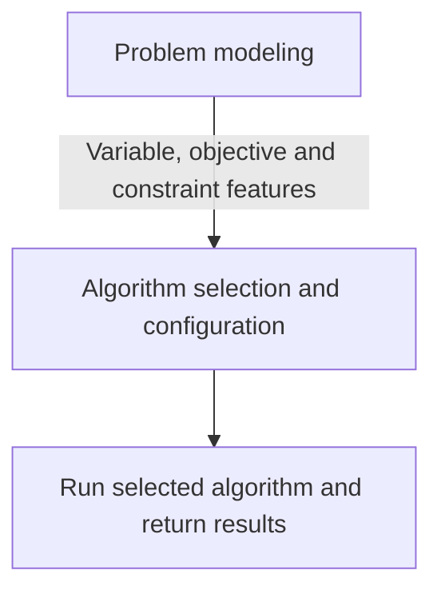

AutoCO (Automated Combinatorial Optimization) has two stages. **Problem modeling** defines the decision variables, objectives and constraints from the description and instance data and produces a candidate evaluator. **Algorithm selection and configuration** uses model features to choose a search algorithm from 12 families and configure its operators and parameters. The platform then runs the selected configuration and reports the result and its feasibility status.

## When to choose AutoCO

| Task | What the search can return |
|---|---|
| Balance conflicting objectives such as electricity cost and failure risk | A set of feasible, non-dominated alternatives found during the run |
| Assign jobs, schedule operations or plan routes | The best feasible assignment or ordering found within the time budget |
| Optimize a black-box, piecewise or nonlinear objective | A candidate scored by evaluating the objective directly |

For a tractable LP or MILP that requires an optimality certificate, choose an exact modeling method such as Direct or TriVAL with a suitable solver. In [Chat Agent](../chat-agent/), the default **Auto** mode can route multi-objective or metaheuristic requests to AutoCO. To choose it yourself, select `AutoCO` in the composer or in [Configure a run](../run-settings/).

## From the problem description to a search configuration

Suppose 12 jobs must be assigned to four GPU clusters. Electricity cost and failure risk are separate objectives. Capacity limits and pairs of jobs that must run apart are hard constraints. Follow the example to see how these requirements shape both the model and the search.



```walkthrough
[
  {
    "title": "Problem modeling",
    "nodes": [
      "Model"
    ],
    "body": "Each of the 12 decision variables records the cluster assigned to one job. Given an assignment, the evaluator computes electricity cost, failure risk and constraint violation.",
    "artifact": "P: cluster capacities and job data\nX: x[j] in {0, 1, 2, 3} for each job j\nF: minimize electricity cost and failure risk\nC: respect capacities and keep conflicting pairs apart\nVariable block: VarSpec('cluster', 'assignment', size=12, n_categories=4)\nEvaluator output: ([cost, risk], violation)\nA feasible assignment has zero violation."
  },
  {
    "title": "Algorithm selection and configuration",
    "nodes": [
      "Config"
    ],
    "body": "The assignment variables and two objectives guide the choice of an algorithm that can retain alternative trade-offs. The configuration specifies population size and variation operators. Short trials can compare candidates before the platform runs the selected algorithm.",
    "artifact": "Candidate families: NSGA-II, MOEA/D\nExample NSGA-II mutation: swap two jobs’ assigned clusters\nConfigurable hyperparameters include population size and mutation rate."
  },
  {
    "title": "Reading the search result",
    "nodes": [
      "Out"
    ],
    "body": "The platform runs the selected configuration. Each feasible assignment has an objective vector, allowing comparison of cost and risk across the alternatives found.",
    "artifact": "Each returned point gives a cost and a risk for one assignment.\nSelect a point to inspect the corresponding job-to-cluster decisions."
  }
]
```

## How algorithm selection and configuration work

AutoCO combines features from the formulation with sandbox observations such as the variable types, number of objectives and time per evaluation. Its knowledge graph relates problem features to search mechanisms. For example, a move that reverses a sequence can break precedence constraints. The selector can inspect alternatives that move a job while preserving the relative order of the others.

The algorithm specifications list the available operators and hyperparameters for each family. When `enable_pilot` is on and the solve time limit is at least five seconds, the selector can run up to two configurations per trial before committing a configuration. Pilot results include whether a feasible candidate was found, its objective value when available, and the evaluation rate.

| Search family | Built-in algorithms |
|---|---|
| Trajectory and neighborhood search | SA, TS, ILS, LNS |
| Population-based search | GA, CMA-ES, DE, PSO, ACO |
| Multi-objective search | NSGA-II, MOEA/D, NSGA-III |

## Read and compare results

For a single objective, inspect the best feasible solution found within the budget. For multiple objectives, the workbench plots the returned non-dominated solutions and marks a recommended compromise (**Knee Point**). Select a point or table row to see the decisions behind it. You can discuss the run in chat or export the results.

Each result describes the submitted model and the candidates explored. If the search finds no feasible candidate, the feasibility of the model remains open. AutoCO requires neither a commercial solver license nor a separate modeling library. Use [Compare methods and LLMs](../method-comparison/) to run it alongside Direct, TriVAL or another method on the same task.
