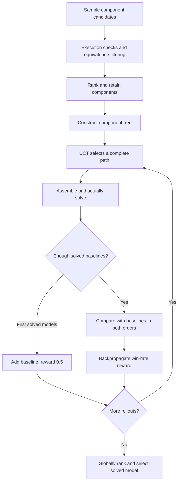

AutoFormulation searches a tree of modeling components. It checks, deduplicates and ranks candidates, explores complete models with Monte Carlo tree search (MCTS), then selects a solved candidate through pairwise ranking.

## What is being searched

Tree levels are parameters, decision variables, objective, equality constraints and inequality constraints. A root-to-leaf path is a complete model. Integer versus continuous production quantities, for example, are different variable choices affecting all later components.

The search concerns interpretations of the problem. It is not simply choosing the production plan with the largest profit. Objectives from models obeying different rules cannot directly establish which interpretation is correct.

## Construction, search and ranking



```walkthrough
[
  {"title":"Build candidates","nodes":["Sample","Check","Rank"],"body":"Equivalent notation should be deduplicated, while invalid components need checking. Different wording alone should not create distinct models.","artifact":"Candidate 1: nonnegative integer A, B\nCandidate 2: nonnegative integer x[p], p∈{A,B}\nThese may differ only in notation."},
  {"title":"Select a path","nodes":["Tree","Select","Solve"],"body":"UCT balances promising and underexplored paths. A complete path must be assembled and solved before becoming a solved candidate.","artifact":"Parameters → variables → objective → equalities → inequalities\nEach complete candidate has its own code and execution result."},
  {"title":"Establish comparisons","nodes":["Baseline","Warmup","Compare","Back"],"body":"The first 3 solved models become baselines with reward 0.5. Later candidates are compared against baselines in both orders.","artifact":"Compare each candidate with baselines in both orders.\nReturn comparison win rates as search rewards."},
  {"title":"Select final model","nodes":["More","Final"],"body":"Bradley–Terry ranking selects the final solved model. Rankings are model judgments; readers still inspect domains and rules.","artifact":"Output: selected formulation, code and actual solver result.\nEquivalent candidates can leave one complete model, with no meaningful competition."}
]
```

## Equivalence and reward

Parameters use a mode, variable candidates use repeated LLM grouping, and other expressions use symbolic SymPy/Z3 scripts for equivalence. Generated checking scripts run in the sandbox, not the host process.

UCT uses exploration weight `w_exp=1` and node-reward weight `lambda_cte=0.5`. Repeated judgments in both comparison orders reduce dependence on a single reply or order. These judgments produce relative candidate preferences.

## Why the budget is much larger

Defaults sample 8 completions per node, retain 3 candidates, use 5 ranking completions and run 16 rollouts. Initial tree construction can need about 540 completions; a later comparison can need about 30. Pruning reduces actual use.

 Its default run limits reach 20,000 LLM calls, 1,000 solves and 6 hours. Check deployment limits first. Parameters are changed in deployment presets, not through a per-run UI control.

## When it is useful

Use it for LP/MILP candidate-modeling and search research, especially when inspecting structural alternatives. Explicit units, indices and field meanings reduce unhelpful candidates. For one inspectable first model with a smaller call budget, start with [Direct](../direct/) or [Feedback Repair](../feedback-repair/).

## Source and platform adaptation

Based on the [pinned AutoFormulator implementation](https://github.com/jumpynitro/AutoFormulator/tree/52148018d04de23dc2d36d4281eb6244c2a42ffc) and [ICML 2025 paper](https://proceedings.mlr.press/v267/astorga25a.html). The platform retains construction, MCTS and ranking, supplies sandboxed native-library code, bounds unparseable-comparison retries and fixes the reversed two-candidate comparison direction. Detailed differences are recorded in the source documentation.
