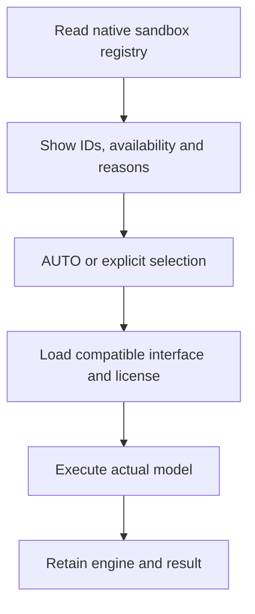

A backend performs mathematical computation. Settings discover native IDs, availability and reasons in the solver environment; results retain the actual engine.

## Common engines and tasks

| Engine | Model direction | Example platform entry |
|---|---|---|
| HiGHS, CBC, GLPK | Supported LP/MIP | Compatible Pyomo/PuLP interfaces |
| SCIP | Linear, integer and native nonlinear constraints | PySCIPOpt, OR-Tools and others |
| CP-SAT | Finite integers, Booleans and scheduling | OR-Tools, CPMpy |
| Gurobi, COPT | Native mathematical programming | gurobipy, coptpy and compatible interfaces |
| OSQP | Continuous convex quadratic objectives, linear constraints | CVXPY |
| Clarabel, SCS | Continuous cones | CVXPY |
| MOSEK | Supported native mathematics | CVXPY and compatible interfaces |
| Ipopt | Smooth continuous NLP | CasADi and others |
| Bonmin | Compatible mixed-integer nonlinear models | CasADi plugin |
| SAT, SMT, MiniZinc families | Finite domains and logic | CPMpy native backends |

Choose exact IDs from settings. The same engine can have different identifiers across libraries, including separate command-line and Python adapters.

## Discovery, selection and execution



AUTO follows native library/model logic; CVXPY uses compatible installed paths. Explicit selection fixes the engine. Errors identify interface, dependency or license issues.

## After installation or updates

Compose builds backend dependencies into the Worker. Python setups use `uv run llm4om build-worker`. For custom dependencies, update the Worker environment, rebuild and restart.

The service caches its backend catalog. Restart after dependency or license changes to discover again. Run a complete small model from the library guide to check the selected path.

## Configure commercial licenses

| Engine | Environment variable | Example file |
|---|---|---|
| Gurobi | `GRB_LICENSE_FILE` | `/opt/gurobi/gurobi.lic` |
| MOSEK | `MOSEKLM_LICENSE_FILE` | `/opt/mosek/mosek.lic` |
| COPT | `COPT_LICENSE_DIR` | Directory with `license.dat` and `license.key` |

Prepare an offline, container-compatible license on the host. Mount identical absolute paths into app. Example `compose.override.yaml`:

```yaml
services:
  app:
    volumes:
      - /opt/gurobi/gurobi.lic:/opt/gurobi/gurobi.lic:ro
      - /opt/mosek/mosek.lic:/opt/mosek/mosek.lic:ro
      - /opt/copt/license.dat:/opt/copt/license.dat:ro
      - /opt/copt/license.key:/opt/copt/license.key:ro
```

Set the corresponding `.env` variables and run `docker compose up -d app`. Workers mount the specified files read-only. Keep entries for the engines you use.

## Locate environment issues

| Error | Inspect |
|---|---|
| Executable missing | Worker installation and PATH |
| Plugin cannot load | Native libraries, drivers and dependencies |
| License path/host mismatch | Paths, container compatibility and license contents |
| Unsupported model type | Domains, expressions and engine capabilities |
| Model-size restriction | License and intended model size |

Retain complete errors with engine information for inspection. See [troubleshooting](../troubleshooting/).

## Native references

See [Gurobi documentation](https://docs.gurobi.com/projects/optimizer/en/current/), [MOSEK client setup](https://docs.mosek.com/latest/licensing/client-setup.html) and [COPT installation/licensing](https://guide.coap.online/copt/en-doc/install.html). Use [solver selection](../solvers/) for interfaces and mathematics.
