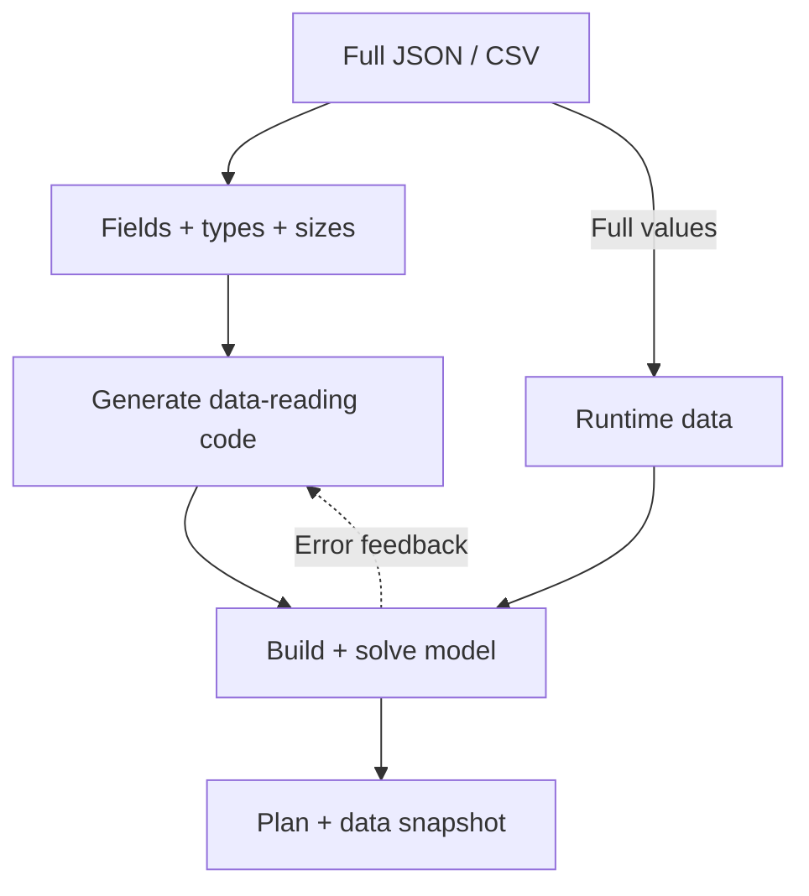

BIND separates understanding data structure from reading complete values. The LLM sees fields, types and sizes; generated code reads the full JSON/CSV during execution. This addresses truncated previews, long-table transcription and data-binding errors.

## Why structure can be enough

Model structure often does not depend on every individual value. A transport model needs to know that costs form a warehouse-by-store matrix and demand is indexed by store. It need not copy every matrix entry into a prompt and back into code.

Describe field meanings in the problem: for example, whether `capacity` measures hours or units, and which objects index each matrix row and column.

## How data flows



```walkthrough
[
  {"title":"Prepare data","nodes":["File"],"body":"Upload structured data and explain units and index meanings in the problem.","artifact":"production.json\nprofit: profit per unit, indexed by product\nusage: resource-by-product hours per unit\ncapacity: available hours per resource"},
  {"title":"Provide structure","nodes":["Schema","LLM"],"body":"Generation receives field structure, including nested and irregular shapes.","artifact":"profit: array[number], length 2\nusage: array[array[number]], 2 rows\ncapacity: array[number], length 2"},
  {"title":"Bind at execution","nodes":["Data","Solve"],"body":"Code parses complete file text from data and constructs expressions from those values.","artifact":"payload = json.loads(data['production.json'])\nprofit = payload['profit']\nusage = payload['usage']\ncapacity = payload['capacity']"},
  {"title":"Check and repair","nodes":["Finish"],"body":"Format and execution errors trigger retries with feedback. The result retains the solver status and the data-reading code.","artifact":"At most 3 generation/execution attempts.\nInspect file names, row/column mappings and units in the saved code."}
]
```

## A ready-to-use example

```json
{
  "products": ["A", "B"],
  "profit": [3, 2],
  "usage": [[2, 1], [1, 2]],
  "capacity": [8, 8]
}
```

Describe it as: “`usage[r][p]` gives hours of resource r per unit of product p. `capacity[r]` is available hours. Choose nonnegative integer quantities to maximize total profit without exceeding any resource.” The correct result is A=3, B=2, objective 13. The [data editor example](../attachments/) demonstrates editing while preserving original result snapshots.

## Supported inputs and information boundaries

JSON and CSV are supported; the frontend converts Excel to CSV. CSV headers and row widths are checked before LLM calls. JSON schemas describe the actual nesting and element types. With no attachment, generation uses the problem statement directly.

Generation receives schema; execution reads complete attachments. Later feedback can include actual objectives and decision values.

## When to use it and what to check

Use it for structured data too large to transcribe conveniently when rules are clear. Inspect file names, fields, matrix orientation, units and iteration over all records. For semantic review of complex rules, compare with [Feedback Repair](../feedback-repair/) or [TriVAL](../trival/).

## Source and platform adaptation

Based on schema offload and the default agentic path in the [pinned Text2Opt-Bench implementation](https://github.com/SprocketLab/Text2Opt-Bench/tree/1dac06be656c41d827ef20987cf8af0b48d382a2). User attachments replace benchmark data; reference-optimum and model-size scoring are removed. The platform returns a formulation and native model code, repairing according to actual execution status.
