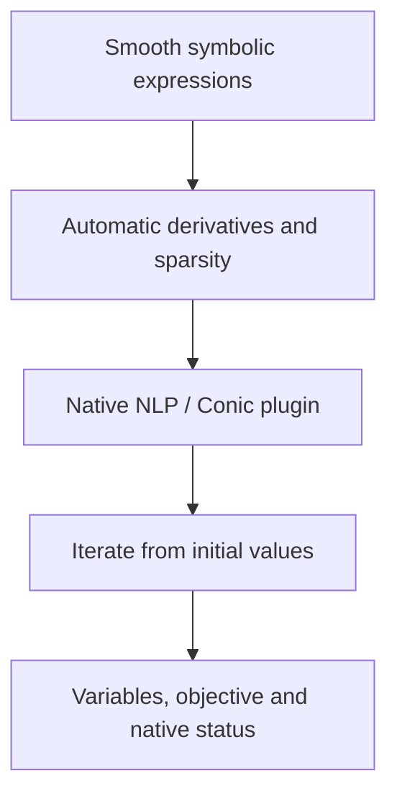

CasADi builds optimization problems with symbolic expressions and automatic differentiation. Opti organizes variables, objectives and constraints; Ipopt is a common path for smooth continuous nonlinear models.

## A complete nonlinear model

This single-variable objective has two wells, allowing exploration of starting points and local results:

$$\min_{-2\le x\le2}\;(x^2-1)^2+0.2x.$$

```python
import casadi as ca

def build_model(data):
    model = ca.Opti()
    x = model.variable()
    model.minimize((x*x - 1)**2 + 0.2*x)
    model.subject_to(model.bounded(-2, x, 2))
    model.set_initial(x, -1.8)
    return model
```

Select CasADi and Ipopt. Initial values, bounds and smooth expressions enter the solve. Results use native CasADi variable names; describe component meanings in the formulation.

## Play a local-search illustration

```demo
local
```

This interaction uses fixed-step gradient descent to display iterations on the function. Choose a starting point and inspect the path, iteration count and objective. Platform CasADi runs use the selected native plugin.

## Solving symbolic problems



Opti NLP commonly uses Ipopt. Opti Conic can specify a compatible plugin such as qrqp. Integer domains use `set_domain` with a compatible plugin such as Bonmin. Available plugins come from the execution environment's native registry.

## Maximization and low-level interfaces

For maximizing f, minimize `-f` and return the objective sign so reported values use the original objective:

```python
return {"model": model, "objective_sign": -1}
```

Low-level `nlpsol/qpsol/conic` returns provide `problem`, `arguments`, optional `solver` and `options`. Native decision vectors are recorded as `x[i]`, supporting explicit numerical arguments, sparse structure and plugin configuration.

## Using results and continuing

Nonconvex NLP results retain local status. Run different starts, bounds or requirements as separate scenarios and compare actual values and objectives with saved configurations.

CasADi suits smooth nonlinear continuous, control and trajectory models. See [CVXPY](../cvxpy/) for convex quadratic/conic structure and [OR-Tools](../ortools/) for combinatorial tasks. Refer to the [CasADi documentation](https://web.casadi.org/docs/) and [plugin API](https://web.casadi.org/python-api/).
