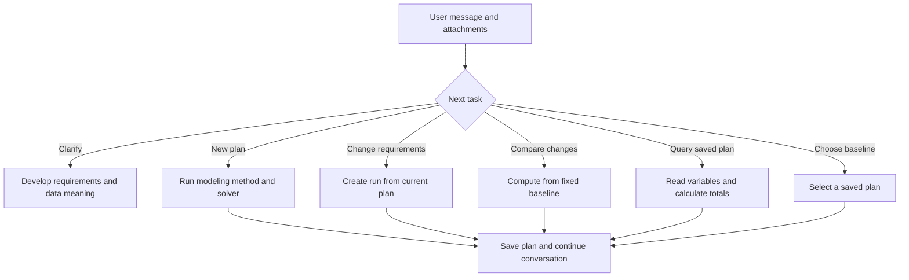

Open Chat Agent from “Optimization chat” in the sidebar. Start with an idea, add data, compute a plan, then continue asking questions and revising the same task.

## Send the first message

Choose an LLM preset and describe the problem. Attach CSV, JSON or Excel beside the message. Defaults are Direct, Pyomo and AUTO. Modeling preferences can fix a method and library; messages can also specify them.

```text
Plan next week's store staffing. Each day needs at least 3 people.
Each employee can work at most 5 days. Every weekend shift needs a supervisor.
First check what information is missing from the attachment, then calculate
the lowest-cost schedule after we confirm the requirements.
```

Tool execution shows stages and result cards. On desktop, the adjacent workbench displays formulation, code and results. Open a plan's full run page for export.

## How a conversation progresses



## Try a plan conversation

Start with the production plan worth 13. Query resources, add minimum demand, compare scenarios and return to the original. Each button represents a conversation action.

```demo
plans
```

In the actual workbench, send messages such as:

| Task | Example message | Result |
|---|---|---|
| Inspect decisions | “List Tuesday's employees and their costs.” | Query saved variables |
| Calculate a metric | “Total the weekend cost in this plan.” | Calculation card with expression and values |
| Revise a requirement | “Tuesday needs 4 people; recalculate with other rules unchanged.” | A new plan and full run |
| Compare alternatives | “Calculate budgets of 1000 and 1200 separately.” | Scenarios from one baseline |
| Select a baseline | “Use the second plan from now on.” | Plan-selection receipt |

## Tools used by the agent

| Tool | Role |
|---|---|
| `modeling_capabilities` | Read current methods, problem scopes, libraries and actual backend availability |
| `model_and_solve` | Run a complete modeling workflow and save a new plan |
| `solve_scenarios` | Prepare and compute changes from one fixed plan |
| `lookup_variables` | Read full variables by names, groups and pages |
| `calculate` | Calculate costs, ratios and resource totals from values |
| `select_plan` | Choose a saved plan for subsequent discussion |

A conversation turn uses one plan-changing tool to advance computation. Multiple explicit alternatives can be submitted as scenarios. Queries and numerical calculations can be combined.

## Current plan, browsing and attachments

A single new plan becomes current. Multiple scenarios use one fixed baseline and preserve the current selection. The workbench labels the current discussion plan and the historical plan being viewed, with a shortcut back to the discussion plan.

Click file names to edit attachments. After saving, ask to model using the new data. New runs save new inputs; existing plans retain their snapshots. When search is enabled, inspect sources and confirm adopted business rules before calculation.

## Everyday controls and recovery

Enter sends; Shift+Enter adds a line. Drag the divider, or focus it with Tab and use arrow keys, to resize the conversation. Scrolling upward pauses following; “Back to latest” resumes it.

Refresh reconnects to active server runs. Saved plans open from cards or history. Stop and retry preserve turn context. DeepSeek's thinking toggle controls the conversation reply; modeling tools use the run preset parameters.
