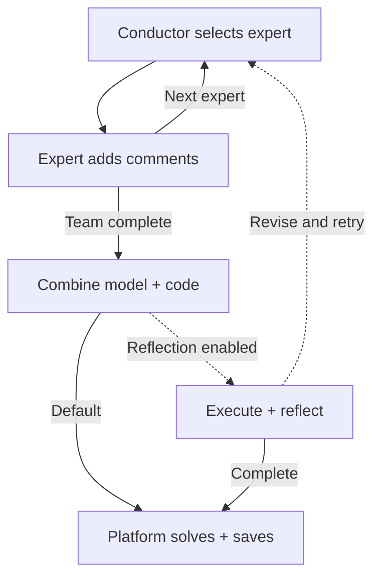

Chain-of-Experts (CoE) asks a conductor to select experts in sequence. Later experts read earlier comments; a reducer produces the final model and code. Each comment enters the pool available to later roles.

## How comments affect the next step

The conductor chooses among seven expert roles. Each expert sees the problem and the current comment pool, so later comments can extend or correct earlier ones. The default selects three experts per trial before reduction.

Each expert uses its role prompt and current comment pool with the run's selected LLM preset.

## Workflow and collaboration example



```walkthrough
[
  {"title":"Interpret","nodes":["Conductor","Expert"],"body":"This example follows useful comments into the pool, beginning with business terminology.","artifact":"Illustrative comment: unit profit differs from revenue; processing hours per unit differ from total hours."},
  {"title":"Add modeling detail","nodes":["Expert"],"body":"A later expert reads existing comments and adds domains, indices or resource constraints.","artifact":"Illustrative comment: use nonnegative integers for whole products.\nCutting: 2A+B≤8; finishing: A+2B≤8."},
  {"title":"Reduce","nodes":["Reduce"],"body":"The reducer must turn comments into one internally consistent model. Conflicting comments still require an explicit final choice.","artifact":"Combined model: nonnegative integer quantities, total profit and two resource constraints.\nFollow each expert comment to its final expression."},
  {"title":"Read the default path","nodes":["Reflect","Return"],"body":"The default completes three expert contributions and reduction, then passes the model to the platform for solving.","artifact":"Default: three experts → reduction → platform solve\nReflection is a deployment-preset branch."}
]
```

## What reflection actually means

When enabled, reflection is triggered by execution failure. Experts are questioned backwards from the latest speaker; the first accepting responsibility refines its comment. Each new trial starts with a fresh comment pool.

`enable_reflection=false` is the default. `max_trials=3` matters when reflection is enabled. Execution checks use whether the code obtains a solver status.

## Reading and comparing runs

Look for new information: a missing rule, resolved ambiguity, domain issue or objective correction. The final model shows how comments became expressions used in computation.

Use CoE for LP/MILP collaboration workflows and method comparisons. For explicit per-constraint checks see [SAC-Opt](../sac-opt/); for problem-type retrieval see [OptiTree](../optitree/).

## Source and platform adaptation

The [pinned Chain-of-Experts implementation](https://github.com/xzymustbexzy/Chain-of-Experts/tree/afb89bf602690ea621f13a23c42722f20f653a43) supplies the conductor, seven expert roles and reducer prompts. Native-library contracts replace original examples. Execution reads the attached data in the sandbox.
