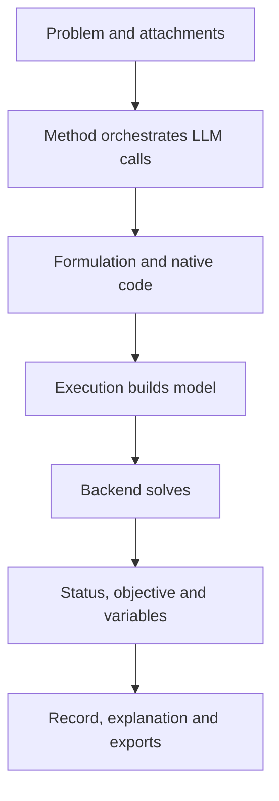

LLM4OM connects requirements, modeling, computation and plan management. These terms map to settings and artifacts in the workbench.

## Run data flow

Attachments map file names to complete text. `build_model(data)` parses inputs and returns a native model. The platform executes and retains results.

## Four configuration objects

| Term | Role | Example |
|---|---|---|
| Method | Generation, checking and repair orchestration | Direct, TriVAL, BIND |
| LLM preset | Service and request configuration | Team endpoint and model ID |
| Library | Variables, objective and constraints | Pyomo, CPMpy, CVXPY |
| Backend | Mathematical computation | HiGHS, CP-SAT, Gurobi, Ipopt |

One configuration might be “Feedback Repair + team preset + Pyomo + HiGHS.” Run information retains selections and the actual engine.

## Four types of model information

| Information | Meaning | Production example |
|---|---|---|
| Parameters | Known input values | Unit profit and capacity |
| Variables | Quantities or choices to determine | A and B quantities |
| Objective | Expression to minimize or maximize | Total profit |
| Constraints | Relationships decisions must satisfy | Hours and minimum orders |

Indices extend these objects across products, dates, employees and nodes. Units connect statements, data and result labels.

## Runs and plans

A run contains inputs, settings, steps, formulation, code and execution. A plan is its computed decision result. Revisions create new runs; scenarios connect runs to one baseline. The conversation's current plan determines the basis for questions and changes.

## Common statuses

| Status | Meaning |
|---|---|
| optimal | Optimal result for the current model |
| feasible | A feasible plan is available |
| locally_optimal | Local result from a native nonlinear path |
| infeasible | Current requirements cannot hold together |
| unbounded | Objective is unbounded along a feasible direction |
| time_limit | Limit reached; inspect retained solution and feedback |
| Execution or validation failure | Read the specific stage and feedback |

Status, values and method validation remain in the run. See [results](../results/) for daily use and [methods](../methods/) or [solvers](../solvers/) for mechanisms and interfaces.
