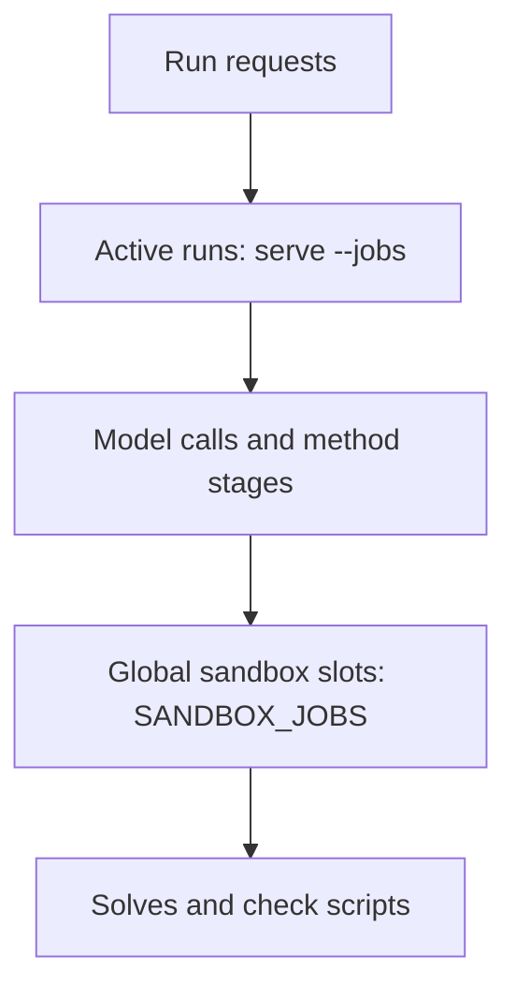

Configuration controls default models, concurrency, quotas and persistence. Compose uses `.env` and a data volume; Python services use environment variables and `--workspace`.

## Choose the configuration location

| Change | Location | Verify |
|---|---|---|
| Selectable models and credentials | AI model settings | Save and select the preset, then run the quickstart problem |
| Server default model | `.env` or service-process environment | Restart the Python service or recreate the Compose app, then inspect the default preset |
| Concurrency and quotas | Startup arguments and environment | Restart or recreate the service, then inspect configuration and preset usage |
| Interface language | Browser appearance/language menu | Start a new run after switching; historical content uses reading translations without rewriting records |

Editing `.env` does not change an already-running process. Presets created in the interface belong to the current workspace; selecting another `--workspace` does not move them.

## Model and search settings

| Field | Role |
|---|---|
| `LLM4OM_LLM_PROVIDER` | Default provider |
| `LLM4OM_LLM_BASE_URL` | Service endpoint |
| `LLM4OM_LLM_MODEL` | Actual model ID |
| `LLM4OM_LLM_API_KEY` | Service credentials |
| `LLM4OM_LLM_NAME` | Display name |
| `LLM4OM_LLM_EXTRA_BODY` | Provider-specific JSON |
| `LLM4OM_SEARCH_API_KEY` | Separate search credentials |
| `LLM4OM_SEARCH_BASE_URL` | Search endpoint |

DeepSeek presets can use their own search configuration; other providers use separate search credentials. See [presets](../model-presets/).

## Shared usage limits

```dotenv
LLM4OM_DAILY_TOKENS=2000000
LLM4OM_RUNS_PER_HOUR=30
LLM4OM_RUN_JOBS=4
LLM4OM_SANDBOX_JOBS=4
TZ=Asia/Shanghai
```

Daily quotas count input plus output tokens per preset. Hourly limits count runs per client address. Zero or unset values disable these two limits. Sandbox concurrency still defaults to four and must be positive; zero does not mean unlimited sandbox slots.

Daily accounting uses the service process's local date. Linux/Compose deployments can set `TZ=Asia/Shanghai`. For a local Windows service, check the system time zone rather than assuming `TZ` changes the process date.

Set `LLM4OM_TRUST_PROXY=1` only behind a trusted reverse proxy. It makes rate limiting use the forwarded client address. Keep the default for direct access so client-supplied forwarding headers are not trusted.

The preset dialog shows usage. At the daily cap, the next model call shows a quota message; choose another available preset or continue the following day. The last call can exceed the cap because actual usage is charged after completion. Reading and example translations also count toward the preset that performs them. Saved results remain readable.

## Two concurrency levels



One service process manages each workspace. `LLM4OM_RUN_JOBS` limits active runs, and an explicit `serve --jobs` takes precedence. `LLM4OM_SANDBOX_JOBS` limits concurrent solves and check scripts. Both default to four. Waiting for a sandbox counts toward the run deadline.

## Back up the workspace

The volume stores presets, credentials, history and runs. Stop app to finish persistence, then copy:

```bash
docker compose stop app
docker compose cp app:/data ./llm4om-backup
chmod -R go-rwx ./llm4om-backup
docker compose start app
```

Keep backups in access-controlled storage. For Python services, back up the selected `--workspace` directory.

The permission command above is for Linux shells; use folder access controls for Windows backups. Backups include credentials and private translation caches, so keep them out of Git and public shares. Before restoring, preserve a separate backup of the destination and confirm no other service is writing to that directory.

## Restore or migrate

```bash
docker compose stop app
docker compose cp ./llm4om-backup/. app:/data/
docker compose start app
```

To migrate Python history, substitute `runs/web/.` or the actual workspace. After startup, inspect presets and a historical run to confirm records and attachments.

The service persists every ten seconds and at normal exit, writing a temporary file before renaming. Normal stop commands complete persistence of public steps and artifacts.

## Optional call tracing

Set `LANGSMITH_TRACING`, `LANGSMITH_API_KEY` and `LANGSMITH_PROJECT` for external tracing. Enabled tracing sends problems, data and model replies to LangSmith while retaining local run records.

See the repository's [environment example](https://github.com/Fangziyang0910/LLM4OM/blob/main/.env.example) and [team deployment](../team-deployment/) for HTTPS and service access.
