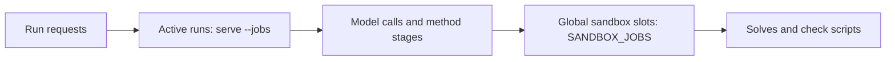

Configuration controls default models, concurrency, quotas and persistence. Compose uses `.env` and a data volume; Python services use environment variables and `--workspace`.

## Model and search settings

| Field | Role |
|---|---|
| `LLM4OM_LLM_PROVIDER` | Default provider |
| `LLM4OM_LLM_BASE_URL` | Service endpoint |
| `LLM4OM_LLM_MODEL` | Actual model ID |
| `LLM4OM_LLM_API_KEY` | Service credentials |
| `LLM4OM_LLM_NAME` | Display name |
| `LLM4OM_LLM_EXTRA_BODY` | Provider-specific JSON |
| `LLM4OM_SEARCH_API_KEY` | Separate search credentials |
| `LLM4OM_SEARCH_BASE_URL` | Search endpoint |

DeepSeek presets can use their own search configuration; other providers use separate search credentials. See [presets](../model-presets/).

## Shared usage limits

```dotenv
LLM4OM_DAILY_TOKENS=2000000
LLM4OM_RUNS_PER_HOUR=30
LLM4OM_SANDBOX_JOBS=4
TZ=Asia/Shanghai
LLM4OM_TRUST_PROXY=1
```

Daily quotas count input plus output tokens per preset. Hourly limits count runs per client address. Zero or unset limits are unlimited. `TZ=Asia/Shanghai` resets daily usage at Beijing midnight.

The preset dialog shows usage. At the daily cap, the next model call shows a quota message; choose another available preset or continue the following day. Saved results remain readable.

## Two concurrency levels



`serve --jobs` defaults to four active runs, with others queued. Four sandbox slots cover all solves and checks, including parallel AutoFormulation checks. Waiting counts toward run limits. One service process manages each workspace.

## Back up the workspace

The volume stores presets, credentials, history and runs. Stop app to finish persistence, then copy:

```bash
docker compose stop app
docker compose cp app:/data ./llm4om-backup
chmod -R go-rwx ./llm4om-backup
docker compose start app
```

Keep backups in access-controlled storage. For Python services, back up the selected `--workspace` directory.

## Restore or migrate

```bash
docker compose stop app
docker compose cp ./llm4om-backup/. app:/data/
docker compose start app
```

To migrate Python history, substitute `runs/web/.` or the actual workspace. After startup, inspect presets and a historical run to confirm records and attachments.

The service persists every ten seconds and at normal exit, writing a temporary file before renaming. Normal stop commands complete persistence of public steps and artifacts.

## Optional call tracing

Set `LANGSMITH_TRACING`, `LANGSMITH_API_KEY` and `LANGSMITH_PROJECT` for external tracing. Enabled tracing sends problems, data and model replies to LangSmith while retaining local run records.

See the repository's [environment example](https://github.com/Fangziyang0910/LLM4OM/blob/main/.env.example) and [team deployment](../team-deployment/) for HTTPS and service access.
