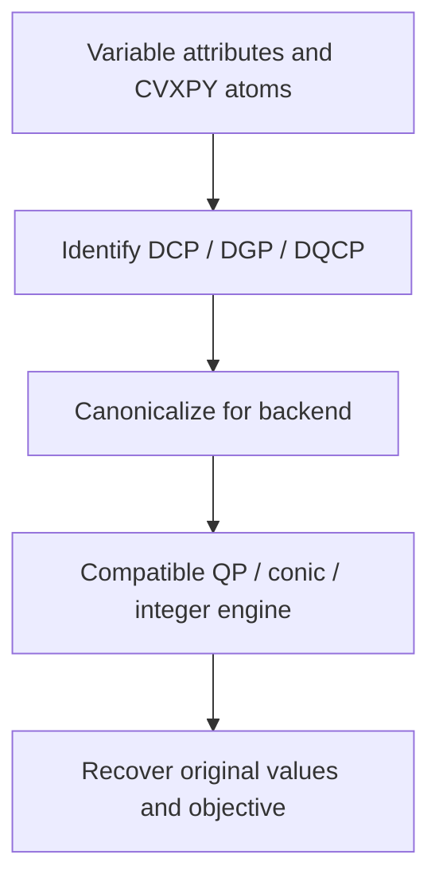

CVXPY builds convex and related models with structured mathematical expressions. Native atoms for squared losses, norms, linear maps and cones suit fitting, allocation, portfolio weights and regularized optimization.

## A complete convex quadratic example

Choose continuous `(x,y)` near target `(1,2)`, with nonnegative quantities and a total resource limit of 2:

$$\min_{x,y\ge0}(x-1)^2+(y-2)^2\quad\text{s.t.}\quad x+y\le2.$$

The optimum is `(0.5,1.5)`, objective 0.5.

```python
import cvxpy as cp

def build_model(data):
    x = cp.Variable(2, nonneg=True, name="allocation")
    objective = cp.Minimize(cp.sum_squares(x - [1.0, 2.0]))
    return cp.Problem(objective, [cp.sum(x) <= 2])
```

Select CVXPY. OSQP supports this continuous convex quadratic objective with linear constraints. Return `Problem`; the platform solves and reads its variable array.

## Explore resource changes

```demo
convex
```

Increase the limit from 2 to 3 to move the solution toward the target. A line connects target and solution; the ellipse is an equal-objective contour around the target. Variable components map to x and y in array order.

## From expressions to a backend



DCP describes disciplined convex expressions; DGP uses positive variables and geometric-programming structure; DQCP handles recognized quasiconvex structure. The platform detects the mode, using `gp=True` for DGP and `qcp=True` for DQCP.

## Select a backend

| Model | Typical backend direction |
|---|---|
| Continuous convex quadratic objective, linear constraints | OSQP |
| Supported continuous cones | Clarabel, SCS and others |
| Integer or Boolean decisions | A mixed-integer backend supporting the model structure |
| Native MOSEK capabilities | MOSEK with configured license |

AUTO uses a compatible installed `solver_path` and records the actual engine. Explicit selection fixes the computation path. See [backends](../backends/) for installation and licenses.

## Expressions and further use

Use `@` for matrix multiplication, `cp.sum`, `cp.norm` and `cp.quad_form` for the corresponding expressions. Nonnegative, positive and integer variable attributes help structure recognition. Map business switches and selections to the appropriate domains.

After reviewing complete values, use [plan conversation](../plan-chat/) for derived totals or revised budgets. See official documentation for [solvers](https://www.cvxpy.org/tutorial/solvers/), [DGP](https://www.cvxpy.org/tutorial/dgp/) and [DQCP](https://www.cvxpy.org/tutorial/dqcp/).
