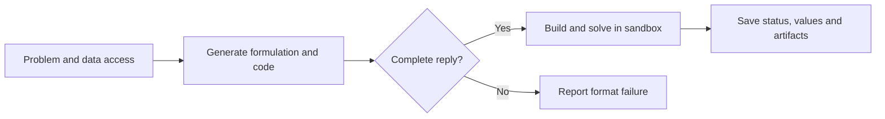

Direct sends the problem, data description and modeling-library contract to the LLM in one request. The reply contains a formulation and complete code. The platform executes the code and calls a real solver. This short workflow is useful for a first attempt and as a baseline for other methods.

## What the method does

A solver cannot consume a business description directly. Direct translates the description into variables, an objective and constraints, then translates those expressions into code. Both translations happen in one reply. The formulation and code are followed by actual solver execution.

Consider two products. A and B earn 3 and 2 per unit. They use 2 and 1 cutting hours, and 1 and 2 finishing hours. Each resource has 8 hours available. Products must be whole units.

$$\max\;3A+2B\quad\text{s.t.}\quad2A+B\le8,\;A+2B\le8,\;A,B\in\mathbb Z_{\ge0}.$$

The critical choices are the integer domain, resource coefficients, units and maximization direction.

## Workflow and worked example



```walkthrough
[
  {"title":"Read","nodes":["Read"],"body":"Separate decisions from inputs. Profits and processing times are parameters; quantities are decisions.","artifact":"Profit (3, 2); cutting (2, 1); finishing (1, 2); capacity (8, 8)\nQuantities must be nonnegative integers."},
  {"title":"Generate","nodes":["Generate","Format"],"body":"One reply supplies the formulation and build_model(data). Code must read full attachments even when their preview is truncated.","artifact":"Variables: A, B are nonnegative integers\nObjective: max 3A + 2B\nConstraints: 2A + B ≤ 8; A + 2B ≤ 8"},
  {"title":"Compute","nodes":["Solve"],"body":"Code returns a native model. The platform calls a compatible backend; the LLM does not invent numerical answers.","artifact":"Integer optimum: A = 3, B = 2, objective 13\nCutting: 8 / 8; finishing: 7 / 8"},
  {"title":"Check","nodes":["Result"],"body":"Results retain the model, code and computed plan together for export, discussion and revision.","artifact":"Result: A = 3, B = 2, objective 13\nNext: export CSV or revise cutting capacity to 10 hours."}
]
```

## How to assess a result

Check problem to formulation, formulation to code, then the values. Here, `2×3+2=8`, `3+2×2=7` and `3×3+2×2=13`. The formulation, code and values remain available in one run.

Check that “at least” becomes `≥` and “at most” becomes `≤`. Check whether a rule applies per day, per product or across the whole plan. A weekly staffing total can be solved successfully even when the requirement was daily coverage.

```demo
production
```

## Calls, stopping and when to use it

The modeling stage uses one LLM call. Direct has no internal repair loop for reply format, execution or semantic errors. Incomplete replies fail before execution; execution failures retain feedback. Later platform explanations can make additional calls.

Start with Direct for a clear problem and a quick first model. Use [Feedback Repair](../feedback-repair/) for review after solving, [TriVAL](../trival/) for validation at several levels, or [BIND](../bind/) when binding large structured attachments is the central issue.

## Platform implementation and comparison

This project maintains Direct and its shared Feedback Repair generator. It is not restricted to linear problems, although the library and backend must support the expressions used. Keep the problem, attachments, LLM preset and solver fixed when comparing workflows.
