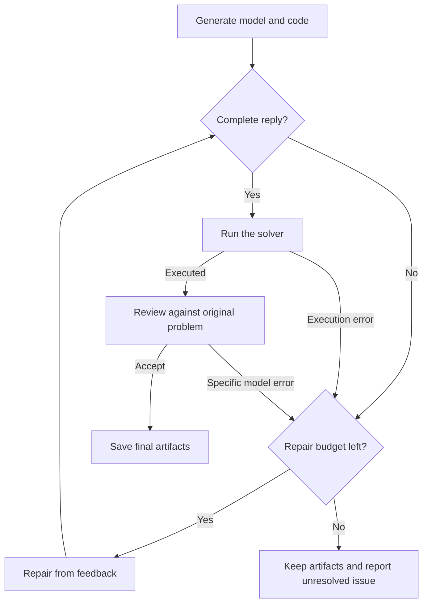

Feedback Repair adds execution, review against the original problem and targeted repair to Direct. It addresses a common failure: code runs and the solver reports optimality, but a business rule was translated incorrectly.

## Why review after a successful solve

Suppose production requires at least 3 units of B, but the code says `B <= 3`. The solver can return `(3, 2)` with objective 13. This is correct for the wrong model and violates the requirement. Fixing Python exceptions cannot detect it.

The reviewer reads the problem, formulation, code, execution feedback and available conflict evidence. It checks coefficients, domains, constraint directions and data binding, then accepts or identifies a repair.

## Workflow and worked example



```walkthrough
[
  {"title":"First model","nodes":["Generate","Solve"],"body":"Assume generation reverses the demand constraint. The solver does not read the business description and can still report optimality.","artifact":"Required: B ≥ 3\nHypothetical error: B ≤ 3\nWrong-model optimum: A = 3, B = 2, objective 13"},
  {"title":"Review","nodes":["Review"],"body":"Name the mismatch. The mismatch becomes specific repair feedback.","artifact":"Decision: repair\nReason: a minimum became an upper bound; B = 2 violates B ≥ 3."},
  {"title":"Repair and solve","nodes":["Budget","Repair","Solve"],"body":"Restore B ≥ 3, preserve the other requirements and execute the revised code.","artifact":"2A + B ≤ 8; A + 2B ≤ 8; B ≥ 3\nInteger optimum: A = 2, B = 3, objective 12"},
  {"title":"Accept or report","nodes":["Review","Finish","Failed"],"body":"The lower objective is the cost of satisfying the requirement. Accept after review, or retain artifacts and report an unresolved error when the budget ends.","artifact":"Original objective: 13. With B ≥ 3: 12.\nBoth models and results remain available."}
]
```

## What should be repaired

| Feedback | Appropriate response |
|---|---|
| Syntax error or invalid return object | Repair from execution feedback |
| Whole products modeled as continuous | Restore integers and solve again |
| Genuine demand and resource conflict | Retain reviewed infeasibility and original requirements |
| Time limit with a feasible incumbent | Save status and available incumbent |
| No objective for a satisfaction problem | Check whether finding a satisfying assignment was intended |

## Budget and final artifacts

At most three repairs are shared across format, execution and modeling errors. A run without repair uses two LLM calls and one solve. Later explanations can add calls.

An incomplete later reply preserves the last formulation, code and result actually executed. The platform does not choose an earlier model for its attractive objective. A failed or unparseable review also preserves computation and records the failure.

## Using and reading the method

Select Feedback Repair in run settings. Inspect the initial model, review reason and changed expressions. Follow each repair reason to its rule and code expression.

Use it for a short workflow with review after execution. For layered validation, see [TriVAL](../trival/). For constraint backtranslation and frozen accepted components, see [SAC-Opt](../sac-opt/).

## Implementation source

This project maintains the method and its shared Direct generator. The review node and repair loop are published alongside the generator.
