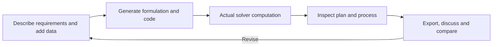

LLM4OM turns natural-language problems and data into optimization models and calls solvers to compute plans. Describe requirements, inspect decisions and the modeling process, then revise conditions, compare alternatives and export results.

## Choose an entry point

| Entry | Starting point | Next actions |
|---|---|---|
| [Optimization chat](../chat-agent/) | Send a problem or idea | Clarify, compute, query, revise and compare scenarios |
| [Manual modeling](../run-settings/) | A prepared statement and data | Edit inputs, choose settings and follow execution |
| [Requirements assistant](../requirements/) | A developing business idea | Create an editable statement and attachments |

First-time users can complete the production [quickstart](../quickstart/). To run a service, see [installation](../installation/).

## From requirements to a usable plan

A run retains statement, attachments, configuration, formulation, code, values and steps. Original and revised plans remain connected to their inputs.

## Everyday features

| Task | Guide |
|---|---|
| Add tables and edit fields or values | [Upload and edit data](../attachments/) |
| Read production, staffing or allocation decisions | [Results and exports](../results/) |
| Query a decision or total costs | [Discuss a plan](../plan-chat/) |
| Change a requirement and compute another plan | [Revisions](../revisions/) |
| Compare budgets, demand or resources | [Scenarios](../scenarios/) |
| Find past tasks and record decisions | [History, tags and reports](../history/) |

## Understand modeling and computation

[Methods](../methods/) covers 13 workflows with mechanisms, Mermaid diagrams, step-by-step examples and current parameters: generation, feedback repair, layered validation, type retrieval, component search and data binding.

[Libraries and solvers](../solvers/) covers nine libraries, native interfaces, backends and complete code. Production, staffing, assignment, convex quadratic and nonlinear examples help select a computation path.

## Watch and interact

Docs include localized workbench recordings, screenshots and interactive examples. Download quickstart data, step through method artifacts, or change solver-example parameters and inspect computed results.

The interface supports Chinese, English and light/dark/system themes. Desktop dividers resize work areas; narrow screens use tabs for main content and assistants.

## Teams and scripts

[Team deployment](../team-deployment/) covers shared services, HTTPS and access configuration. [Usage and backups](../configuration/) covers quotas, concurrency and data maintenance. [CLI and Python](../cli-python/) runs the same modeling workflows from existing programs.

LLM4OM is developed by the [EIPI team](https://scut-eipi.github.io/), with publicly maintained source and documentation.
