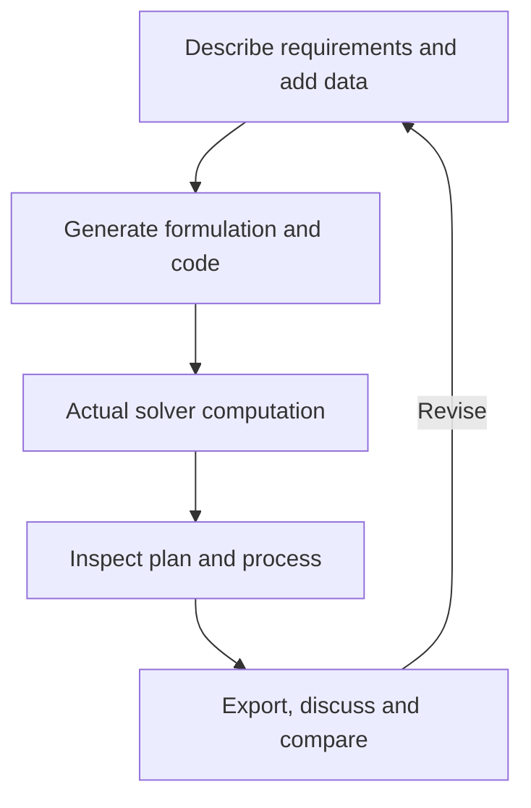

General Intelligent Optimization Solver is a general solver for complex optimization problems, turning natural-language problems and business data into mathematical optimization models and calling solvers to compute optimal plans. Describe requirements, inspect decisions and the modeling process, then revise conditions, compare alternatives and export results.

## Choose an entry point

| Entry | Starting point | Next actions |
|---|---|---|
| [Optimization chat](../chat-agent/) | Send a problem or idea | Clarify, compute, query, revise and compare scenarios |
| [Manual modeling](../run-settings/) | A prepared statement and data | Edit inputs, choose settings and follow execution |
| [Requirements assistant](../requirements/) | A developing business idea | Create an editable statement and attachments |

## Start here

1. **You have access to a service**: complete the production [quickstart](../quickstart/), then check its formulation and known result.
2. **You need to host a service**: [install and start it](../installation/), configure a [model preset](../model-presets/), then follow the quickstart.
3. **You are preparing a business problem**: identify decisions, objectives, constraints, units and data sources. Use the [requirements assistant](../requirements/) to resolve missing information before modeling.

For page or run failures, use the symptom-based [troubleshooting guide](../troubleshooting/).

## From requirements to a usable plan

A run retains statement, attachments, configuration, formulation, code, values and steps. Original and revised plans remain connected to their inputs.

The model translates the problem into a formulation and code. By default, a Docker Worker executes that code and calls the solver. An “optimal” status applies to the mathematical model that was solved; check that it captures the business rules. Interactive documentation examples compute small, bounded problems and do not establish platform-wide performance or correctness guarantees.

## Everyday features

| Task | Guide |
|---|---|
| Add tables and edit fields or values | [Upload and edit data](../attachments/) |
| Read production, staffing or allocation decisions | [Results and exports](../results/) |
| Query a decision or total costs | [Discuss a plan](../plan-chat/) |
| Change a requirement and compute another plan | [Revisions](../revisions/) |
| Compare budgets, demand or resources | [Scenarios](../scenarios/) |
| Find past tasks and record decisions | [History, tags and reports](../history/) |

## Understand modeling and computation

[Methods](../methods/) covers 13 workflows with mechanisms, Mermaid diagrams, step-by-step examples and current parameters: generation, feedback repair, layered validation, type retrieval, component search and data binding.

[Libraries and solvers](../solvers/) covers nine libraries, native interfaces, backends and complete code. Production, staffing, assignment, convex quadratic and nonlinear examples help select a computation path.

## Watch and interact

Docs include localized workbench recordings, screenshots and interactive examples. Download quickstart data, step through method artifacts, or change solver-example parameters and inspect computed results.

The interface supports Chinese, English and light/dark/system themes. Desktop dividers resize work areas; narrow screens use tabs for main content and assistants.

New runs request explanatory prose in the selected interface language. Foreign-language problem statements and historical formulations can use cached reading translations. Changing language does not rewrite source statements, code or saved records. Live stages use localized labels; raw model output is available on demand and may contain English, code or tool fields. See [language and display issues](../troubleshooting/).

## Teams and scripts

[Team deployment](../team-deployment/) covers shared services, HTTPS and access configuration. [Usage and backups](../configuration/) covers quotas, concurrency and data maintenance. [CLI and Python](../cli-python/) runs the same modeling workflows from existing programs.

General Intelligent Optimization Solver is developed by the [EIPI team](https://scut-eipi.github.io/), with publicly maintained source and documentation.
