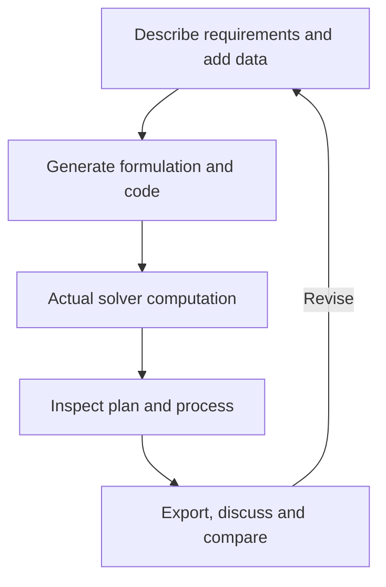

General Intelligent Optimization Solver turns a business problem into an optimization plan you can check line by line. Describe goals and constraints in plain language and attach your spreadsheets. The platform writes a mathematical model and solver code, runs a real solver in an isolated Docker environment, and explains the result in business terms.

Linear, integer and other mathematical programs go through modeling libraries such as Pyomo and OR-Tools to solvers such as HiGHS, SCIP and CP-SAT. Large combinatorial problems and multi-objective trade-offs can use the heuristic search in [AutoCO](../autoco/). Every plan keeps its problem statement, data, model, code and solver record.

## Choose an entry point

| Entry | Starting point | Next actions |
|---|---|---|
| [Optimization chat](../chat-agent/) (home page `/`) | Describe the problem or drop in Excel/CSV | The assistant models and solves it; read the explanation, ask follow-ups, change conditions or compare scenarios |
| [Manual modeling](../run-settings/) (`/model`) | A clear problem statement and a method, library and model you want to choose yourself | Pick from 9 modeling methods, 5 modeling libraries and several solvers; “Multi-plan comparison” runs up to 12 side by side |
| [Requirements assistant](../requirements/) | A business idea still taking shape | Turn the conversation into an editable requirements draft, then apply it to manual modeling |

## Start here

1. **You have access to a service**: complete the production [quickstart](../quickstart/), then check its formulation and known result.
2. **You need to host a service**: [install and start it](../installation/), configure a [model preset](../model-presets/), then follow the quickstart.
3. **You are preparing a business problem**: identify decisions, objectives, constraints, units and data sources. Use the [requirements assistant](../requirements/) to resolve missing information before modeling.

For page or run failures, use the symptom-based [troubleshooting guide](../troubleshooting/).

## From requirements to a usable plan

A run retains statement, attachments, configuration, formulation, code, values and steps. Original and revised plans remain connected to their inputs.

The model translates the problem into a formulation and code. By default, a Docker Worker executes that code and calls the solver. An “optimal” status applies to the mathematical model that was solved; check that it captures the business rules. Interactive documentation examples compute small, bounded problems and do not establish platform-wide performance or correctness guarantees.

AutoCO returns the heuristic results and Pareto candidates found within its search budget; it does not guarantee global optimality or a complete Pareto front. Check the algorithm, objective directions, constraint handling and actual result status before using a plan.

## Everyday features

| Task | Guide |
|---|---|
| Add tables and edit fields or values | [Upload and edit data](../attachments/) |
| Read production, staffing or allocation decisions | [Results and exports](../results/) |
| Query a decision or total costs | [Discuss a plan](../plan-chat/) |
| Change a requirement and compute another plan | [Revisions](../revisions/) |
| Compare budgets, demand or resources | [Scenarios](../scenarios/) |
| Find past tasks and record decisions | [History, tags and reports](../history/) |

## Understand modeling and computation

[Methods](../methods/) covers 9 modeling methods: Direct, OR-LLM-Agent, LLMOPT, TriVAL and BIND, [AutoCO](../autoco/) for large combinatorial and multi-objective tasks, plus OptiMUS, CoE and OptiTree. Each page explains the mechanism and includes a Mermaid diagram, a step-by-step walkthrough and the current parameters.

[Libraries and solvers](../solvers/) covers 5 modeling libraries (Pyomo, OR-Tools, CVXPY, PySCIPOpt, CasADi), native interfaces, backend compatibility and complete runnable examples.

## Watch and interact

Docs include localized workbench recordings, screenshots and interactive examples. Download quickstart data, step through method artifacts, or change solver-example parameters and inspect computed results.

The interface supports Chinese, English and light/dark/system themes. Desktop dividers resize work areas; narrow screens use tabs for main content and assistants.

New runs request explanatory prose in the selected interface language. Foreign-language problem statements and historical formulations can use cached reading translations. Changing language does not rewrite source statements, code or saved records. Live stages use localized labels; raw model output is available on demand and may contain English, code or tool fields. See [language and display issues](../troubleshooting/).

## Teams and scripts

[Team deployment](../team-deployment/) covers shared services, HTTPS and access configuration. [Usage and backups](../configuration/) covers quotas, concurrency and data maintenance. [CLI and Python](../cli-python/) runs the same modeling workflows from existing programs.

General Intelligent Optimization Solver is developed by the [EIPI team](https://scut-eipi.github.io/), with publicly maintained source and documentation.
