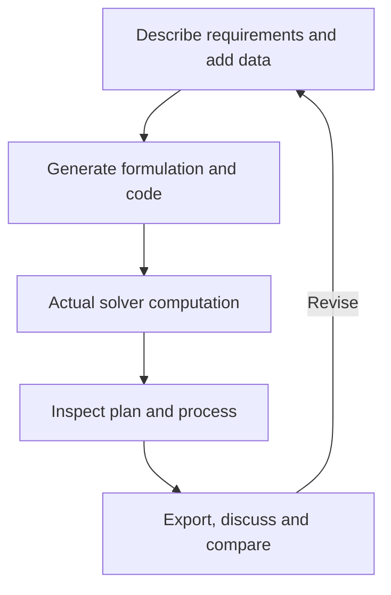

General Intelligent Optimization Solver is a natural-language-driven **dual-engine optimization platform (Exact Solvers × AutoCO Metaheuristics)**. Describe your business goals and drop spreadsheets — the platform automatically routes between **9 exact mathematical modeling frameworks** and **AutoCO's 12-family metaheuristic pool**, running inside an isolated sandbox to return verified optima and multi-objective Pareto fronts.

## Choose an entry point

| Entry | Starting point | Next actions |
|---|---|---|
| [Optimization chat](../chat-agent/) (default `/` workbench) | Send a plain-language problem or drop Excel/CSV | Zero-config dual-engine routing, side-by-side Pareto/plan analysis, follow-up revisions and scenarios |
| [Multi-strategy comparison & manual setup](../run-settings/) (`/model`) | Prepared statement needing explicit strategy control | Switch across all 14 methods, 9 modeling libraries and solvers, or benchmark up to 12 runs side by side |
| [Requirements assistant](../requirements/) | A developing business idea | Structure a clear problem statement and attachments before solving |

First-time users can complete the production [quickstart](../quickstart/). To run your own service, see [installation](../installation/).

## From requirements to a usable plan

A run retains statement, attachments, configuration, formulation, code, values and steps. Original and revised plans remain connected to their inputs.

## Everyday features

| Task | Guide |
|---|---|
| Add tables and edit fields or values | [Upload and edit data](../attachments/) |
| Read production, staffing or allocation decisions | [Results and exports](../results/) |
| Query a decision or total costs | [Discuss a plan](../plan-chat/) |
| Change a requirement and compute another plan | [Revisions](../revisions/) |
| Compare budgets, demand or resources | [Scenarios](../scenarios/) |
| Find past tasks and record decisions | [History, tags and reports](../history/) |

## Understand modeling and computation

[Methods](../methods/) covers **14 workflows**: the core exact strategies (Direct, Feedback Repair, TriVAL), the **[AutoCO metaheuristic engine](../autoco/)** for large combinatorial and multi-objective Pareto tasks, plus 10 research methods — each with mechanisms, Mermaid diagrams, interactive step-by-step walkthroughs and live preset parameters.

[Libraries and solvers](../solvers/) covers **9 exact modeling libraries** (Pyomo, gurobipy, OR-Tools, CPMpy, PuLP, CVXPY, PySCIPOpt, CasADi, coptpy), native interfaces, backend compatibility and complete runnable examples.

## Watch and interact

Docs include localized workbench recordings, screenshots and interactive examples. Download quickstart data, step through method artifacts, or change solver-example parameters and inspect computed results.

The interface supports Chinese, English and light/dark/system themes. Desktop dividers resize work areas; narrow screens use tabs for main content and assistants.

## Teams and scripts

[Team deployment](../team-deployment/) covers shared services, HTTPS and access configuration. [Usage and backups](../configuration/) covers quotas, concurrency and data maintenance. [CLI and Python](../cli-python/) runs the same modeling workflows from existing programs.

General Intelligent Optimization Solver is developed by the [EIPI team](https://scut-eipi.github.io/), with publicly maintained source and documentation.
