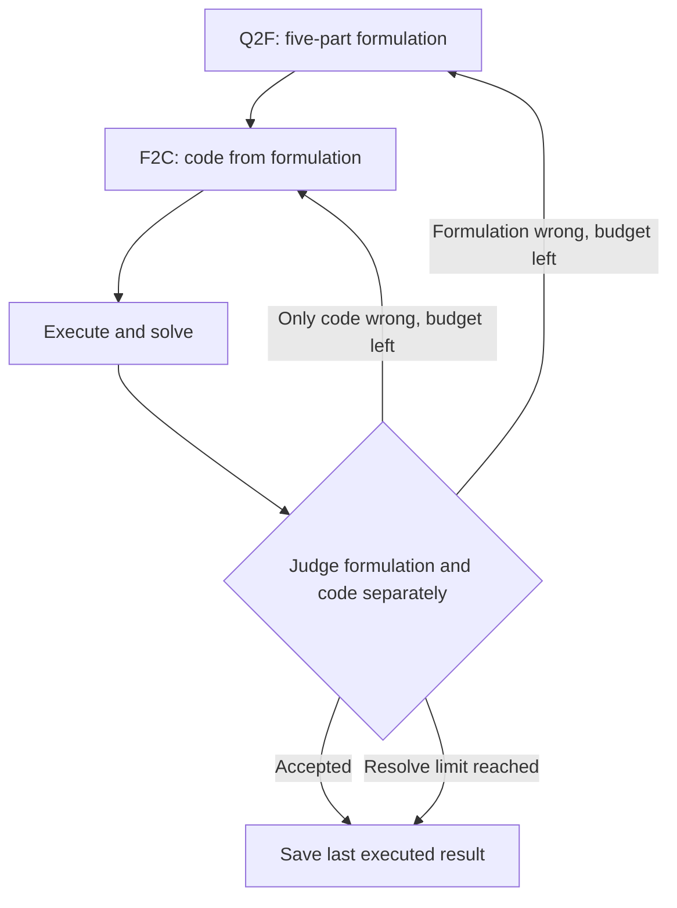

LLMOPT connects language and code through a five-part formulation: Sets, Parameters, Variables, Objective and Constraints. After execution, self-correction judges the formulation and code separately and returns to the affected stage.

## How five elements locate errors

The structure separates objects, known quantities, decisions, goals and requirements. Indices, units and domains have explicit places, making it easier to distinguish a modeling error from an implementation error.

| Element | Production example |
|---|---|
| Sets | Products P={A,B}; resources R={cutting,finishing} |
| Parameters | Profit p, consumption matrix a, capacity b |
| Variables | Nonnegative integer quantities x[p] |
| Objective | Maximize total profit |
| Constraints | Resource use cannot exceed each capacity |

## Workflow and correction example



```walkthrough
[
  {"title":"State structure","nodes":["Define"],"body":"Preserve whole-unit requirements, resource dimensions and parameter values. F2C depends on this formulation, so omissions can propagate into code.","artifact":"Sets: P, R\nParameters: profit[P], usage[R,P], capacity[R]\nVariables: x[P] are nonnegative integers"},
  {"title":"Translate to code","nodes":["Code","Solve"],"body":"Build the native model from the five elements, then execute. Check corresponding variables, objective and resource constraints.","artifact":"Objective: max Σ profit[p]x[p]\nFor each r: Σ usage[r,p]x[p] ≤ capacity[r]"},
  {"title":"Choose the return point","nodes":["Judge","Define","Code"],"body":"If the formulation made quantities continuous, rebuild it and code. If only code uses the wrong domain, regenerate code alone.","artifact":"Wrong formulation → Q2F → F2C → solve\nOnly code wrong → F2C → solve"},
  {"title":"Read final evidence","nodes":["Finish"],"body":"Use the last execution for numerical evidence. The run retains correction judgments alongside execution status.","artifact":"Up to 12 re-solves after the first execution.\nFinal result uses the last actual execution."}
]
```

## What self-correction reads

The judge receives the original problem, five-part formulation, code and actual feedback: status, errors, objective and decision values.

The platform routes a wrong formulation to Q2F first; otherwise wrong code returns to F2C. Upstream did not publish the complete loop code, so routing follows the paper's description. Missing judgments currently parse as correct, making inspection of the actual judgment text useful.

## Workflow versus trained model

The paper also includes multi-instruction SFT and KTO alignment. This platform integrates the inference workflow using the selected LLM preset.

To use released weights, deploy them separately behind a compatible service and add an `openai_compatible` preset. Changing orchestration and changing weights are separate experimental conditions.

## When to use it and what to inspect

Use it for a structured formulation checkpoint and stage-specific correction. The method is not uniformly restricted to linear models; library and backend capabilities still apply. Inspect indices and domains first, then whether correction returns to the right level.

## Source and platform adaptation

Based on the [pinned LLMOPT implementation](https://github.com/antgroup/LLMOPT/tree/1492dd33e39ea13f1afe32a0adc13d4217334195) and [paper](https://arxiv.org/abs/2410.13213). It retains Q2F/F2C and correction prompts with native-model contracts. The loop follows the paper and returns the last execution.
