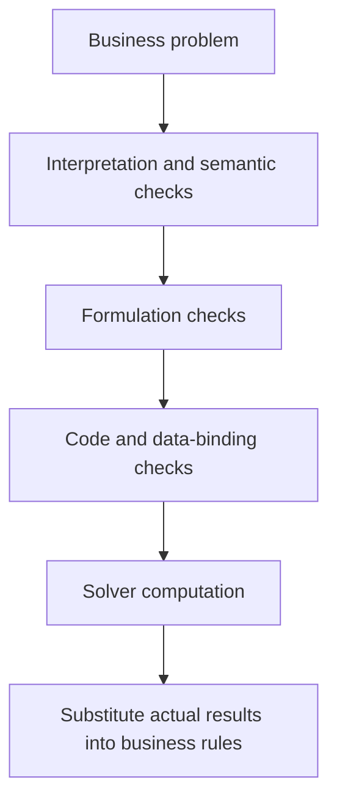

A modeling method controls how the LLM builds formulations and code, and when it checks, retries or compares candidates. It does not replace the solver: final numerical values must come from execution.

## Choose by the difficulty you face

| Main difficulty | Start with | Inspect |
|---|---|---|
| Need a quick first model | [Direct](../direct/) | Domains, constraints and data binding |
| Executable code may miss rules | [Feedback Repair](../feedback-repair/) | Specific review after solving |
| Need to separate interpretation, formulation and code errors | [TriVAL](../trival/) | Layered checks and attribution |
| Many rules need component inspection | [OptiMUS 0.3](../optimus/) | Constraint-to-formula-to-code mapping |
| Want to inspect role collaboration | [Chain-of-Experts](../coe/) | Useful information added by later experts |
| Want problem-type templates | [OptiTree](../optitree/) | Match path and template applicability |
| Want formulation before code and rechecks | [OR-LLM-Agent](../or-llm-agent/) | Rounds and actually executed code versions |
| Need a retained modeling explanation | [ORThought](../orthought/) | Reasons for concrete modeling choices |
| Want five-element formulation and correction | [LLMOPT](../llmopt/) | Formulation errors versus code errors |
| Want candidate-model search | [AutoFormulation](../autoformulation/) | Pruning, rewards and final ranking |
| Need constraint-level meaning checks | [SAC-Opt](../sac-opt/) | Blind backtranslation and selective repair |
| Large JSON/CSV cannot fit conveniently in prompts | [BIND](../bind/) | Schema and full-data execution binding |
| Want public type hints and continuing feedback | [OptiMind](../optimind/) | Public hint scope and checks after success |

Each article expands the mechanism, example and current parameters.

## Four checks answer different questions

Semantic checks interpret “each employee works at most five days.” Formulation checks require a sum for each employee. Code checks inspect indices and domains. The solver determines feasibility and optimality for the submitted model.

Repair loops also differ. Some read only execution errors, others review the problem, and others backtranslate individual constraints. Compare trigger conditions and return points by inspecting their trigger conditions and return points.

## Read different workflows on one example

For the production problem, Direct generates formulation and code before solving. Feedback Repair adds a review after solving. TriVAL creates semantic, formulation and code validation artifacts. Open the worked examples to follow the same rule through those stages.

[Quickstart](../quickstart/) provides the statement, data and recording. [Method comparison](../method-comparison/) provides side-by-side runs.

## What determines call cost

Direct uses one modeling call. Feedback Repair without repairs uses two calls and one solve. Component methods scale with rule count; validation methods scale with failed checks and returns. AutoFormulation's candidate sampling has a substantially larger default budget.

There is no reliable universal time per problem. Provider latency, attachment size, output length and mathematical difficulty all matter. The platform records actual calls, usage and elapsed time; parameter tables come from current presets.

## Problem scope and combinations

OptiMUS, CoE, OptiTree, OR-LLM-Agent, AutoFormulation and SAC-Opt currently target LP/MILP. Other methods run according to the chosen model, library and backend. All nine libraries can be selected, but actual mathematics must fit the library and backend.

For example, CPMpy has no continuous variables, OSQP does not solve integer programs, and Ipopt does not certify global optimality for general nonconvex models. Method and [solver selection](../solvers/) must both fit.

## Make comparisons informative

Fix the problem, attachments, LLM preset, library, backend and limits, then vary one factor. Record rule coverage, domains, actual solutions, solver status, validation status, call count and solve count.

One run on one problem can reveal differences, not establish a stable ranking. Retain failures: they help decide whether to clarify requirements, improve data descriptions or change checking workflows. See [method and LLM comparison](../method-comparison/) for the UI workflow.
