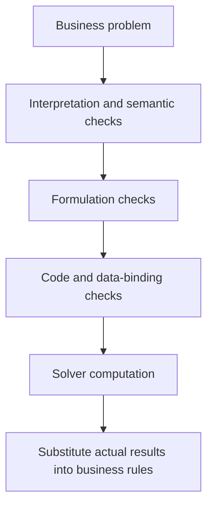

A modeling method controls how the LLM turns a business problem into an executable mathematical model or evaluator, and when it validates, repairs, or searches candidates. The platform ships **9 strategies** spanning **exact mathematical solvers** and the **[AutoCO metaheuristic engine](../autoco/)**.

## Choose by the difficulty you face

| Main difficulty | Start with | Inspect |
|---|---|---|
| Need a quick first exact model | [Direct](../direct/) | Domains, constraints and data binding |
| Need to separate interpretation, formulation and code errors | [TriVAL](../trival/) | Layered checks and attribution |
| Multi-objective Pareto trade-offs, large combinatorial or black-box nonlinear tasks | **[AutoCO](../autoco/)** | Problem modeling defines the evaluator. Model features and optional pilot trials guide algorithm selection and configuration |
| Many rules need component inspection | [OptiMUS 0.3](../optimus/) | Constraint-to-formula-to-code mapping |
| Want to inspect role collaboration | [Chain-of-Experts](../coe/) | Useful information added by later experts |
| Want problem-type templates | [OptiTree](../optitree/) | Match path and template applicability |
| Want formulation before code and rechecks | [OR-LLM-Agent](../or-llm-agent/) | Rounds and actually executed code versions |
| Want five-element formulation and correction | [LLMOPT](../llmopt/) | Formulation errors versus code errors |
| Large JSON/CSV cannot fit conveniently in prompts | [BIND](../bind/) | Schema and full-data execution binding |

Each article expands the mechanism, example and current parameters.

## Four checks answer different questions

Semantic checks interpret “each employee works at most five days.” Formulation checks require a sum for each employee. Code checks inspect indices and domains. The solver determines feasibility and optimality for the submitted model.

Repair loops also differ. Some read only execution errors, others review the problem, and others backtranslate individual constraints. Compare what triggers each check and which stage receives its feedback.

## Read different workflows on one example

For the production problem, Direct generates formulation and code before solving. TriVAL creates semantic, formulation and code validation artifacts. Open the worked examples to follow the same rule through those stages.

[Quickstart](../quickstart/) provides the statement, data and recording. [Method comparison](../method-comparison/) provides side-by-side runs.

## What determines call cost

Direct uses one modeling call. Component methods scale with rule count; validation methods scale with failed checks and returns.

Elapsed time depends on provider latency, attachment size, output length and solving difficulty. The platform records actual calls, usage and elapsed time; parameter tables come from current presets.

## Problem scope and combinations

OptiMUS, CoE, OptiTree and OR-LLM-Agent currently target LP/MILP. [AutoCO](../autoco/) targets library-independent large combinatorial, black-box nonlinear and multi-objective Pareto problems via its 12-family metaheuristic pool. The remaining exact methods run across all five modeling libraries, subject to each backend's mathematical capabilities.

For example, OR-Tools CP-SAT expresses finite-domain decisions, OSQP handles continuous convex quadratic programs, and Ipopt seeks local solutions for smooth nonlinear models. Use [solver selection](../solvers/) to match these structures.

## Make comparisons informative

Fix the problem, attachments, LLM preset, library, backend and limits, then vary one factor. Record rule coverage, domains, actual solutions, solver status, validation status, call count and solve count.

Use differences and failed stages to decide whether to clarify requirements, improve data descriptions or change the checking workflow. See [method and LLM comparison](../method-comparison/) for the UI workflow.
