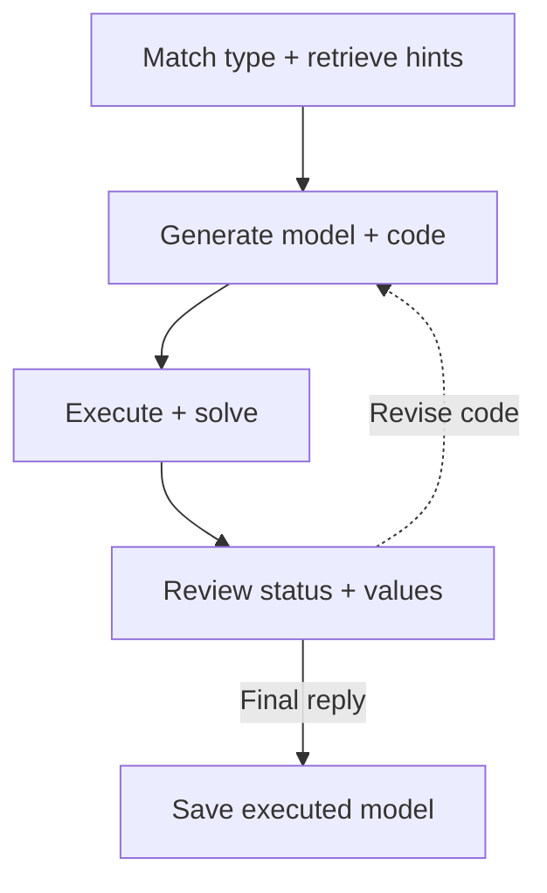

OptiMind combines public problem-type hints with multi-turn solver feedback. A successful solve still produces feedback, allowing another revision or a final textual answer that ends the trajectory.

## What the hint library provides

Type hints highlight common modeling mistakes. In traveling salesperson models, one incoming and one outgoing edge per city can still produce separate subtours; additional constraints must enforce a single tour.

The public library currently contains only TravelingSalesman, with six error/hint pairs. Classification selects a public type or no match. Unmatched problems receive general checking guidance.

## Workflow and checking example



```walkthrough
[
  {"title":"Match hints","nodes":["Hint"],"body":"Traveling salesperson problems can use public specialist hints. Other types use general checks when no public entry matches.","artifact":"Example: visit every city once and return to the start.\nReminder: in-degree/out-degree constraints do not eliminate separate subtours."},
  {"title":"Generate and solve","nodes":["Generate","Solve"],"body":"The generator turns hints into constraints; the process retains both the hint and generated formulation.","artifact":"Inspect binary edges, degree constraints and subtour elimination.\nActual solver execution provides the numerical result."},
  {"title":"Check success too","nodes":["Feedback"],"body":"Read selected edges even after optimality. Separate cycles identify a connectivity rule to inspect.","artifact":"Two disjoint cycles → inspect connectivity constraints.\nFaithful model and result → final answer can end the run."},
  {"title":"End one trajectory","nodes":["Finish"],"body":"The default follows one generation-and-feedback trajectory. A final answer ends the run and retains the last executed model.","artifact":"At most 5 generations; temperature 0.6; top_p 0.95.\nFinal artifacts include the executed code, status and values."}
]
```

## Revision and stopping

Feedback includes successful as well as failed statuses, objectives and values. Revised code continues the generate–execute–feedback loop. After a valid execution, a final reply without code can stop it.

Without any valid execution, a code-free reply is not completion; code is requested again within the budget. Final numbers come from the last executed model.

## Comparing related workflows

[Feedback Repair](../feedback-repair/) has an explicit accept-or-repair review. OptiMind centers on hints and continuing feedback within one trajectory. [OptiTree](../optitree/) retrieves entries from a hierarchical type tree, a different source and use of guidance.

Use it to inspect the effect of public hints. Choose a library and backend for the model structure; the type-specific hints apply to the matched problem family. Weights, orchestration and specialist hints are separate experimental conditions.

## Public scope and platform implementation

Based on the [pinned Microsoft OptiGuide/optimind implementation](https://github.com/microsoft/OptiGuide/tree/419cf7b9eee20b6af036abf15152fa775b20c951/optimind). The platform preserves public hint files, adds optional type matching and supplies native-model contracts and actual solver feedback. The public hint files and adaptation are available in source.
