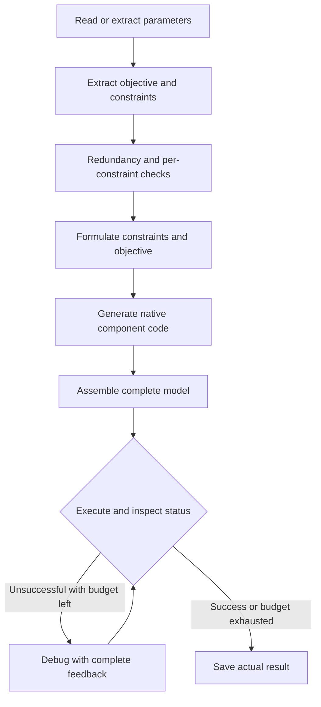

OptiMUS 0.3 constructs a model component by component. It extracts parameters, objectives and constraints, formulates and codes individual components, then assembles and executes them. Intermediate artifacts make a long generation task easier to inspect.

## From rules to components

“Only 8 cutting hours” is a business rule; `2A+B≤8` is its formulation; a native Constraint is its implementation. OptiMUS keeps these stages visible so readers can follow changes in meaning.

Objectives and constraints are handled separately. Constraints receive redundancy and confidence checks. A low-confidence item can be retained, removed or modified. These are LLM judgments: check whether removal eliminates a duplicate or loses a distinct requirement.

## Workflow and worked example



```walkthrough
[
  {"title":"Parameters and rules","nodes":["Params","Extract"],"body":"Identify profit, resource consumption and capacities as parameters. Two resources are not duplicates merely because both capacities equal 8.","artifact":"Profit: A=3, B=2\nC1: cutting capacity 8, consumption (2,1)\nC2: finishing capacity 8, consumption (1,2)"},
  {"title":"Check components","nodes":["Check","Form"],"body":"Repeated wording can be removed. Cutting and finishing have different coefficients and remain separate constraints.","artifact":"C1 → 2A + B ≤ 8\nC2 → A + 2B ≤ 8\nPreserve nonnegative integer domains."},
  {"title":"Assemble code","nodes":["Components","Assemble"],"body":"Components enter one build_model(data). Names, indices and parameters must agree across components.","artifact":"setup + variables + C1 + C2 + objective + return model\nGenerated code builds; the platform solves."},
  {"title":"Execute and debug","nodes":["Solve","Debug","Finish"],"body":"The correct model gives A=3, B=2 and objective 13. If debugging occurs, check that changes preserve component meaning.","artifact":"At most 3 execution/debug attempts\nInfeasible or unbounded statuses can also trigger debugging."}
]
```

## Parameter data and confidence

An attached `params.json` in the upstream format supplies parameters directly. Otherwise the method extracts them, including values, from the problem. An unknown business quantity must not become an invented fixed parameter.

Constraint confidence uses five-point judgments with bounded retries. Low-confidence items receive further feedback deciding retention, removal or revision. The process retains those decisions and the updated list.

## How its repair differs

Execution debugging treats optimality as success and also preserves explicitly local optimality from compatible backends. Infeasible and unbounded models can therefore enter debugging. [Feedback Repair](../feedback-repair/) instead permits a reviewed, genuinely infeasible model to end normally.

When infeasibility is plausible, check whether debugging changes a hard requirement. For checking code against individual constraint meanings, see [SAC-Opt](../sac-opt/).

## Scope and reading a run

The current method targets LP/MILP. Follow a rule through parameters, description, formulation, code and execution. More rules require more component calls. Defaults use temperature 1.0 and at most three execution/debug attempts. RAG and interactive human confirmation are not enabled.

## Source and adaptation

The platform ports the [pinned OptiMUS v0.3 implementation](https://github.com/teshnizi/OptiMUS/tree/e182e9ef5841605c2a7e87467021fd83522b6484), retaining the component workflow and prompts while supplying native-library components and a sandbox. Delimiter and code-block parsing fixes preserve generated content. Detailed changes are linked in the source documentation.
