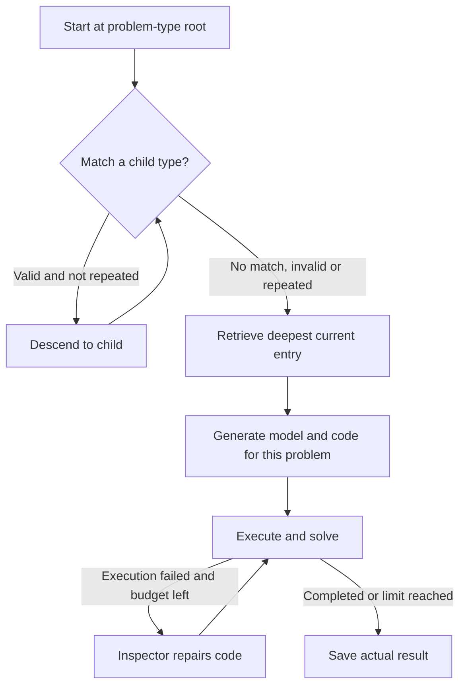

OptiTree searches a hierarchy of problem types before generating code. It makes “recognize the structure, then borrow a relevant modeling pattern” an explicit part of the workflow.

## What the type tree provides

Transportation, assignment and staffing descriptions can share variable and constraint structures. The tree provides reasoning templates, not complete answers. Costs, indices, capacities and special rules must still come from the current problem.

Matching starts at the Mixed Integer Programming root and selects only among the current node's children. The deepest matched node's full entry becomes context for generation. The process retains the matching path and retrieved entry.

## Workflow and retrieval example



```walkthrough
[
  {"title":"Recognize structure","nodes":["Root","Match"],"body":"For warehouse-to-store transport, recognize quantities, supply and demand. The actual matching path depends on the bundled tree and LLM decisions.","artifact":"Decisions: shipment quantities from warehouses to stores.\nInputs: unit costs, warehouse supply, store demand."},
  {"title":"Use the template","nodes":["Descend","Retrieve"],"body":"A template can suggest indexed x[i,j], but the current wording determines whether supply and demand require equality or inequality.","artifact":"x[i,j] ≥ 0\nWarehouse: sum_j x[i,j] ≤ supply[i]\nStore: sum_i x[i,j] ≥ demand[j], if required by the problem"},
  {"title":"Generate and execute","nodes":["Reason","Solve"],"body":"Use the retrieved entry together with current data. Template example values must not replace user data.","artifact":"Check warehouse/store indices and cost-matrix orientation.\nSpecial business rules still need explicit constraints."},
  {"title":"Handle no match","nodes":["Match","Inspect","Finish"],"body":"Stop at the current node if no valid deeper type exists. Do not invent a classification. Inspection repairs execution failures.","artifact":"Unknown type / missing judgment / repeated path → stop descent\nAt most 4 code inspections."}
]
```

## Why a broader match can be useful

A specific but wrong type can impose the wrong structure. Treating divisible transport as one-to-one assignment can invent a restriction against split shipments. A broader match supplies general guidance while leaving details to the problem.

Read the path, retrieved entry and final formulation together. The process shows the path and entry; the final model shows selected variables and constraints.

## Scope and related methods

The current workflow targets LP/MILP, uses temperature 0 and permits four code inspections. Use it to study the effect of type retrieval. For component construction see [OptiMUS](../optimus/); for searching multiple complete candidates see [AutoFormulation](../autoformulation/).

## Source and platform adaptation

The platform ports the [pinned OptiTree implementation](https://github.com/MIRALab-USTC/OptiTree/tree/2e70ecfd0a3c8e9c0c16d36d7d498a7344cfdec9), including its type tree and templates. It retains classification, reasoning and inspection prompts, supplies native-library contracts, and stops safely on unknown types, missing judgments or repeated matching paths.
