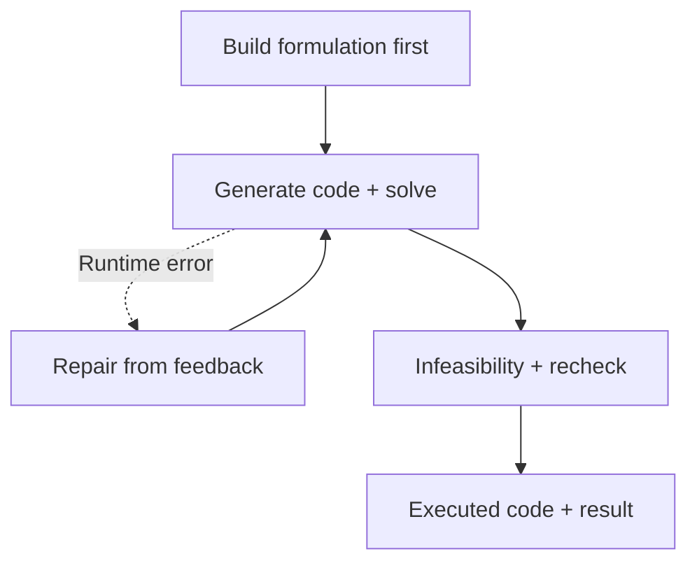

OR-LLM-Agent builds a formulation before generating and executing code. Its main round, infeasibility check and recheck have separate budgets, allowing execution feedback to inform later modeling decisions.

## Why separate formulation and code

A separate formulation gives readers a checkpoint without having to recover business meaning from Python. When execution fails, inspect whether code deviates from the formulation or the formulation itself needs revision.

In transport, establish warehouse supply limits, store demand and the cost objective first. A transposed cost matrix is an implementation issue; reversed demand inequalities require formulation review.

## Workflow and feedback example



```walkthrough
[
  {"title":"State the rules","nodes":["Form"],"body":"Check supply and demand directions. Whether excess delivery is permitted must come from the problem.","artifact":"sum_j x[i,j] ≤ supply[i]\nsum_i x[i,j] ≥ demand[j]\nmin sum_i,j cost[i,j] × x[i,j]"},
  {"title":"Locate runtime errors","nodes":["Execute","Fix"],"body":"If cost[j][i] causes an index error, use the data orientation in execution feedback to repair indexing.","artifact":"Hypothetical error: costs indexed store-first.\nActual data: warehouse rows, store columns."},
  {"title":"Interpret the result","nodes":["Round"],"body":"Supply below hard demand can be genuinely infeasible. Distinguish a data conflict from a modeling error.","artifact":"Total supply 10, required demand 12 → shortfall 2.\nReview the supply limits, demand constraints and attached quantities."},
  {"title":"Check code versions","nodes":["Finish"],"body":"Upstream round behavior can leave the final proposed repair unexecuted. Numerical results must stay attached to executed code.","artifact":"Intermediate artifact: latest repair proposal\nNumerical result: last actually executed model\nRun steps identify which code versions were executed."}
]
```

## Separate attempt budgets

The preset assigns main 3, infeasibility 1 and recheck 2 attempts. Repairs use copied conversations; only the final code returns to the main conversation. Read each round together with its actual execution record.

## Difference from Chat Agent

“Agent” here names a fixed modeling method. [Chat Agent](../chat-agent/) is the user-facing optimization conversation. It can call Direct, TriVAL or other methods and handles explanations, plan selection and scenarios. You can request OR-LLM-Agent as the modeling method within Optimization chat.

## When to use it and what to inspect

The method targets LP/MILP. Use it to inspect an explicit formulation followed by execution repair and rechecking. Locate the last actual execution first; inspect its code, status, objective and variables before reading later repair suggestions.

## Source and platform adaptation

The platform ports the [pinned OR-LLM-Agent implementation](https://github.com/bwz96sco/or_llm_agent/tree/5dccdaab89ab91c3cb28066fe849423dc124d287), retaining prompts and recovery paths. Native `build_model(data)` contracts replace Gurobi-specific requests. Final repair proposals and actual executions retain their respective artifacts.
