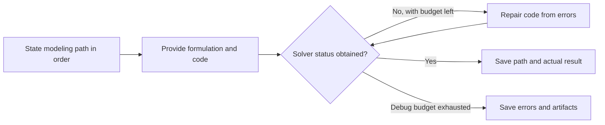

ORThought asks the LLM to state a modeling path in an expert-like order, then provide the formulation and code. The path is retained so readers can understand why variables, objectives and constraints were chosen.

## What a useful modeling path explains

Useful explanations name concrete choices: “whole products require integer quantities” or “processing hours add across products, so capacity is consumption times quantity.” Generic steps such as “analyze, model, optimize” do not explain these decisions.

The current workflow uses the upstream `formalized` mode and outputs a modeling path, formulation and code. The process view retains this explanation as a separate solution_path artifact.

## Workflow and modeling-path example



```walkthrough
[
  {"title":"Identify decisions","nodes":["Path"],"body":"Separate production decisions from known inputs.","artifact":"Decide production quantities A and B.\nProfit, processing times and capacity are given parameters."},
  {"title":"Explain expressions","nodes":["Path","Form"],"body":"Connect each expression to its business meaning instead of listing unexplained formulae.","artifact":"Whole units → nonnegative integer A, B\nAdditive hours → 2A+B≤8, A+2B≤8\nTotal profit → max 3A+2B"},
  {"title":"Check execution","nodes":["Execute","Debug"],"body":"If code cannot obtain a solver status, debugging reads the problem, formulation, code and actual error.","artifact":"Execution error → at most 3 code-debug attempts\nValid infeasible status → no debugging solely for infeasibility"},
  {"title":"Read back results","nodes":["Finish"],"body":"The correct integer optimum is 13. Substitute actual values into resource expressions to check the explanation.","artifact":"A=3, B=2\nCutting 8; finishing 7; profit 13\nExplanation must agree with these actual values."}
]
```

## Execution repair versus semantic checking

Code that cannot obtain a solver status enters debugging, up to three times. Successfully executed code returning infeasibility does not trigger debugging simply for lacking a feasible solution. This differs from [OptiMUS](../optimus/).

For explicit review against the problem see [Feedback Repair](../feedback-repair/); for layered validation see [TriVAL](../trival/).

## When to use it and how to read it

Use it when a retained modeling explanation helps learning and inspection. The method is not uniformly limited to linear models, but the selected library and backend still constrain supported mathematics. The saved path, formulation, code and values can be read together.

## Source and platform adaptation

The platform ports the formalized workflow from the [pinned ORThought implementation](https://github.com/BeinuoYang/ORThought/tree/5293e24861a65d1e4a2f61f4fad0a81de901ee38). It returns native models, executes in the sandbox and retains `solution_path`.
