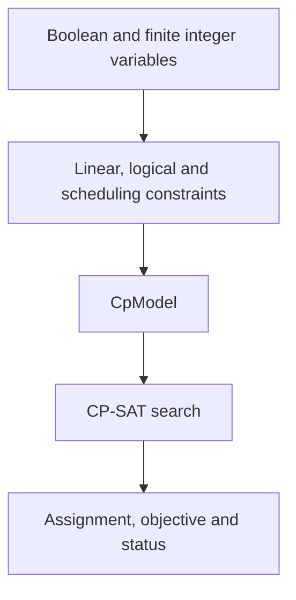

OR-Tools provides mathematical programming, constraint programming, routing and graph algorithms. The platform recognizes the returned native model and uses its corresponding solving path.

## Choose the native interface by task

| Interface | Model structure | Backend examples |
|---|---|---|
| MPSolver / MathOpt / ModelBuilder | Linear, integer and interface-supported mathematical programming | Compatible SCIP, HIGHS and other engines |
| CpModel / CP-SAT | Finite integers, Booleans, scheduling and logic | CP_SAT |
| RoutingModel | Vehicles, visits, capacities and time windows | ROUTING |
| Original Constraint Solver | Finite-domain constraints and search | CP |
| Maximum / minimum-cost flow | Network arcs, capacities, costs and supply | MAX_FLOW, MIN_COST_FLOW |
| Assignment / knapsack | One-to-one matching and capacity-limited selection | ASSIGNMENT, KNAPSACK_* |

Select OR-Tools and a backend in settings; code determines the API. The default mathematical-programming reference uses SCIP. HIGHS can use MathOpt.

## A complete CP-SAT staffing model

Four employees each work one day. Monday and Tuesday each need two employees. `x[e,d]` indicates whether employee e works on day d; costs are in the matrix below.

```python
from ortools.sat.python import cp_model

def build_model(data):
    costs = [[1, 7], [2, 8], [7, 1], [8, 2]]
    model = cp_model.CpModel()
    x = {(e, d): model.new_bool_var(f"work[{e},{d}]")
         for e in range(4) for d in range(2)}
    for e in range(4):
        model.add(sum(x[e, d] for d in range(2)) == 1)
    for d in range(2):
        model.add(sum(x[e, d] for e in range(4)) == 2)
    model.minimize(sum(costs[e][d] * x[e, d]
                       for e in range(4) for d in range(2)))
    return model
```

Choose `CP_SAT`. Employees 0 and 1 work Monday; 2 and 3 work Tuesday, for cost 6. Requiring employee 0 on Tuesday raises the optimum to 18. Use [scenario comparison](../scenarios/) for independent staffing changes.

## CP-SAT model structure



Integer domains, logic and interval variables express discrete schedules. Fractional durations can be represented in a consistent integer unit, such as minutes. Use that unit throughout inputs and convert results for presentation.

## Returns for Routing and graph algorithms

Routing needs both model and index manager so internal indices can be mapped to business nodes:

```python
return {"model": routing, "manager": manager}
```

Maximum flow also needs source and sink. Minimum-cost flow normally returns its native model. The original Constraint Solver returns the model and variables, plus objective and sense for optimization. See the [native-interface reference](https://github.com/Fangziyang0910/LLM4OM/blob/main/docs/references/modeling-libraries.md).

## Reading and using results

Named CP-SAT Boolean variables map directly to employees and days. Read Routing output as visit sequences together with objective, status and route requirements. Export full variables or use [plan conversation](../plan-chat/) to query an employee and calculate daily totals.

See the official [CP-SAT guide](https://developers.google.com/optimization/cp/cp_example), [Routing guide](https://developers.google.com/optimization/routing/vrp) and [MathOpt documentation](https://developers.google.com/optimization/math_opt).
