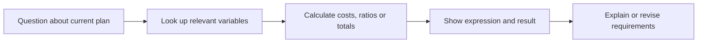

Click “Discuss plan” on a result to query decisions, calculate metrics, explain the model or create another plan. The assistant sits beside the saved result.

## Ask a concrete question

```text
List Tuesday's scheduled employees and their costs.
Total the weekend cost and show the expression.
Find product B's quantity and its resource use.
```

The assistant reads the current plan's problem, model and saved values. Variable lookup supports names, groups and pagination over the complete result, useful for both individual decisions and larger totals.

## From queries to calculations



Calculation cards show the result. Expand one for its expression and number of values read. Ordinary arithmetic is also supported. The adjacent formulation and original variables identify the components used.

## Try a sequence

```demo
plans
```

Query resources, then set minimum B to 3. Subsequent questions use the new plan. Selecting the original changes the baseline for later work.

## Create a new plan in one message

```text
Require at least 3 units of B; keep other conditions and recalculate.
Calculate B ≥ 3 and B ≥ 4 as two scenarios.
Return to the original, then change cutting capacity to 10 hours.
```

A single new plan becomes current; multiple scenarios use one baseline. The conversation shows preparation, modeling, solving and explanation. Open each plan or compare the current batch.

## Current and related plans

The assistant header names the current discussion plan. Related plans can be browsed in the main area. “Use the second plan from now on” produces a selection receipt and sets it as the next baseline.

Modeling inherits the baseline's method, LLM preset, library, backend and attachments. The conversation reply preset can be selected separately; each configuration remains visible in its own context.

## Persistence and controls

Resize the divider; refresh retains the layout. Scroll upward to pause following and use “Back to latest” to resume. Stop/retry preserves discussion context. Saved plans remain accessible through cards and history.

See [results](../results/) for complete exports and [scenarios](../scenarios/) for batch conditions.
