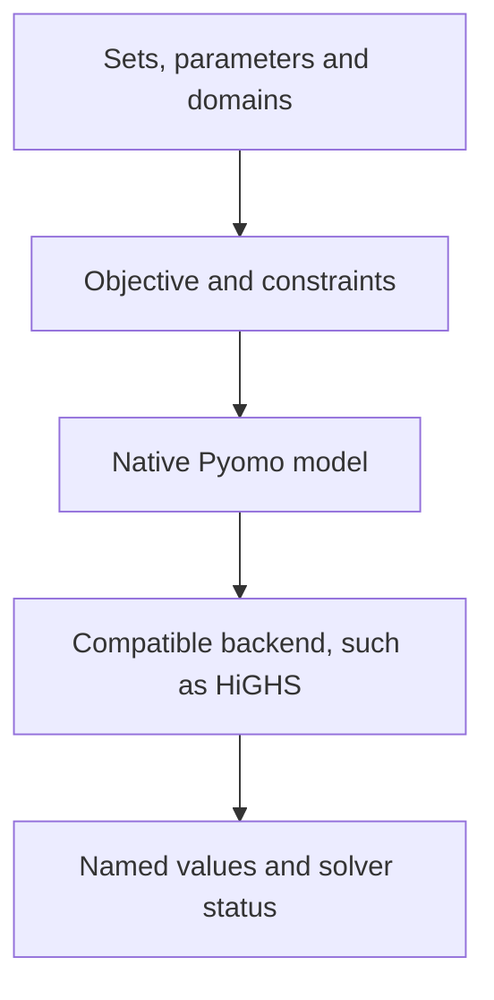

Pyomo expresses optimization in a form close to mathematical notation. Products, factories and dates become index sets; objectives and constraints use those indices, making business rules easier to map to code.

## Start with the mathematics

Choose whole-unit quantities A and B, maximize `3A+2B`, and enforce cutting `2A+B≤8` and finishing `A+2B≤8`. The integer optimum is A=3, B=2, objective 13.

If quantities are genuinely divisible, continuous domains give A=B=8/3 and objective 40/3. The selected domain is recorded in the model.

## Complete platform code

```python
import pyomo.environ as pyo

def build_model(data):
    model = pyo.ConcreteModel()
    model.products = pyo.Set(initialize=["A", "B"])
    profit = {"A": 3, "B": 2}
    model.x = pyo.Var(model.products, domain=pyo.NonNegativeIntegers)
    model.profit = pyo.Objective(
        expr=sum(profit[p] * model.x[p] for p in model.products),
        sense=pyo.maximize,
    )
    model.cutting = pyo.Constraint(expr=2*model.x["A"] + model.x["B"] <= 8)
    model.finishing = pyo.Constraint(expr=model.x["A"] + 2*model.x["B"] <= 8)
    return model
```

Return the built model; the platform selects a backend, solves and reads named variables. For attachments, parse complete parameters with `json.loads(data['production.json'])`; see [BIND](../bind/).

## From expressions to solving



Pyomo connects compatible engines through native adapters. The platform accepts ConcreteModel, instantiated AbstractModel and Kernel. Algebraic models normally default to HiGHS; Kernel defaults to compatible CBC.

## Common expression mistakes

Use binary variables or suitable logical formulations for decisions that activate constraints. Use native Pyomo expressions for relationships among unknown variables.

Inspect index sets in indexed constraints. Use `pyo.Constraint.Skip` when an index should be omitted. Instantiate AbstractModel before returning it.

## Checking results

Read `x[A]` and `x[B]`, substitute them into both resources, and recompute profit with units. Confirm the actual backend and integer domain. Execution feedback identifies backend compatibility issues.

```demo
production
```

## Selection and references

Start here for indexed algebraic rules and readable mathematical structure. [PuLP](../pulp/) also fits small linear models; [CPMpy](../cpmpy/) suits richer discrete logic; [CasADi](../casadi/) supports smooth nonlinear modeling. See the [official Pyomo modeling guide](https://pyomo.readthedocs.io/en/stable/explanation/modeling/index.html).
