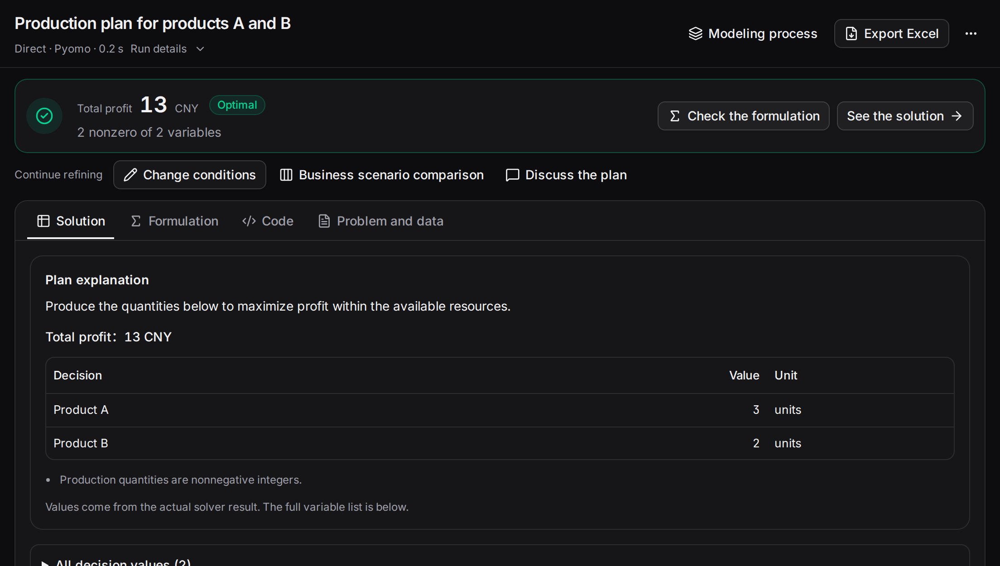

This example uses two products and two resources to walk through describing a problem, solving it, checking the plan and changing a requirement.

## 1. Prepare the platform

Open your team's platform address, or [install and launch](../installation/) a local service. If the server has no default LLM, open LLM presets at the lower left and add a provider, model ID and key. See [Configure LLM presets](../model-presets/).

## 2. Enter a complete problem

Open Optimization chat and send this problem. You can also paste it into the manual workbench.

```text
A factory makes products A and B in nonnegative integer quantities.
Each A earns CNY 3 and uses 2 cutting units and 1 processing unit.
Each B earns CNY 2 and uses 1 cutting unit and 2 processing units.
There are 8 units of each resource.
How much of each product should we make to maximize total profit?
```

In the manual workbench, select Direct, Pyomo and the AUTO backend, then click Start modeling. These are also the defaults in Optimization chat. Computation uses your configured LLM and an actual solver.

## 3. Check the plan

The integer model has an optimum of **3 units of A, 2 units of B and CNY 13 profit**. It uses 8 cutting units and 7 processing units.

Check the integer domains, both resource constraints and the profit coefficients. Open Solution to inspect quantities and Formulation to inspect the model. Export Excel downloads the full result.



## 4. Change a requirement

Send “Produce at least 3 units of B, keeping all other conditions unchanged. Recalculate.” You can also click Adjust conditions on the result page. The revised optimum is **CNY 12**. The original plan remains available for comparison.

Use [business scenario comparison](../scenarios/) to test several requirements together, or [discuss the plan](../plan-chat/) to understand a result.
