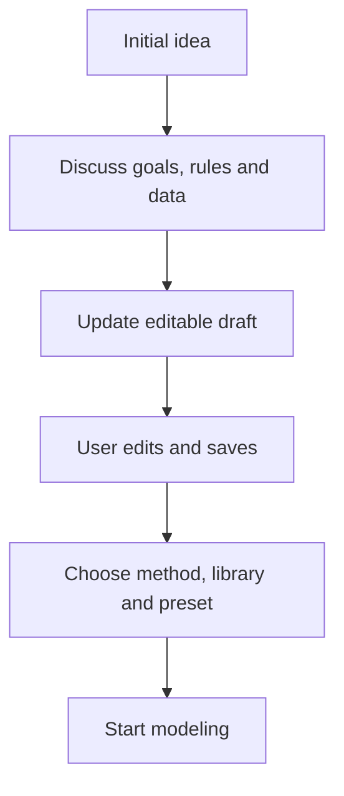

“Clarify requirements through conversation” develops an initial idea into an editable problem statement and attachments. Use it when the task is known but goals, rules or data need further discussion.

## Start from a draft or a blank page

Existing homepage text and attachments carry into the conversation. You can also start with “Schedule next week's employees across three stores.” The assistant updates the draft and asks for information affecting the next step.

Desktop keeps the problem and data beside the assistant. Narrow screens use tabs. Edit the draft directly or switch to Markdown preview.

## How a draft develops



```walkthrough
[
  {"title":"Describe the task","nodes":["Idea","Chat"],"body":"State the objects, time horizon and goal. The assistant organizes the available information.","artifact":"Schedule next week's employees across three stores and control total staffing cost."},
  {"title":"Add key rules","nodes":["Chat","Draft"],"body":"Turn answers into concrete requirements and list the data still needed.","artifact":"At least 3 people per store per day; at most 5 days per person; weekend supervisor.\nData: costs, availability and supervisor qualifications."},
  {"title":"Edit the draft","nodes":["Edit"],"body":"Edit rules, units or wording directly, save, then continue discussing.","artifact":"Allow movement between stores; one store per employee per day.\nColumns: employee, date, availability, daily cost, supervisor."},
  {"title":"Hand off","nodes":["Configure","Run"],"body":"Choose settings and start modeling. The method receives the current statement and attachments.","artifact":"Handoff: complete draft + current attachments\nThe run saves this input version."}
]
```

## A reusable problem structure

```text
Task: objects to arrange and time horizon.
Decisions: quantities, selections or sequences to determine.
Objective: minimum cost, maximum profit or another explicit goal.
Rules: individual requirements.
Data: file names, field meanings, units and index mappings.
```

Start with the parts you know. Keep costs, times and quantities in explicit units; edit attachment headers to make them clear.

## Save, search and hand off

Leaving the editor saves manual edits; “Save draft” is also available. Sending a message or starting modeling saves pending changes first. Attachments are saved after reading.

Search shows queries and sources. Adopt useful business rules into the draft. “Use for modeling” returns the draft to the workbench; settings and modeling are also available directly in the current workspace.

## Continue working

Conversation history retains requirement development; runs retain the handoff statement and data. Unsent text stays in the current browser tab and survives refresh. Stop or retry a turn, then continue refining.

Next see [data editing](../attachments/) and [run settings](../run-settings/). For clarification and computation in one continuing conversation, use [Chat Agent](../chat-agent/).
