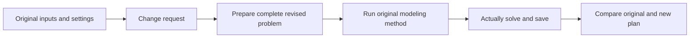

“Revise requirements” prepares a changed problem from a saved plan and runs the original modeling configuration again. Both plans are retained, with differences in problem text, objective and decisions.

## Make one revision

1. Open the original result and choose “Revise requirements.”
2. Enter a specific change, such as “Require B≥3; keep everything else.”
3. Generate the new plan and follow preparation, modeling and solving.
4. Open the plan comparison for objective, variables and text differences.

For a complete rewrite, use “More → Edit and run” to return inputs and settings to the editor.

## How a new plan is created



The run inherits method, LLM preset, library, backend selection and attachments. Problem preparation uses one additional model call before the method's complete workflow.

## Worked case: higher minimum B

| Item | Original | B≥3 |
|---|---:|---:|
| A quantity | 3 | 2 |
| B quantity | 2 | 3 |
| Profit | 13 | 12 |
| Cutting used | 8 | 7 |
| Finishing used | 7 | 8 |

Submit that change in the example, then select the original for another operation.

```demo
plans
```

## Write a useful change request

```text
Change Tuesday's minimum from 3 people to 4; keep other days.
Set cutting capacity to 10 hours, preserving profit, finishing and integer rules.
Allow warehouse 2 up to 20 additional units of supply; keep attachment costs.
```

Name the object, rule and new value. For changed costs or capacities, edit and save attachments before creating the new run.

## Read differences and retain the baseline

Comparison uses the original checkpoint saved when revision starts. It aligns objectives and same-named variables; renamed variables appear as additions/removals. Expand text differences to inspect the changed requirements.

Original, revised run and comparison remain available in history. Use [scenarios](../scenarios/) for multiple alternatives or [plan conversation](../plan-chat/) to combine queries and revisions.
