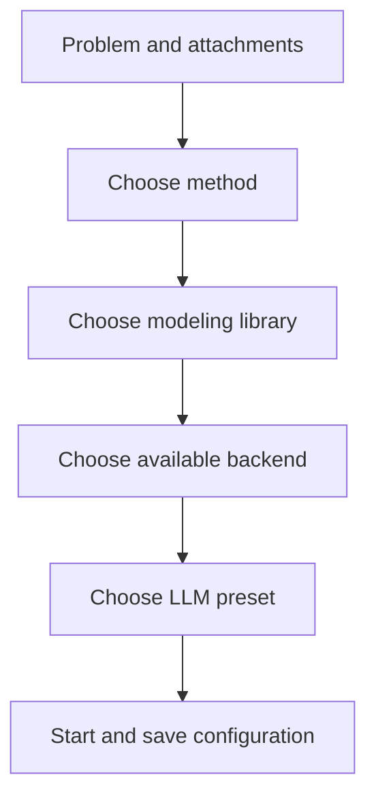

Run settings select the modeling workflow, code library, computation engine and LLM. The homepage shows a configuration summary; open “View run settings” or “Adjust settings” for all options.

## The four settings

| Setting | Role | Production example |
|---|---|---|
| Method | Generation, validation and revision workflow | Feedback Repair |
| Modeling library | Native model expressed in code | Pyomo |
| Backend | Computation engine | highs or AUTO |
| LLM preset | Service used for generation and checking | Saved team preset |

Methods appear on the left; library, backend and preset appear on the right. Choose options and click “Done.” The summary updates, and backend options show availability and reasons.

## Configure one run

For production/transport LP/MILP, start with compatible Pyomo or PuLP backends. Inspect CPMpy/OR-Tools for scheduling and logic, CVXPY for convex quadratic structure, and CasADi for smooth nonlinear models. See [solver selection](../solvers/).

## Three configurations to try

| Task | Method | Library / backend | Inspect |
|---|---|---|---|
| First production run | Direct | Pyomo / AUTO | Formulation, quantities and profit |
| Inspect layered business-rule checks | TriVAL | Mathematically suitable library / AUTO | Stage artifacts and validation feedback |
| Large JSON/CSV | BIND | Pyomo or another compatible library / AUTO | Schema and data-reading code |

Each method article lists current preset parameters, which are saved with runs. Method-specific parameters are set in deployment presets. The UI selects the method and execution environment.

## Start and follow progress

After attachments finish reading, click “Start modeling” or press Ctrl+Enter / Cmd+Enter. The run page displays stages and artifacts. Execution takes place on the server; reopen the link to see progress.

Completed runs show status and objective. “Run information” includes actual preset, backend, elapsed time and usage. “Modeling process” expands the stages that used those settings.

## Batch comparison and next steps

Enable “Compare” and select methods or presets to start up to 12 runs. The comparison table aligns settings, results and usage; see [method and LLM comparison](../method-comparison/).

After a run, [export](../results/), [revise](../revisions/) or [discuss the plan](../plan-chat/). Revisions inherit baseline settings; “Edit and run” returns the complete input to the editor.
